# BÁO CÁO TOÀN DIỆN KIỂM TOÁN KIẾN TRÚC, LUỒNG DỮ LIỆU, CẢNH BÁO VÀ TRẢI NGHIỆM NGƯỜI DÙNG HỆ THỐNG AIOTLIBTQB

> **Dự án**: Giám sát Môi trường & Vi khí hậu Thư viện Đại học (AIoTLibTQB)  
> **Cơ quan thẩm định**: Tổ Kiểm toán Độc lập (Worker Synthesizer & Forensic Audit Team)  
> **Tài liệu tham chiếu**: `ORIGINAL_REQUEST.md`, `deep-codebase-analysis.md`, Chuẩn ISA-18.2, ASHRAE 55, ISO 11799, ANSI/ASA S12.60, WCAG 2.1 AA  
> **Trạng thái mã nguồn**: Read-only kiểm toán (Bảo toàn 100% mã nguồn dự án, Git status hoàn toàn sạch)  
> **Hệ thống nhãn minh chứng**: `[XÁC NHẬN]` (kèm tọa độ file:dòng), `[SUY LUẬN]` (lập luận kỹ thuật), `[CHƯA RÕ]` (vấn đề mở)

---

## TÓM TẮT ĐIỀU HÀNH (EXECUTIVE SUMMARY)
1. Hệ thống AIoTLibTQB sở hữu nền tảng kỹ thuật hiện đại với Java 21 Virtual Threads, MongoDB 8.0 TimeSeries và Next.js 14 Canvas Heatmap trực quan.
2. Dữ liệu vi khí hậu được làm sạch và tính điểm tiện nghi thư viện (LCS) theo Nguyên lý Thùng gỗ Liebig với bộ điều tiết 1Hz Conflator ổn định.
3. Tuy nhiên, hệ thống cảnh báo hiện mang tính hình thức: toàn bộ ngưỡng gán cứng, thiếu trường phân cấp mức độ nghiêm trọng (Severity) và quy trình xử lý chuẩn (SOP).
4. Xuất hiện "Nghịch lý đỉnh tiếng ồn": bộ lọc trễ 30s vô hiệu hóa việc phát hiện xung âm bất thường, biến cảnh báo xung kích thành logic chết trên thực tế.
5. Cảnh báo thời gian thực chỉ phát broadcast đơn kênh WebSocket, hoàn toàn im lặng (không âm thanh), tự tắt sau 5s, gây quá tải báo động và mất dấu sự cố.
6. Tồn tại hiện tượng "lệch pha kiến trúc": các quy tắc vi khí hậu chuẩn nghiệp vụ thư viện chỉ chạy tạm bợ trên RAM trình duyệt, không được lưu trữ trong CSDL.
7. Trải nghiệm người dùng bị phân hóa: công cụ quản trị 2D xuất sắc (8.5/10), nhưng sinh viên bị chặn bởi rào cản đăng nhập (6.5/10) và rủi ro "bẫy dữ liệu cũ".
8. Bản đồ nhiệt 2D trên di động thiếu cử chỉ cảm ứng (chụm/phóng to/vuốt), không hiển thị cảnh báo nhấp nháy trực quan trên mặt bằng tầng.
9. Đối chiếu chuẩn công nghiệp ISA-18.2, Grafana, ThingsBoard và Occupancy chỉ ra khoảng cách kỹ thuật lớn cần tái cấu trúc để đạt chuẩn vận hành production.
10. Lộ trình cải thiện gồm 12 giải pháp cấu trúc (P0-P3) tập trung: mở cổng nặc danh sinh viên, tái cấu trúc FSM cảnh báo có âm thanh, và chuẩn hóa giám sát thiết bị.

---

## PHẦN 1: KHẢO SÁT KIẾN TRÚC VÀ LUỒNG DỮ LIỆU TOÀN TRÌNH (R1)

### 1.1. Sơ đồ Luồng Dữ liệu Toàn trình (End-to-End Dataflow Sequence Diagram)

Hệ thống AIoTLibTQB vận hành theo mô hình luồng dữ liệu thời gian thực khép kín: từ các thiết bị đo vật lý hoặc bộ giả lập qua hàng đợi MQTT đến backend xử lý đa luồng, làm sạch số liệu, tính điểm tiện nghi, lưu trữ chuỗi thời gian, điều tiết phát tin qua WebSocket và kết xuất bản đồ nhiệt 2D trên trình duyệt.

```mermaid
sequenceDiagram
    autonumber
    actor Sensor as Trạm Đo ESP32-S3<br/>(INMP441, SPS30, SHT31, BH1750)
    actor Sim as IoT Circuit Simulator<br/>(tools/iot-simulator)
    participant Broker as Eclipse Mosquitto Broker<br/>(TCP :1883, QoS 1)
    participant Inbound as MqttConfig<br/>(Paho Adapter + Virtual Threads)
    participant Dispatcher as MqttMessageDispatcherService<br/>(Regex Routing & Anti-Spoofing)
    participant Sanitizer as TelemetrySanitizerService<br/>(Clamping & Forward-Fill 30s)
    participant Engine as AlertRuleEngine / AlertService<br/>(In-Memory FSM: PENDING -> FIRING)
    participant LCS as ComfortScoreService<br/>(Liebig Non-linear Gating Formula)
    participant Mongo as MongoDB 8.0 TimeSeries<br/>(telemetry_records & Semaphore 30)
    participant Cache as LatestTelemetryCache<br/>(ConcurrentHashMap in RAM)
    participant Conflator as TelemetryConflationService<br/>(1Hz Scheduled Throttling)
    participant STOMP as RealtimePublisherImpl<br/>(WebSocket STOMP: /ws-aiot)
    participant Browser as Client Next.js App Router<br/>(AiotStompManager & TanStack Query)
    participant Canvas as FloorplanCanvas Component<br/>(2D Gaussian RBF + IDW Heatmap)

    alt Thu thập Dữ liệu Phần cứng Thực tế
        Sensor->>Broker: PUBLISH devices/{hwId}/telemetry (QoS 1, JSON 9 metrics)
    else Chạy Kịch bản Giả lập Vi khí hậu
        Sim->>Broker: PUBLISH devices/{hwId}/telemetry (QoS 1, Box-Muller Gaussian Noise)
    end

    Broker->>Inbound: Giao nhận gói tin qua Adapter Inbound
    Note over Inbound: Gán xử lý vào Java 21 Virtual Thread độc lập<br/>(Executors.newVirtualThreadPerTaskExecutor)

    Inbound->>Dispatcher: dispatch(Message<?>)
    Note over Dispatcher: 1. Kiểm tra Anti-spoofing topicHardwareId vs payload.hardwareId<br/>2. Tra cứu DeviceMetadataCache & kiểm tra device.isActive()

    Dispatcher->>Sanitizer: sanitize(deviceId, rawData)
    Note over Sanitizer: 1. Clamping 9 chỉ số môi trường theo dải đo vật lý<br/>2. Forward-Fill 30s cho 8 chỉ số nếu mất số liệu<br/>3. NGOẠI LỆ: noise_peak KHÔNG forward-fill!

    Dispatcher->>Engine: evaluateTelemetry(deviceId, cleanData)
    Note over Engine: Đánh giá FSM (PENDING 30s -> FIRING)<br/>Nếu vi phạm: Tạo Alert lưu MongoDB & gửi STOMP

    Dispatcher->>LCS: calculateForRoom(sanitized, roomId)
    Note over LCS: Tra cứu RoomType (STUDY_ROOM / STORAGE / HALL)<br/>Tái phân bổ trọng số động & Hệ số nghẽn Liebig

    Dispatcher->>Mongo: telemetryRepository.save(record)
    Note over Mongo: Khống chế tải qua Semaphore(30, 3000ms)<br/>Lưu collection TimeSeries (TTL 90 ngày)

    Dispatcher->>Cache: latestTelemetryCache.putRoomTelemetry(roomId, response)

    loop Định kỳ mỗi 1000ms (1Hz Conflator)
        Conflator->>Cache: Quét toàn bộ số liệu phòng mới nhất
        alt Phát hiện bản ghi mới (Khác chữ ký signature)
            Conflator->>STOMP: publishRoomTelemetry(roomId, telemetry)
            STOMP->>Browser: STOMP MESSAGE /topic/rooms/{roomId}/telemetry
            Note over Browser: useRoomTelemetryStream cập nhật TanStack Query Cache<br/>mergeRealtimeTelemetry loại bỏ gói tin out-of-order
            Browser->>Canvas: Kích hoạt render lại Canvas mặt bằng tầng
            Note over Canvas: 1. ctx.clip() khép kín theo boundaryPolygon của phòng<br/>2. Nội suy đa nguồn Gaussian RBF & IDW mịn<br/>3. Tô thang màu khí tượng liên tục 7 lớp vi khí hậu
        end
    end
```



---

### 1.2. Phân tích Chi tiết 6 Tầng Xử lý Dữ liệu

#### Tầng 1: Tầng Cảm biến & Thu nhận Dữ liệu (Sensor & Ingestion Layer)
- `[XÁC NHẬN] src/main/java/com/example/AIoTLibTQB/dto/mqtt/TelemetryPayload.java:32-88`: Tiếp nhận đúng 9 chỉ số môi trường:
  - Phân nhóm Âm học (`acoustics`): Độ ồn tương đương $L_{\text{Aeq}}$ (`noise_avg`), độ ồn đỉnh $L_{\text{peak}}$ (`noise_peak`).
  - Phân nhóm Bụi mịn (`air_quality`): Đo đồng thời 4 phân đoạn quang học gồm `pm1_0`, `pm2_5`, `pm4_0`, `pm10`.
  - Phân nhóm Vi khí hậu & Chiếu sáng (`environment`): Nhiệt độ `temperature`, độ ẩm `humidity`, cường độ sáng `lux`.
  - Thuộc tính mạng: Cường độ sóng Wi-Fi `wifi_rssi` và mốc thời gian trạm đo `timestamp`.
- `[XÁC NHẬN] docs/09-firmware-iot.md:48-54`: Đặc tả phần cứng tương ứng: Micro MEMS silicon **INMP441** (giao tiếp I2S DMA 24-bit PCM), cảm biến tán xạ laser **Sensirion SPS30** (UART/I2C), cảm biến số **Sensirion SHT31** ($\pm 0.2^\circ\text{C}$, $\pm 2\%\,\text{RH}$), quang học **ROHM BH1750 / VEML7700** (ADC 16-bit).
- `[XÁC NHẬN] docs/04-lcs-algorithm.md:61`: Thiết kế của AIoTLibTQB tập trung vào 4 trục bảo tồn và học tập; **hoàn toàn không tích hợp cảm biến CO2, VOC hay chuyển động PIR** trong payload chuẩn.
- `[XÁC NHẬN] tools/iot-simulator/src/signalModel.js:6-13, 34-44, 53-74`: Bộ giả lập sử dụng thuật toán **Box-Muller Transform** sinh nhiễu Gauss $\mathcal{N}(0, \sigma^2)$, mô phỏng chu kỳ tuần hoàn ngày đêm (Diurnal Cycle đạt đỉnh lúc 14:00, đáy lúc 04:00), hệ số mật độ bạn đọc (Crowd Factor) và độ lệch vi khí hậu thực địa (gần cửa sổ, điều hòa, cửa ra vào).
- `[XÁC NHẬN] src/main/java/com/example/AIoTLibTQB/configuration/MqttConfig.java:42-44`:
  ```java
  @Bean
  public MessageChannel mqttInboundChannel() {
      return new ExecutorSubscribableChannel(Executors.newVirtualThreadPerTaskExecutor());
  }
  ```
  Backend sử dụng `Executors.newVirtualThreadPerTaskExecutor()` (Project Loom - Java 21). Mỗi gói tin MQTT được gán vào một Virtual Thread nhẹ, cho phép hệ thống mở rộng phục vụ hàng nghìn trạm đo đồng thời mà không nghẽn Platform Thread hệ điều hành.
- `[XÁC NHẬN] src/main/java/com/example/AIoTLibTQB/service/MqttMessageDispatcherService.java:82-83, 127-132, 187-192`: Cơ chế bảo mật chống giả mạo (**Anti-Spoofing**): So khớp `hardware_id` trong payload JSON với token `topicHardwareId` trích xuất từ URI MQTT bằng regex `^devices/([^/]+)/telemetry$`. Nếu sai lệch, bản tin bị hủy bỏ ngay lập tức và ghi log an ninh.
- `[XÁC NHẬN] src/main/java/com/example/AIoTLibTQB/service/MqttMessageDispatcherService.java:194-205`: Bản tin từ trạm chưa đăng ký (`device == null`) tự động đẩy vào hàng đợi hòa mạng `discoveredDeviceService.recordDiscovered(hardwareId, rssi)`; thiết bị bị vô hiệu hóa (`!device.isActive()`) bị từ chối tiếp nhận.

#### Tầng 2: Tầng Làm sạch & Chuẩn hóa Dữ liệu (Data Cleansing & Normalization)
- `[XÁC NHẬN] src/main/java/com/example/AIoTLibTQB/service/TelemetrySanitizerService.java:24-35`: Kẹp cứng dải đo vật lý (Clamping):
  - Độ ồn trung bình `noiseAvg`: `[30.0, 110.0]` dBA.
  - Độ ồn đỉnh `noisePeak`: `[30.0, 130.0]` dBA.
  - Bụi mịn PM (`pm1_0`, `pm2_5`, `pm4_0`, `pm10`): `[0.0, 1000.0]` $\mu\text{g/m}^3$.
  - Nhiệt độ `temperature`: `[0.0, 60.0]` $^\circ\text{C}$.
  - Độ ẩm `humidity`: `[0.0, 100.0]` %RH.
  - Ánh sáng `lux`: `[0.0, 65535.0]` Lux.
- `[XÁC NHẬN] src/main/java/com/example/AIoTLibTQB/service/TelemetrySanitizerService.java:36-44, 142-167`: Cơ chế **Forward-Fill 30 giây** sử dụng Caffeine Cache dung lượng 50,000 mục. Nếu một cảm biến bị lỗi tạm thời hoặc mất mẫu, giá trị hợp lệ gần nhất trong vòng 30 giây sẽ được bù đắp tự động, đảm bảo dòng dữ liệu liên tục.
- `[XÁC NHẬN] src/main/java/com/example/AIoTLibTQB/service/TelemetrySanitizerService.java:82, 94-106`: **Ngoại lệ đặc biệt: `noisePeak` bị loại trừ hoàn toàn khỏi Forward-Fill** (`sanitizePeakWithoutForwardFill`). Do đỉnh âm thanh $L_{\text{peak}}$ là hiện tượng xung động thoáng qua (0.5s – 1s), việc kéo dài $L_{\text{peak}}$ sang 30 giây sẽ làm sai lệch bản chất vật lý của sự kiện âm học.
- `[XÁC NHẬN] src/main/java/com/example/AIoTLibTQB/service/MqttMessageDispatcherService.java:308-333`: Chuẩn hóa thời gian (Timestamp Clamping): Timestamp trước năm 2020 (do RTC mất pin reset về epoch 1970) hoặc lệch về tương lai quá 60 giây được tự động kẹp về `Instant.now()`. Dữ liệu gửi bù ngoại tuyến (Offline Store-and-Forward) được bảo toàn mốc thời gian thực.

#### Tầng 3: Tầng Nghiệp vụ & Động cơ Điểm Tiện nghi (Domain Logic & LCS Engine)
- `[XÁC NHẬN] src/main/java/com/example/AIoTLibTQB/service/ComfortScoreService.java:21-35, 442-448`: Tính toán Điểm Tiện nghi Thư viện (Library Comfort Score - LCS) từ 0–100 điểm, hiệu chuẩn theo chuẩn ASHRAE 55, ISO 11799 và ANSI/ASA S12.60 với bảng trọng số gốc theo 3 cấu hình phòng:
  
  | Cấu hình Không gian (`RoomType`) | Âm học ($W_{acoustics}$) | Bụi mịn ($W_{air}$) | Nhiệt ẩm ($W_{thermal}$) | Chiếu sáng ($W_{light}$) |
  | :--- | :---: | :---: | :---: | :---: |
  | **`STUDY_ROOM`** (Phòng đọc & tự học) | **0.35** | **0.30** | **0.20** | **0.15** |
  | **`BOOK_STORAGE`** (Kho lưu trữ tài liệu) | **0.05** | **0.30** | **0.50** | **0.15** |
  | **`CIRCULATION_HALL`** (Sảnh mượn trả & chung) | **0.20** | **0.30** | **0.25** | **0.25** |

- `[XÁC NHẬN] src/main/java/com/example/AIoTLibTQB/service/ComfortScoreService.java:100-138`: **Tái phân bổ trọng số động (Dynamic Re-weighting)**: Khi mất số liệu một chỉ số, hệ thống tính $W_{avail} = \sum W_i$ và chuẩn hóa $W_i' = W_i / W_{avail}$, ngăn chặn sụp đổ điểm tổng hợp.
- `[XÁC NHẬN] src/main/java/com/example/AIoTLibTQB/service/ComfortScoreService.java:140-145`: **Nguyên lý Thùng gỗ Liebig (Liebig's Law of the Minimum - Non-linear Gating Formula)**:
  $$\text{bottleneckRatio} = \frac{\min(S_{acoustics}, S_{air}, S_{thermal}, S_{light})}{\sum (W_i' \cdot S_i)}$$
  $$\text{LCS}_{\text{raw}} = \left( \sum (W_i' \cdot S_i) \right) \times (0.30 + 0.70 \times \text{bottleneckRatio})$$
  *Ý nghĩa*: Chỉ số kém nhất đóng vai trò "thanh gỗ ngắn nhất". Nếu phòng cực kỳ ồn ($S_{acoustics} = 0$), điểm LCS chung bị kéo giảm mạnh bất kể nhiệt độ hay ánh sáng có đạt chuẩn tối ưu.
- `[XÁC NHẬN] src/main/java/com/example/AIoTLibTQB/service/ComfortScoreService.java:416-431`: Phân hạng chất lượng: $\ge 90.0$ (Platinum - Xuất sắc), $\ge 75.0$ (Gold - Tối ưu), $\ge 60.0$ (Silver - Khá), $\ge 45.0$ (Bronze - Trung bình), $< 45.0$ (Poor - Kém).

#### Tầng 4: Tầng Lưu trữ CSDL & Bộ đệm Tức thời (Database Storage & Caching Layer)
- `[XÁC NHẬN] src/main/java/com/example/AIoTLibTQB/document/TelemetryRecord.java:15-26`:
  ```java
  @Document(collection = "telemetry_records")
  @TimeSeries(
      collection = "telemetry_records",
      timeField = "timestamp",
      metaField = "metadata",
      granularity = Granularity.SECONDS,
      expireAfter = "7776000s"
  )
  ```
  Lưu trữ trong MongoDB 8.0 TimeSeries Collection với TTL tự động giải phóng sau **90 ngày** ($7,776,000\,\text{s}$). Metadata phân nhóm theo `deviceId`, `hardwareId`, `roomId`.
- `[XÁC NHẬN] src/main/java/com/example/AIoTLibTQB/service/MqttMessageDispatcherService.java:70, 80, 270-301`: Bảo vệ CSDL bằng **`Semaphore(30, true)`** (tối đa 30 kết nối ghi đồng thời, thời gian chờ 3000ms), ngăn ngừa cạn kiệt MongoDB Connection Pool khi gặp bão tin viễn trắc (burst).
- `[XÁC NHẬN] src/main/java/com/example/AIoTLibTQB/service/LatestTelemetryCacheImpl.java:1-50`: Lưu bản ghi mới nhất của từng phòng trong bộ nhớ RAM (`ConcurrentHashMap<String, TelemetryResponse>`), phục vụ đọc tức thời không truy vấn CSDL.
- `[XÁC NHẬN] src/main/java/com/example/AIoTLibTQB/service/MqttMessageDispatcherService.java:69, 74-77`: Bộ đệm `lastSeenThrottleCache` (cửa sổ 30s) điều tiết việc cập nhật trường `lastSeenAt` vào MongoDB, giảm tới 85% thao tác ghi thừa (Write Amplification).

#### Tầng 5: Tầng Phân phối Thời gian thực & REST API (Realtime Distribution & API)
- `[XÁC NHẬN] src/main/java/com/example/AIoTLibTQB/configuration/WebSocketConfig.java:38-53`: Điểm cuối WebSocket STOMP tại `/ws-aiot`, prefix `/topic` (Broker in-memory) và `/app`. Nguồn gốc CORS lấy từ `cors.allowed-origins`.
- `[XÁC NHẬN] src/main/java/com/example/AIoTLibTQB/configuration/StompChannelInterceptor.java:45-134`: Chặn lệnh `SEND` lên `/topic/**` từ trình duyệt; xác thực token JWT ở khung `CONNECT`; kiểm tra quyền `VIEW_ALERTS` khi subscribe `/topic/alerts`.
- `[XÁC NHẬN] src/main/java/com/example/AIoTLibTQB/service/TelemetryConflationService.java:23-58`:
  - **Bộ điều tiết Conflation Throttling 1Hz**: Tác vụ định kỳ `@Scheduled(fixedRate = 1000)` quét `LatestTelemetryCache`. Nếu có số liệu mới (so khớp chữ ký `signature = id:timestamp`), phát tin đến `/topic/rooms/{roomId}/telemetry`.
  - *Ý nghĩa*: Dù cảm biến gửi dày đặc, tần số đẩy ra giao diện người dùng luôn được chặn ở mức tối đa **1 thông điệp/giây/phòng**, loại bỏ hiện tượng đơ trình duyệt do re-render liên tục.
- `[XÁC NHẬN] src/main/java/com/example/AIoTLibTQB/controller/**`: 7 bộ REST API Controllers cung cấp 28 endpoint trả về cấu trúc chuẩn `ApiResponse<T>`:
  1. `TelemetryController`: `/api/v1/telemetry` (latest theo device/room, buckets 15m/1h/1d, overview summary).
  2. `RoomController`: `/api/v1/rooms` (CRUD phòng, lọc tầng, tra cứu theo code).
  3. `DeviceController`: `/api/v1/devices` (CRUD thiết bị, auto-discovery, heartbeat, cấp lại API key).
  4. `AlertController`: `/api/v1/alerts` (danh sách sự cố, đếm chưa đọc, acknowledge, resolve).
  5. `AuthenticationController`: `/api/v1/auth` (login, logout, introspect, refresh).
  6. `UserController`: `/api/v1/users` (CRUD tài khoản, my-info, phân vùng zone, khóa tài khoản).
  7. `RoleController` & `PermissionController`: `/api/v1/roles`, `/api/v1/permissions` (ma trận RBAC).

#### Tầng 6: Tầng Tiếp nhận & Hiển thị Frontend (Presentation & 2D Canvas)
- `[XÁC NHẬN] frontend/src/lib/realtime/stomp-client.ts:43-112`: Lớp điều phối Singleton `AiotStompManager` quản lý kết nối STOMP, gắn JWT header, cơ chế heartbeat 10s và tự động kết nối lại sau 5s.
- `[XÁC NHẬN] frontend/src/lib/realtime/use-room-stream.ts:28-52`: Hook `useRoomTelemetryStream` ghi đè trực tiếp dữ liệu nhận được vào cache của **TanStack Query** (`queryClient.setQueryData`), cập nhật giao diện ngay lập tức mà không cần gọi lại HTTP.
- `[XÁC NHẬN] frontend/src/lib/realtime/stomp-client.ts:8-21`: Hàm thuần `mergeRealtimeTelemetry` so khớp timestamp, tự động loại bỏ các gói tin đến trễ ngoài thứ tự (Out-of-order drop).
- `[XÁC NHẬN] frontend/src/lib/floorplan/weatherPalette.ts:22-79, 298-306, 347-370`:
  - 7 thang màu khí tượng liên tục: `temperature`, `noiseAvg`, `pm2_5`, `comfortScore`, `humidity`, `lux`, `wifiRssi`.
  - **Cơ chế Cắt đa giác phòng (Polygon Clipping Barrier)**: Lệnh `ctx.clip()` theo các đỉnh `boundaryPolygon` giúp trường màu chỉ hiển thị bên trong phòng, hoàn toàn không bị loang qua tường hoặc phòng bên cạnh.
  - Khuếch tán nhiệt đa nguồn mượt mà kết hợp **Gaussian RBF và IDW** trên Offscreen Canvas, phóng đại bằng phép nội suy bilinear phần cứng.

---

### 1.3. Danh mục Toàn bộ 16 Tuyến Trang Giao diện (Next.js App Router Routes)

Codebase Frontend triển khai theo kiến trúc Next.js App Router (`frontend/src/app/**`) phục vụ 4 nhóm người dùng (Sinh viên, Thủ thư, Quản trị viên, Khách công cộng):

| STT | URL Route | Tên Trang / Mục đích Nghiệp vụ | Nhóm Người dùng | Điều kiện Truy cập / RBAC | Danh sách Component Con & Thư viện Nhúng |
| :---: | :--- | :--- | :--- | :--- | :--- |
| **1** | `/` | **Landing Page Redirect**<br>Tự động chuyển hướng về `/dashboard`. | Mọi người dùng | Công khai | `redirect('/dashboard')` (`page.tsx:4`) |
| **2** | `/login` | **Xác thực & Đăng nhập**<br>Đăng nhập, đăng ký tự phục vụ, chế độ Kiosk sảnh, đếm ngược khóa tài khoản (Rate Limit Cooldown). | Mọi người dùng | Công khai | Form đăng nhập/đăng ký, Cooldown Banner, Kiosk mode checkbox, `useLoginMutation`, `useRegisterMutation` |
| **3** | `/kiosk` | **Màn hình Kiosk Sảnh Thư viện**<br>Màn hình công cộng lớn tại sảnh: Đồng hồ thời gian thực, bảng xếp hạng phòng theo tầng, bản đồ nhiệt 2D toàn viện. | Sinh viên, Bạn đọc, Khách tham quan | Yêu cầu phiên Kiosk (hiện khóa nếu chưa đăng nhập) | `FloorplanCanvas`, `GradeBadge`, `Skeleton`, `EmptyState`, `ErrorBanner`, Realtime Clock, Layer Switcher, Floor Tabs |
| **4** | `/dashboard` | **Bảng Điều khiển Tổng quan**<br>Trung tâm chỉ huy vi khí hậu: 4 thẻ KPI lớn, Banner "Không gian lý tưởng nhất", Banner "Phòng cần lưu ý", Lưới thẻ phòng, Cảnh báo gần đây. | Sinh viên, Thủ thư, Quản trị viên | Đã đăng nhập (`(protected)/layout.tsx`) | `RoomTelemetryCard`, `GradeBadge`, `CollapsibleSection`, `AlertStatusBadge`, `AlertTypeBadge`, Floor Filters, `Skeleton`, `ErrorBanner` |
| **5** | `/floorplan` | **Bản đồ Mặt bằng Tầng 2D (Digital Twin)**<br>Mặt bằng tương tác thời gian thực: Lớp phủ Heatmap 7 chỉ số (Gaussian RBF + IDW), Smart Study Spot Finder, Acoustic Patrol View, Blindspot Diagnostic View. | Sinh viên (tìm chỗ học), Thủ thư (bắt ồn), Admin / Bảo trì | Đã đăng nhập | `FloorplanCanvas`, Study Spot Quick Filter Tabs, Layer Selector (7 chỉ số), Side Drawer chi tiết phòng/bàn/thiết bị, Palette Gradient Legend, `ConnectionBadge`, `GradeBadge` |
| **6** | `/rooms/[id]` | **Chi tiết Phòng đọc & Lịch sử Đo đạc**<br>Đồng hồ bán nguyệt (Radial Gauge) điểm LCS, 4 điểm thành phần, lưới 6 chỉ số môi trường, Biểu đồ dải biến thiên Min-Max-Avg theo thời gian (6h, 12h, 24h, 7 ngày). | Thủ thư, Sinh viên, Quản trị viên | Đã đăng nhập | Radial Semicircle Gauge, `MinMaxAvgChart`, Time-range presets selector, Auto-recommend interval, Realtime Pulse Indicator, `Skeleton`, `ErrorBanner` |
| **7** | `/telemetry-explorer` | **Khám phá Dữ liệu Cảm biến Thô**<br>Tra cứu và kiểm toán dữ liệu chuỗi thời gian thô (cửa sổ tối đa 24 giờ) theo Phòng hoặc theo Trạm đo; Xem bảng dữ liệu 9 thông số; Xuất dữ liệu CSV (`.csv`). | Thủ thư, Quản trị viên, Kỹ thuật viên | Quyền `canViewRawTelemetry` (`VIEW_RAW_TELEMETRY` hoặc `ADMIN`) | Query Parameter Form (Mode toggle, Target dropdown, Datetime pickers), Export CSV button (`escapeCsvCell`), Data Table, `PaginationBar`, `Skeleton`, `EmptyState` |
| **8** | `/alerts` | **Trung tâm Quản lý Sự cố & Cảnh báo**<br>Bộ lọc theo Phòng, Loại sự cố, Trạng thái cảnh báo; Bảng lịch sử sự cố; Nút Tiếp nhận (Acknowledge) và Đóng sự cố (Resolve). | Thủ thư, Quản trị viên, Bảo trì | Quyền `canViewAlerts` (`VIEW_ALERTS`) | Filters Bar, Unread Count Banner, Alert Data Table, `AlertStatusBadge`, `AlertTypeBadge`, Action Buttons (Ack/Resolve), `PaginationBar`, `EmptyState`, `useToast` |
| **9** | `/profile` | **Hồ sơ Cá nhân & Bảo mật Tài khoản**<br>Xem thông tin tài khoản, danh sách vai trò và vùng quản lý; Cập nhật liên hệ; Đổi mật khẩu bảo mật (tự động đăng xuất sau khi đổi); Đăng xuất. | Người dùng có tài khoản | Đã đăng nhập | Profile Card, Scope/Zone Badges, Contact Form, Password Change Form, Logout Button, `useToast` |
| **10** | `/admin/devices` | **Quản lý Danh mục Thiết bị IoT**<br>Kiểm kê toàn bộ trạm đo ESP32: Trạng thái kết nối Online/Offline, liên lạc cuối (`lastSeenAt`), bật/tắt thiết bị, đăng ký thiết bị mới kèm cấp API Key đúng 1 lần. | Quản trị viên, Kỹ thuật viên IoT | Quyền `canViewDevices`, `canManageDevices` | Device Data Table, Room & Zone Filter, Register Device Modal, `OneTimeKeyDialog`, `ConnectionBadge`, `PaginationBar`, `EmptyState` |
| **11** | `/admin/devices/[id]` | **Cấu hình & Vòng đời Thiết bị**<br>Xem chi tiết và chỉnh sửa metadata trạm đo: Tên, Zone, Phòng gán, Tọa độ tương đối trên bản đồ (`posX`, `posY`), Cấp lại khóa API Key (Regenerate Key); Xóa thiết bị. | Quản trị viên, Kỹ thuật viên IoT | Quyền `canManageDevices` | Device Info Card, Metadata Edit Form, Regenerate Key Dialog (checkbox an toàn), `OneTimeKeyDialog`, Delete Device Dialog, `ConnectionBadge` |
| **12** | `/admin/devices/discovery` | **Hàng đợi Tự động Hòa mạng (Auto-Discovery)**<br>Danh sách các trạm đo ESP32 mới cắm nguồn chưa đăng ký nhưng đã phát tin MQTT: Hiển thị Hardware ID, RSSI, thời gian; Nút "Tiếp nhận / Gán thiết bị" vào phòng. | Quản trị viên, Kỹ thuật viên IoT | Quyền `canManageDevices` | Discovered Devices Table, Claim Device Modal Dialog (chọn phòng, tọa độ), `OneTimeKeyDialog`, RSSI Signal Bar, `EmptyState`, `Skeleton` |
| **13** | `/admin/rooms` | **Quản lý Không gian & Phòng đọc**<br>Danh mục phòng trong tòa nhà TQB: Thêm, sửa, xóa phòng; Cấu hình Mã phòng, Tên, Tầng, Sức chứa, Điểm mục tiêu, Loại phòng (`RoomType`); Liên kết sang Biên tập Đa giác. | Quản trị viên, Thủ thư trưởng | Quyền `canManageRooms` | Rooms Data Table, Floor Filter Tabs, Create/Edit Room Modal Dialog, Delete Room Dialog, Link to Polygon Editor, `PaginationBar`, `EmptyState` |
| **14** | `/admin/rooms/[id]/polygon` | **Biên tập Đa giác Ranh giới & Bố trí Trạm đo**<br>Bộ công cụ đồ họa vector: Vẽ và sửa đỉnh đa giác phòng trên nền CAD SVG TQB; Áp dụng mẫu chuẩn 1-click; Kéo thả định vị trạm ESP32; Kiểm tra tự giao nhau. | Quản trị viên, Kỹ sư bản đồ | Quyền `canManageRooms` | Interactive Vector Canvas, CAD SVG Underlay Toggle, Preset Library Selector, Vertex Drag Handles, Device Drag Pins, In-Polygon Validator, Sibling Rooms Outline |
| **15** | `/admin/users` | **Quản trị Người dùng & Phân quyền**<br>Danh sách người dùng, Tạo tài khoản mới, Khóa/mở khóa tài khoản, Gán vai trò, Gán phân vùng quản lý (`assignedZones`), Đổi mật khẩu người dùng. | Quản trị viên tối cao (Admin) | Quyền `canManageUsers` | Users Data Table, Create User Modal, Edit User Modal, Lock/Unlock Toggle, Role Checkboxes, Zones Input Parser, `PaginationBar`, `EmptyState` |
| **16** | `/admin/roles` | **Ma trận Vai trò & Quyền hạn (RBAC Matrix)**<br>Bảng ma trận 2D trực quan giữa Vai trò (Roles) và Quyền hạn (Permissions): Đánh dấu checkbox bật/tắt từng quyền, Lưu từng cột vai trò, Tạo vai trò/quyền mới, Xóa vai trò. | Quản trị viên tối cao (Admin) | Quyền `canManageRoles` | 2D RBAC Interactive Table, Permission Checkboxes, Save Role Column Buttons, Create Role Modal, Create Permission Modal, Delete Dialogs, `EmptyState` |

---

### 1.4. Bảng Danh mục Thành phần Dùng chung (Shared Components Inventory)

| Phân Loại Thành Phần | Tên Component | Tọa Độ File Mã Nguồn | Chức Năng Kỹ Thuật & Nghiệp Vụ Chi Tiết |
| :--- | :--- | :--- | :--- |
| **Layout & Điều hướng** | `AppShell` | `frontend/src/components/layout/AppShell.tsx` | Khung ứng dụng chính: Sidebar phân cấp 3 nhóm tự động ẩn hiện theo RBAC; Header hiển thị profile, chuyển Kiosk; Chỉ báo trạng thái STOMP; Chuông cảnh báo chưa đọc; Toast container. |
| **Trực quan hóa Bản đồ** | `FloorplanCanvas` | `frontend/src/features/floorplan/components/FloorplanCanvas.tsx` | Bản đồ nhiệt 2D mặt bằng: Vẽ nền CAD SVG, Đa giác phòng, Cắt ranh giới (`ctx.clip()`), Khuếch tán Gaussian RBF + IDW, Nhãn LOD theo mức zoom, Chế độ Room Focus Zoom. |
| **Biểu đồ & Đồ thị** | `MinMaxAvgChart` | `frontend/src/features/telemetry/components/MinMaxAvgChart.tsx` | Biểu đồ SVG tương tác: Hiển thị đồng thời dải bóng mờ Min-Max (Shaded Band Fill) và đường trung bình (Average Line); Chuyển đổi tức thì 6 chỉ số; Thước đo tooltip hover. |
| **Thẻ Giám sát Phòng** | `RoomTelemetryCard`| `frontend/src/features/telemetry/components/RoomTelemetryCard.tsx` | Thẻ tóm tắt phòng: Mã phòng, Tầng, Tên phòng, Điểm LCS kèm GradeBadge; 4 ô chỉ số nhanh (Nhiệt, Ẩm, Ồn, Bụi); Hiệu ứng nhấp nháy viền (Realtime Pulse) 300ms khi nhận tin mới; Skeleton khi tải. |
| **Hộp thoại Bảo mật** | `OneTimeKeyDialog` | `frontend/src/features/devices/components/OneTimeKeyDialog.tsx` | Hộp thoại hiển thị API Key **đúng 1 lần duy nhất trong RAM (ephemeral state)**: Không lưu LocalStorage/Cookie; Tự động xóa Clipboard sau 60s; Bắt buộc tích xác nhận trước khi đóng. |
| **Hộp thoại Chuẩn A11y** | `ModalDialog` | `frontend/src/components/ui/primitives.tsx:219-285` | Hộp thoại trợ năng (WCAG A11y): Tự động bắt phím `Escape`; Bẫy tiêu điểm (Focus Trap); Lớp phủ nền mờ (Backdrop Blur); Đóng khi click ra ngoài; Tiêu đề `aria-labelledby`. |
| **Huy hiệu Phân hạng** | `GradeBadge` | `frontend/src/components/ui/primitives.tsx:96-116` | Huy hiệu xếp hạng tiện nghi LCS (Platinum, Gold, Silver, Bronze, Poor): Kết hợp đồng thời chấm màu tương phản và nhãn chữ tiếng Việt chuẩn (Tuân thủ WCAG 1.4.1). |
| **Huy hiệu Kết nối** | `ConnectionBadge` | `frontend/src/components/ui/primitives.tsx:119-142` | Huy hiệu trạng thái trạm đo: "Trực tuyến" (chấm xanh lá) hoặc "Mất kết nối" (chấm xám), hỗ trợ đọc màn hình bằng văn bản tường minh. |
| **Huy hiệu Cảnh báo** | `AlertStatusBadge`<br>`AlertTypeBadge` | `frontend/src/features/alerts/components/AlertBadges.tsx` | Huy hiệu trạng thái sự cố (`FIRING`, `PENDING`, `ACKNOWLEDGED`, `RESOLVED`) và loại sự cố (`NOISE_EXCEEDED`, `AIR_UNHEALTHY`, `DEVICE_OFFLINE`, `SENSOR_MALFUNCTION`) kèm icon và tiếng Việt. |
| **Thông báo Nổi (Toast)**| `ToastProvider`<br>`useToast` | `frontend/src/components/ui/primitives.tsx:332-406` | Hệ thống toast tự biến mất sau 5000ms: 4 mức (info, success, warning, danger); Tích hợp `role="alert"` và `aria-live="assertive"` cho người khiếm thị. |
| **Thanh Phân trang** | `PaginationBar` | `frontend/src/components/ui/primitives.tsx:288-330` | Điều hướng phân trang 0-based đồng bộ Spring Boot `PageResponse<T>`: Tổng số bản ghi, trang hiện tại, nút Trước/Sau tự vô hiệu hóa ở đầu/cuối trang. |
| **Khối Mở rộng** | `CollapsibleSection` | `frontend/src/components/ui/primitives.tsx:145-216` | Accordion hỗ trợ Progressive Disclosure: Tiêu đề, huy hiệu, tóm tắt thông số và đóng mở mượt mà. |
| **Trạng thái Biên UI** | `Skeleton`<br>`EmptyState`<br>`ErrorBanner` | `frontend/src/components/ui/primitives.tsx:26-94` | Shimmer tải trang chống giật layout (CLS); Khối hiển thị dữ liệu rỗng kèm nút gọi hành động (Contextual CTA); Banner lỗi kèm nút thử lại (Retry). |

---

### 1.5. Cơ chế Giám sát Sức khỏe Thiết bị (Device Health, Heartbeat & Watchdog)

Hệ thống kết hợp **3 cơ chế phòng vệ** độc lập để theo dõi sống còn của trạm đo:
1. **Cơ chế Bản tin Di chúc MQTT (Last Will and Testament - LWT)**:
   - `[XÁC NHẬN] tools/iot-simulator/src/index.js:138-168` & `docs/09-firmware-iot.md:150-176`: Khi kết nối Mosquitto, thiết bị đăng ký LWT tại topic `devices/{hardwareId}/status` với payload `{"status": "offline", "reason": "lwt"}`. Nếu mất nguồn hoặc đứt cáp TCP không gửi `DISCONNECT`, Broker phát bản tin này sau khoảng Keepalive (30s).
   - `[XÁC NHẬN] src/main/java/com/example/AIoTLibTQB/service/MqttMessageDispatcherService.java:134-165`: Backend nhận tin lập tức cập nhật CSDL `connectionState = OFFLINE`, xóa cache và gọi `alertService.triggerDeviceOfflineAlert`.
2. **Tiến trình Canh gác Định kỳ (Device Watchdog Service)**:
   - `[XÁC NHẬN] src/main/java/com/example/AIoTLibTQB/service/DeviceWatchdogService.java:68-75, 84-149`: Tiến trình nền chạy mỗi **15 giây** (`@Scheduled(fixedRate = 15000)`), quét các thiết bị có `lastSeenAt < now - 2 phút` (ngưỡng timeout 2 phút). Thiết bị quá hạn bị chuyển sang `OFFLINE` và phát cảnh báo mất kết nối.
3. **Khôi phục Online Tức thời Không Truy vấn DB (Zero-Query Restoration)**:
   - `[XÁC NHẬN] src/main/java/com/example/AIoTLibTQB/service/DeviceWatchdogService.java:184-208`: Danh sách thiết bị offline được lưu trong bộ nhớ `offlineDeviceHardwareIds = ConcurrentHashMap.newKeySet()`. Khi nhận gói tin mới, nếu thiết bị không nằm trong tập offline, hàm trả về `false` với **0 truy vấn CSDL**, tối ưu hóa hoàn toàn hiệu năng xử lý. Chỉ khi thiết bị từng offline gửi tin lại, hệ thống mới cập nhật DB sang `ONLINE` và tự đóng cảnh báo.
4. **Cô lập Thiết bị Mất mạng trên Bản đồ Nhiệt**:
   - `[XÁC NHẬN] frontend/src/lib/floorplan/idw.ts:18-25`: Trạm đo offline bị loại trừ khỏi phép nội suy IDW.
   - `[XÁC NHẬN] frontend/src/lib/floorplan/weatherPalette.ts:178-247`: Nếu tỷ lệ diện tích mất sóng cảm biến trong phòng vượt 22% (`blindspotRatio >= 0.22`), phòng tự động kích hoạt viền cảnh báo vùng mù `isUnderCovered = true` cho kỹ thuật viên.

---

## PHẦN 2: PHÂN TÍCH LUỒNG CẢNH BÁO VÀ GIÁ TRỊ HÀNH ĐỘNG (R2)

### 2.1. Đánh giá Chi tiết 5 Khía cạnh Cốt lõi của Hệ thống Cảnh báo

#### Khía cạnh 1: Điều kiện Kích hoạt & Ngưỡng (Trigger Conditions & Thresholds)
- `[XÁC NHẬN] src/main/java/com/example/AIoTLibTQB/service/AlertRuleEngine.java:37-40`: Toàn bộ ngưỡng cảnh báo vi khí hậu bị **GÁN CỨNG (HARDCODED)** dưới dạng hằng số:
  ```java
  static final double THRESHOLD_NOISE_AVG = 65.0;   // dBA
  static final double THRESHOLD_NOISE_PEAK = 75.0;  // dBA
  static final double THRESHOLD_TEMP = 32.0;        // °C
  static final double THRESHOLD_PM25 = 50.0;        // µg/m³
  ```
- `[XÁC NHẬN] src/main/java/com/example/AIoTLibTQB/document/Room.java:21-49`: Thực thể `Room` **hoàn toàn không có** bất kỳ trường lưu ngưỡng cảnh báo riêng theo phòng nào.
- `[XÁC NHẬN] src/main/java/com/example/AIoTLibTQB/controller/AlertController.java:69`: Quyền `MANAGE_ALERT_CONFIG` trên danh nghĩa cấu hình ngưỡng thực chất chỉ được dùng để bảo vệ endpoint **Đóng cảnh báo (`PATCH /api/v1/alerts/{id}/resolve`)**. Hệ thống **không có API hay giao diện nào cho phép người dùng thay đổi ngưỡng**!
- `[XÁC NHẬN] src/main/java/com/example/AIoTLibTQB/service/AlertRuleEngine.java:172-223`: Debounce sử dụng cửa sổ `PENDING_WINDOW = 30 giây`. Chỉ khi chỉ số duy trì vượt ngưỡng liên tục trong 30 giây thì cảnh báo mới chuyển từ `PENDING` sang `FIRING` để lưu DB và gửi WebSocket.
- `[XÁC NHẬN] src/main/java/com/example/AIoTLibTQB/service/AlertRuleEngine.java:225-253`: Hysteresis thời gian 60 giây (`HYSTERESIS_WINDOW = 60s`). Chỉ khi chỉ số trở về mức an toàn liên tục trong 60 giây, sự cố mới tự động chuyển sang `RESOLVED`.
- `[XÁC NHẬN]` **Các khiếm khuyết kỹ thuật nghiêm trọng**:
  1. **Nghịch lý Đỉnh tiếng ồn (Peak Noise Paradox)**:
     - `[XÁC NHẬN] docs/09-firmware-iot.md:87` và `TelemetrySanitizerService.java:82`: `noise_peak` là xung âm tức thời vài mili-giây (rơi sách, kéo ghế) và **bị loại trừ khỏi Forward-Fill 30s**.
     - `[XÁC NHẬN] AlertRuleEngine.java:127-131`: Logic lại bắt `noise_peak` phải duy trì vượt ngưỡng 75 dBA liên tục trong 30 giây mới được kích hoạt `FIRING`.
     - `[SUY LUẬN]`: Xung âm xảy ra ở gói tin thứ nhất, sang gói tin thứ hai (sau 5-10s) giá trị trở về bình thường $\rightarrow$ FSM lập tức hủy `PENDING` (dòng 219-222). **Cảnh báo `NOISE_PEAK` KHÔNG BAO GIỜ có thể kích hoạt trong thực tế**, biến nhánh code này thành mã chết (Dead Logic)!
  2. **Thiếu Deadband Biên độ (Amplitude Deadband)**: Ngưỡng kích hoạt và hồi phục dùng chung một giá trị (65.0 dBA). Nếu tiếng ồn dao động ngập ngừng giữa 65.1 và 64.9 dBA, hệ thống sẽ liên tục bị reset timer hồi phục (Flapping/Chattering Timer).
  3. **Enum "Ma" (Phantom Enum) - `SENSOR_MALFUNCTION`**:
     - `[XÁC NHẬN] AlertType.java:7` khai báo `SENSOR_MALFUNCTION`, nhưng quét toàn bộ mã nguồn backend không có bất kỳ dòng code nào sinh loại cảnh báo này.

#### Khía cạnh 2: Nội dung Cảnh báo (Alert Message Content)
- `[XÁC NHẬN] src/main/java/com/example/AIoTLibTQB/document/Alert.java:27-58` & `AlertResponse.java:15-30`:
  - **HOÀN TOÀN THIẾU TRƯỜNG `severity` (Mức độ nghiêm trọng)**: Mọi sự cố từ mất trạm đo cả tầng đến nhiệt độ hơi cao đều bị đối xử bình đẳng.
  - **THIẾU TRƯỜNG `resolvedBy`**: Khi đóng sự cố, hệ thống chỉ lưu `resolvedAt` mà không ghi nhận danh tính người xử lý.
  - **HOÀN TOÀN THIẾU HƯỚNG DẪN HÀNH ĐỘNG (Recommended Action / SOP)**: Không có khuyến nghị khắc phục chuẩn.
  - Thông điệp thô sơ: Chỉ lặp lại số liệu đo (`"Average noise level (68.0 dBA) exceeded threshold (65.0 dBA)"`) mà không có ngữ cảnh nghiệp vụ.

#### Khía cạnh 3: Vị trí Cảnh báo (Location Specificity)
- `[XÁC NHẬN] src/main/java/com/example/AIoTLibTQB/document/Alert.java:33-38`: Cảnh báo chỉ lưu 3 mã kỹ thuật thô: `deviceId` (UUID), `hardwareId` (chuỗi ESP32), `roomId` (UUID). Hoàn toàn thiếu tên phòng, số tầng và khu vực.
- `[XÁC NHẬN] frontend/src/app/(protected)/alerts/page.tsx:95-98`: Nếu thiết bị chưa gán phòng, bảng sự cố chỉ hiển thị nhãn "Toàn cục" hoặc chuỗi mã `HW-001`, thủ thư không thể biết vị trí thực địa.
- `[XÁC NHẬN] frontend/src/features/floorplan/components/FloorplanCanvas.tsx:1-1716`: Bản đồ 2D canvas **hoàn toàn không nhận prop cảnh báo (`alerts`)**. Không có bất kỳ biểu tượng nhấp nháy sự cố hay tọa độ cảnh báo nào được vẽ trên mặt bằng!

#### Khía cạnh 4: Kênh và Đối tượng Tiếp nhận (Channels & Recipients)
- `[XÁC NHẬN] src/main/java/com/example/AIoTLibTQB/service/RealtimePublisherImpl.java:39-52`: Kênh duy nhất là **WebSocket STOMP Broker** đẩy vào topic công cộng `/topic/alerts`.
- `[XÁC NHẬN] pom.xml:1-170`: Hoàn toàn không có thư viện Email, SMS hay Web Push. Tắt trình duyệt hoặc khóa máy là thủ thư **mất hoàn toàn liên lạc sự cố**.
- `[XÁC NHẬN] RealtimePublisherImpl.java:42`: Bản tin STOMP gửi dạng **BROADCAST TOÀN CỤC**. Mọi người dùng trực tuyến đều nhận chung một luồng cảnh báo, không phân quyền theo Zone/Role và không có cơ chế leo thang (Escalation).

#### Khía cạnh 5: Vòng đời Cảnh báo (Alert Lifecycle & History)
- `[XÁC NHẬN] AlertStatus.java:3-8`: FSM 4 trạng thái (`PENDING` in-memory 30s $\to$ `FIRING` $\to$ `ACKNOWLEDGED` $\to$ `RESOLVED`).
- `[XÁC NHẬN] AlertRuleEngine.java:242-250` & `DeviceWatchdogService.java:184-206`: Hỗ trợ tự động giải tỏa (Auto-clear) khi số liệu an toàn 60s hoặc thiết bị gửi tin trở lại.
- `[XÁC NHẬN] Alert.java:17-21`: 3 Compound Indexes phục vụ tra cứu lịch sử theo thiết bị, phần cứng và trạng thái.
- `[XÁC NHẬN] AlertController.java:41`: **Phát hiện lỗi logic tiềm ẩn**: API cho phép sắp xếp theo trường `severity` (`java.util.List.of("startedAt", "severity", "status", ...)`), nhưng trong Document `Alert.java` lại **không hề có trường `severity`**!

---

### 2.2. Lệch pha Kiến trúc: Hệ thống Khuyến nghị Client-side (`librarianAdvisories`)

- `[XÁC NHẬN] frontend/src/app/(protected)/floorplan/page.tsx:525-610`: Frontend tự xây dựng riêng một hệ thống khuyến nghị vận hành chạy trên RAM trình duyệt:
  - Kiểm tra `roomType === 'BOOK_STORAGE'` và độ ẩm $\ge 57.5\%RH \rightarrow$ "Bảo quản Kho sách: Kích hoạt máy hút ẩm chống nấm mốc giấy".
  - Kiểm tra `roomType === 'STUDY_ROOM'` và tiếng ồn $\ge 48.0 dBA \rightarrow$ "Nhắc nhở trật tự phòng đọc: Chuyển sang cụm phòng nhóm Tầng 5 nếu cần thảo luận".
  - Kiểm tra nhiệt độ $\ge 24.3^\circ C \rightarrow$ "Hạ rèm chắn nắng hoặc tăng gió lạnh".
- `[SUY LUẬN]`: Toàn bộ các quy tắc thông minh chuẩn nghiệp vụ thư viện này **chỉ tồn tại tạm bợ trong bộ nhớ trình duyệt của người dùng mở trang `/floorplan`**. Chúng **không được lưu vào CSDL MongoDB, không phát qua WebSocket, không có vòng đời FSM và biến mất hoàn toàn khi tắt tab**. Backend hoàn toàn "mù" trước các vi phạm này!

---

### 2.3. Kết luận Toàn diện về Giá trị Hành động của Cảnh báo

> **KẾT LUẬN KIỂM TOÁN**:  
> Hệ thống cảnh báo hiện tại của AIoTLibTQB **CHỈ LÀ HIỂN THỊ HÌNH THỨC (ORNAMENTAL / SHALLOW NOTIFICATION)**, hoàn toàn chưa đạt tiêu chuẩn Cảnh báo Có Giá trị Hành động (Actionable Alarm) theo chuẩn công nghiệp:
> 1. **Thiếu tính hành động (No Actionability)**: Chỉ lặp lại dữ liệu cảm biến, không chỉ dẫn nguyên nhân hay quy trình ứng phó (SOP).
> 2. **Mù vị trí không gian (Spatial Blindness)**: Thiếu tầng, phòng, và hoàn toàn không hiển thị biểu tượng nhấp nháy trên bản đồ 2D.
> 3. **Báo động giả & Quá tải (Alarm Fatigue)**: Không có phân cấp Severity; broadcast cào bằng; khi rớt mạng một switch sẽ sinh lũ báo động (Alarm Flood) làm tê liệt người trực.
> 4. **Logic chết do nghịch lý lọc nhiễu**: Cảnh báo xung âm đỉnh `NOISE_PEAK` không bao giờ kích hoạt được do ràng buộc 30s phi thực tế.

---

## PHẦN 3: PHÂN TÍCH TRẢI NGHIỆM NGƯỜI DÙNG (UX) THEO 3 NHÓM ĐỐI TƯỢNG (R3)

### 3.1. Đánh giá Trải nghiệm theo 3 Nhóm Đối tượng (Personas)

#### 1. Nhóm Sinh viên & Độc giả tìm chỗ học (Students / Readers) — Điểm UX: 6.5 / 10
- **Rào cản tiếp cận ban đầu quá cao**:
  - `[XÁC NHẬN] frontend/src/app/page.tsx:3-5` & `AppShell.tsx:65-86`: Tuyến gốc `/` tự động chuyển sang `/dashboard`, sau đó `AppShell` lập tức chặn và ép chuyển hướng sang `/login` nếu chưa đăng nhập.
  - `[XÁC NHẬN] frontend/src/app/kiosk/page.tsx:90, 246-281`: Tuyến `/kiosk` cũng hiển thị màn hình khóa cứng yêu cầu đăng nhập tài khoản `VIEWER`/`USER` nếu không có phiên làm việc.
  - `[SUY LUẬN]`: Sinh viên quét mã QR tại bàn hoặc cửa ra vào bằng điện thoại cá nhân bị chặn ngay bởi form đăng nhập. Không có cổng thông tin công cộng nặc danh (Public Anonymous Portal).
- **Số bước thao tác**: Để tìm chỗ học, sinh viên phải qua 4 bước: (1) Đăng nhập tài khoản $\to$ (2) Xem phòng tốt nhất tại Dashboard hoặc bấm sang Floorplan $\to$ (3) Mở rộng panel "Gợi ý chỗ ngồi học" $\to$ (4) Chọn nhu cầu và bấm "Định vị".
- **Tính trực quan thông số**: Điểm LCS (0–100) phân hạng màu sắc (Platinum, Gold, Silver, Bronze) rất dễ hiểu. Tuy nhiên, các thông số kỹ thuật thô (`PM2.5: 13.5 µg/m³`, `42 dBA`, `Wi-Fi -56 dBm`) không kèm tooltip hay thanh đo tham chiếu trên Dashboard và Floorplan (`rooms/[id]/page.tsx:416-420`).
- **Điểm trừ tính năng**: Panel "Gợi ý chỗ ngồi học tối ưu" trên trang Floorplan bị đóng thu gọn mặc định (`defaultOpen={false}`, `floorplan/page.tsx:814`), khiến tính năng giá trị nhất cho sinh viên lại bị che giấu.

#### 2. Nhóm Thủ thư & Quản lý khu vực (Librarians / Zone Managers) — Điểm UX: 7.5 / 10
- **Cảnh báo thời gian thực hoàn toàn "im lặng"**:
  - `[XÁC NHẬN] frontend/src/components/layout/AppShell.tsx:97-113` & `primitives.tsx:366-373`: Khi có sự cố `FIRING`, hệ thống chỉ đẩy một Toast popup ở góc dưới màn hình và tự biến mất sau đúng **5 giây**.
  - `[XÁC NHẬN] frontend/src`: Không tồn tại bất kỳ API âm thanh (`Audio`, `.play()`) hay chuông báo động nào.
  - `[SUY LUẬN]`: Thủ thư không thể làm việc khác mà vẫn phát hiện được sự cố. Nếu không nhìn vào màn hình đúng trong 5 giây popup hiển thị, cảnh báo sẽ trôi mất mà không ai hay biết.
- **Ranh giới giữa thực tế và mô phỏng vi mô**:
  - Khi bấm "Định vị", bản đồ tự chuyển lớp độ ồn và phóng to phòng vi phạm rất ấn tượng (`floorplan/page.tsx:1008-1049`).
  - `[XÁC NHẬN] frontend/src/config/tqb-floorplan-presets.ts:2239-2267`: Độ ồn chi tiết từng bàn học (`readingBays`) được tính bằng công thức bù trừ vi mô: `noiseAvg = clamp(baseNoise + bay.microOffsets.noiseDelta, 28, 88)`. Đây là độ lệch mô phỏng định sẵn theo preset kiến trúc, không phải dữ liệu đo từ micro riêng từng bàn. Thủ thư chỉ biết phòng nào đang ồn, không thể định vị chính xác bàn nào gây ồn nếu phòng chỉ có 1 trạm đo tổng.

#### 3. Nhóm Quản trị viên Hệ thống (System Administrators) — Điểm UX: 8.5 / 10
- **Công cụ Biên tập Đa giác 2D xuất sắc**:
  - `[XÁC NHẬN] frontend/src/app/(protected)/admin/rooms/[id]/polygon/page.tsx:261-478`: Cho phép nạp đa giác chuẩn 1-click từ bản vẽ CAD TQB, kéo thả đỉnh, kéo thả vị trí trạm ESP32 và có thuật toán kiểm tra thiết bị không được nằm ngoài đa giác phòng (`!isPointInPolygon`). Loại bỏ hoàn toàn việc phải nhập tọa độ JSON thô.
- **Điểm gãy tính nhất quán & Thiếu giám sát sâu**:
  - `[XÁC NHẬN] admin/devices/[id]/page.tsx:482-514`: Trên trang chi tiết thiết bị riêng lẻ, việc chỉnh tọa độ lại hiển thị dạng 2 ô nhập số tương đối (`posX`, `posY` từ 0.0 - 1.0) không có bản đồ thu nhỏ.
  - `[XÁC NHẬN]`: Không có dữ liệu pin (`batteryLevel`), tỷ lệ rớt gói tin hay chất lượng sóng RSSI trên trang chi tiết thiết bị. Admin chỉ biết thiết bị sống hay chết qua boolean `online`.
  - `[XÁC NHẬN] admin/users/page.tsx:39-44`: Nhập vùng phụ trách (`assignedZones`) phải gõ tay chuỗi phân tách dấu phẩy thay vì chọn danh mục có sẵn.

---

### 3.2. Đánh giá Xử lý các Trạng thái Giao diện Biên (Edge States)

1. **Trạng thái Đang tải (Loading State)**:
   - `[XÁC NHẬN] primitives.tsx:27-34`: Sử dụng `Skeleton` shimmer animation với kích thước container cố định (`h-10`, `h-40`, `h-96`), ngăn chặn hoàn toàn hiện tượng giật cục giao diện (CLS).
2. **Trạng thái Lỗi Hệ thống (System Error State)**:
   - `[XÁC NHẬN] error-mapper.ts:15-36`: Chuẩn hóa lỗi 4xx/5xx sang tiếng Việt thân thiện và hiển thị qua `ErrorBanner` có nút "Thử lại".
   - `[XÁC NHẬN]`: Thiếu file `app/error.tsx` hoặc `global-error.tsx`. Nếu component React bị crash runtime, ứng dụng có nguy cơ văng màn hình trắng.
3. **Trạng thái Cảm biến Mất mạng (Device Offline State)**:
   - `[XÁC NHẬN] FloorplanCanvas.tsx:1582-1603`: Trạm offline hiển thị vòng tròn đứt nét màu xám với ký hiệu `✕`. Chế độ bảo trì hiện sọc chẩn đoán vùng mù (`fieldPresence < 0.25`).
   - `[XÁC NHẬN] weatherPalette.ts:339-345`: Nếu mọi cảm biến trong phòng đều offline, bản đồ nhiệt tiếp tục tô màu phẳng theo bản tin cuối cùng lưu trong CSDL (`fallbackValue`).
4. **Rủi ro "Bẫy Dữ liệu Cũ" (Stale Data Trap)**:
   - `[XÁC NHẬN] RoomTelemetryCard.tsx:130-135` & `datetime.ts:24-44`: Khi cảm biến ngừng gửi tin từ 15–30 phút trước, hệ thống chỉ hiển thị dòng chữ mờ ở chân card: `"15 phút trước"`.
   - `[SUY LUẬN]`: Điểm số tiện nghi LCS vẫn giữ màu xanh rực rỡ và bản đồ nhiệt vẫn tô màu tối ưu, tạo ra "bẫy nhận thức" khiến sinh viên và thủ thư nhầm tưởng môi trường vẫn đang hoạt động bình thường.

---

### 3.3. Đánh giá Tính Đáp ứng Di động (Responsive) và Tính Tiếp cận (A11y)

- **Responsive Layout**: Sidebar desktop tự ẩn dưới 1024px, drawer mobile mở trượt toàn màn hình mượt mà (`AppShell.tsx:316-340`).
- **Hạn chế Nghiêm trọng trên Mobile Canvas**:
  - `[XÁC NHẬN] FloorplanCanvas.tsx:1349-1357`: Canvas chỉ đăng ký sự kiện chuột (`onMouseMove`, `onClick`). **Hoàn toàn không có sự kiện Touch (`onTouchStart`, `onTouchMove`)**.
  - `[SUY LUẬN]`: Trên smartphone, người dùng không thể dùng 2 ngón tay chụm/mở để phóng to (Pinch-to-zoom) hay vuốt kéo di chuyển tự do (Touch Pan), gây ức chế lớn khi quan sát mặt bằng rộng 76m trên màn hình nhỏ.
- **Tính Tiếp cận (Accessibility - WCAG 2.1)**:
  - `[XÁC NHẬN] primitives.tsx:96-142`: Tuân thủ WCAG 1.4.1 (Không dùng màu sắc đơn độc): Các nhãn trạng thái luôn kết hợp icon và chữ tường minh ("Trực tuyến", "Mất kết nối", "Tối ưu", "Đạt chuẩn").
  - `[XÁC NHẬN] floorplan/page.tsx:1509-1598`: Có bảng dữ liệu HTML song song dưới canvas phục vụ trình đọc màn hình (Screen Reader).
  - `[XÁC NHẬN] tailwind.config.ts:68-70` & `globals.css:188-190`: Lạm dụng chữ cỡ nhỏ 11px (`text-2xs`) màu xám nhạt `text-slate-400`. Độ tương phản trên nền trắng chỉ đạt **~2.5:1**, vi phạm chuẩn WCAG 2.1 AA (yêu cầu tối thiểu 4.5:1).

---

### 3.4. Bảng Tổng hợp Điểm số UX & Top 5 Rào cản Trải nghiệm Lớn nhất

| Nhóm Người dùng | Điểm số UX | Đánh giá Tổng quan | Ưu điểm Nổi bật | Điểm Nghẽn Lớn Nhất |
| :--- | :---: | :--- | :--- | :--- |
| **Sinh viên** *(Students)* | **6.5 / 10** | Trung bình khá. Trực quan sau khi vào trong nhưng rào cản tiếp cận ban đầu quá lớn. | Điểm LCS và thẻ Best Room rất rõ ràng, dễ hiểu. | Bị chặn đăng nhập ở cả `/` lẫn `/kiosk`; thiếu cổng tra cứu nặc danh; canvas khó tương tác trên mobile. |
| **Thủ thư** *(Librarians)* | **7.5 / 10** | Khá. Hỗ trợ tốt quy trình điều phối tầng và xử lý FSM cảnh báo vi khí hậu. | Nút "Định vị" tự phóng to và đổi layer; xử lý FSM trực tiếp trên mặt bằng. | Cảnh báo hoàn toàn im lặng (không âm thanh), tự biến mất sau 5s; độ ồn từng bàn là mô phỏng vi mô. |
| **Quản trị viên** *(Admins)* | **8.5 / 10** | Tốt đến Rất tốt. Công cụ quản trị mặt bằng 2D và phân quyền mạnh mẽ. | Biên tập đa giác 2D trên nền CAD, nạp preset 1-click, kéo thả ghim trạm có chống tràn phòng. | Trang chi tiết thiết bị nhập tọa độ X/Y bằng số thô; thiếu chỉ số pin và giám sát sức khỏe sâu cho phần cứng. |

#### TOP 5 Rào cản Trải nghiệm Lớn nhất:
1. **Rào cản đăng nhập công cộng của Sinh viên**: Tuyến `/` ép chuyển sang `/login`; tuyến `/kiosk` khóa cứng yêu cầu đăng nhập VIEWER/USER.
2. **Cảnh báo thời gian thực "im lặng" đối với Thủ thư**: Không có âm thanh cảnh báo; Toast tự động biến mất sau đúng 5 giây khiến thủ thư dễ bỏ sót sự cố.
3. **Bẫy Dữ liệu cũ (Stale Data Trap)**: Cảm biến mất mạng 30 phút vẫn hiển thị điểm LCS màu xanh và tô màu nhiệt bình thường.
4. **Bản đồ 2D Canvas không hỗ trợ cảm ứng trên Mobile**: Không có Pinch-to-zoom và Touch Pan trên màn hình cảm ứng điện thoại.
5. **Panel gợi ý chỗ học bị ẩn mặc định**: Bị đóng thu gọn (`defaultOpen={false}`) trên trang Floorplan khiến sinh viên khó tìm thấy.

---

## PHẦN 4: ĐỐI CHIẾU CHUẨN CÔNG NGHIỆP IOT (R4)

Bảng đối chiếu toàn diện hiện trạng hệ thống AIoTLibTQB với 4 chuẩn công nghiệp:

| Chức năng hiện tại trong AIoTLibTQB | Chuẩn tham chiếu Công nghiệp | Khoảng cách kỹ thuật cụ thể (Gap Analysis) | Mức ưu tiên |
| :--- | :--- | :--- | :--- |
| **1. Quản lý Cảnh báo Công nghiệp (ISA-18.2)** | | | |
| Ngưỡng cảnh báo gán cứng trong mã nguồn (`AlertRuleEngine.java:37-40`: 65 dBA, 75 dBA, 32°C, 50 µg/m³). Không phân biệt loại phòng. | **ISA-18.2 Clause 5 & 8: Alarm Philosophy & Threshold Determination**.<br>Ngưỡng cảnh báo phải linh hoạt theo từng khu vực bảo vệ và hậu quả nếu không can thiệp. | Backend thiếu bảng cấu hình ngưỡng động. Không hỗ trợ ngưỡng riêng theo `RoomType` (Kho sách cần độ ẩm < 60%RH; Phòng yên tĩnh cần độ ồn < 50 dBA). Quyền `MANAGE_ALERT_CONFIG` bị biến thành quyền đóng cảnh báo thay vì cấu hình. | **P0 (Cực cao)** |
| Cảnh báo hoàn toàn không có trường mức độ nghiêm trọng (`Alert.java:27-58`). Mọi sự cố đều bình đẳng về mặt hiển thị. | **ISA-18.2 Clause 8: Alarm Severity & Prioritization**.<br>Bắt buộc phân cấp tối thiểu 3-4 mức (Critical, High, Medium, Low/Info) dựa trên mức độ khẩn cấp và thời gian phản hồi cho phép. | Cả Document `Alert` và DTO `AlertResponse` đều thiếu trường `severity`. Mã nguồn `AlertController.java:41` cho phép sort theo `severity` nhưng trường này không tồn tại trong CSDL MongoDB. | **P0 (Cực cao)** |
| Bộ lọc trễ 30s áp dụng cứng nhắc cho cả `NOISE_PEAK` (`AlertRuleEngine.java:124-132`). | **ISA-18.2 Clause 10.4: Advanced Handling for Transient Events**.<br>Xử lý sự kiện xung tức thời (Impulse Spikes) bằng bộ đếm tần suất xuất hiện trong cửa sổ trượt (Count-within-Window). | Nghịch lý lọc nhiễu: 30s PENDING liên tục khiến cảnh báo xung âm `NOISE_PEAK` không bao giờ kích hoạt được trên thực tế do `noise_peak` không được forward-fill. | **P1 (Cao)** |
| Hysteresis thời gian 60s, không có Deadband biên độ (`AlertRuleEngine.java:35, 243`). Ngưỡng kích hoạt và hồi phục trùng nhau (65.0 dBA). | **ISA-18.2 Clause 10.3: Deadband & Delay Timers**.<br>Yêu cầu kết hợp giữa Deadband biên độ (2% - 5% dải đo) và bộ đếm trễ thời gian để triệt tiêu báo động chập chờn (Chattering Alarms). | Chỉ có time delay (60s), thiếu Amplitude Deadband. Nếu giá trị rung rinh quanh 65.0 dBA sẽ liên tục reset bộ đếm hồi phục. | **P1 (Cao)** |
| Vòng đời 4 trạng thái đơn giản (`PENDING`, `FIRING`, `ACKNOWLEDGED`, `RESOLVED` trong `AlertStatus.java`). | **ISA-18.2 Clause 10.2: Standard Alarm State Machine**.<br>Mô hình trạng thái chuẩn gồm: Normal, Unack, Ack, RTNU (Return to Normal Unacknowledged), Shelved (tạm ngưng bảo trì), Suppressed by Design. | Thiếu trạng thái `RTNU` (giúp người dùng biết sự cố đã tự hết nhưng chưa từng được kiểm tra); thiếu cơ chế `Shelved / Suppressed` (tạm tắt cảnh báo khi phòng đang quét dọn hoặc bảo trì cảm biến). | **P1 (Cao)** |
| Chỉ có 1 kênh WebSocket STOMP broadcast công cộng (`RealtimePublisherImpl.java:42`). Không có Email, SMS, Web Push, Escalation. | **ISA-18.2 Clause 10.6: Annunciation & Escalation**.<br>Cảnh báo phải gửi đúng đối tượng phụ trách; có cơ chế leo thang (Escalation) khi sau thời gian $T$ không có người tiếp nhận. | Mọi client đều nhận chung 1 luồng cảnh báo; tắt tab web là mất liên lạc; không có leo thang lên cấp quản lý khi sự cố nghiêm trọng bị bỏ quên. | **P1 (Cao)** |
| Không có cơ chế khống chế Lũ báo động (Alarm Flood). 20 node rớt mạng cùng lúc sinh 20 cảnh báo riêng. | **ISA-18.2 Clause 10.5 & Annex E: Alarm Flood & Suppression**.<br>Tỷ lệ cảnh báo trung bình $< 1$ báo động trong 10 phút. Hệ thống phải tự gom nhóm (Group/Correlate) theo nguyên nhân gốc rễ. | Không có cơ chế gom nhóm (Grouping/Root-cause correlation). Khi 1 Switch rớt mạng, giao diện thủ thư sẽ bị tràn ngập hàng chục toast cảnh báo thiết bị offline. | **P2 (Trung bình)** |
| Thống kê lịch sử đơn giản qua bảng phân trang (`AlertController.java:28-49`). | **ISA-18.2 Clause 16: Alarm System Performance Monitoring**.<br>Giám sát định lượng chất lượng cảnh báo: Tỷ lệ Chattering, Thời gian phản hồi trung bình (MTTA), Thời gian xử lý trung bình (MTTR). | Chỉ hỗ trợ truy vấn xem danh sách thô; không có báo cáo KPI đo lường hiệu quả vận hành cảnh báo. | **P2 (Trung bình)** |
| **2. Bảng Điều khiển & Trực quan hóa IoT (Grafana & ThingsBoard)** | | | |
| Bản đồ nhiệt 2D tĩnh theo tầng, chỉ đổi layer 7 chỉ số bằng menu chọn cố định (`floorplan/page.tsx`). | **ThingsBoard IoT Dashboard & Grafana Dashboards**.<br>Bảng điều khiển động kéo thả (Dynamic Widget Grid), tùy biến widget theo vai trò, hỗ trợ Data Buckets rollup. | Giao diện Next.js hiện tại là cấu trúc cứng; không cho phép thủ thư tự kéo thả các thẻ widget phòng mong muốn; không hỗ trợ lưu dashboard cá nhân hóa. | **P2 (Trung bình)** |
| Tính toán điểm tiện nghi LCS và xử lý quy tắc cố định trong code Java Backend (`ComfortScoreService.java`). | **ThingsBoard Rule Engine / Node-RED**.<br>Động cơ quy tắc đồ họa (Visual Rule Chain) cho phép cấu hình luồng dữ liệu, ngưỡng lọc và hành động bằng sơ đồ khối không cần sửa code. | Mọi thay đổi logic tính điểm hoặc bổ sung cảm biến mới đều đòi hỏi phải sửa mã nguồn Java, biên dịch lại và deploy lại hệ thống. | **P2 (Trung bình)** |
| Quản lý phân quyền vùng (`assignedZones`) bằng chuỗi text thô (`admin/users/page.tsx:39`). | **ThingsBoard Multi-tenant Asset Hierarchy**.<br>Phân cấp không gian phân vùng trực quan (Tenant $\to$ Customer $\to$ Asset $\to$ Device), cô lập dữ liệu theo cây phân cấp. | Chưa có thực thể CSDL riêng cho `Zone`; chuỗi zone gõ tay dễ gây sai sót chính tả làm hỏng luồng phân quyền dữ liệu. | **P2 (Trung bình)** |
| **3. Quản lý Không gian & Sức chứa (Occupancy & Space Management)** | | | |
| Màn hình Kiosk sảnh và trang chủ khóa cứng yêu cầu tài khoản (`kiosk/page.tsx:246`). | **Public Smart Space Kiosk**.<br>Cổng thông tin không gian công cộng không cần xác thực (Zero-auth Public Portal), tối ưu hóa hiển thị nhanh cho thiết bị di động cá nhân. | Rào cản đăng nhập cản trở bạn đọc tiếp cận thông tin vi khí hậu và chỗ ngồi trống; làm mất đi giá trị phục vụ cộng đồng của hệ thống IoT. | **P0 (Cực cao)** |
| Mật độ và tiếng ồn dãy bàn đọc tính bằng độ lệch vi mô kiến trúc định sẵn (`bay.microOffsets.noiseDelta` trong `tqb-floorplan-presets.ts`). | **Smart Occupancy Sensing**.<br>Đo lường mật độ người thực tế ẩn danh thông qua mật độ thiết bị di động (Wi-Fi Probe Request RSSI sniffing, BLE Beacons) hoặc cảm biến PIR/ToF. | Thiếu dữ liệu đếm người thực tế; dữ liệu bàn đọc hiện tại mang tính chất trang trí giao diện hơn là phản ánh tình trạng chỗ ngồi thực địa. | **P3 (Thấp)** |
| Thuật toán tiện nghi LCS phân lập, chưa liên kết hệ thống HVAC điều hòa thông gió. | **Demand-Controlled Ventilation (DCV) & Smart Building**.<br>Tự động điều tiết thông gió và điều hòa dựa trên nồng độ bụi mịn, nhiệt độ và mật độ người thực tế. | Hệ thống hiện chỉ giám sát một chiều (Monitoring Only); chưa có kênh điều khiển ngược xuống rơ-le hoặc cổng BACnet/Modbus tòa nhà. | **P3 (Thấp)** |
| **4. Giám sát Sức khỏe Thiết bị (Device Health & Heartbeat)** | | | |
| Giám sát thiết bị chỉ có trạng thái Online/Offline và `lastSeenAt` (`admin/devices/[id]/page.tsx:342`). | **Enterprise IoT Device Management (AWS IoT / Azure IoT Hub)**.<br>Giám sát toàn diện thông số vận hành: Điện áp pin, biểu đồ RSSI, tỷ lệ rớt gói tin (Packet Loss Rate), nhiệt độ chip ESP32. | Thiếu telemetry pin và chất lượng mạng sâu; admin không thể dự báo sự cố thiết bị sắp hết pin hoặc sóng yếu trước khi trạm đo sập nguồn. | **P1 (Cao)** |
| Khóa API Key trạm đo chỉ hiển thị 1 lần (`OneTimeKeyDialog.tsx`) nhưng lưu dạng chuỗi băm trong DB. | **Hardware Secure Element & X.509 Mutual TLS**.<br>Xác thực hai chiều qua chứng chỉ số X.509 lưu trong vùng nhớ an toàn (Secure Element ATECC608 / ESP32 eFuse). | Hiện kết nối qua MQTT cổng 1883 không mã hóa TLS; API Key xác thực qua HTTP header thô; cần nâng cấp lên TLS 8883 khi ra môi trường thật. | **P2 (Trung bình)** |
| Cập nhật phần mềm trạm đo phải nạp qua cổng nạp dây thủ công. | **Firmware Over-The-Air (FOTA) Management**.<br>Quản lý phiên bản firmware tập trung, đẩy bản cập nhật OTA từ xa có xác thực chữ ký số (Signed Firmware). | Chưa triển khai kênh điều khiển ngược `devices/{hwId}/command` để kích hoạt nạp OTA từ xa cho hàng chục trạm đo phân tán trong tòa nhà. | **P3 (Thấp)** |

---

## PHẦN 5: ĐỀ XUẤT CẢI THIỆN CÓ CẤU TRÚC (R5)

Các đề xuất được sắp xếp theo 3 mức ưu tiên: **Cao (P0/P1)**, **Trung bình (P2)**, và **Thấp (P3)**, nhằm đạt được 3 mục tiêu cốt lõi:
- **Mục tiêu 1 (G1)**: Theo dõi dữ liệu môi trường chuẩn xác & ổn định.
- **Mục tiêu 2 (G2)**: Cảnh báo tiếng ồn và vi khí hậu có giá trị hành động cho thủ thư.
- **Mục tiêu 3 (G3)**: Hỗ trợ sinh viên tìm chỗ học tối ưu dễ dàng, tức thì.

Mỗi đề xuất đáp ứng đầy đủ 5 tiêu chí bắt buộc: Vấn đề $\to$ Giải pháp $\to$ File/Module ảnh hưởng $\to$ Công sức $\to$ Rủi ro & Giảm thiểu.

---

### 5.1. Nhóm Ưu Tiên Cực Cao (P0) — Triển Khai Ngay Lập Tức

#### Đề xuất 1: Mở cổng tra cứu công cộng nặc danh cho Sinh viên & Bỏ rào cản đăng nhập Kiosk (Phục vụ G3)
- **1. Vấn đề**:
  - `frontend/src/app/page.tsx:3-5` chuyển hướng về `/dashboard` rồi bị `AppShell.tsx:65-86` chặn ép về `/login`.
  - `frontend/src/app/kiosk/page.tsx:246-281` khóa cứng yêu cầu đăng nhập tài khoản VIEWER/USER. Sinh viên quét mã QR tại bàn bằng điện thoại không thể tra cứu chỗ ngồi nếu không có tài khoản.
- **2. Giải pháp kỹ thuật**:
  - Tại `frontend/src/app/kiosk/page.tsx`: Loại bỏ điều kiện kiểm tra `!hasSession`, cho phép chế độ hiển thị nặc danh mặc định cho công chúng. Tự động chuyển tab tầng và làm mới dữ liệu qua WebSocket công khai.
  - Tạo trang công cộng di động nặc danh `/explore` (hoặc mở tuyến `/` thành Landing tra cứu nhanh): Hiển thị bản đồ nhiệt, thẻ phòng tối ưu nhất và panel "Gợi ý chỗ ngồi học" mà không đòi hỏi JWT token.
- **3. File / Module bị ảnh hưởng**:
  - `frontend/src/app/page.tsx`
  - `frontend/src/app/kiosk/page.tsx`
  - `frontend/src/components/layout/AppShell.tsx`
  - `src/main/java/com/example/AIoTLibTQB/configuration/SecurityConfig.java` (cho phép `GET /api/v1/telemetry/overview/summary` và `/api/v1/rooms` ở chế độ `permitAll()`).
- **4. Công sức ước tính**: 2 ngày công (2 Story Points).
- **5. Rủi ro & Giải pháp giảm thiểu**:
  - *Rủi ro*: Nguy cơ lộ thông tin nội bộ hoặc bị tấn công cào dữ liệu (scraping).
  - *Giảm thiểu*: Giới hạn API công khai chỉ trả về dữ liệu tổng hợp phòng và điểm LCS, không trả về mã phần cứng ESP32 hay thông số kỹ thuật nhạy cảm; áp dụng Rate Limiting IP trên Spring Security.

---

#### Đề xuất 2: Bổ sung Phân cấp Mức độ Nghiêm trọng (Severity) và Hướng dẫn Hành động (SOP) cho Cảnh báo (Phục vụ G2)
- **1. Vấn đề**:
  - Document `Alert.java:27-58` và `AlertResponse.java:15-30` thiếu hoàn toàn trường `severity`, `resolvedBy` và quy trình ứng phó chuẩn (SOP).
  - Mã nguồn `AlertController.java:41` cho phép sắp xếp theo `severity` nhưng trường này không tồn tại trong MongoDB.
  - Cảnh báo chỉ lặp lại số liệu đo, gây Alarm Fatigue cho thủ thư.
- **2. Giải pháp kỹ thuật**:
  - Thêm Enum `AlertSeverity` (`CRITICAL`, `HIGH`, `MEDIUM`, `LOW`) vào `Alert.java` và DTO `AlertResponse.java`.
  - Thêm trường `String recommendedAction` (SOP) và `String resolvedBy` vào `Alert.java`.
  - Cập nhật `AlertRuleEngine.java`: Thiết lập mức độ và hành động chuẩn theo từng loại sự cố:
    * `NOISE_EXCEEDED`: `HIGH` $\to$ SOP: *"Nhắc nhở giữ trật tự tại phòng đọc; hướng dẫn nhóm chuyển sang phòng thảo luận Tầng 5"*.
    * `AIR_UNHEALTHY` (Kho sách ẩm): `CRITICAL` $\to$ SOP: *"Kiểm tra cửa sổ kho sách; bật ngay máy hút ẩm công nghiệp"*.
    * `DEVICE_OFFLINE`: `MEDIUM` $\to$ SOP: *"Kiểm tra adapter nguồn và đèn LED trạm ESP32 tại phòng đọc"*.
  - Frontend: Hiển thị Badge Severity với màu sắc phân cấp chuẩn ISA-18.2 (Đỏ đậm $\to$ Cam $\to$ Vàng $\to$ Xanh dương) và hiển thị khối SOP nổi bật trong modal chi tiết sự cố.
- **3. File / Module bị ảnh hưởng**:
  - `src/main/java/com/example/AIoTLibTQB/document/Alert.java`
  - `src/main/java/com/example/AIoTLibTQB/dto/response/AlertResponse.java`
  - `src/main/java/com/example/AIoTLibTQB/service/AlertRuleEngine.java`
  - `src/main/java/com/example/AIoTLibTQB/service/AlertServiceImpl.java`
  - `frontend/src/features/alerts/components/AlertBadges.tsx`
  - `frontend/src/app/(protected)/alerts/page.tsx`
- **4. Công sức ước tính**: 3 ngày công (3 Story Points).
- **5. Rủi ro & Giải pháp giảm thiểu**:
  - *Rủi ro*: Tương thích ngược với các bản ghi cảnh báo cũ trong MongoDB chưa có trường `severity`.
  - *Giảm thiểu*: Thêm giá trị mặc định `AlertSeverity.MEDIUM` trong constructor hoặc migration script MongoDB `$set: {severity: "MEDIUM"}`.

---

#### Đề xuất 3: Chuyển đổi Ngưỡng gán cứng sang Cấu hình Động theo Loại phòng và Đồng bộ `librarianAdvisories` vào Backend (Phục vụ G1 & G2)
- **1. Vấn đề**:
  - `AlertRuleEngine.java:37-40` gán cứng 65 dBA, 75 dBA, 32°C, 50 µg/m³ cho mọi phòng.
  - Kho sách cần kiểm soát độ ẩm nhưng backend không có cảnh báo độ ẩm; phòng đọc yên tĩnh bị ồn 58 dBA không kích hoạt cảnh báo.
  - Các quy tắc thông minh `librarianAdvisories` chỉ chạy trên RAM trình duyệt tại `floorplan/page.tsx:525-610` và biến mất khi tắt web.
- **2. Giải pháp kỹ thuật**:
  - Mở rộng thực thể `Room.java`: Thêm nhúng `AlertThresholdConfig thresholdConfig` (gồm `noiseAvgThreshold`, `noisePeakThreshold`, `temperatureMax`, `humidityMin`, `humidityMax`, `pm25Threshold`).
  - Cho phép cấu hình ngưỡng mặc định theo `RoomType`:
    * `STUDY_ROOM`: Ồn tối đa **50 dBA**, Nhiệt độ **22–26°C**, Bụi PM2.5 **35 µg/m³**.
    * `BOOK_STORAGE`: Ẩm tối đa **60%RH** (theo TCVN 8681), Ẩm tối thiểu **45%RH**, Nhiệt độ **18–24°C**, Ồn **70 dBA**.
    * `CIRCULATION_HALL`: Ồn **65 dBA**, Nhiệt độ **22–28°C**.
  - Cập nhật `AlertRuleEngine.java`: Lấy ngưỡng động từ Room nạp qua cache `roomTypeCache`, kích hoạt cảnh báo độ ẩm kho sách từ backend và lưu DB.
  - Mở API `PUT /api/v1/rooms/{id}/thresholds` và giao diện cấu hình ngưỡng tại `/admin/rooms`.
- **3. File / Module bị ảnh hưởng**:
  - `src/main/java/com/example/AIoTLibTQB/document/Room.java`
  - `src/main/java/com/example/AIoTLibTQB/service/AlertRuleEngine.java`
  - `src/main/java/com/example/AIoTLibTQB/controller/RoomController.java`
  - `frontend/src/app/(protected)/floorplan/page.tsx` (loại bỏ advisories client-side, thay bằng luồng sự cố chính thức).
  - `frontend/src/app/(protected)/admin/rooms/page.tsx`
- **4. Công sức ước tính**: 4 ngày công (5 Story Points).
- **5. Rủi ro & Giải pháp giảm thiểu**:
  - *Rủi ro*: Truy vấn ngưỡng của từng phòng liên tục làm chậm pipeline Virtual Threads.
  - *Giảm thiểu*: Lưu cấu hình ngưỡng phòng trong Caffeine Cache in-memory (`roomThresholdCache`), chỉ reload khi có sự kiện cập nhật phòng.

---

### 5.2. Nhóm Ưu Tiên Cao (P1) — Triển Khai Trong Quý Tới

#### Đề xuất 4: Khắc phục Nghịch lý Đỉnh tiếng ồn (`NOISE_PEAK`) bằng Bộ đếm Xung Trượt & Bổ sung Amplitude Deadband (Phục vụ G1 & G2)
- **1. Vấn đề**:
  - `noise_peak` không được forward-fill nhưng lại bị áp cửa sổ 30s PENDING liên tục trong `AlertRuleEngine.java:127-131`, khiến xung âm không bao giờ kích hoạt được cảnh báo.
  - Thiếu Deadband biên độ khiến cảnh báo chập chờn khi dao động quanh 65.0 dBA.
- **2. Giải pháp kỹ thuật**:
  - Tách riêng nhánh xử lý `NOISE_PEAK` theo chuẩn **ISA-18.2 Transient Event Handling**:
    Sử dụng bộ đếm xung trượt (Sliding Window Pulse Counter): Nếu trong vòng **60 giây** xuất hiện $\ge 3$ lần xung âm vượt ngưỡng 75 dBA, hoặc nếu xuất hiện 01 xung âm cực đại vượt **85 dBA**, lập tức chuyển sang trạng thái `FIRING` mà không cần chờ PENDING 30s liên tục.
  - Bổ sung **Deadband biên độ 3 dBA / 1.5°C**:
    Ngưỡng kích hoạt 65 dBA thì ngưỡng hồi phục phải là $\le 62.0\,\text{dBA}$ (chênh lệch $\Delta = 3.0\,\text{dBA}$), triệt tiêu hoàn toàn hiện tượng reset timer chập chờn.
- **3. File / Module bị ảnh hưởng**:
  - `src/main/java/com/example/AIoTLibTQB/service/AlertRuleEngine.java` (hàm `evaluateTelemetry`, `evaluateMetric`, `checkHysteresis`).
- **4. Công sức ước tính**: 2.5 ngày công (3 Story Points).
- **5. Rủi ro & Giải pháp giảm thiểu**:
  - *Rủi ro*: Xung âm giả do tiếng va đập nhỏ cục bộ gần cảm biến.
  - *Giảm thiểu*: Kết hợp ngưỡng kép: xung $\ge 85\,\text{dBA}$ (báo ngay) và chuỗi 3 xung $\ge 75\,\text{dBA}$ trong 1 phút mới báo động.

---

#### Đề xuất 5: Tích hợp Âm thanh Cảnh báo (Web Audio Chime) & Kênh Đa phương tiện Web Push / Telegram Bot (Phục vụ G2)
- **1. Vấn đề**:
  - Cảnh báo hoàn toàn im lặng, popup Toast tự biến mất sau 5s (`AppShell.tsx:97-113`, `primitives.tsx:370`). Thủ thư bỏ sót sự cố nếu không nhìn màn hình.
  - Tắt trình duyệt là mất hoàn toàn cảnh báo (chỉ có WebSocket STOMP).
- **2. Giải pháp kỹ thuật**:
  - Frontend: Tích hợp Web Audio API phát âm thanh chuông cảnh báo dịu nhẹ (Chime Sound) khi nhận bản tin STOMP `FIRING` (có nút gạt Bật/Tắt âm thanh và thanh chỉnh âm lượng trong Header).
  - Toast cảnh báo sự cố `variant="danger"` bắt buộc **không tự động tắt (Sticky Toast)**, chỉ đóng khi thủ thư bấm nút "Đã xem" hoặc "Tiếp nhận".
  - Backend: Tích hợp module gửi tin Telegram Bot / Web Push API thông báo ngay vào nhóm trực ban thư viện khi phát sinh sự cố mức `CRITICAL` hoặc `HIGH`.
- **3. File / Module bị ảnh hưởng**:
  - `frontend/src/components/layout/AppShell.tsx`
  - `frontend/src/components/ui/primitives.tsx`
  - Thêm `src/main/java/com/example/AIoTLibTQB/service/NotificationDispatcherService.java`
  - `pom.xml` (thêm thư viện HTTP Client cho webhook).
- **4. Công sức ước tính**: 3 ngày công (3 Story Points).
- **5. Rủi ro & Giải pháp giảm thiểu**:
  - *Rủi ro*: Trình duyệt chặn tự động phát âm thanh (Autoplay Policy).
  - *Giảm thiểu*: Yêu cầu người dùng tương tác nhấp chuột kích hoạt âm thanh lần đầu khi đăng nhập (Audio Context Resume on First Click).

---

#### Đề xuất 6: Khắc phục "Bẫy Dữ liệu Cũ" (Stale Data Trap) trên Giao diện (Phục vụ G1 & G3)
- **1. Vấn đề**:
  - Cảm biến mất kết nối 30 phút vẫn giữ điểm LCS màu xanh và tô màu nhiệt bình thường (`RoomTelemetryCard.tsx:130`, `weatherPalette.ts:339`), gây ngộ nhận cho sinh viên và thủ thư.
- **2. Giải pháp kỹ thuật**:
  - Khi mốc thời gian telemetry cũ quá **5 phút** (`diffMinutes >= 5`):
    * Thẻ phòng hiển thị huy hiệu viền vàng cảnh báo: `"Dữ liệu cũ (Chậm 15 phút)"`.
    * Điểm số LCS bị làm mờ (opacity 40%), không hiển thị badge Platinum/Gold rực rỡ.
  - Trên bản đồ nhiệt 2D: Phòng mất toàn bộ tín hiệu cảm biến quá 5 phút sẽ được phủ lớp hoa văn gạch chéo mờ (Diagonal Stripe Pattern) và hiển thị icon cảnh báo mất tín hiệu thay vì tô màu bình thường.
- **3. File / Module bị ảnh hưởng**:
  - `frontend/src/features/telemetry/components/RoomTelemetryCard.tsx`
  - `frontend/src/lib/floorplan/weatherPalette.ts`
  - `frontend/src/features/floorplan/components/FloorplanCanvas.tsx`
- **4. Công sức ước tính**: 2 ngày công (2 Story Points).
- **5. Rủi ro & Giải pháp giảm thiểu**:
  - *Rủi ro*: Ảnh hưởng đến hiệu năng vẽ canvas nếu vẽ quá nhiều pattern sọc.
  - *Giảm thiểu*: Tạo pattern một lần bằng `ctx.createPattern()` ngoài vòng lặp và tái sử dụng.

---

#### Đề xuất 7: Nâng cấp Bản đồ 2D Canvas: Bổ sung Cảm ứng Mobile (Pinch-to-zoom / Pan) & Biểu tượng Cảnh báo nhấp nháy Trực quan (Phục vụ G2 & G3)
- **1. Vấn đề**:
  - `FloorplanCanvas.tsx:1349` không có sự kiện Touch (`onTouchStart`, `onTouchMove`), điện thoại không thể chụm/phóng to hay vuốt kéo mặt bằng.
  - Bản đồ 2D không hề hiển thị cảnh báo nhấp nháy khi phòng đang có sự cố.
- **2. Giải pháp kỹ thuật**:
  - Bổ sung bộ xử lý cử chỉ cảm ứng (`onTouchStart`, `onTouchMove`, `onTouchEnd`) trên canvas: Tính toán khoảng cách giữa 2 đầu ngón tay để thực hiện **Pinch-to-zoom mượt mà** và tính toán độ dời ngón tay để **Touch Pan**.
  - Truyền danh sách `activeAlerts` vào `FloorplanCanvas`:
    Với các phòng có sự cố `FIRING`, vẽ vòng tròn đỏ nhấp nháy hoạt họa (`animate-pulse` / sóng tỏa lan) tại tâm phòng hoặc vị trí trạm đo vi phạm kèm biểu tượng tam giác cảnh báo $\triangle$.
- **3. File / Module bị ảnh hưởng**:
  - `frontend/src/features/floorplan/components/FloorplanCanvas.tsx`
  - `frontend/src/app/(protected)/floorplan/page.tsx`
- **4. Công sức ước tính**: 3.5 ngày công (5 Story Points).
- **5. Rủi ro & Giải pháp giảm thiểu**:
  - *Rủi ro*: Xung đột giữa thao tác cuộn trang web di động và thao tác vuốt kéo canvas.
  - *Giảm thiểu*: Sử dụng CSS `touch-action: none` bên trong vùng canvas và cung cấp nút bật/tắt chế độ tương tác bản đồ.

---

### 5.3. Nhóm Ưu Tiên Trung Bình (P2) — Nâng Cấp Hệ Thống

#### Đề xuất 8: Mở rộng FSM Cảnh báo theo Chuẩn ISA-18.2: Trạng thái RTNU và Cơ chế Tạm ngưng (Shelving / Maintenance) (Phục vụ G2)
- **1. Vấn đề**: FSM hiện chỉ có 4 trạng thái, thiếu trạng thái `RTNU` (sự cố đã tự hết nhưng chưa ai kiểm tra) và thiếu khả năng tạm tắt cảnh báo khi phòng đang quét dọn/sửa chữa thiết bị (`AlertStatus.java`).
- **2. Giải pháp kỹ thuật**:
  - Thêm trạng thái `RETURN_TO_NORMAL_UNACKNOWLEDGED` (RTNU) và `SHELVED` vào `AlertStatus`.
  - Nếu sự cố tự động hết vi phạm khi chưa được bấm tiếp nhận (`ACK`), chuyển sang `RTNU` màu xanh nhạt để thủ thư biết đã từng có biến động xảy ra.
  - Cung cấp tính năng "Tạm ngưng cảnh báo (Shelve Alert)" trong 1h, 2h hoặc 4h kèm lý do (Bảo dưỡng, Quét dọn) để tránh báo động giả.
- **3. File / Module bị ảnh hưởng**: `AlertStatus.java`, `AlertRuleEngine.java`, `AlertServiceImpl.java`, `AlertController.java`, `frontend/src/app/(protected)/alerts/page.tsx`.
- **4. Công sức ước tính**: 3 ngày công (3 Story Points).
- **5. Rủi ro & Giảm thiểu**: Thêm trạng thái làm phức tạp giao diện $\to$ Thiết kế bộ lọc tab riêng cho các trạng thái thứ cấp.

---

#### Đề xuất 9: Đồng bộ Công cụ Biên tập Tọa độ Thiết bị 2D và Bổ sung Dropdown Danh mục Vùng (Zone) (Phục vụ G1)
- **1. Vấn đề**:
  - Trang chi tiết thiết bị `/admin/devices/[id]` chỉnh tọa độ bằng 2 ô nhập số thô (`posX`, `posY`) không có bản đồ thu nhỏ.
  - Gán vùng phụ trách cho người dùng (`assignedZones`) phải gõ tay chuỗi văn bản (`admin/users/page.tsx:39`).
- **2. Giải pháp kỹ thuật**:
  - Nhúng bản đồ thu nhỏ (Mini Floorplan Picker) vào trang `/admin/devices/[id]`, cho phép click trực tiếp để định vị thiết bị.
  - Tạo bảng danh mục quản lý Vùng (`Zone`) trong CSDL; giao diện gán zone hiển thị dạng Dropdown đa chọn (Multi-select Tag Dropdown).
- **3. File / Module bị ảnh hưởng**: `frontend/src/app/(protected)/admin/devices/[id]/page.tsx`, `frontend/src/app/(protected)/admin/users/page.tsx`, backend thêm `ZoneController.java`.
- **4. Công sức ước tính**: 2.5 ngày công (3 Story Points).
- **5. Rủi ro & Giảm thiểu**: Rủi ro thấp, chủ yếu cải thiện tính tiện dụng giao diện.

---

#### Đề xuất 10: Nâng cấp Giám sát Chiều sâu Sức khỏe Thiết bị: Theo dõi Tỷ lệ Rớt Gói & Biểu đồ RSSI (Phục vụ G1)
- **1. Vấn đề**: Trang quản trị thiết bị thiếu thông số sóng Wi-Fi RSSI, tỷ lệ rớt gói tin và thời gian hoạt động liên tục (Uptime) (`admin/devices/[id]/page.tsx:342`).
- **2. Giải pháp kỹ thuật**:
  - Lưu trường `wifi_rssi` vào chuỗi thời gian telemetry; hiển thị biểu đồ biến thiên cường độ sóng Wi-Fi trong 24h.
  - Tính toán tỷ lệ rớt gói tin (Packet Loss Ratio) dựa trên chu kỳ gửi dự kiến (ví dụ 5s/lần) so với số lượng gói tin thực nhận được trong giờ.
- **3. File / Module bị ảnh hưởng**: `TelemetryRecord.java`, `DeviceController.java`, `frontend/src/app/(protected)/admin/devices/[id]/page.tsx`.
- **4. Công sức ước tính**: 2.5 ngày công (3 Story Points).
- **5. Rủi ro & Giảm thiểu**: Tăng nhẹ tải tính toán tổng hợp MongoDB $\to$ Sử dụng MongoDB Aggregation Pipeline tính định kỳ theo giờ.

---

### 5.4. Nhóm Ưu Tiên Thấp (P3) — Hoàn Thiện & Mở Rộng Dài Hạn

#### Đề xuất 11: Bổ sung Error Boundary Cấp Ứng dụng & Chuẩn hóa Độ tương phản WCAG 2.1 AA (Phục vụ UX & A11y)
- **1. Vấn đề**: Thiếu file `app/error.tsx` khiến ứng dụng có rủi ro văng màn hình trắng nếu gặp lỗi runtime; chữ nhỏ 11px màu xám `text-slate-400` độ tương phản thấp (~2.5:1).
- **2. Giải pháp kỹ thuật**:
  - Tạo `frontend/src/app/error.tsx` và `frontend/src/app/not-found.tsx` bắt lỗi React và cung cấp nút "Khôi phục phiên làm việc".
  - Nâng cấp các lớp chữ xám nhạt từ `text-slate-400` lên `text-slate-600` (`#475569`), nâng tỷ lệ tương phản lên **$\ge 4.6:1$**, đạt chuẩn WCAG 2.1 Level AA.
- **3. File / Module bị ảnh hưởng**: `frontend/src/app/error.tsx`, `frontend/src/app/not-found.tsx`, `frontend/src/app/globals.css`, `frontend/tailwind.config.ts`.
- **4. Công sức ước tính**: 1.5 ngày công (1 Story Point).
- **5. Rủi ro & Giảm thiểu**: Rủi ro bằng 0; tăng độ tin cậy và thẩm mỹ giao diện.

---

#### Đề xuất 12: Tích hợp Đếm người Ẩn danh qua Wi-Fi Probe Request / BLE Beacons Thay thế Preset Vi mô (Phục vụ G3)
- **1. Vấn đề**: Mật độ bàn đọc và độ ồn dãy bàn hiện đang tính bằng độ lệch vi mô cố định (`bay.microOffsets.noiseDelta` trong `tqb-floorplan-presets.ts`).
- **2. Giải pháp kỹ thuật**:
  - Bật tính năng Wi-Fi Sniffer / BLE Scanning trên phần cứng ESP32-S3 để đếm số lượng địa chỉ MAC di động ẩn danh xuất hiện gần trạm đo trong khoảng 3 phút.
  - Đưa chỉ số mật độ người thực tế này vào tính toán bản đồ nhiệt và gợi ý chỗ ngồi trống chính xác cho sinh viên.
- **3. File / Module bị ảnh hưởng**: `docs/09-firmware-iot.md`, `TelemetryPayload.java`, `frontend/src/config/tqb-floorplan-presets.ts`.
- **4. Công sức ước tính**: 5 ngày công (8 Story Points).
- **5. Rủi ro & Giảm thiểu**: Vấn đề bảo mật quyền riêng tư cá nhân $\to$ Băm một chiều (One-way Hash MD5/SHA256) ngay trên firmware chip ESP32 kèm chu kỳ đổi khóa muối (salt) hàng ngày, tuyệt đối không lưu địa chỉ MAC gốc.

---

## PHỤ LỤC: HƯỚNG DẪN KIỂM CHỨNG ĐỘC LẬP (VERIFICATION GUIDE)

Tài liệu này cung cấp các bước và câu lệnh cụ thể để bất kỳ kiểm toán viên hoặc chuyên gia kỹ thuật độc lập nào cũng có thể kiểm chứng lại toàn bộ các phát hiện trong báo cáo:

### 1. Kiểm tra Tính Toàn vẹn Mã nguồn (Git Status Clean)
```powershell
# Xác nhận không có bất kỳ file code hoặc cấu hình nào bị thay đổi
git status
```

### 2. Kiểm tra Luồng Ingestion & Java 21 Virtual Threads
```powershell
# Kiểm tra việc sử dụng newVirtualThreadPerTaskExecutor trong Spring Integration
Select-String -Path "src/main/java/com/example/AIoTLibTQB/configuration/MqttConfig.java" -Pattern "newVirtualThreadPerTaskExecutor"
```

### 3. Kiểm tra Ngưỡng Cảnh báo Gán Cứng & Ngoại lệ Lọc Nhiễu
```powershell
# Kiểm tra các hằng số ngưỡng gán cứng
Select-String -Path "src/main/java/com/example/AIoTLibTQB/service/AlertRuleEngine.java" -Pattern "THRESHOLD_NOISE_AVG", "THRESHOLD_TEMP", "THRESHOLD_PM25"

# Kiểm tra hàm xử lý riêng không forward-fill cho noise_peak
Select-String -Path "src/main/java/com/example/AIoTLibTQB/service/TelemetrySanitizerService.java" -Pattern "sanitizePeakWithoutForwardFill"
```

### 4. Kiểm tra Nghịch lý Đỉnh Tiếng ồn & Enum Ma `SENSOR_MALFUNCTION`
```powershell
# Kiểm tra điều kiện 30s PENDING áp cho NOISE_PEAK
Select-String -Path "src/main/java/com/example/AIoTLibTQB/service/AlertRuleEngine.java" -Pattern "NOISE_PEAK", "pendingSeconds >= 30"

# Tìm kiếm enum SENSOR_MALFUNCTION trong toàn bộ backend
Select-String -Path "src/main/java/com/example/AIoTLibTQB/**/*.java" -Pattern "SENSOR_MALFUNCTION"
```

### 5. Kiểm tra Cấu trúc Alert Thiếu Severity và Lỗi Sắp xếp API
```powershell
# Kiểm tra Document Alert không có trường severity
Select-String -Path "src/main/java/com/example/AIoTLibTQB/document/Alert.java" -Pattern "severity"

# Kiểm tra AlertController cho phép sort theo severity
Select-String -Path "src/main/java/com/example/AIoTLibTQB/controller/AlertController.java" -Pattern "severity"
```

### 6. Kiểm tra Khuyến nghị Client-side `librarianAdvisories`
```powershell
# Kiểm tra logic cảnh báo kho sách và phòng học trên RAM trình duyệt
Select-String -Path "frontend/src/app/(protected)/floorplan/page.tsx" -Pattern "librarianAdvisories", "BOOK_STORAGE", "STUDY_ROOM"
```

### 7. Kiểm tra Rào cản Đăng nhập Kiosk và Trang chủ
```powershell
# Kiểm tra redirect tại trang chủ
Select-String -Path "frontend/src/app/page.tsx" -Pattern "redirect"

# Kiểm tra màn hình khóa Kiosk
Select-String -Path "frontend/src/app/kiosk/page.tsx" -Pattern "hasSession", "Màn hình Kiosk yêu cầu khởi tạo"
```

### 8. Kiểm tra Canvas 2D Thiếu Sự Kiện Cảm ứng Mobile
```powershell
# Kiểm tra sự kiện canvas chỉ có mouse, thiếu touch
Select-String -Path "frontend/src/features/floorplan/components/FloorplanCanvas.tsx" -Pattern "onMouseMove", "onTouchStart"
```

### 9. Chạy Kiểm thử Đơn vị của Hệ thống
```powershell
# Xác nhận toàn bộ bài kiểm thử hiện có của backend vượt qua thành công
./mvnw.cmd test -Dtest=DeviceWatchdogServiceTest,MqttMessageDispatcherServiceTest,TelemetrySanitizerServiceTest,ComfortScoreServiceTest,AlertServiceTest
```
