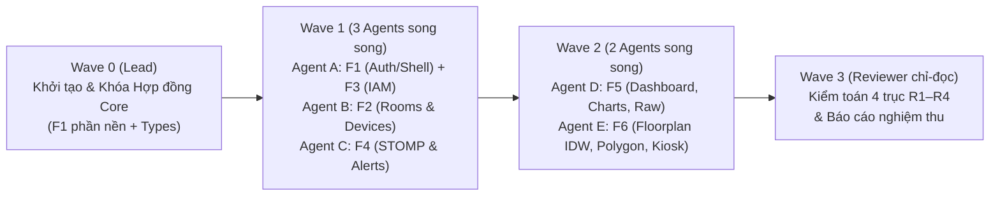

# KẾ HOẠCH TRIỂN KHAI TOÀN BỘ GIAO DIỆN FRONTEND (FRONTEND MASTER IMPLEMENTATION PLAN)

> **Dự án**: AIoTLibTQB — Hệ thống Quản lý & Giám sát Vi khí hậu, Âm học Thư viện Tạ Quang Bửu  
> **Phiên bản**: 1.0 (Đồng bộ 100% với Backend MVP v1.0, `FRONTEND_HANDOVER_SPEC.md` và `FRONTEND_STANDARD.md`)  
> **Ngày lập**: 2026-10-22  
> **Phạm vi**: Xây dựng trọn gói 15 màn hình (`M01`–`M15`), tầng lõi HTTP/STOMP/RBAC, đồ họa 2D Canvas Heatmap & Polygon Editor, và bộ kiểm thử tự động theo mô hình thực thi đa tác tử (`/teamwork-preview`).

---

## 1. MỤC TIÊU & KIẾN TRÚC TỔNG THỂ

### 1.1. Mục tiêu Sản phẩm
Xây dựng ứng dụng Web Dashboard & Public Kiosk hoàn chỉnh cho hệ thống **AIoTLibTQB**, kết nối trực tiếp tới Backend Spring Boot (`/api/v1/**` và WebSocket STOMP `/ws-aiot`), đáp ứng đầy đủ các quy tắc kỹ thuật bắt buộc (`FE-*`) trong [FRONTEND_STANDARD.md](docs/implementation/FRONTEND_STANDARD.md) và đặc tả API trong [FRONTEND_HANDOVER_SPEC.md](docs/implementation/FRONTEND_HANDOVER_SPEC.md).

### 1.2. Công nghệ Chốt (Tech Stack)
- **Thư mục mã nguồn**: `frontend/` (đặt tại gốc repository `c:\Users\C\Documents\Project\AIoTLibTQB\frontend`).
- **Core Framework**: **Next.js 15 (App Router) + React 19 + TypeScript (`strict: true`)**.
- **UI & Styling**: **Tailwind CSS + shadcn/ui (Radix UI) + Lucide Icons** (hỗ trợ Dark/Light mode).
- **Server State & Caching**: **TanStack Query v5** (`@tanstack/react-query`).
- **Client State**: **Zustand** (quản lý phiên xác thực trong RAM, bộ lọc tầng/chỉ số bản đồ nhiệt).
- **Realtime Client**: **`@stomp/stompjs`** (Singleton client kết nối `ws://localhost:8080/ws-aiot`).
- **Form & Validation**: **React Hook Form + Zod**.
- **Trực quan hóa**: **Recharts** (biểu đồ dải Min–Max–Avg từ `/buckets`) + **HTML5 Canvas 2D API** (Bản đồ nhiệt nội suy IDW & Trình vẽ đa giác `boundaryPolygon` trong hệ tọa độ chuẩn hóa `[0.0, 1.0]`).
- **Testing**: **Vitest + React Testing Library + MSW (Mock Service Worker)**.

---

## 2. CẤU TRÚC THƯ MỤC CHUẨN (`frontend/src/`)

```text
frontend/
├── package.json
├── tsconfig.json
├── next.config.ts
├── vitest.config.ts
└── src/
    ├── types/
    │   └── api.ts                  # Toàn bộ Type DTO chuẩn (Phụ lục A của FRONTEND_STANDARD.md)
    ├── config/
    │   ├── env.ts                  # Đọc NEXT_PUBLIC_API_BASE_URL, NEXT_PUBLIC_WS_URL
    │   └── thresholds.ts           # Thang màu Platinum/Gold/Silver/Bronze/Poor & ngưỡng chỉ số
    ├── messages/
    │   └── vi.ts                   # Từ điển chuỗi tiếng Việt & bảng tra mã lỗi ErrorCode (1001–9999)
    ├── lib/
    │   ├── http/
    │   │   ├── client.ts           # Axios/Fetch instance duy nhất + unwrap ApiResponse<T>
    │   │   ├── refresh-queue.ts    # Single-flight Mutex/Queue cho Silent Refresh Token Rotation
    │   │   └── error-mapper.ts     # Ánh xạ ErrorCode -> thông điệp tiếng Việt thân thiện
    │   ├── rbac/
    │   │   ├── scope-parser.ts     # Giải mã JWT claim `scope` (7 Roles + 14 Permissions)
    │   │   └── capabilities.ts     # Ma trận quyền duy nhất khớp §5.2 của FRONTEND_STANDARD.md
    │   ├── realtime/
    │   │   ├── stomp-client.ts     # Singleton STOMP client + beforeConnect + fallback polling
    │   │   └── use-room-stream.ts  # Hook subscribe/unsubscribe theo vòng đời màn hình + setQueryData
    │   ├── format/
    │   │   ├── metrics.ts          # Format số lẻ (°C, %RH, dBA, µg/m³, lux, --) & công thức đếm bucket
    │   │   └── datetime.ts         # ISO-8601 UTC <-> Asia/Ho_Chi_Minh & relative time ("3 phút trước")
    │   └── floorplan/
    │       ├── coords.ts           # Chuyển đổi tọa độ chuẩn hóa [0.0, 1.0] <-> Canvas Pixel + HiDPI
    │       ├── idw.ts              # Hàm thuần nội suy Inverse Distance Weighting (IDW)
    │       └── polygon.ts          # Kiểm tra đa giác >= 3 đỉnh, không tự cắt, điểm nằm trong đa giác
    ├── components/
    │   ├── ui/                     # Các nguyên tử UI (Button, Dialog, Drawer, Table, Skeleton, Badge, Toast)
    │   └── layout/                 # AppShell, Sidebar theo Role, Header + Chuông cảnh báo realtime
    ├── features/
    │   ├── auth/                   # Login form, Rate-limit countdown, Auth store, Route Guard
    │   ├── rooms/                  # API, Queries, Room Table, Room Form Modal, Delete guard (5006)
    │   ├── devices/                # API, Queries, Device Table, Discovery Claim, One-time API Key Dialog
    │   ├── iam/                    # API, Queries, Users Table/Modal, Roles-Permissions Checkbox Matrix
    │   ├── telemetry/              # API, Queries, KPI Summary Banner, Min-Avg-Max Chart, Raw CSV Explorer
    │   ├── alerts/                 # API, Queries, Alert Center Table, Ack/Resolve actions, Toast listener
    │   ├── floorplan/              # Canvas 2D Heatmap Renderer, SVG Device Markers, Polygon Editor
    │   └── kiosk/                  # Kiosk TV Dark-mode Ranking View & Auto-refresh
    └── app/                        # 15 Routes (M01–M15) ghép từ features/
        ├── login/page.tsx                              # M01
        ├── kiosk/page.tsx                              # M02
        └── (protected)/
            ├── layout.tsx                              # AppShell + RouteGuard + StompProvider
            ├── dashboard/page.tsx                      # M03
            ├── floorplan/page.tsx                      # M04
            ├── rooms/[id]/page.tsx                     # M05
            ├── alerts/page.tsx                         # M06
            ├── telemetry-explorer/page.tsx             # M07
            ├── profile/page.tsx                        # M15
            └── admin/
                ├── rooms/page.tsx                      # M08
                ├── rooms/[id]/polygon/page.tsx         # M09
                ├── devices/page.tsx                    # M10
                ├── devices/discovery/page.tsx          # M11
                ├── devices/[id]/page.tsx               # M12
                ├── users/page.tsx                      # M13
                └── roles/page.tsx                      # M14
```

---

## 3. ĐẶC TẢ KỸ THUẬT 8 GÓI CÔNG VIỆC (TASKS F1–F8)

### Task F1: Khởi tạo Dự án, Tầng lõi HTTP/Auth/RBAC & Khung Điều hướng (`M01`, `M15`)
- **Mục tiêu**: Xây dựng nền móng kỹ thuật tuân thủ `FE-ARC-*`, `FE-API-*`, `FE-AUTH-*`, `FE-RBAC-*`.
- **Hạng mục thực hiện**:
  1. Khởi tạo `frontend/` với Next.js App Router, TypeScript `strict: true`, Tailwind CSS, Vitest, MSW.
  2. Hiện thực `src/types/api.ts` (khớp 100% Phụ lục A của `FRONTEND_STANDARD.md`), `src/config/thresholds.ts` (thang màu `Platinum`/`Gold`/`Silver`/`Bronze`/`Poor`/`N/A`) và `src/messages/vi.ts` (bảng ánh xạ toàn bộ mã lỗi `1001`–`9999`).
  3. Hiện thực `src/lib/http/`:
     - Unwrap `ApiResponse<T>` (`code === 1000` trả `result`, ngược lại ném `ApiError`).
     - **Single-flight Refresh Queue** (`FE-AUTH-03`): khi nhiều request cùng gặp `401 / 1006`, chỉ phát duy nhất 1 lệnh `POST /api/v1/auth/refresh`, các request khác đợi và tự động phát lại.
     - Logout (`FE-AUTH-06`): gửi `POST /api/v1/auth/logout` với `{ token, refreshToken }` trong 1 request rồi xóa state.
  4. Hiện thực `src/lib/rbac/`: giải mã claim `scope` và cung cấp `capabilities.ts` khớp bảng §5.2 của `FRONTEND_STANDARD.md`.
  5. Hiện thực `AppShell` (Sidebar lọc menu theo capability, Header hiển thị trạng thái kết nối STOMP và chuông cảnh báo), màn hình Đăng nhập **M01** (`/login` có đồng hồ đếm ngược khi nhận HTTP 429 `Retry-After`) và Hồ sơ cá nhân **M15** (`/profile`).
- **Kiểm thử bắt buộc**: Unit test cho `unwrap`, `error-mapper`, `refresh-queue` (5 request 401 đồng thời chỉ gọi `/refresh` 1 lần), và `capabilities`.

---

### Task F2: Quản trị Không gian Phòng đọc & Thiết bị IoT (`M08`, `M10`, `M11`, `M12`)
- **Mục tiêu**: Hoàn thiện CRUD Không gian, Thiết bị, Tự động phát hiện (Auto-Discovery) và bảo mật khóa `rawApiKey`.
- **Hạng mục thực hiện**:
  1. **M08 (`/admin/rooms`)**: Bảng phân trang 0-based `GET /api/v1/rooms`, lọc theo tầng (`floor`), Modal thêm/sửa phòng (`RoomCreationRequest`/`RoomUpdateRequest` với Zod validation), xử lý lỗi `5001 ROOM_EXISTED` và hộp thoại hướng dẫn khi gặp `5006 ROOM_HAS_DEVICES` lúc xóa phòng.
  2. **M10 (`/admin/devices`)**: Bảng phân trang `GET /api/v1/devices` (hỗ trợ lọc `zoneId`, `roomId`), hiển thị huy hiệu `ONLINE` / `OFFLINE` (kèm icon + chữ theo `FE-A11Y-01`), thời gian tương đối `lastSeenAt` tự làm mới mỗi 30s (`FE-UI-03`), công tắc bật/tắt `active` (chỉ hiện cho `ADMIN`/`LIBRARIAN`).
  3. **M11 (`/admin/devices/discovery`)**: Hiển thị danh sách trạm ESP32 mới cắm điện từ `GET /api/v1/devices/discovered` (`hardwareId`, `lastWifiRssi`, `messageCount`), nút **"Cấp phát (Claim)"** gọi `POST /api/v1/devices/register`. Xử lý trường `alreadyExisted = true` (`D15`).
  4. **M12 (`/admin/devices/[id]`) & One-Time Secret Dialog (`FE-SEC-02`)**: Xem/cập nhật thiết bị, xóa thiết bị (`ADMIN`), và cấp lại API Key (`POST /api/v1/devices/{id}/regenerate-key`) có xác nhận 2 bước. Hiển thị `rawApiKey` trong hộp thoại One-time Copy và xóa sạch khỏi bộ nhớ ngay khi đóng hộp thoại (tuyệt đối không lưu trong React Query cache hay `localStorage`).

---

### Task F3: Quản trị Người dùng, Phân vùng & Ma trận Vai trò RBAC (`M13`, `M14`)
- **Mục tiêu**: Cung cấp công cụ quản trị IAM trực quan cho `ADMIN`.
- **Hạng mục thực hiện**:
  1. **M13 (`/admin/users`)**: Bảng phân trang `GET /api/v1/users`, tạo tài khoản mới qua `POST /api/v1/users` (truyền luôn `roles` và `assignedZones` theo `D5`), cập nhật qua `PUT /api/v1/users/{id}`, khóa/mở khóa qua `PATCH /api/v1/users/{id}/status`, xóa tài khoản có hộp thoại xác nhận.
  2. **M14 (`/admin/roles`)**:
     - Lấy động danh sách vai trò (`GET /api/v1/roles`) và 14 quyền hạn thực tế (`GET /api/v1/permissions` — `READ_SENSOR_DATA`, `MANAGE_DEVICES`, v.v. theo `D1`).
     - Xây dựng giao diện **Ma trận Checkbox (Role × Permission)** cho phép bật/tắt quyền và lưu qua `PUT /api/v1/roles/{name}`.
     - Hỗ trợ tạo/xóa Role và Permission; bắt lỗi `2005 PERMISSION_IN_USE` khi xóa quyền đang được gán cho Role.

---

### Task F4: Tầng Thời Gian Thực STOMP Singleton & Trung Tâm Cảnh Báo (`M06`)
- **Mục tiêu**: Kích hoạt luồng đẩy sự kiện thời gian thực và quy trình xử lý sự cố 4 trạng thái FSM (`FE-RT-*`).
- **Hạng mục thực hiện**:
  1. Hiện thực `src/lib/realtime/stomp-client.ts` và `use-room-stream.ts`:
     - Duy nhất 1 STOMP client singleton (`FE-RT-01`), nạp token mới nhất trong `beforeConnect` (`FE-RT-02`).
     - Chỉ subscribe `/topic/alerts` khi user có quyền `VIEW_ALERTS` (`FE-RBAC-05`, `D14`).
     - Khi nhận bản tin `/topic/rooms/{roomId}/telemetry`, kiểm tra `timestamp` mới hơn mới ghi đè vào cache TanStack Query (`FE-RT-04`, `FE-RT-05`).
     - Khi mất kết nối STOMP: hiển thị thanh banner màu vàng trên Header và tự động bật fallback polling 15s cho phòng đang mở (`FE-RT-07`).
  2. **M06 (`/alerts`)**:
     - Bảng cảnh báo phân trang `GET /api/v1/alerts` với bộ lọc `roomId`, `type` (`NOISE_EXCEEDED`, `AIR_UNHEALTHY`, `DEVICE_OFFLINE`, `SENSOR_MALFUNCTION`), `status` (`PENDING`, `FIRING`, `ACKNOWLEDGED`, `RESOLVED`).
     - Hiển thị ngưỡng từ trường `AlertResponse.threshold` (`FE-UI-05`).
     - Nút **"Tiếp nhận (Acknowledge)"** (chỉ hiện khi có quyền `ACKNOWLEDGE_ALERT` và `status === 'FIRING'`) và **"Đóng sự cố (Resolve)"** (chỉ hiện khi có quyền `MANAGE_ALERT_CONFIG` và `status !== 'RESOLVED'`).
     - Nhận sự kiện STOMP `/topic/alerts`: hiển thị Toast (`aria-live="assertive"` cho `FIRING`), upsert vào danh sách và refetch `/api/v1/alerts/unread-count` (`FE-RT-06`).

---

### Task F5: Dashboard Tổng Quan, Chi Tiết Phòng Đọc & Tra Cứu Dữ Liệu Thô (`M03`, `M05`, `M07`)
- **Mục tiêu**: Xây dựng các màn hình giám sát và phân tích dữ liệu cảm biến cốt lõi.
- **Hạng mục thực hiện**:
  1. **M03 (`/dashboard`)**:
     - 4 thẻ KPI từ `GET /api/v1/telemetry/overview/summary` và `GET /api/v1/alerts/unread-count`.
     - Xử lý đúng đặc thù `Summary` (`D9`, `FE-UI-06`): tra tên phòng từ cache `rooms` cho `bestRoom`/`attentionRoom`; ẩn thẻ `attentionRoom` nếu trùng `bestRoom`; hiển thị Empty state *"Đang chờ bản tin đầu tiên từ trạm đo"* khi `totalRooms === 0` / `overallGrade === "N/A"`.
     - Lưới thẻ phòng đọc (Room Card Grid) kèm bộ lọc tầng và hiệu ứng nháy sáng nhẹ (`pulse` 300ms) khi có bản tin mới.
  2. **M05 (`/rooms/[id]`)**:
     - Đồng hồ bán nguyệt hiển thị `comfortScore.overall` + nhãn hạng (`Platinum`–`Poor`) và 4 thanh điểm thành phần (`acousticScore`, `airScore`, `thermalScore`, `lightScore`).
     - Biểu đồ vùng Min–Max + đường Avg (Recharts) gọi `GET /api/v1/telemetry/room/{id}/buckets` (`FE-API-08`, `FE-VIZ-01`).
     - Bộ chọn khoảng thời gian kiểm tra công thức `(durationSeconds + intervalSeconds - 1) / intervalSeconds <= 1000` (`FE-API-09`, `N3`) và tự động gợi ý `15m` / `1h` / `1d` (`FE-API-10`).
  3. **M07 (`/telemetry-explorer`)**:
     - Bảng tra cứu lịch sử bản tin thô theo phòng hoặc thiết bị, khóa chọn khoảng thời gian tối đa $\le 24\text{h}$ (`FE-API-11`), và xuất file CSV phía client (lược bỏ các trường ID nội bộ).

---

### Task F6: Đồ Họa Mặt Bằng 2D, Bản Đồ Nhiệt IDW & Trình Biên Tập Đa Giác (`M04`, `M09`, `M02`)
- **Mục tiêu**: Hiện thực các thuật toán hình học không gian 2D, nội suy nhiệt độ/độ ồn và màn hình Kiosk sảnh thư viện (`FE-VIZ-*`).
- **Hạng mục thực hiện**:
  1. Hiện thực bộ thư viện hình học thuần trong `src/lib/floorplan/` (có unit test độc lập 100%):
     - `coords.ts`: quy đổi tọa độ tương đối chuẩn hóa `[0.0, 1.0]` $\leftrightarrow$ pixel theo kích thước Canvas và `devicePixelRatio` (`FE-VIZ-02`, `FE-VIZ-06`).
     - `idw.ts`: hàm thuần tính nội suy khoảng cách nghịch đảo IDW cho $\ge 2$ thiết bị `ONLINE` (`FE-VIZ-04`, `FE-VIZ-05`).
     - `polygon.ts`: kiểm tra đa giác $\ge 3$ đỉnh, kiểm tra các cạnh không tự cắt nhau (line-segment intersection) và thuật toán Ray-casting kiểm tra tọa độ thiết bị `(posX, posY)` nằm trong đa giác phòng (`FE-VIZ-08`).
  2. **M04 (`/floorplan`)**:
     - Render 2 lớp: Lớp `<canvas>` dùng `ctx.clip()` theo `boundaryPolygon` từng phòng + tô màu nội suy IDW trong `requestAnimationFrame` (`FE-VIZ-03`); Lớp SVG/DOM overlay hiển thị Marker thiết bị có Hover Tooltip và Click mở Drawer chi tiết phòng.
     - Cung cấp bảng danh sách giá trị theo phòng song song với Canvas để hỗ trợ trình đọc màn hình (`FE-A11Y-05`).
  3. **M09 (`/admin/rooms/[id]/polygon`)**:
     - Công cụ tương tác cho phép `ADMIN`/`LIBRARIAN` chấm đỉnh vẽ/sửa `boundaryPolygon` `[0.0, 1.0]` và kéo-thả vị trí cảm biến `(posX, posY)` rồi lưu qua `PUT /api/v1/rooms/{id}` và `PUT /api/v1/devices/{id}`.
  4. **M02 (`/kiosk`)**:
     - Giao diện TV Kiosk toàn màn hình (Dark Mode độ tương phản cao $\ge 4.5:1$), tự động làm mới dữ liệu xếp hạng tiện nghi các tầng và gợi ý phòng đọc lý tưởng nhất (`bestRoom`) cho sinh viên.

---

### Task F7: Kiểm Toán Độc Lập (4 Trục R1–R4) & Đóng Gói Nghiệm Thu
- **Mục tiêu**: Chạy kiểm toán chéo toàn bộ mã nguồn theo §13 của `FRONTEND_STANDARD.md` và đảm bảo cổng chất lượng `FE-TEST-01` xanh 100%.

---

## 4. QUY TRÌNH THỰC THI THEO WAVE (`/teamwork-preview`)

Để đảm bảo không xung đột file giữa các agent và kiểm soát chất lượng chặt chẽ, kế hoạch được chia thành **4 Wave**:



### Phân công Sở hữu File (File Ownership Matrix)
| Wave | Phụ trách | Phạm vi Task | Thư mục / File Sở hữu Độc quyền |
| :---: | :--- | :--- | :--- |
| **Wave 0** | **Lead Agent** | Khởi tạo & Khóa Core | `frontend/package.json`, `tsconfig.json`, `src/types/api.ts`, `src/config/**`, `src/messages/vi.ts`, `src/lib/http/**`, `src/lib/rbac/**`, `src/lib/format/**`, `src/components/ui/**` |
| **Wave 1** | **Agent A** | Hoàn tất **F1** + **F3** (`M01`, `M13`, `M14`, `M15`) | `src/components/layout/**`, `src/features/auth/**`, `src/features/iam/**`, `src/app/login/**`, `src/app/(protected)/layout.tsx`, `src/app/(protected)/profile/**`, `src/app/(protected)/admin/users/**`, `src/app/(protected)/admin/roles/**` |
| **Wave 1** | **Agent B** | **F2** (`M08`, `M10`, `M11`, `M12`) | `src/features/rooms/**`, `src/features/devices/**`, `src/app/(protected)/admin/rooms/page.tsx`, `src/app/(protected)/admin/devices/**` |
| **Wave 1** | **Agent C** | **F4** (`M06` + STOMP Core) | `src/lib/realtime/**`, `src/features/alerts/**`, `src/app/(protected)/alerts/**` |
| **Wave 2** | **Agent D** | **F5** (`M03`, `M05`, `M07`) | `src/features/telemetry/**`, `src/app/(protected)/dashboard/**`, `src/app/(protected)/rooms/[id]/**`, `src/app/(protected)/telemetry-explorer/**` |
| **Wave 2** | **Agent E** | **F6** (`M02`, `M04`, `M09`) | `src/lib/floorplan/**`, `src/features/floorplan/**`, `src/features/kiosk/**`, `src/app/kiosk/**`, `src/app/(protected)/floorplan/**`, `src/app/(protected)/admin/rooms/[id]/polygon/**` |
| **Wave 3** | **Reviewer** | **F7** (Kiểm toán R1–R4) | Chỉ đọc toàn bộ `frontend/src/**`, chạy grep/test/build và xuất `docs/implementation/99_frontend_report.md` |

---

## 5. TIÊU CHÍ NGHIỆM THU TỔNG THỂ (DEFINITION OF DONE)

1. **Cổng biên dịch & kiểu dữ liệu (`FE-TEST-01`, `FE-ARC-04`)**:
   - `npm run typecheck` (`tsc --noEmit`) và `npm run build` pass 100% với `0 errors`.
   - Không có `: any` trái phép; không có lệnh gọi `fetch`/`axios` trực tiếp trong `src/app/**` hoặc `components/**` (`FE-ARC-01`).
2. **Cổng kiểm thử đơn vị (`FE-TEST-02`)**:
   - `npm run test` (Vitest) pass 100% cho toàn bộ các module lõi:
     - `http/client` & `error-mapper` (đầy đủ mã lỗi `1001`–`9999`).
     - `http/refresh-queue` (5 request 401 đồng thời chỉ gọi `/api/v1/auth/refresh` đúng 1 lần).
     - `rbac/capabilities` (khớp 7 Roles & 14 Permissions thực tế).
     - `format/metrics` (làm tròn số, xử lý `null` $\rightarrow$ `--`, công thức giới hạn 1000 buckets).
     - `floorplan/idw` & `floorplan/polygon` (nội suy IDW, kiểm tra đa giác tự cắt và điểm nằm trong đa giác).
     - `realtime/stomp-reducer` (bỏ qua bản tin có `timestamp` cũ hơn, upsert cảnh báo).
3. **Cổng giao diện & bảo mật (`FE-UI-01`, `FE-SEC-*`)**:
   - Đủ 15 màn hình (`M01`–`M15`) hoạt động đúng phân quyền và xử lý đủ 4 trạng thái UI (`Loading Skeleton`, `Empty State`, `Error/Stale Banner`, `Realtime Pulse`).
   - Tuyệt đối không lộ `rawApiKey` hoặc JWT trong URL, log, hay bộ nhớ bền vững trái quy định.
