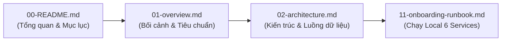

# HỆ THỐNG TÀI LIỆU KỸ THUẬT AIoTLibTQB

> **Dự án**: AIoTLibTQB — Hệ thống Giám sát Vi khí hậu & Âm học Thông minh Thư viện Tạ Quang Bửu (Đại học Bách khoa Hà Nội)  
> **Phiên bản tài liệu**: 2.0 (Toàn diện & Đã kiểm chứng thực tế mã nguồn)  
> **Nguyên tắc kỹ thuật**: Mã nguồn thực tế là nguồn sự thật tối thượng (*Code is the Single Source of Truth*). Mọi mô tả kiến trúc, quy chuẩn và tham số đều được đối chiếu trực tiếp với mã nguồn đang chạy.

---

## 1. MỤC TIÊU

Tài liệu này là cổng thông tin khởi đầu (*Entrypoint*) của toàn bộ hệ sinh thái kỹ thuật **AIoTLibTQB**. Mục tiêu cốt lõi của tài liệu bao gồm:
1. Giới thiệu tổng quan hệ thống, bài toán kỹ thuật và sứ mệnh bảo tồn tài liệu lưu trữ, tối ưu không gian tự học tại Thư viện Tạ Quang Bửu — Đại học Bách khoa Hà Nội.
2. Cung cấp **Bản đồ tài liệu toàn diện (Documentation Map)** cho toàn bộ 13 tài liệu kỹ thuật trong thư mục `docs/`.
3. Thiết lập **Lộ trình đọc phân cấp (Reading Roadmaps)** phù hợp với từng vai trò chuyên môn (Kiến trúc sư phần mềm, Lập trình viên Backend, Lập trình viên Frontend, Kỹ sư IoT/Nhúng, Kỹ sư Đảm bảo chất lượng QA/Tester, Kỹ sư Vận hành DevOps/SRE) và theo quỹ thời gian (30 phút, 2 giờ, nghiên cứu chuyên sâu).
4. Công bố minh bạch các **Quy ước kỹ thuật cốt lõi** và danh mục **Điểm lệch kiến trúc đã xác nhận (Architectural Drift)** so với thiết kế ban đầu nhằm giúp các kỹ sư mới tiếp cận dự án một cách chuẩn xác, không bị nhầm lẫn giữa tài liệu lý thuyết và hiện trạng mã nguồn thực tế.

---

## 2. ĐỐI TƯỢNG ĐỌC

Tài liệu này được biên soạn cho tất cả các bên tham gia phát triển, bảo trì và nghiên cứu hệ thống AIoTLibTQB:
- **Kỹ sư mới gia nhập dự án (New Onboarding Engineers)**: Cần lộ trình tiếp cận nhanh chóng để thiết lập môi trường và hiểu bức tranh toàn cảnh hệ thống.
- **Kiến trúc sư phần mềm & Trưởng nhóm kỹ thuật (Software Architects & Tech Leads)**: Nắm bắt cấu trúc phân rã module, luồng dữ liệu toàn trình và các quyết định kiến trúc then chốt.
- **Lập trình viên chuyên trách (Backend / Frontend / Embedded Engineers)**: Tra cứu nhanh các quy ước giao tiếp, mô hình dữ liệu, cấu trúc gói tin và phân định trạng thái.
- **Kỹ sư Kiểm thử & Bảo mật (QA / Security Auditors)**: Nắm vững các kịch bản kiểm thử, máy trạng thái cảnh báo FSM, ma trận phân quyền RBAC và kiểm tra tính toàn vẹn hệ thống.
- **Ban Quản lý & Thủ thư (Librarians & Space Managers)**: Hiểu cơ chế tính điểm tiện nghi thư viện LCS (Library Comfort Score) và quy trình vận hành cảnh báo môi trường.

---

## 3. NỘI DUNG CHI TIẾT

### 3.1. Bối cảnh & Sứ mệnh Hệ sinh thái AIoTLibTQB

Thư viện Tạ Quang Bửu (Đại học Bách khoa Hà Nội) là một trong những thư viện đại học lớn nhất Việt Nam với quy mô 10 tầng, phục vụ hàng chục nghìn lượt sinh viên, giảng viên và nhà nghiên cứu mỗi ngày. Tòa nhà tích hợp đa dạng các không gian chức năng:
- Các **Kho lưu trữ sách quý hiếm & luận án** đòi hỏi quy chuẩn bảo tồn vật lý khắt khe nhằm chống lại sự phân hủy giấy và mực in cổ dưới khí hậu nhiệt đới ẩm gió mùa Hà Nội.
- Các **Phòng tự học chuyên sâu & phòng đọc đa phương tiện** yêu cầu môi trường yên tĩnh tuyệt đối, hạn chế tiếng ồn và duy trì nồng độ bụi mịn, vi khí hậu trong lành để đảm bảo hiệu suất tư duy.
- Các **Sảnh mượn trả, hành lang & khu vực giao dịch công cộng** có mật độ di chuyển cao, biến động âm học và lưu thông không khí liên tục.

**AIoTLibTQB** được xây dựng như một hệ thống Cyber-Physical System (CPS) kết hợp công nghệ IoT (Internet of Things) và AI xử lý dữ liệu thời gian thực:
- Mạng lưới các trạm đo phần cứng chuyên dụng tích hợp vi điều khiển **ESP32-S3** thu thập đồng thời **9 thông số môi trường**: Âm thanh trung bình ($L_{eq}$), Âm thanh đỉnh tức thời ($L_{peak}$), Bụi siêu mịn PM1.0, Bụi mịn hô hấp PM2.5, Bụi lắng PM4.0, Bụi thô PM10, Nhiệt độ, Độ ẩm tương đối và Cường độ ánh sáng.
- Luồng dữ liệu truyền tải qua **MQTT Broker Mosquitto 2.0** (QoS 1) với cơ chế bảo mật ACL phân lập theo từng node phần cứng.
- Hệ thống xử lý trung tâm phát triển trên nền **Java 21 LTS & Spring Boot 3.5.8**, tối ưu xử lý I/O đồng thời bằng **Virtual Threads (Project Loom)**, lọc dữ liệu vật lý 3 lớp, bù trôi 30s forward-fill và kẹp timestamp chuẩn hóa UTC.
- Cơ sở dữ liệu chuỗi thời gian **MongoDB 8.0 TimeSeries Collection** tự động nén bucket và purge dữ liệu định kỳ 90 ngày.
- Động cơ toán học tính toán **Chỉ số Tiện nghi Thư viện (Library Comfort Score - LCS)** dựa trên **Nguyên lý Thùng gỗ Liebig (Liebig's Law of the Minimum)**, phạt phi tuyến các yếu tố nghẽn môi trường theo từng loại phòng chuyên biệt.
- Giao diện giám sát Web thời gian thực hiện đại xây dựng trên **Next.js 15 App Router**, **React 19**, **Tailwind CSS**, bản đồ nhiệt Heatmap 2D nội suy **Gaussian RBF / IDW** vẽ trên HTML5 Canvas Responsive, và cơ chế đẩy tin STOMP WebSocket trễ dưới 1 giây.

---

### 3.2. Cấu trúc Cây Thư mục & Bản đồ Bộ Tài liệu Kỹ thuật (`docs/`)

Hệ thống tài liệu dự án AIoTLibTQB được chuẩn hóa theo cấu trúc phân tầng rõ ràng, tách biệt giữa **Bộ tài liệu chuẩn hóa đang vận hành (Canonical Docs)** và **Thư mục lưu trữ lịch sử thiết kế (Archived Legacy Docs)**:

```text
docs/
├── 00-README.md                   # Cổng thông tin, chỉ mục & lộ trình đọc tài liệu
├── 01-overview.md                 # Bối cảnh nghiệp vụ Thư viện TQB & 3 trụ cột tiêu chuẩn
├── 02-architecture.md             # Kiến trúc tổng thể 5 phân tầng & ADR
├── 03-ingestion-pipeline.md       # Thu nạp MQTT Inbound, lọc dữ liệu & Watchdog
├── 04-lcs-algorithm.md            # Động cơ tiện nghi LCS & Liebig Gating phi tuyến
├── 05-data-model.md               # Mô hình CSDL MongoDB 8.0 & TimeSeries 90 ngày
├── 06-security-rbac.md            # An ninh, JWT HMAC-SHA512 & Mosquitto ACL
├── 07-api-reference.md            # Đặc tả REST API, DTO & danh mục mã lỗi ErrorCode
├── 08-frontend.md                 # Kiến trúc Next.js 15, Zustand & Heatmap 2D Canvas
├── 09-firmware-iot.md             # Phần cứng ESP32-S3, cảm biến & IoT Simulator
├── 10-conventions.md              # Quy chuẩn kỹ thuật Backend & Frontend
├── 11-onboarding-runbook.md       # Cẩm nang cài đặt, vận hành & kịch bản nghiệm thu phần cứng
├── 12-glossary.md                 # Từ điển thuật ngữ kỹ thuật & bảng đơn vị đo
└── archive/                       # THƯ MỤC LƯU TRỮ HỒ SƠ TÀI LIỆU CŨ (26 tệp)
    ├── analysis/                  # 9 tệp: Báo cáo kỹ thuật Phase 1, cấu hình cache & benchmark
    ├── business/                  # 9 tệp: Đặc tả nghiệp vụ gốc (IAM, Space, Telemetry...)
    ├── frontend/                  # 1 tệp: Báo cáo kiểm toán đối chiếu kết nối FE-BE (gap report)
    ├── implementation/            # 6 tệp: Handover spec, tiêu chuẩn FE/Hardware, UI Style Guide
    └── testing/                   # 1 tệp: Nghiệm thu bộ giả lập IoT Simulator & mô hình Box-Muller
```

#### Bản đồ Danh mục Bộ 13 Tài liệu Kỹ thuật Chuẩn hóa

| Mã tài liệu | Tên tệp tin | Mục tiêu & Phạm vi nội dung cốt lõi | Dẫn chiếu mã nguồn chính |
| :---: | :--- | :--- | :--- |
| **00** | [`00-README.md`](./00-README.md) | **Cổng thông tin & Hướng dẫn khai thác**: Mục lục, cấu trúc cây thư mục, thuyết minh kho lưu trữ `archive/`, lộ trình đọc theo cấp độ (30m / 2h / deep dive), quy ước kỹ thuật, danh mục điểm lệch kiến trúc đã xác minh. | Toàn bộ repo |
| **01** | [`01-overview.md`](./01-overview.md) | **Bối cảnh & Tiêu chuẩn Nghiệp vụ**: Bài toán bảo tồn tài liệu quý Thư viện TQB, khung giá trị 3 trụ cột (ISO 11799, ASHRAE 55, Vận hành), phạm vi In-scope/Out-of-scope, ma trận tác nhân vận hành. | `docs/archive/business/` |
| **02** | [`02-architecture.md`](./02-architecture.md) | **Kiến trúc Tổng thể & Luồng Dữ liệu**: Sơ đồ Mermaid toàn trình (ESP32 $\to$ Mosquitto $\to$ Spring Boot $\to$ MongoDB $\to$ STOMP $\to$ Next.js), phân tích lý do chọn công nghệ (ADR), topology mạng Docker. | `docker-compose.yml`, `MqttConfig.java` |
| **03** | [`03-ingestion-pipeline.md`](./03-ingestion-pipeline.md) | **Đường ống Thu nạp Telemetry**: Adapter MQTT Inbound, lọc dải đo vật lý phần cứng, cơ chế forward-fill 30s (ngoại lệ `noisePeak`), kẹp timestamp, FSM Watchdog phát hiện offline trong 15s. | `TelemetrySanitizerService.java`, `MqttMessageDispatcherService.java` |
| **04** | [`04-lcs-algorithm.md`](./04-lcs-algorithm.md) | **Động cơ Toán học LCS & Nguyên lý Liebig**: Công thức Non-linear Gating $S_{weighted} \times [0.30 + 0.70 \times \text{ratio}]$, ma trận trọng số 3 profile phòng (`STUDY_ROOM`, `BOOK_STORAGE`, `CIRCULATION_HALL`), ví dụ tính tay và test cases. | `ComfortScoreService.java`, `ComfortScoreServiceTest.java` |
| **05** | [`05-data-model.md`](./05-data-model.md) | **Mô hình Dữ liệu & CSDL MongoDB 8.0**: Đặc tả 7 Document collections (`users`, `roles`, `permissions`, `rooms`, `devices`, `alerts`, `invalidated_tokens`), TimeSeries `telemetry_records` (retention 90 ngày), tọa độ 2D đa giác. | `document/*.java` |
| **06** | [`06-security-rbac.md`](./06-security-rbac.md) | **Kiến trúc An ninh & Phân quyền RBAC**: Luồng JWT HMAC-SHA512, rotation Access/Refresh, TTL Blacklist MongoDB, phân quyền vùng `assignedZones`, ma trận 7 vai trò $\times$ 14 quyền, bảo mật Mosquitto ACL `%u`. | `SecurityConfig.java`, `CustomJwtDecoder.java`, `acl.conf` |
| **07** | [`07-api-reference.md`](./07-api-reference.md) | **Đặc tả REST API & Danh mục Mã lỗi**: Danh mục 7 nhóm endpoints bọc chuẩn `ApiResponse<T>`, tham số phân trang `PageResponse<T>`, kỹ thuật downsampling `$dateTrunc`, danh mục lỗi `ErrorCode`. | `controller/*.java`, `ApiResponse.java`, `ErrorCode.java` |
| **08** | [`08-frontend.md`](./08-frontend.md) | **Kiến trúc Giao diện Next.js 15 & Heatmap 2D**: App Router, phân rã 15 màn hình M01–M15, ranh giới Client State (Zustand) vs Server Cache (React Query), STOMP client native WebSocket, giải thuật nội suy RBF/IDW Canvas. | `frontend/src/app/`, `store.ts`, `heatmapMath.ts` |
| **09** | [`09-firmware-iot.md`](./09-firmware-iot.md) | **Đặc tả Phần cứng ESP32-S3 & Giao thức IoT**: 9 cảm biến vật lý (INMP441, SPS30, SHT30, BH1750), cấu trúc gói JSON telemetry/status, chu kỳ phát tin 5-10s, di chúc LWT, xác thực API Key băm BCrypt. | `TelemetryPayload.java`, `tools/iot-simulator/` |
| **10** | [`10-conventions.md`](./10-conventions.md) | **Quy ước Lập trình Bắt buộc**: Các mẫu code chuẩn kèm ví dụ Đúng/Sai: Virtual Threads & Semaphore thay vì `synchronized`, quy chuẩn Frontend (FE-ARC, FE-AUTH single-flight, FE-RT STOMP, FE-VIZ Canvas HiDPI), bảo mật Secret. | Toàn bộ codebase |
| **11** | [`11-onboarding-runbook.md`](./11-onboarding-runbook.md) | **Cẩm nang Triển khai & Vận hành (Runbook)**: Cài đặt môi trường từ zero, khởi chạy Docker Compose 6 services, quy trình Provisioning tự động, 4 kịch bản nghiệm thu phần cứng thực tế & hướng dẫn chạy IoT Simulator. | `docker-compose.yml`, `.env.example`, `provision.js` |
| **12** | [`12-glossary.md`](./12-glossary.md) | **Thuật ngữ, Từ viết tắt & Đơn vị Đo lường**: Bảng tra cứu thuật ngữ vi khí hậu/âm học, danh mục từ viết tắt kỹ thuật (IDW, Liebig Gating, RTR, Conflation, LWT, Single-Flight), bảng đơn vị đo lường chuẩn hóa. | Toàn bộ repo |

---

### 3.2.1. Thuyết Minh Thư Mục Lưu Trữ Tài Liệu Cũ (`docs/archive/`)

Nhằm làm sạch thư mục tài liệu chính `docs/` để người mới chỉ nhìn thấy bộ tài liệu chuẩn hóa 13 tệp duy nhất, toàn bộ 26 tệp tài liệu giai đoạn 1 đã được di chuyển có cấu trúc vào thư mục `docs/archive/`.

#### Mục đích & Ý nghĩa Lưu trữ:
1. **Bảo toàn Toàn vẹn Lịch sử Ra Quyết định Kiến trúc (ADR) & Nguồn gốc Thiết kế**:
   - Lưu trữ các căn cứ nghiên cứu then chốt: Lý do từ bỏ kiến trúc PostgreSQL/TimescaleDB của dự án tiền thân (*Listen_Project*) để chuyển sang MongoDB 8.0 Native TimeSeries (`archive/analysis/03_docs.md`).
   - Lưu trữ kết quả nghiên cứu đối sánh chuyên sâu (Benchmarking) 4 hệ thống nguồn mở IoT cùng lĩnh vực: ThingsBoard CE, OpenRemote, AirGradient, openSenseMap (`archive/analysis/06_references.md`).
2. **Bảo đảm Tính Truy vết Kiểm toán (Audit Trail)**:
   - Cho phép các đợt kiểm toán hệ thống đối chiếu độc lập giữa Yêu cầu Nghiệp vụ Ban đầu (*Design Intent*) và Hiện trạng Mã nguồn Thực tế (*Current State*).
   - Lưu trữ nguyên trạng các bảng quy chuẩn đồng bộ D1–D16 (`archive/implementation/FRONTEND_STANDARD.md`), báo cáo kiểm toán khoảng trống kết nối API (`archive/frontend/01_gap_report.md`), cẩm nang thiết kế UI Style Guide (`archive/implementation/UI_STYLE_GUIDE.md`) và đặc tả firmware phần cứng (`archive/implementation/HARDWARE_HANDOVER_SPEC.md`).
3. **Loại bỏ Tệp Checkpoint Tạm thời**:
   - Đã loại bỏ an toàn 3 tệp checkpoint mang tính chất tiến độ tạm thời (`00_preflight.md`, `01_wave1.md`, `02_wave2.md`) do toàn bộ kết quả, commit log và kết quả kiểm thử của chúng đã được tổng kết trọn vẹn 100% trong `archive/implementation/99_report.md`.

#### Cấu trúc Phân khu Thư mục Lưu trữ:
- [`docs/archive/analysis/`](./archive/analysis/): 9 tệp — Khảo sát mã nguồn, phân tích phụ thuộc `pom.xml`, cấu hình 4 bộ đệm Caffeine Cache, lịch sử tiến hóa kiến trúc, benchmark 4 hệ sinh thái IoT và bản thiết kế UI blueprint 15 màn hình.
- [`docs/archive/business/`](./archive/business/): 9 tệp — Đặc tả nghiệp vụ gốc giai đoạn thành lập dự án (Tổng quan, IAM, Không gian & Thiết bị, Telemetry Ingestion, Mô hình dữ liệu, Tiến trình ngầm, An ninh bảo mật, Vận hành và Câu hỏi mở).
- [`docs/archive/frontend/`](./archive/frontend/): 1 tệp — Báo cáo kiểm toán khớp nối toàn diện giữa 100% endpoints Backend với mã nguồn Next.js 15 và 15 màn hình UI.
- [`docs/archive/implementation/`](./archive/implementation/): 6 tệp — Báo cáo nghiệm thu Backend MVP, Báo cáo nghiệm thu Frontend, Đặc tả bàn giao tích hợp Frontend REST/STOMP, Tiêu chuẩn kỹ thuật Frontend, Hướng dẫn kết nối phần cứng ESP32 và Cẩm nang phong cách giao diện UI.
- [`docs/archive/testing/`](./archive/testing/): 1 tệp — Báo cáo nghiệm thu bộ giả lập trạm đo IoT Simulator, mô hình toán học biến đổi Box-Muller phân phối Gauss và 10 kịch bản kiểm thử tải.

> **Nguyên tắc tra cứu**: Toàn bộ tinh hoa kỹ thuật và tri thức kiến trúc còn giá trị từ `docs/archive/` đã được trích xuất và tích hợp trọn vẹn vào 13 tài liệu chuẩn (`docs/00` đến `docs/12`). Người dùng thông thường chỉ cần đọc bộ tài liệu chuẩn; chỉ cần mở `docs/archive/` khi cần nghiên cứu sâu lịch sử ra quyết định hoặc kiểm toán đối chiếu chi tiết.

---

### 3.3. Lộ trình Đọc Tài liệu Theo Cấp độ & Vai trò

#### Lộ trình 1: Onboarding Siêu tốc (30 phút)
*Mục tiêu: Dành cho lập trình viên mới hoặc thành viên cần nắm bắt ngay cấu trúc dự án và chạy được hệ thống trên máy cá nhân.*
1. [`00-README.md`](./00-README.md): Nắm bức tranh tổng quan và quy ước chung (5 phút).
2. [`01-overview.md`](./01-overview.md): Hiểu bài toán nghiệp vụ Thư viện TQB và các tiêu chuẩn môi trường (7 phút).
3. [`02-architecture.md`](./02-architecture.md): Nắm sơ đồ luồng dữ liệu E2E và kiến trúc tổng thể (8 phút).
4. [`11-onboarding-runbook.md`](./11-onboarding-runbook.md): Làm theo các bước bật Docker Compose, backend, frontend và simulator (10 phút).



---

#### Lộ trình 2: Nắm vững Toàn diện Hệ thống (2 giờ)
*Mục tiêu: Hiểu sâu sắc logic nghiệp vụ, các thuật toán cốt lõi, mô hình CSDL và cơ chế bảo mật của toàn hệ sinh thái.*
1. Hoàn thành Lộ trình 1 (30 phút).
2. [`03-ingestion-pipeline.md`](./03-ingestion-pipeline.md): Khảo sát đường ống xử lý dữ liệu cảm biến, bộ lọc 3 lớp và cơ chế watchdog (20 phút).
3. [`04-lcs-algorithm.md`](./04-lcs-algorithm.md): Phân tích động cơ toán học Liebig, công thức tính điểm tiện nghi và ma trận trọng số theo loại phòng (20 phút).
4. [`05-data-model.md`](./05-data-model.md): Nắm chi tiết các bảng MongoDB, cấu trúc TimeSeries 90 ngày và tọa độ 2D đa giác (15 phút).
5. [`06-security-rbac.md`](./06-security-rbac.md): Tìm hiểu luồng JWT rotation, blacklist token TTL và ma trận phân quyền 7 vai trò (15 phút).
6. [`08-frontend.md`](./08-frontend.md): Khảo sát kiến trúc Next.js 15, phân định Zustand vs React Query và giải thuật vẽ Heatmap 2D (20 phút).

---

#### Lộ trình 3: Chuyên sâu theo Vai trò Kỹ thuật (Deep Dive)

##### 1. Backend & Data Engineer
Tập trung vào tính toàn vẹn dữ liệu, khả năng mở rộng xử lý đồng thời và hiệu năng CSDL chuỗi thời gian:
- [`02-architecture.md`](./02-architecture.md) $\to$ [`03-ingestion-pipeline.md`](./03-ingestion-pipeline.md) $\to$ [`04-lcs-algorithm.md`](./04-lcs-algorithm.md) $\to$ [`05-data-model.md`](./05-data-model.md) $\to$ [`06-security-rbac.md`](./06-security-rbac.md) $\to$ [`07-api-reference.md`](./07-api-reference.md) $\to$ [`10-conventions.md`](./10-conventions.md).
- *Trọng tâm kiểm tra*: Semaphore 30 permits tại `MqttMessageDispatcherService.java:80`, chống carrier thread pinning trong Virtual Threads, toán tử downsampling `$dateTrunc` trong `TelemetryService.java:156`.

##### 2. Frontend & UI/UX Engineer
Tập trung vào trạng thái ứng dụng, trải nghiệm hiển thị thời gian thực và xử lý đồ họa mặt bằng:
- [`02-architecture.md`](./02-architecture.md) $\to$ [`05-data-model.md`](./05-data-model.md) $\to$ [`07-api-reference.md`](./07-api-reference.md) $\to$ [`08-frontend.md`](./08-frontend.md) $\to$ [`10-conventions.md`](./10-conventions.md).
- *Trọng tâm kiểm tra*: Bộ nhớ token RAM trong `useAuthStore` (`frontend/src/features/auth/store.ts:35`), kết nối STOMP qua native WebSocket `/ws-aiot`, thuật toán nội suy Gaussian RBF / IDW trên HTML5 Canvas.

##### 3. Firmware, IoT & Hardware Engineer
Tập trung vào giao tiếp vi điều khiển, độ tin cậy cảm biến và cơ chế truyền tin nhẹ:
- [`02-architecture.md`](./02-architecture.md) $\to$ [`03-ingestion-pipeline.md`](./03-ingestion-pipeline.md) $\to$ [`09-firmware-iot.md`](./09-firmware-iot.md) $\to$ [`11-onboarding-runbook.md`](./11-onboarding-runbook.md) $\to$ [`12-glossary.md`](./12-glossary.md).
- *Trọng tâm kiểm tra*: Dải đo vật lý 9 cảm biến trong `TelemetrySanitizerService.java:24-35`, di chúc LWT, xác thực API key băm BCrypt, bộ giả lập Simulator `tools/iot-simulator/`.

##### 4. QA / Tester / Security Auditor
Tập trung vào ma trận kiểm thử, kiểm thử biên, máy trạng thái cảnh báo và lỗ hổng an ninh:
- [`04-lcs-algorithm.md`](./04-lcs-algorithm.md) $\to$ [`06-security-rbac.md`](./06-security-rbac.md) $\to$ [`07-api-reference.md`](./07-api-reference.md) $\to$ [`09-firmware-iot.md`](./09-firmware-iot.md) $\to$ [`11-onboarding-runbook.md`](./11-onboarding-runbook.md).
- *Trọng tâm kiểm tra*: 10 ca kiểm thử tự động trong `ComfortScoreServiceTest.java`, bộ sưu tập Postman `AIoTLibTQB_Postman_Collection.json`, 10 kịch bản kiểm thử trong `tools/iot-simulator/src/scenarios.js`.

##### 5. DevOps & SRE Engineer
Tập trung vào đóng gói vùng chứa, phân vùng mạng, cấu hình biến môi trường và sức khỏe dịch vụ:
- [`02-architecture.md`](./02-architecture.md) $\to$ [`06-security-rbac.md`](./06-security-rbac.md) $\to$ [`11-onboarding-runbook.md`](./11-onboarding-runbook.md).
- *Trọng tâm kiểm tra*: Phân vùng 2 mạng bridge `aiot_db_net` và `aiot_app_net` trong `docker-compose.yml`, kiểm tra healthcheck, thiết lập placeholder an toàn từ `.env.example`.

---

### 3.4. Nguyên tắc Quy ước Kỹ thuật Cốt lõi

Mọi thành viên phát triển và bảo trì hệ sinh thái AIoTLibTQB bắt buộc phải tuân thủ 5 nguyên tắc kỹ thuật sau:

1. **Mã nguồn thực tế là nguồn sự thật tối thượng (Code is the Single Source of Truth)**:
   - Khi có sự mâu thuẫn giữa tài liệu mô tả ý đồ thiết kế ban đầu và mã nguồn đang chạy, hiện trạng mã nguồn được ưu tiên ghi nhận chính xác.
   - Các điểm lệch hoặc chưa có mã nguồn tương ứng phải được gắn nhãn minh bạch `TODO: cần xác nhận` thay vì suy đoán hoặc mô tả sai thực tế.

2. **Tuyệt đối không lưu trữ Secret trong mã nguồn và tài liệu (Zero Hardcoded Secrets)**:
   - Nghiêm cấm đưa bất kỳ JWT secret, API key thật, mật khẩu CSDL hoặc chứng chỉ sản xuất vào tài liệu hoặc commit vào Git.
   - Tài liệu chỉ sử dụng placeholder quy ước: `<JWT_SECRET>`, `<PASSWORD>`, `<RAW_API_KEY_32_HEX>`, `<MONGO_ROOT_PASSWORD>`.

3. **An toàn Đa luồng tương thích Virtual Threads (Thread-Safe & Non-blocking)**:
   - Nghiêm cấm sử dụng từ khóa `synchronized` trong tầng Ingestion và Services nhằm chống hiện tượng ghim luồng nền tảng (*Carrier Thread Pinning*).
   - Sử dụng các cấu trúc dữ liệu không khóa: `ConcurrentHashMap.compute()`, `ConcurrentHashMap.newKeySet()`, `Semaphore(30, true)` và bộ nhớ đệm `Caffeine Cache` (`TelemetrySanitizerService.java:41`).

4. **Làm sạch vật lý & Giữ nguyên tính chất xung âm (Physical Clamping & Peak Protection)**:
   - Mọi giá trị cảm biến ngoài dải đo vật lý đều bị loại bỏ.
   - Dữ liệu thiếu được áp dụng cơ chế forward-fill trong cửa sổ trượt tối đa 30 giây. **Ngoại lệ bắt buộc**: Không áp dụng forward-fill cho thông số tiếng ồn đỉnh (`noisePeak`) để tránh kéo dài xung âm ngẫu nhiên.

5. **Đóng gói REST API Chuẩn hóa (`ApiResponse<T>`)**:
   - Mọi API phản hồi phải tuân thủ cấu trúc đồng nhất gồm `code` (1000 = Thành công), `message` (chuỗi thông báo), và `result` (dữ liệu payload hoặc null khi lỗi).

---

### 3.5. Danh mục Điểm lệch Kiến trúc Đã Xác minh (Architectural Drift)

Qua quá trình rà soát độc lập và đối chiếu trực tiếp giữa yêu cầu nghiệp vụ ban đầu và mã nguồn thực tế của hệ thống, các điểm lệch kiến trúc sau đã được xác minh chính xác:

| # | Hạng mục đối chiếu | Mô tả trong yêu cầu gốc | Hiện trạng thực tế trong mã nguồn | Minh chứng tọa độ mã nguồn | Đánh giá & Hướng dẫn xử lý |
| :-: | :--- | :--- | :--- | :--- | :--- |
| **1** | **Vai trò thứ 7 trong hệ thống RBAC** | Nêu vai trò `PUBLIC_GUEST` dành cho khách xem vãng lai | Khai báo 7 vai trò: `ADMIN`, `LIBRARIAN`, `ZONE_MANAGER`, `MAINTENANCE`, `VIEWER`, `USER`, và **`DEVICE`**. Không có vai trò `PUBLIC_GUEST` trong CSDL backend. | `src/main/java/com/example/AIoTLibTQB/enums/Role.java:3-18`, `ApplicationInitConfig.java:101-160` | `DEVICE` được cấp riêng cho ESP32-S3 với quyền `WRITE_SENSOR_DATA`. Khách xem vãng lai trên web được xử lý ở tầng Frontend mà không cấp role backend riêng. |
| **2** | **Thuật toán băm API Key của Thiết bị** | Yêu cầu API Key thiết bị được băm bằng SHA-256 | Backend sử dụng **`BCryptPasswordEncoder(strength = 10)`** để băm `rawApiKey` trước khi lưu vào trường `apiKeyHash` của MongoDB. | `src/main/java/com/example/AIoTLibTQB/service/DeviceService.java:328`, `SecurityConfig.java:89` | BCrypt có chi phí tính toán cao và muối ngẫu nhiên (salt), mang lại độ an toàn chống tấn công brute-force tốt hơn SHA-256. |
| **3** | **Cơ chế điều tiết đồng bộ hóa I/O** | Đề xuất tránh `synchronized` bằng `ReentrantLock` | Mã nguồn **không sử dụng** `ReentrantLock`. Toàn bộ hệ thống dùng `ConcurrentHashMap`, `Semaphore(30, true)` và Caffeine Cache. | `src/main/java/com/example/AIoTLibTQB/service/MqttMessageDispatcherService.java:80` | `Semaphore(30, true)` đóng vai trò van điều áp công bằng, giới hạn tối đa 30 luồng ghi đồng thời vào MongoDB, tránh cạn kiệt connection pool. |
| **4** | **Cơ chế ghi Telemetry vào MongoDB** | Đề xuất gom nhóm bản ghi và ghi hàng loạt (Bulk Write / Batch Insert) | Backend ghi đơn từng bản ghi qua `telemetryRepository.save(record)`, được bảo vệ bởi giấy phép Semaphore. | `src/main/java/com/example/AIoTLibTQB/service/MqttMessageDispatcherService.java:278` | Giúp đơn giản hóa kiến trúc, loại bỏ buffer in-memory phức tạp; tốc độ ghi vẫn đạt hàng nghìn bản ghi/giây nhờ tính năng TimeSeries nén bucket của MongoDB 8.0. |
| **5** | **Cấu hình Virtual Threads toàn cục** | Yêu cầu toàn bộ hệ thống kích hoạt Virtual Threads | Virtual Threads được cấu hình tường minh cho MQTT Inbound Channel (`newVirtualThreadPerTaskExecutor()`). Tuy nhiên `application.yaml` chưa có cờ `spring.threads.virtual.enabled: true`. | `src/main/java/com/example/AIoTLibTQB/configuration/MqttConfig.java:42-44`, `application.yaml:1-44` | Luồng nhận tin IoT đã chạy trên Virtual Threads hoàn toàn. Web MVC Tomcat phục vụ REST API hiện vẫn đang dùng Platform Threads mặc định nếu chưa bật cờ cấu hình. |

---

### 3.6. Danh mục Các Mục "TODO: Cần Xác Nhận"

Các tính năng xuất hiện trong ý định thiết kế nhưng **chưa tìm thấy triển khai mã nguồn tương ứng**:

1. **`TODO: cần xác nhận` — Endpoint Công khai Màn hình Kiosk sảnh (`PUBLIC_GUEST`)**:
   - *Vấn đề*: Bản thiết kế màn hình TV Kiosk sảnh thư viện yêu cầu đọc dữ liệu điểm tiện nghi LCS của các phòng mà không cần người xem đăng nhập.
   - *Hiện trạng code*: Tất cả các endpoint trong `TelemetryController.java` (`/api/v1/telemetry/**`) đều yêu cầu Header JWT (`@PreAuthorize("hasAnyAuthority(...)")`). Hiện tại Frontend Kiosk (`frontend/src/app/kiosk/page.tsx`) đang phải duy trì một phiên đăng nhập định danh sẵn qua `localStorage`. Cần xác nhận với Product Owner xem có mở endpoint public không cần JWT riêng hay giữ nguyên cơ chế tài khoản chuyên dụng cho Kiosk.
2. **`TODO: cần xác nhận` — Giải thuật Kiểm tra Tọa độ Điểm trong Đa giác (2D Spatial Point-in-Polygon)**:
   - *Vấn đề*: Khả năng tự động xác định thiết bị `(posX, posY)` thuộc phòng nào dựa trên `rooms.boundaryPolygon`.
   - *Hiện trạng code*: Lớp `Point2D.java` trong Backend chỉ chứa dữ liệu thuần `{Double x, Double y}`. Mối quan hệ giữa Thiết bị và Phòng hiện được gán thủ công qua trường `device.roomId`. Giải thuật Ray-Casting hiện chỉ được triển khai trên Canvas của Frontend Editor (`frontend/src/app/(protected)/admin/rooms/[id]/polygon/page.tsx`).
3. **`TODO: cần xác nhận` — REST API Cấu hình Động Ngưỡng & Trọng số Điểm LCS**:
   - *Vấn đề*: Quản trị viên tùy chỉnh trọng số các thành phần âm thanh, nhiệt độ, bụi mịn và ánh sáng theo mùa hoặc quy định mới.
   - *Hiện trạng code*: Toàn bộ ma trận trọng số và công thức phạt phi tuyến đang được lập trình tĩnh trong `ComfortScoreService.java:442-448`. Chưa có endpoint REST và bảng dữ liệu MongoDB lưu trữ cấu hình động này.

---

## 4. ĐỌC TIẾP

Để tiếp tục nghiên cứu và phát triển hệ sinh thái AIoTLibTQB, vui lòng chọn tài liệu tiếp theo theo nhu cầu:
- **Nghiên cứu nghiệp vụ & bối cảnh Thư viện TQB**: Đọc tiếp [`01-overview.md`](./01-overview.md).
- **Khảo sát kiến trúc kỹ thuật & luồng dữ liệu E2E**: Đọc tiếp [`02-architecture.md`](./02-architecture.md).
- **Tìm hiểu đường ống thu nạp dữ liệu IoT Ingestion**: Đọc tiếp [`03-ingestion-pipeline.md`](./03-ingestion-pipeline.md).
- **Nắm vững thuật toán tính điểm tiện nghi LCS**: Đọc tiếp [`04-lcs-algorithm.md`](./04-lcs-algorithm.md).
- **Khởi động ngay môi trường phát triển máy cá nhân**: Đọc tiếp [`11-onboarding-runbook.md`](./11-onboarding-runbook.md).
- **Tra cứu thuật ngữ & đơn vị đo lường**: Xem bảng tra cứu tại [`12-glossary.md`](./12-glossary.md).
