# TỔNG QUAN HỆ THỐNG & NỀN TẢNG NGHIỆP VỤ (AIoTLibTQB)

> **Dự án**: AIoTLibTQB — Hệ thống Giám sát Vi khí hậu & Âm học Thông minh Thư viện Tạ Quang Bửu  
> **Tài liệu**: `docs/01-overview.md`  
> **Dẫn chiếu nghiệp vụ gốc**: Lưu trữ tại `docs/archive/business/00_TONG_QUAN.md` đến `docs/archive/business/90_DOI_CHIEU_VA_CAU_HOI_MO.md`

---

## 1. MỤC TIÊU

Tài liệu này xác lập nền tảng nghiệp vụ và cơ sở khoa học cho toàn bộ hệ sinh thái **AIoTLibTQB**, phục vụ các mục tiêu chính:
1. Phân tích bài toán vận hành thực tế tại **Thư viện Tạ Quang Bửu — Đại học Bách khoa Hà Nội**, làm rõ sự cân bằng giữa hai mục tiêu song hành: **Bảo tồn tài liệu học thuật quý hiếm lâu dài** và **Tối ưu hóa môi trường tiện nghi cho hoạt động tự học, nghiên cứu chuyên sâu**.
2. Phân tích chi tiết cơ sở khoa học và các thông số kỹ thuật của 3 bộ tiêu chuẩn quốc tế cốt lõi được mã hóa vào hệ thống: **ISO 11799** (Lưu trữ và bảo quản tài liệu thư viện), **ASHRAE 55** (Tiện nghi nhiệt cho con người) và **WHO / ANSI/ASA S12.60** (Chất lượng không khí & âm học không gian học tập).
3. Định vị ranh giới phạm vi hệ thống (**In-scope** và **Out-of-scope**), xác định trách nhiệm của từng bên liên quan (**Stakeholders**).
4. Dẫn chiếu liên kết chặt chẽ tới bộ tài liệu phân tích nghiệp vụ gốc đã lưu trữ tại thư mục `docs/archive/business/`.

---

## 2. ĐỐI TƯỢNG ĐỌC

- **Product Owners & Quản lý Dự án**: Nắm bắt bức tranh bài toán thực tế, giá trị nghiệp vụ mang lại cho thư viện đại học và phạm vi ranh giới sản phẩm.
- **Kiến trúc sư Phần mềm & Kỹ sư Hệ thống**: Hiểu rõ nguồn gốc của các công thức tính toán, ngưỡng cảnh báo và nguyên nhân phân chia các profile không gian.
- **Lập trình viên (Backend, Frontend, Embedded)**: Nắm vững các tham số vật lý, dải đo chuẩn hóa và hành vi ứng xử cần thiết của hệ thống.
- **Thủ thư, Cán bộ Lưu trữ & Quản lý Tòa nhà Thư viện**: Hiểu nguyên lý vận hành, ý nghĩa của các mức xếp hạng tiện nghi LCS và cơ chế xử lý sự cố vi khí hậu.

---

## 3. NỘI DUNG CHI TIẾT

### 3.1. Bài toán Thực tiễn tại Thư viện Tạ Quang Bửu

Thư viện Tạ Quang Bửu (TQB) là trung tâm thông tin tri thức trọng điểm của Đại học Bách khoa Hà Nội. Tòa nhà 10 tầng sở hữu diện tích sàn sử dụng lên tới hơn 20.000 $m^2$, phục vụ hơn 35.000 sinh viên, học viên cao học, nghiên cứu sinh và giảng viên.

Trong công tác quản lý vận hành tòa nhà, Ban Quản trị Thư viện đối mặt với hai thách thức nghiệp vụ lớn:

```
                            BÀI TOÁN KÉP TẠI THƯ VIỆN TẠ QUANG BỬU
                                             |
             +-------------------------------+-------------------------------+
             |                                                               |
             v                                                               v
  MỤC TIÊU 1: BẢO TỒN TÀI LIỆU QUÝ                                MỤC TIÊU 2: TIỆN NGHI HỌC TẬP & SỨC KHỎE
  - Kho sách cổ, tài liệu quý hiếm, luận án tiến sĩ.              - Không gian tự học yên tĩnh, phòng đọc mở.
  - Chống phân hủy hóa học, ố vàng giấy do nhiệt độ cao.          - Ô nhiễm tiếng ồn âm thầm (nói chuyện, kéo bàn ghế).
  - Ngăn ngừa nấm mốc phát triển do nồm ẩm (> 55% RH).           - Bụi mịn PM2.5 tích tụ trong phòng điều hòa kín.
  - Tránh bức xạ ánh sáng phân hủy mực in (> 100 Lux).            - Mất cân bằng nhiệt ẩm (quá lạnh hoặc quá bí bức).
  -> Áp dụng nghiêm ngặt Tiêu chuẩn ISO 11799.                   -> Áp dụng Tiêu chuẩn ASHRAE 55 & Khuyến nghị WHO.
```

#### Thách thức 1: Bảo tồn Tài liệu Học thuật Quý hiếm dưới Khí hậu Nhiệt đới Ẩm
Thư viện TQB lưu trữ hàng trăm nghìn đầu sách khoa học kỹ thuật, tài liệu viết tay cổ, bản đồ địa chất và toàn bộ kho luận văn, luận án tiến sĩ từ những năm 1956. Khí hậu Hà Nội có đặc trưng nhiệt đới ẩm gió mùa với hiện tượng nồm ẩm kéo dài vào mùa xuân (độ ẩm ngoài trời thường xuyên vượt $90\% - 95\%$ RH). 
- Sự dao động độ ẩm lớn làm sợi xenlulozo trong giấy co giãn liên tục, gây cong vênh, giòn gãy bìa và gáy sách đóng keo.
- Khi độ ẩm vượt quá $55\%$ RH kết hợp nhiệt độ trên $22^\circ\text{C}$, các bào tử nấm mốc (*Aspergillus*, *Penicillium*) bùng phát, tiết enzyme xenlulaza phá hủy cấu trúc giấy vĩnh viễn.
- Ánh sáng tự nhiên và đèn chiếu sáng công suất lớn chứa bức xạ tử ngoại (UV) và ánh sáng khả kiến năng lượng cao, xúc tác quá trình quang oxy hóa làm phai mực in và ố vàng giấy.

#### Thách thức 2: Suy giảm Trải nghiệm Tự học & Sức khỏe do Ô nhiễm Âm thầm
Tại các phòng tự học và phòng đọc chuyên sâu:
- Tiếng ồn âm thầm từ các cuộc trò chuyện thì thầm kéo dài, tiếng kéo bàn ghế, tiếng gõ phím cơ hoặc tiếng chuông điện thoại làm gián đoạn dòng tập trung (*Deep Work*) của người học. Theo các nghiên cứu công thái học, sau mỗi lần bị phân tâm bởi tiếng động lạ, não bộ mất trung bình 15 đến 20 phút để phục hồi trạng thái tập trung cao độ.
- Hệ thống điều hòa trung tâm kín gió thường tích tụ bụi mịn hô hấp $\text{PM}_{2.5}$ và $\text{PM}_{1.0}$ do ma sát quần áo, sợi giấy sách và sự di chuyển của người đọc. Hít thở nồng độ bụi cao trong thời gian dài gây mệt mỏi, đau đầu và suy giảm khả năng tiếp thu kiến thức.

**Giải pháp của AIoTLibTQB**: Thiết lập mạng lưới quan trắc vi khí hậu tự động, thu thập liên tục 9 thông số cảm biến, đánh giá chất lượng phòng học theo thời gian thực và cảnh báo sớm các vi phạm trước khi gây tổn thất cho tài liệu hoặc con người.

#### Khung Định Vị Giá Trị Nghiệp Vụ Cốt Lõi 3 Trụ Cột (3-Pillar Core Value Framework)

Để giải quyết triệt để bài toán kép trên và hiện đại hóa công tác quản trị cơ sở vật chất, AIoTLibTQB định vị giá trị theo 3 trụ cột kỹ thuật & nghiệp vụ:

| Trụ cột Giá trị | Chuẩn tham chiếu & Cơ sở khoa học | Mục tiêu cụ thể & Cơ chế bảo vệ | Chỉ số & Ngưỡng kiểm soát trọng yếu | Giá trị thực tiễn mang lại cho Thư viện TQB |
| :--- | :--- | :--- | :--- | :--- |
| **Trụ cột 1: Bảo tồn Tài liệu Học thuật Quý** | **ISO 11799:2015** (Storage requirements for archive and library materials) | Bảo vệ an toàn hàng trăm nghìn luận án tiến sĩ, tư liệu viết tay cổ, bản đồ địa chất; ngăn chặn phản ứng thủy phân xenlulozo theo định luật Arrhenius, triệt tiêu nguy cơ nấm mốc nồm ẩm mùa xuân và thoái hóa quang hóa mực in | - Nhiệt độ: $18.0 - 22.0^\circ\text{C}$ (phạt nặng $12.0$ đ/$^\circ\text{C}$ khi quá nhiệt)<br>- Độ ẩm: $45.0 - 55.0\%$ RH (phạt $6.0$ đ/% khi nồm ẩm)<br>- Ánh sáng: $\le 100$ Lux (triệt tiêu về $0$đ nếu $>500$ Lux) | Loại bỏ nguy cơ hủy hoại tài liệu lịch sử không thể phục dựng; kéo dài tuổi thọ vật lý của kho sách quý thêm hàng trăm năm; tiết kiệm ngân sách phục chế sách thủ công. |
| **Trụ cột 2: Tiện nghi & Sức khỏe Học thuật** | **ASHRAE 55:2020** (Thermal comfort) & **WHO / ANSI S12.60** (Acoustics) | Kiến tạo không gian học tập đạt chuẩn công thái học PMV/PPD, duy trì trạng thái tập trung sâu (*Deep Work*), kiểm soát nồng độ bụi mịn hô hấp $\text{PM}_{2.5}/\text{PM}_{1.0}$ trong phòng kín và xử lý ô nhiễm tiếng ồn âm thầm | - Nhiệt độ: $23.5 - 25.5^\circ\text{C}$<br>- Độ ẩm: $40.0 - 60.0\%$ RH<br>- Bụi mịn: $\text{PM}_{2.5} \le 10\,\mu\text{g/m}^3$<br>- Tiếng ồn: $L_{\text{eq}} \le 45$ dBA, phạt gắt xung âm đỉnh $L_{\text{peak}}$ | Nâng cao hiệu suất học tập, nghiên cứu của hơn 35.000 sinh viên, giảng viên Bách khoa; bảo vệ sức khỏe hệ hô hấp và giảm căng thẳng tâm lý học đường. |
| **Trụ cột 3: Vận hành Chủ động & Tự động hóa** | **Industry Best Practices** (ThingsBoard, AirGradient, Mosquitto ACL) | Chuyển đổi mô hình quản lý tòa nhà từ "phản ứng bị động khi có sự cố/khiếu nại" sang "giám sát thời gian thực & phòng ngừa chủ động": Tự động phát hiện trạm đo mới (Auto-discovery), phát hiện đứt kết nối qua FSM Watchdog trong 2 phút, cảnh báo sớm đa cấp | - Quét Watchdog định kỳ 15 giây<br>- Phát hiện trạm OFFLINE sau 120s<br>- Tự phục hồi ONLINE: 0 truy vấn DB<br>- Điều tiết Conflation STOMP 1Hz<br>- Bảo mật phân quyền trạm Mosquitto ACL | Giảm 80% công tác tuần tra kiểm tra thủ công của cán bộ thư viện; phát hiện tức thì sự cố rò rỉ nước, hỏng điều hòa, quá tải phòng đọc; tối ưu hóa chi phí điện năng vận hành. |

---

### 3.2. Cơ sở Khoa học & Các Tiêu chuẩn Môi trường Quốc tế Tích hợp

Hệ thống AIoTLibTQB không áp dụng các công thức cảm tính mà tích hợp trực tiếp 3 bộ tiêu chuẩn quốc tế vào động cơ tính toán `ComfortScoreService.java`:

```
+----------------------------------------------------------------------------------------------------+
|                                    3 TIÊU CHUẨN MÔI TRƯỜNG CỐT LÕI                                 |
+------------------------------------+-----------------------------------+---------------------------+
|          ISO 11799:2015            |            ASHRAE 55              |       WHO & ANSI S12.60   |
|   (Bảo quản Lưu trữ & Thư viện)    |   (Tiện nghi Nhiệt Con người)     |    (Không khí & Âm học)   |
+------------------------------------+-----------------------------------+---------------------------+
| - Áp dụng: BOOK_STORAGE            | - Áp dụng: STUDY_ROOM, HALL       | - Áp dụng: Toàn bộ phòng  |
| - Nhiệt độ: 18.0 - 22.0°C (100đ)   | - Nhiệt độ: 23.5 - 25.5°C (100đ)  | - PM2.5: <= 10 ug/m3      |
| - Độ ẩm: 45.0 - 55.0% RH (100đ)    | - Độ ẩm: 40.0 - 60.0% RH (100đ)   | - Noise Avg: <= 35-45 dBA |
| - Ánh sáng: <= 100 Lux (100đ)      | - Trạng thái: Ngồi đọc tĩnh tại   | - Phạt xung âm đỉnh Lpeak |
+------------------------------------+-----------------------------------+---------------------------+
```

#### 1. Tiêu chuẩn ISO 11799:2015 (Information and documentation — Document storage requirements for archive and library materials)
Tiêu chuẩn quy định các điều kiện môi trường lưu trữ bắt buộc nhằm tối đa hóa tuổi thọ của sách và tài liệu giấy:
- **Cơ chế nhiệt độ**:
  - Dải tối ưu: **$18.0^\circ\text{C} - 22.0^\circ\text{C}$** (`ComfortScoreService.java:297-325`).
  - Phản ứng hóa học: Tốc độ suy thoái xenlulozo tuân theo định luật Arrhenius — cứ tăng mỗi $5^\circ\text{C}$, tốc độ phản ứng thủy phân axit phá hủy sợi giấy tăng lên gấp đôi. Do đó, hệ thống áp dụng mức phạt rất nặng: vượt quá $22.0^\circ\text{C}$ bị phạt **$12.0$ điểm cho mỗi $1^\circ\text{C}$ tăng thêm**.
- **Cơ chế độ ẩm tương đối (% RH)**:
  - Dải tối ưu: **$45.0\% - 55.0\%$ RH** (`ComfortScoreService.java:310-322`).
  - Nguy cơ nấm mốc: Khi độ ẩm $> 55.0\%$ RH, nguy cơ phát triển nấm mốc tăng theo hàm mũ. Hệ thống phạt **$6.0$ điểm cho mỗi $1\%$ RH tăng thêm**. Ngược lại, nếu độ ẩm $< 45.0\%$ RH, giấy bị mất nước và giòn gãy, bị phạt $3.0$ điểm cho mỗi $1\%$ RH suy giảm.
- **Cơ chế ánh sáng (Illuminance)**:
  - Cường độ tối ưu: **$\le 100.0$ Lux** (`ComfortScoreService.java:384-394`).
  - Trong kho sách quý, mức sáng tối đa chỉ duy trì đủ cho việc tra cứu vị trí tài liệu. Ánh sáng trên 100 Lux bắt đầu bị phạt, và nếu vượt quá $500.0$ Lux, điểm thành phần ánh sáng lập tức bị triệt tiêu về $0$ điểm.

#### 2. Tiêu chuẩn ASHRAE 55-2020 (Thermal Environmental Conditions for Human Occupancy)
Quy chuẩn của Hiệp hội Kỹ sư Nhiệt lạnh Hoa Kỳ (ASHRAE) xác lập vùng tiện nghi nhiệt cho con người dựa trên mô hình PMV (Predicted Mean Vote) và PPD (Predicted Percentage of Dissatisfied):
- **Đối tượng & Trạng thái hoạt động**: Sinh viên ngồi đọc sách và nghiên cứu tĩnh tại có mức trao đổi chất trao đổi chất thấp: $M = 1.0 - 1.2\,\text{met}$ ($58 - 70\,\text{W/m}^2$). Mức độ cách nhiệt của trang phục trong nhà mùa hè/thu là $I_{cl} \approx 0.5 - 0.7\,\text{clo}$.
- **Vùng tiện nghi nhiệt tối ưu cho Phòng Tự học (`STUDY_ROOM`)**:
  - Nhiệt độ vận hành tối ưu: **$23.5^\circ\text{C} - 25.5^\circ\text{C}$** (Đạt $100$ điểm tối đa, `ComfortScoreService.java:271-285`). Độ lệch nhiệt độ phạt $8.0$ điểm/$^\circ\text{C}$.
  - Độ ẩm tương đối tối ưu: **$40.0\% - 60.0\%$ RH** (Đạt $100$ điểm tối đa). Lệch độ ẩm phạt $2.0$ điểm/% RH.
  - Điểm tiện nghi nhiệt tổng hợp: $S_{thermal} = 0.70 \times S_T + 0.30 \times S_{RH}$.

#### 3. Khuyến nghị Chất lượng Không khí của WHO & Chuẩn Âm học ANSI/ASA S12.60
- **Bụi mịn $\text{PM}_{2.5}$ theo Hướng dẫn Chất lượng Không khí WHO (Global Air Quality Guidelines)**:
  - WHO khuyến cáo nồng độ trung bình 24 giờ của $\text{PM}_{2.5}$ không vượt quá $15.0\,\mu\text{g/m}^3$ và mức trần mục tiêu lý tưởng là $\le 10.0\,\mu\text{g/m}^3$.
  - Trong thuật toán `STUDY_ROOM` và `BOOK_STORAGE` (`ComfortScoreService.java:226-240`):
    + $\text{PM}_{2.5} \le 10.0\,\mu\text{g/m}^3$: Đạt $100$ điểm.
    + $10.0 < \text{PM}_{2.5} \le 15.0\,\mu\text{g/m}^3$: Phạt $3.0$ điểm cho mỗi $\mu\text{g/m}^3$.
    + $15.0 < \text{PM}_{2.5} \le 35.0\,\mu\text{g/m}^3$: Điểm giảm từ $85$ xuống $60$.
    + $\text{PM}_{2.5} > 100.0\,\mu\text{g/m}^3$: Bị phạt về $0$ điểm.
- **Tiêu chuẩn Âm học Phòng học ANSI/ASA S12.60 & WHO Guidelines for Community Noise**:
  - Tiếng ồn nền cho không gian tự học và đọc sách yên tĩnh: Mức âm thanh tương đương liên tục $L_{eq} \le 35.0 - 45.0$ dBA.
  - Thuật toán `STUDY_ROOM` (`ComfortScoreService.java:187-220`):
    + $L_{avg} \le 35.0$ dBA: Môi trường hoàn hảo, đạt $100$ điểm.
    + $35.0 < L_{avg} \le 55.0$ dBA: Điểm giảm tuyến tính từ $100$ về $70$.
    + $55.0 < L_{avg} \le 70.0$ dBA: Điểm giảm từ $70$ về $30$.
    + $L_{avg} > 80.0$ dBA: Bị phạt về $0$ điểm.
    + **Cơ chế Phạt Xung Âm Đỉnh Tức Thời ($L_{peak}$)**: Nếu có tiếng động lớn đột biến ($L_{peak} > 70.0$ dBA) như tiếng kéo ghế rít mạnh hoặc rơi vật nặng, hệ thống kích hoạt trừ trực tiếp: $\text{penalty} = \min(20.0, (L_{peak} - 70.0) \times 1.0)$.

---

### 3.3. Giải quyết Bài toán Bù trừ Bằng Nguyên lý Thùng gỗ Liebig

Một thiếu sót phổ biến của các hệ thống chấm điểm môi trường truyền thống là sử dụng **Trung bình cộng gia quyền (Weighted Average)**:
$$\text{Score} = \sum w_i \times S_i$$
Cách tính này dẫn tới sai lệch tai hại: Giả sử một phòng đọc có không khí trong lành ($100$ điểm), nhiệt độ tuyệt vời ($100$ điểm), ánh sáng lý tưởng ($100$ điểm), nhưng tiếng ồn ở mức thảm họa $85$ dBA ($0$ điểm). Theo công thức cộng dồn thông thường, điểm tổng thể vẫn đạt:
$$\text{Score} = 0.35 \times 0 + 0.30 \times 100 + 0.20 \times 100 + 0.15 \times 100 = 65.0 \text{ điểm (Xếp loại Khá / Silver)!}$$
Điều này hoàn toàn vô lý, bởi vì một căn phòng ồn 85 dBA là môi trường không ai có thể học tập được.

**Giải pháp của AIoTLibTQB — Động cơ Liebig Non-linear Gating**:  
Dựa trên **Nguyên lý Thùng gỗ Liebig (Liebig's Law of the Minimum)**: *"Khả năng chứa nước của chiếc thùng gỗ bị quyết định bởi thanh gỗ ngắn nhất, chứ không phải thanh gỗ dài nhất"*.  
Được cài đặt trực tiếp tại `ComfortScoreService.java:140-145`:
$$\text{bottleneckRatio} = \frac{\min(S_i)}{S_{weighted}} \quad (0 \le \text{bottleneckRatio} \le 1.0)$$
$$\text{LCS} = S_{weighted} \times \left( 0.30 + 0.70 \times \text{bottleneckRatio} \right)$$

Áp dụng vào trường hợp phòng ồn trên:
- $\min(S_i) = 0$ điểm (thanh gỗ ngắn nhất).
- $\text{bottleneckRatio} = \frac{0}{65.0} = 0.0$.
- Hệ số phạt kích hoạt: $0.30 + 0.70 \times 0.0 = 0.30$.
- Điểm LCS cuối cùng bị sụp đổ xuống:
  $$\text{LCS} = 65.0 \times 0.30 = 19.5 \text{ điểm (Xếp loại Kém / Poor!)}$$
Hệ thống lập tức cảnh báo sự cố âm học và không để sinh viên tiếp tục bị điều hướng vào căn phòng không đạt chuẩn này.

---

### 3.4. Phạm vi Hệ thống (System Scope)

Để đảm bảo dự án phát triển tập trung và khả thi, ranh giới hệ thống được phân định rõ:

```
+----------------------------------------------------------------------------------------------------+
|                                         PHẠM VI HỆ THỐNG AIoTLibTQB                                |
+--------------------------------------------------+-------------------------------------------------+
|            IN-SCOPE (Nằm trong phạm vi)          |         OUT-OF-SCOPE (Nằm ngoài phạm vi)        |
+--------------------------------------------------+-------------------------------------------------+
| 1. Thu nạp 9 cảm biến IoT qua MQTT QoS 1.        | 1. Điều khiển tự động hệ thống cơ điện HVAC/BMS.|
| 2. Lọc dải đo vật lý & bù trôi 30s forward-fill. | 2. Nhận diện khuôn mặt hoặc camera giám sát AI. |
| 3. Lưu trữ TimeSeries 90 ngày trên MongoDB 8.0.  | 3. Kiểm soát cổng quay phân làn Turnstile/RFID. |
| 4. Động cơ tính điểm LCS theo nguyên lý Liebig.  | 4. Quản lý mượn trả sách thư viện (Hệ thống ILS)|
| 5. Cảnh báo tự động FSM (Pending, Firing, Ack).  | 5. Dự báo thời tiết vĩ mô ngoài trời.           |
| 6. Hiển thị Heatmap vi khí hậu 2D trên Canvas.   | 6. Thanh toán phí dịch vụ hoặc thẻ thư viện.    |
| 7. Quản lý phân quyền RBAC & phân vùng assigned. |                                                 |
+--------------------------------------------------+-------------------------------------------------+
```

#### Chi tiết In-Scope:
- Thu nạp dữ liệu vi khí hậu và âm học từ mạng lưới trạm đo ESP32-S3 với tần suất từ 5s đến 10s.
- Làm sạch dữ liệu theo ngưỡng vật lý phần cứng, cơ chế forward-fill 30 giây bảo vệ xung âm đỉnh, kẹp timestamp.
- Quản lý trạng thái sống còn thiết bị qua FSM Watchdog (quét 15s, phát hiện ngắt kết nối sau 2 phút, tự phục hồi 0 truy vấn DB).
- Lưu trữ CSDL TimeSeries Native của MongoDB 8.0 với thời gian lưu giữ (retention) 90 ngày.
- Cung cấp REST API bọc chuẩn `ApiResponse<T>` hỗ trợ downsampling `$dateTrunc` (15m, 1h, 1d).
- Phân quyền RBAC 7 vai trò, kiểm soát truy cập phân vùng `assignedZones` cho `ZONE_MANAGER`.
- Đẩy dữ liệu thời gian thực tới trình duyệt qua STOMP over Native WebSocket với cơ chế Conflation Throttling 1Hz.
- Trình diễn mặt bằng 2D đa giác khép kín (`boundaryPolygon`) và bản đồ nhiệt Heatmap nội suy Gaussian RBF / IDW trên HTML5 Canvas.

#### Chi tiết Out-of-Scope:
- Không can thiệp điều khiển trực tiếp hệ thống điều hòa HVAC, quạt thông gió hoặc rèm cửa tự động của tòa nhà (hệ thống chỉ đưa ra cảnh báo và khuyến nghị hành động).
- Không lắp đặt camera giám sát hình ảnh bạn đọc để đảm bảo quyền riêng tư học đường; toàn bộ phân tích âm học thực hiện trên mức năng lượng decibel (dBA), không ghi âm nội dung đàm thoại.
- Không tích hợp nghiệp vụ lưu thông mượn trả sách (ILS - Integrated Library System) hoặc hệ thống cổng từ kiểm soát ra vào.

---

### 3.5. Danh sách Tác nhân & Phân tích Nhu cầu Các Bên Liên quan (Stakeholders)

Hệ sinh thái AIoTLibTQB phục vụ 6 nhóm tác nhân chính:

```mermaid
graph TD
    Root["Tác nhân Hệ thống AIoTLibTQB"]
    
    Root --> Admin["Quản trị viên IT (ADMIN)"]
    Admin --> A1["Toàn quyền cấu hình tài khoản"]
    Admin --> A2["Phân quyền Role & Permission"]
    Admin --> A3["Cấu hình hệ thống & Docker"]
    
    Root --> Librarian["Thủ thư chính (LIBRARIAN)"]
    Librarian --> L1["Đăng ký trạm đo ESP32-S3"]
    Librarian --> L2["Cấp mã API Key 1 lần"]
    Librarian --> L3["Giám sát tổng thể toàn tòa nhà"]
    
    Root --> ZoneMgr["Quản lý phân khu (ZONE_MANAGER)"]
    ZoneMgr --> Z1["Phụ trách tầng/phòng assignedZones"]
    ZoneMgr --> Z2["Giám sát vi khí hậu cục bộ"]
    ZoneMgr --> Z3["Tiếp nhận sự cố trong vùng"]
    
    Root --> Maint["Kỹ thuật viên (MAINTENANCE)"]
    Maint --> M1["Xem RSSI sóng Wi-Fi, pin trạm"]
    Maint --> M2["Xử lý node mất kết nối OFFLINE"]
    Maint --> M3["Xác nhận & khắc phục cảnh báo"]
    
    Root --> UserViewer["Độc giả & Sinh viên (USER / VIEWER)"]
    UserViewer --> U1["Xem điểm tiện nghi LCS phòng"]
    UserViewer --> U2["Chọn chỗ ngồi tự học lý tưởng"]
    UserViewer --> U3["Xem bản đồ nhiệt Heatmap trực quan"]
    
    Root --> IoTNode["Trạm đo IoT (ESP32-S3)"]
    IoTNode --> E1["Đo đạc 9 thông số cảm biến"]
    IoTNode --> E2["Bắn tin MQTT Telemetry & Status"]
    IoTNode --> E3["Gửi di chúc LWT khi mất điện"]
```



| Tác nhân & Mã vai trò (Role Code) | Phân loại | Mục tiêu & Trách nhiệm vận hành cốt lõi | Quyền hạn nguyên tử (Permissions) | Phạm vi dữ liệu (Data Scope) | Giao diện & Kênh tương tác |
| :--- | :--- | :--- | :--- | :--- | :--- |
| **Quản trị viên Hệ thống (`ADMIN`)** | Con người | Quản trị an ninh toàn hệ thống, quản lý vòng đời tài khoản người dùng, phân bổ quyền RBAC, kiểm tra nhật ký vận hành Docker, giám sát tải hệ thống và bảo trì hạ tầng. | Toàn bộ **14 quyền**: `MANAGE_USERS`, `MANAGE_ROLES`, `MANAGE_ZONES`, `MANAGE_DEVICES`, `MANAGE_ALERT_CONFIG`, `ACKNOWLEDGE_ALERT`, `VIEW_ALERTS`, `VIEW_DEVICE_STATUS`, `VIEW_ZONE_SUMMARY`, `READ_SENSOR_DATA`, `READ_SENSOR_DETAIL`, `WRITE_SENSOR_DATA`, `GENERATE_REPORT`, `VIEW_ANALYTICS` | Toàn hệ thống (Global Scope, không giới hạn zone) | Web Admin Portal (`/admin/users`, `/admin/roles`), Actuator Healthcheck (`/actuator/health`, `/metrics`), Docker Logs |
| **Thủ thư Chính / Quản lý Cơ sở (`LIBRARIAN`)** | Con người | Khởi tạo và biên tập không gian phòng đọc, vẽ đa giác tọa độ `boundaryPolygon`, phê duyệt và gán thiết bị mới từ hàng đợi `discovery`, cấp mã API Key ban đầu, giám sát tổng thể toàn tòa nhà và lập báo cáo chất lượng vi khí hậu định kỳ. | **11 quyền**: `MANAGE_DEVICES`, `MANAGE_ZONES`, `VIEW_DEVICE_STATUS`, `VIEW_ZONE_SUMMARY`, `VIEW_ALERTS`, `ACKNOWLEDGE_ALERT`, `READ_SENSOR_DATA`, `READ_SENSOR_DETAIL`, `GENERATE_REPORT`, `VIEW_ANALYTICS`, `MANAGE_ALERT_CONFIG` | Toàn bộ phòng đọc và trạm đo trong thư viện | Web Portal (`/admin/rooms`, `/admin/devices`), 2D Floorplan Editor, Alert Center (`/alerts`), Báo cáo thống kê |
| **Quản lý Phân khu / Tầng (`ZONE_MANAGER`)** | Con người | Giám sát chất lượng vi khí hậu và tiếp nhận xử lý cảnh báo trong phạm vi các phòng/khu vực được phân công phụ trách (`assignedZones`). Không được truy cập hoặc can thiệp vào các khu vực ngoài thẩm quyền. | **6 quyền**: `VIEW_ZONE_SUMMARY`, `VIEW_DEVICE_STATUS`, `VIEW_ALERTS`, `ACKNOWLEDGE_ALERT`, `READ_SENSOR_DATA`, `READ_SENSOR_DETAIL` | Phạm vi hẹp được gán (`user.assignedZones`, lọc tự động tại Controller/Service) | Web Dashboard (`/dashboard`, `/rooms/[id]`, `/alerts`) tích hợp bộ lọc Zone |
| **Kỹ thuật viên Bảo trì (`MAINTENANCE`)** | Con người | Theo dõi sức khỏe phần cứng, giám sát mức sóng Wi-Fi RSSI, phát hiện trạm đo chuyển trạng thái `OFFLINE`, kiểm tra cảm biến hỏng/lệch số đo, tiếp nhận và xác nhận xử lý cảnh báo phần cứng tại hiện trường. | **4 quyền**: `VIEW_DEVICE_STATUS`, `VIEW_ALERTS`, `ACKNOWLEDGE_ALERT`, `READ_SENSOR_DATA` | Toàn bộ thiết bị phần cứng trong mạng lưới | Web Device List (`/admin/devices`), Alert Center (`/alerts`), Công cụ kiểm tra tín hiệu phần cứng |
| **Độc giả & Sinh viên (`USER`)** | Con người | Đăng nhập tài khoản sinh viên/bạn đọc để tra cứu điểm tiện nghi LCS, tìm kiếm phòng học yên tĩnh nhất, xem bản đồ nhiệt 2D Heatmap vi khí hậu và gợi ý không gian học tập lý tưởng. | **0 permission** trực tiếp (xác thực qua Role Authority để đọc `/rooms`, `/devices`, `/telemetry`) | Dữ liệu phòng đọc, điểm LCS và bản đồ công cộng | Web Public Portal (`/floorplan`, `/dashboard`), Màn hình chi tiết phòng đọc (`/rooms/[id]`) |
| **Người xem Hạn chế (`VIEWER`)** | Con người | Tài khoản người xem nội bộ (cán bộ thanh tra, khách mời) cần theo dõi tổng quan môi trường mà không được phép can thiệp cấu hình hoặc xử lý sự cố. | **1 quyền**: `READ_SENSOR_DATA` | Dữ liệu cảm biến và điểm tiện nghi tổng quan | Web Dashboard chỉ đọc (`/dashboard`, `/floorplan`) |
| **Trạm đo Phần cứng (`DEVICE`)** | Thiết bị vật lý | Mạch vi điều khiển ESP32-S3 tại hiện trường, tự động thu thập 9 thông số cảm biến, gửi dữ liệu định kỳ 5s–10s lên Mosquitto Broker, gửi di chúc LWT khi mất nguồn và nhận lệnh qua MQTT. | **1 quyền**: `WRITE_SENSOR_DATA` (chỉ dùng Device JWT để xác thực API Ingestion) | Ghi nhận dữ liệu của chính trạm đo (`hardwareId`) | Giao thức MQTT (Port 1883), REST API xác thực (`/api/v1/devices/authenticate`) |
| **Khách vãng lai / Kiosk Sảnh (`PUBLIC_GUEST`)** | Người dùng công cộng | Sinh viên và khách vãng lai chưa có tài khoản, tra cứu nhanh trạng thái các phòng học tại sảnh tầng 1 qua màn hình TV cảm ứng Kiosk trước khi vào thư viện. | Chưa cấp JWT riêng; sử dụng tài khoản chuyên dụng `VIEWER` hoặc Kiosk Session độc lập với token lưu tại `localStorage` | Bản đồ nhiệt mặt bằng tầng và danh sách phòng đọc | Màn hình TV Kiosk sảnh tầng 1 (`/kiosk`), Web Floorplan công cộng |

---

### 3.6. Dẫn chiếu Bộ Tài liệu Phân tích Nghiệp vụ Lưu trữ (docs/archive/business/)

Bộ tài liệu kỹ thuật mới này được kế thừa và hoàn thiện từ 9 tài liệu nghiệp vụ gốc hiện được lưu trữ tại thư mục `docs/archive/business/`. Người đọc có thể tham chiếu các phân tích chi tiết bổ trợ:

1. [`docs/archive/business/00_TONG_QUAN.md`](./archive/business/00_TONG_QUAN.md): Bối cảnh hình thành dự án, tóm tắt điều hành dành cho người ngoài ngành và sơ đồ ngữ cảnh hệ thống tổng quan.
2. [`docs/archive/business/10_CHUC_NANG_IAM.md`](./archive/business/10_CHUC_NANG_IAM.md): Đặc tả ca sử dụng đăng nhập, xoay vòng Refresh Token và quy trình thu hồi token.
3. [`docs/archive/business/10_CHUC_NANG_SPACE_DEVICE.md`](./archive/business/10_CHUC_NANG_SPACE_DEVICE.md): Nghiệp vụ quản lý không gian phòng đọc, định vị trạm cảm biến và quy trình tự phát hiện thiết bị mới.
4. [`docs/archive/business/10_CHUC_NANG_TELEMETRY.md`](./archive/business/10_CHUC_NANG_TELEMETRY.md): Quy trình nghiệp vụ tiếp nhận số đo cảm biến, logic làm sạch dữ liệu và giải thuật nén bucket.
5. [`docs/archive/business/20_MO_HINH_DU_LIEU.md`](./archive/business/20_MO_HINH_DU_LIEU.md): Phân tích thiết kế thực thể dữ liệu nghiệp vụ và các mối quan hệ không gian.
6. [`docs/archive/business/30_TICH_HOP_VA_TIEN_TRINH_NEN.md`](./archive/business/30_TICH_HOP_VA_TIEN_TRINH_NEN.md): Quy trình vận hành các tiến trình ngầm, FSM Watchdog và xử lý sự kiện ngắt kết nối.
7. [`docs/archive/business/40_BAO_MAT_VA_PHAN_QUYEN.md`](./archive/business/40_BAO_MAT_VA_PHAN_QUYEN.md): Phân tích an ninh bảo mật, phân quyền vùng `assignedZones` và các mối đe dọa an ninh mạng.
8. [`docs/archive/business/50_CAU_HINH_VA_VAN_HANH.md`](./archive/business/50_CAU_HINH_VA_VAN_HANH.md): Hướng dẫn thiết lập thông số vận hành cho cán bộ thư viện.
9. [`docs/archive/business/90_DOI_CHIEU_VA_CAU_HOI_MO.md`](./archive/business/90_DOI_CHIEU_VA_CAU_HOI_MO.md): Danh mục các câu hỏi mở về nghiệp vụ và định hướng phát triển tương lai.

---

## 4. ĐỌC TIẾP

Sau khi đã nắm rõ bối cảnh và nền tảng nghiệp vụ, vui lòng tham khảo các tài liệu chuyên sâu tiếp theo:
- **Khảo sát kiến trúc kỹ thuật & luồng dữ liệu E2E**: Chuyển sang [`02-architecture.md`](./02-architecture.md).
- **Tìm hiểu chi tiết đường ống thu nạp dữ liệu IoT Ingestion**: Đọc [`03-ingestion-pipeline.md`](./03-ingestion-pipeline.md).
- **Khám phá công thức toán học tính điểm LCS & ví dụ tính tay**: Đọc [`04-lcs-algorithm.md`](./04-lcs-algorithm.md).
- **Tra cứu cấu trúc CSDL MongoDB & TimeSeries 90 ngày**: Xem [`05-data-model.md`](./05-data-model.md).
- **Quay lại mục lục chính và bản đồ tài liệu**: Về [`00-README.md`](./00-README.md).
