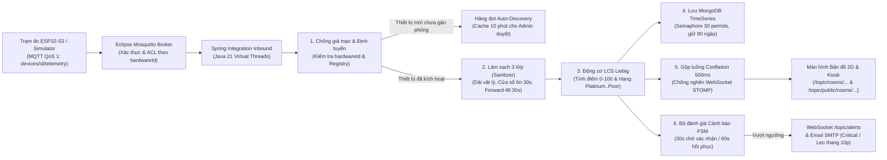
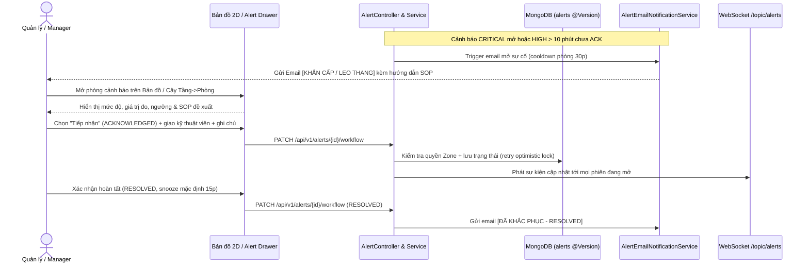
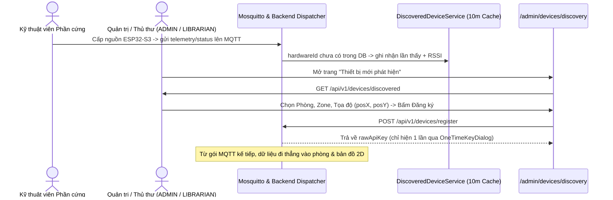
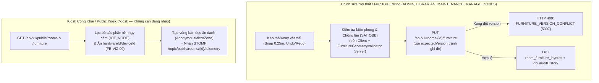

# Luồng Hoạt Động Hệ Thống / End-to-End System Flows

> **Đối tượng đọc / Audience:** Product Manager, BA, Quản lý Thư viện, Kỹ sư mới làm quen kiến trúc.  
> **Cơ sở kiểm chứng / Verification:** Dựa trên [`MqttMessageDispatcherService`](../../src/main/java/com/example/AIoTLibTQB/service/MqttMessageDispatcherService.java), [`TelemetryConflationService`](../../src/main/java/com/example/AIoTLibTQB/service/TelemetryConflationService.java), [`AlertRuleEngine`](../../src/main/java/com/example/AIoTLibTQB/service/AlertRuleEngine.java), [`AlertServiceImpl`](../../src/main/java/com/example/AIoTLibTQB/service/AlertServiceImpl.java), [`RoomService`](../../src/main/java/com/example/AIoTLibTQB/service/RoomService.java) và [`PublicController`](../../src/main/java/com/example/AIoTLibTQB/controller/PublicController.java).

---

## 1. Luồng Thu Thập Dữ Liệu, Tính Điểm & Cảnh Báo Thời Gian Thực / Real-Time Telemetry, Scoring & Alert Flow

**[VI]** Khi cảm biến ngoài phòng đọc hoặc bộ giả lập gửi một gói đo qua MQTT, dữ liệu đi qua 7 bước kiểm soát chất lượng trước khi tới màn hình của người quản lý trong vòng chưa tới 1 giây.  
**[EN]** When a sensor node or simulator publishes an MQTT packet, the message passes through 7 quality-control stages before reaching the operator's screen in sub-second latency.

---

## 2. Luồng Vận Hành & Xử Lý Sự Cố Của Quản Lý Thư Viện / Manager Incident Handling Flow

**[VI]** Khi phòng đọc chuyển sang trạng thái cảnh báo, Quản lý thư viện không cần hiểu cấu trúc cảm biến mà thao tác trực tiếp trên **Alert Inspector Drawer** của Bản đồ nhiệt 2D (`PATCH /api/v1/alerts/{id}/workflow`).  
**[EN]** When a room enters an alert state, Library Managers act directly inside the 2D Heatmap **Alert Inspector Drawer** (`PATCH /api/v1/alerts/{id}/workflow`), updating workflow state with optimistic version locking (`@Version`).

---

## 3. Luồng Hòa Mạng Thiết Bị Mới (Plug-and-Play Auto-Discovery) / New Device Onboarding Flow

**[VI]** Đội phần cứng chỉ cần nạp firmware với `hardwareId` duy nhất và cấp nguồn; không cần cấu hình ID cơ sở dữ liệu trước khi lắp đặt tại phòng đọc.  
**[EN]** Hardware engineers only flash a unique `hardwareId` and power on the node; Admin approval binds it to a library room without pre-creating database records.

---

## 4. Luồng Chỉnh Sửa Nội Thất Tỉ Lệ 1:100 & Kiosk Công Khai / 1:100 Furniture Layout & Public Kiosk Flow

**[VI]** Hệ thống tách biệt hoàn toàn quyền thiết kế mặt bằng (dành cho Kỹ thuật/Quản trị) với luồng tra cứu công khai của Sinh viên tại Kiosk sảnh thư viện (`FE-VIZ-09`).  
**[EN]** Furniture editing (for authorized staff) is isolated via versioned validation, while the Public Kiosk stream strips all hardware identifiers (`FE-VIZ-09`).

