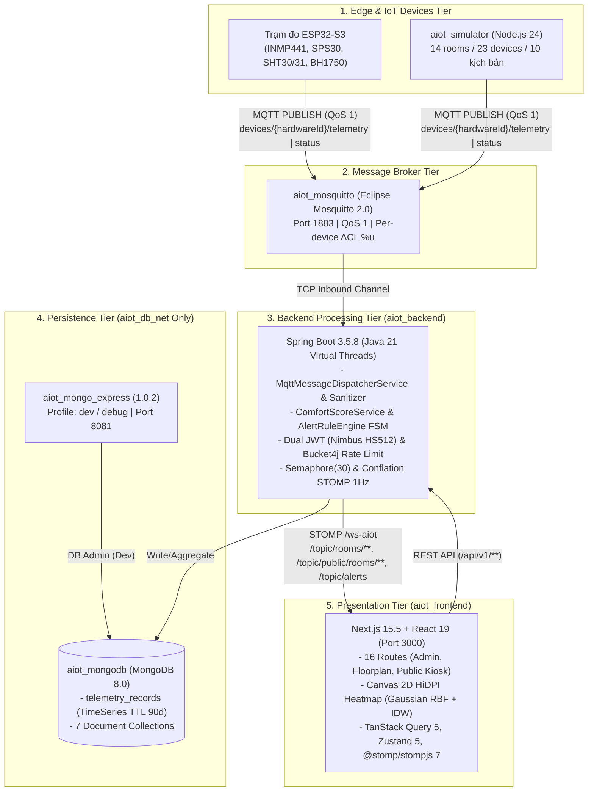

# 02 — Kiến Trúc Hệ Thống & Công Nghệ

> **Tài liệu**: `docs/02-architecture.md` | **Phiên bản**: 2.1 | **Mã nguồn chính**: `pom.xml`, `frontend/package.json`, `docker-compose.yml`
>
> [!NOTE]
> **TL;DR**: **AIoTLibTQB** theo kiến trúc **Modular Event-Driven Monolith** 5 tầng, đóng gói bằng **6 Docker services** trên **2 mạng cầu nối cách ly** (`aiot_app_net` & `aiot_db_net`). Dữ liệu IoT đi qua Mosquitto MQTT QoS 1 → Java 21 Virtual Threads → MongoDB 8.0 TimeSeries + STOMP WebSocket 1Hz tới Next.js 15 Canvas 2D.

---

## 1. Sơ đồ Kiến trúc Tổng thể (C4 Context & Containers)

---

## 2. Tech Stack Chi tiết (Khớp `pom.xml` & `frontend/package.json`)

| Tầng | Thành phần | Thư viện / Phiên bản thực tế | Vai trò chính |
| :--- | :--- | :--- | :--- |
| **Backend** | Runtime & Web | Spring Boot `3.5.8`, Java `21` (Virtual Threads) | REST API, IoT ingestion, background watchdogs |
| **Backend** | Security | `nimbus-jose-jwt` `10.0.2`, `oauth2-resource-server`, `spring-security-crypto` (`BCrypt(10)`) | Dual JWT `HS512`, `CustomJwtDecoder`, RBAC `@PreAuthorize` |
| **Backend** | Rate Limit & Cache | `bucket4j-core` `8.10.1`, `caffeine` | Bảo vệ brute-force/public API, 7 vùng đệm in-memory |
| **Backend** | Messaging | `spring-integration-mqtt`, `org.eclipse.paho.client.mqttv3` `1.2.5`, `spring-boot-starter-websocket` | MQTT inbound consumer & STOMP simple broker (`/ws-aiot`) |
| **Backend** | Mapping & Utils | `mapstruct` `1.5.5.Final`, `lombok` `1.18.38`, `spring-boot-starter-actuator` | Map Entity ↔ DTO, health/info probes |
| **Database** | Storage Engine | MongoDB `8.0` (`spring-boot-starter-data-mongodb`) | Native TimeSeries (`Granularity.SECONDS`), `$dateTrunc` |
| **Frontend** | Core UI Framework | `next` `^15.5.28`, `react` `^19.0.0`, `typescript` `^5.6.3`, `tailwindcss` `^3.4.14` | App Router 16 trang, Light Mode Academic UI |
| **Frontend** | State & Realtime | `zustand` `^5.0.1`, `@tanstack/react-query` `^5.59.0`, `@stomp/stompjs` `^7.0.0`, `zod` `^3.23.8` | RAM auth state, single-flight refresh, STOMP cache patch |
| **Frontend** | Testing | `vitest` `^2.1.4`, `@testing-library/react` `^16.0.1` | 33 unit tests (`core-standard.test.ts`) |

---

## 3. Hạ tầng Docker Compose & Phân vùng Mạng (`docker-compose.yml`)

Hệ thống định nghĩa **6 services** phân tách qua **2 bridge networks** để cô lập hoàn toàn CSDL khỏi tầng giao diện và tầng giả lập:

| Service (`container_name`) | Image / Build | Mạng Docker | Cổng Host Binding | Giới hạn CPU / RAM | Profile / Healthcheck |
| :--- | :--- | :--- | :--- | :--- | :--- |
| **`mongodb`** (`aiot_mongodb`) | `mongo:8.0` | `aiot_db_net` | `127.0.0.1:27017` | `1.50` CPU / `1024M` | Luôn bật / `mongosh ping` |
| **`mongo-express`** (`aiot_mongo_express`) | `mongo-express:1.0.2` | `aiot_db_net` | `127.0.0.1:8081` | `0.50` CPU / `256M` | `profiles: ["dev", "debug"]` |
| **`mosquitto`** (`aiot_mosquitto`) | `eclipse-mosquitto:2.0` | `aiot_app_net` | `127.0.0.1:1883` | `0.50` CPU / `256M` | Luôn bật / `mosquitto_sub $SYS` |
| **`backend`** (`aiot_backend`) | `./Dockerfile` | `aiot_db_net` + `aiot_app_net` | `8080:8080` | `1.50` CPU / `1024M` | Luôn bật / `/actuator/health` |
| **`frontend`** (`aiot_frontend`) | `./frontend/Dockerfile` | `aiot_app_net` | `3000:3000` | `1.00` CPU / `512M` | Luôn bật / `HTTP 127.0.0.1:3000` |
| **`simulator`** (`aiot_simulator`) | `./tools/iot-simulator/Dockerfile` | `aiot_app_net` | *(không mở cổng)* | `0.50` CPU / `256M` | Luôn bật / chạy mặc định `demo` |

> [!IMPORTANT]
> **Nguyên tắc an ninh biên mạng**:
> - `aiot_frontend` và `aiot_simulator` chỉ nằm trong `aiot_app_net`, hoàn toàn không có tuyến mạng trực tiếp tới `aiot_mongodb` (`aiot_db_net`).
> - MongoDB (`27017`), Mongo Express (`8081`) và Mosquitto (`1883`) chỉ bind trên loopback `127.0.0.1`, không phơi nhiễm ra `0.0.0.0`.
> - Khi chia sẻ demo ra Internet qua Cloudflare Tunnel, [`tools/cloudflared/gateway.js`](../tools/cloudflared/gateway.js) mở unified gateway tại cổng `4000` điều hướng `/api/`, `/ws-`, `/actuator/` về `:8080` và `/*` về `:3000` (chi tiết tại [`docs/12-runbook.md`](./12-runbook.md)).

---

## 4. Quyết định Kiến trúc Cốt lõi (Architecture Decision Records — ADRs)

| Mã ADR | Quyết định lựa chọn | Phương án loại trừ | Lý do & Đánh đổi kỹ thuật |
| :--- | :--- | :--- | :--- |
| **ADR-01** | **MongoDB 8.0 Native TimeSeries** | InfluxDB / PostgreSQL TimescaleDB | Hợp nhất nghiệp vụ + chuỗi thời gian trong 1 CSDL `aiot_identity_db`; nén columnar bucket $70\%-85\%$, TTL tự hủy 90 ngày ở tầng kernel và `$dateTrunc` downsampling. |
| **ADR-02** | **Java 21 Virtual Threads** | Spring WebFlux (Reactor) | Giữ mã tuần tự (imperative) dễ debug, giữ trọn `SecurityContext`/stack trace tự nhiên; tránh `synchronized` quanh I/O và khống chế ghi DB bằng `Semaphore(30, true)`. |
| **ADR-03** | **Eclipse Mosquitto 2.0 QoS 1 + ACL `%u`** | HTTP REST Webhook | Header MQTT 2–4 bytes tiết kiệm băng thông Wi-Fi, LWT phát hiện rớt nguồn tức thì và cô lập tuyệt đối topic ghi theo từng `hardwareId`. |
| **ADR-04** | **Next.js 15 + Canvas 2D HiDPI Native** | Leaflet / OpenLayers / Mapbox | Mặt bằng nội thất `76.0m × 57.2m` không dùng tọa độ GPS; Canvas vẽ trực tiếp trên nền SVG CAD 1:100 đạt 60 FPS với 0 KB bundle thư viện GIS. |
| **ADR-05** | **Dual JWT HS512 + RTR + `credentialsUpdatedAt`** | Session Cookie / Stateless JWT thuần | Không dùng cookie tránh CSRF; Refresh Token dùng 1 lần (`invalidated_tokens` TTL `0s`); đổi mật khẩu vô hiệu hóa tức thì mọi token phát hành trước đó. |
| **ADR-06** | **STOMP 1Hz Conflation + Query Fallback** | Polling thuần / Push raw không giới hạn | `TelemetryConflationService` gom bản tin 1Hz/phòng chống bão render; khi mất WebSocket, TanStack Query tự fallback HTTP polling. |
| **ADR-07** | **Adaptive Per-Room Thresholds + Liebig LCS** | Ngưỡng tĩnh toàn tòa nhà + TB cộng | Cho phép chỉnh ngưỡng riêng từng phòng qua `RoomThresholdConfig`, tái phân bổ trọng số khi thiếu cảm biến và chặn điểm ảo bằng Liebig gating. |
| **ADR-08** | **Offscreen Bilinear Gaussian RBF + Anonymous Micro-Zones** | Tô màu phẳng phòng / Lộ `hardwareId` | Đạt 60 FPS trên mặt bằng 5 tầng CAD; ẩn danh hóa phân khu bàn đọc cho sinh viên & Kiosk công khai (`FE-VIZ-09`). |

---

## 5. Tài liệu Liên quan

- Công thức chấm điểm chi tiết: [`docs/03-lcs-algorithm.md`](./03-lcs-algorithm.md)
- Đường ống MQTT, 7 vùng đệm RAM & Alert FSM: [`docs/04-ingestion-and-alerts.md`](./04-ingestion-and-alerts.md)
- Schema CSDL MongoDB 8.0: [`docs/05-data-model.md`](./05-data-model.md)
- Bản đồ nhiệt Không gian 2D CAD 5 tầng: [`docs/09-spatial-heatmap-2d.md`](./09-spatial-heatmap-2d.md)
