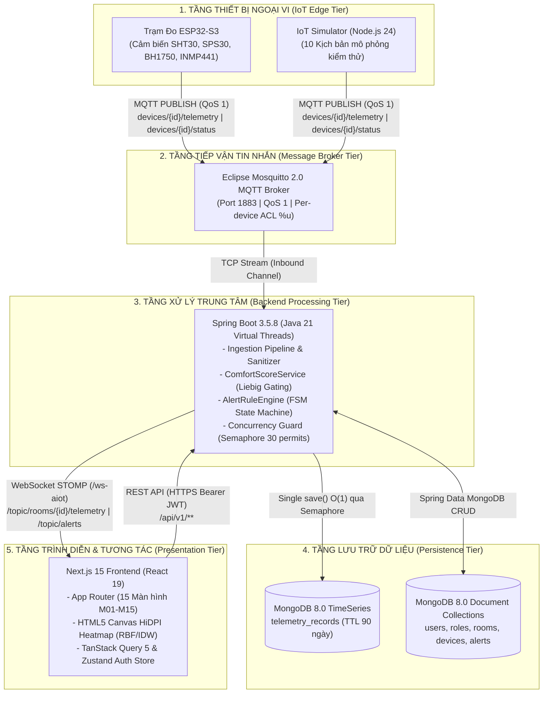
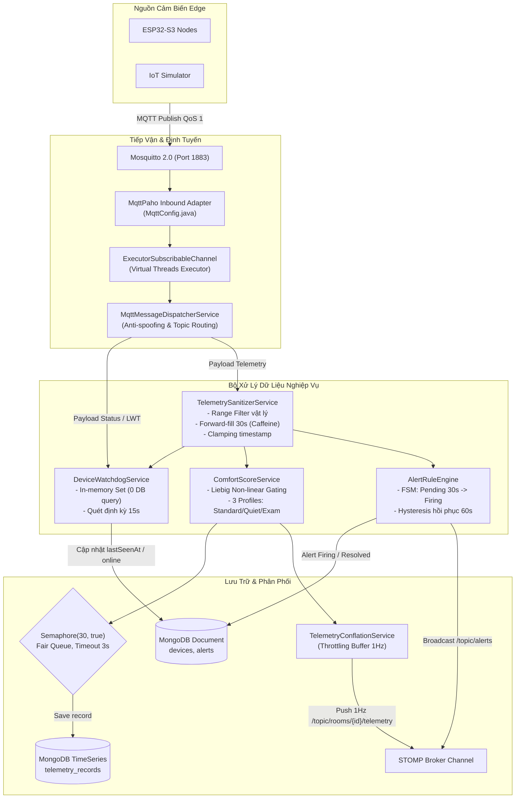
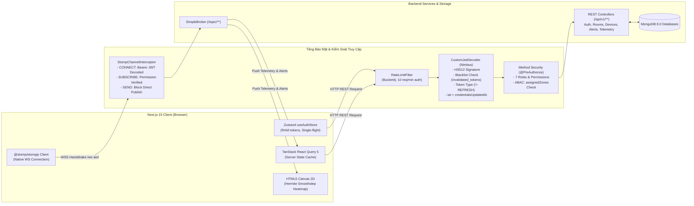
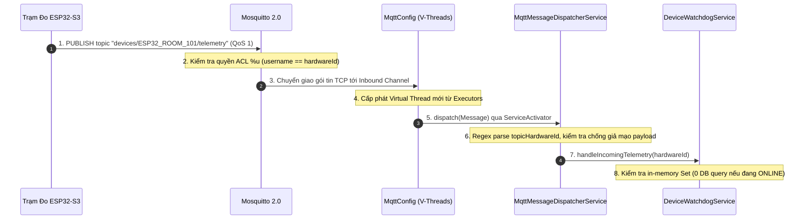
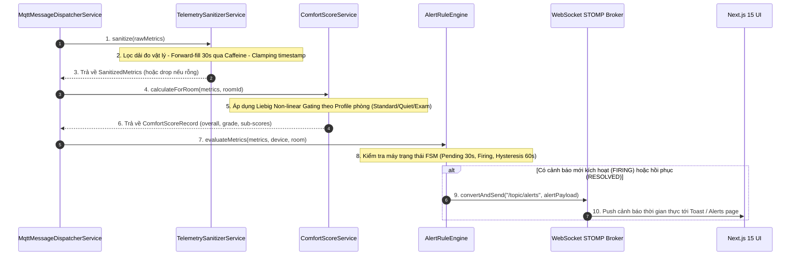
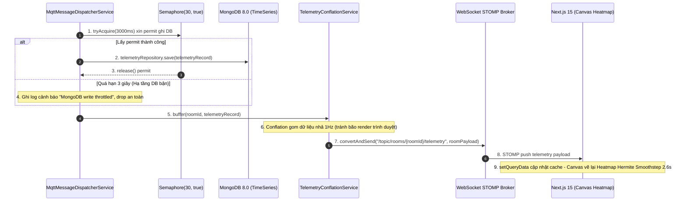
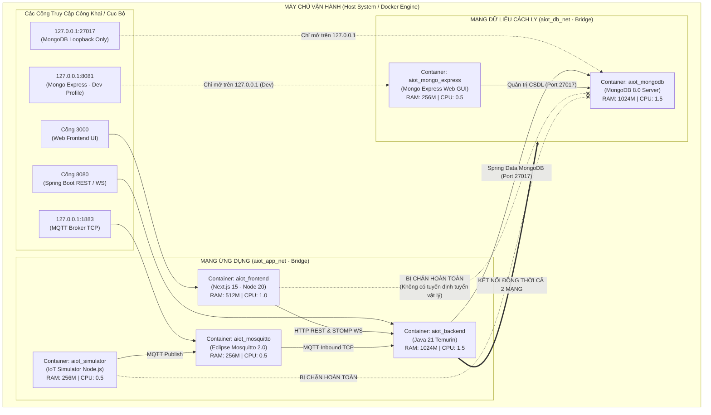

# KIẾN TRÚC HỆ THỐNG & LUỒNG DỮ LIỆU TOÀN TRÌNH (AIoTLibTQB)

> **Dự án**: AIoTLibTQB — Hệ thống Giám sát Vi khí hậu & Âm học Thông minh Thư viện Tạ Quang Bửu  
> **Tài liệu**: `docs/02-architecture.md`  
> **Phiên bản kiến trúc**: 2.0 (Kiểm chứng thực tế mã nguồn)  
> **Trạng thái**: Đã đối chiếu 100% với `docker-compose.yml`, Spring Boot backend và Next.js frontend

---

## 1. MỤC TIÊU

Tài liệu này cung cấp bản thiết kế kiến trúc toàn diện của hệ sinh thái **AIoTLibTQB**, phục vụ các mục tiêu chính:
1. Mô tả trực quan **Kiến trúc Tổng thể (Overall System Architecture)** và sự kết nối giữa 5 tầng công nghệ: Phần cứng IoT $\to$ Tiếp vận Tin nhắn $\to$ Đường ống Xử lý & Dịch vụ $\to$ Cơ sở Dữ liệu $\to$ Giao diện Người dùng.
2. Trình bày chi tiết **Luồng Dữ liệu Toàn trình (End-to-End Data Flow)** từ thời điểm cảm biến vật lý lấy mẫu đến khi điểm tiện nghi hiển thị trên bản đồ nhiệt 2D của trình duyệt người dùng với độ trễ dưới 1 giây.
3. Phân tích tường minh **Lý do lựa chọn công nghệ (Tech Stack Rationales / ADRs)**: Tại sao chọn Java 21 Virtual Threads thay vì Reactive WebFlux? Tại sao chọn MongoDB 8.0 TimeSeries thay vì InfluxDB hay PostgreSQL? Tại sao dùng Mosquitto MQTT QoS 1 thay vì HTTP Webhook?
4. Đặc tả **Cấu trúc Mạng & Phân vùng Bảo mật (Network Topology & Security Boundaries)** theo `docker-compose.yml`, bảo đảm nguyên tắc cô lập CSDL và bảo vệ tài nguyên hệ thống.

---

## 2. ĐỐI TƯỢNG ĐỌC

- **Kiến trúc sư Phần mềm (Software Architects) & Trưởng nhóm Kỹ thuật (Tech Leads)**: Nắm vững cấu trúc phân tầng, các quyết định thiết kế cốt lõi và giới hạn tải đồng thời.
- **Lập trình viên Backend & Data Engineers**: Hiểu rõ chu trình xử lý tin nhắn Inbound, cơ chế điều tiết Semaphore và cách tương tác với CSDL TimeSeries.
- **Lập trình viên Frontend & Giao diện**: Hiểu cơ chế đẩy tin STOMP WebSocket, điều tiết 1Hz conflation và đồng bộ state.
- **Kỹ sư Hạ tầng & Vận hành (DevOps / SRE / SecOps)**: Nắm bắt kiến trúc mạng ảo Docker, phân bổ hạn ngạch CPU/RAM và các cổng phơi nhiễm bảo mật.

---

## 3. NỘI DUNG CHI TIẾT

### 3.1. Sơ đồ Kiến trúc Tổng thể & Phân rã Các Tầng (System Architecture Diagrams)

Hệ thống AIoTLibTQB được tổ chức theo kiến trúc phân tầng hướng sự kiện (Event-Driven Micro-Monolith) kết hợp xử lý dữ liệu dòng (Streaming Ingestion). Để đảm bảo tính trực quan và khả năng đọc hiểu, kiến trúc được phân tách thành sơ đồ phân tầng cấp cao kèm theo các sơ đồ phân rã chi tiết cho từng miền nghiệp vụ trọng yếu.

#### Sơ đồ 1A: Kiến Trúc Phân Tầng Tổng Thể Hệ Thống (High-Level 5-Tier Overview)
*Mục đích:* Cung cấp góc nhìn kiến trúc 5 tầng chuẩn mực, làm nổi bật giao thức truyền thông và ranh giới trách nhiệm giữa các tầng.



#### Sơ đồ 1B: Phân Rã Chi Tiết Tầng Xử Lý Trung Tâm & Ingestion (Deep-Dive Core Backend)
*Mục đích:* Làm rõ luồng đi bên trong Spring Boot Ingestion Pipeline, Virtual Threads, Sanitizer, Liebig Gating và rào chắn đồng thời Semaphore.



#### Sơ đồ 1C: Phân Rã Chi Tiết Tầng Bảo Mật, API & Trình Diễn (Deep-Dive Security & Presentation)
*Mục đích:* Làm rõ cơ chế kiểm soát truy cập từ Web Client qua RateLimiter, Nimbus JWT Decoder, RBAC Filter và kênh STOMP thời gian thực.



---

### 3.2. Luồng Dữ liệu Toàn trình Tuần tự 3 Giai đoạn (End-to-End Data Flow Sequences)

Để đảm bảo khả năng theo dõi trực quan và kiểm soát độ phức tạp trên từng chặng dữ liệu, luồng toàn trình từ trạm cảm biến ESP32-S3 qua máy chủ đến khi hiển thị trên giao diện người dùng được phân rã thành chuỗi 3 sơ đồ tuần tự theo từng giai đoạn xử lý tự nhiên:

#### Sơ đồ 2A: Giai Đoạn 1 — Tiếp Nhận & Định Tuyến Ngoại Vi (Edge Ingestion Handshake)
*Mục đích:* Làm rõ quá trình thiết bị gửi tin qua MQTT Broker, kiểm tra phân quyền ACL `%u`, tiếp nhận qua Java 21 Virtual Threads và định tuyến chống giả mạo.



#### Sơ đồ 2B: Giai Đoạn 2 — Làm Sạch, Tính Điểm Tiện Nghi & Cảnh Báo (Sanitization & Scoring)
*Mục đích:* Làm rõ chu trình lọc dải đo vật lý, bù suy hao forward-fill 30s qua Caffeine Cache, tính điểm Liebig theo Profile phòng và đánh giá FSM cảnh báo vi khí hậu.



#### Sơ đồ 2C: Giai Đoạn 3 — Điều Tiết Ghi DB & Phát Thời Gian Thực (Persistence & Real-time Delivery)
*Mục đích:* Làm rõ rào chắn Semaphore 30 permits kiểm soát lưu lượng ghi TimeSeries, bộ đệm Conflation điều tiết tần suất 1Hz và hiển thị mượt mà trên Canvas 2D.



#### Phân tích Chi tiết 10 Bước Xử lý Trọng yếu:

1. **Bước 1-2: Phát & Cách ly Tin nhắn tại Broker**:
   - Trạm ESP32-S3 gửi gói JSON telemetry theo chu kỳ chuẩn 5s-10s với QoS 1 (`spec_miner_iot/analysis.md:81-105`).
   - Mosquitto đối chiếu quy tắc ACL `%u`: Mạch có tài khoản `ESP32_ROOM_101` chỉ được phép ghi vào topic `devices/ESP32_ROOM_101/telemetry`, ngăn chặn mọi hành vi nghe lén hoặc ghi đè dữ liệu của phòng khác (`mosquitto/config/acl.conf:15-18`).
2. **Bước 3-5: Nhận Tin Trên Nền Java 21 Virtual Threads**:
   - `MqttPahoMessageDrivenChannelAdapter` hứng tin và chuyển vào `ExecutorSubscribableChannel(Executors.newVirtualThreadPerTaskExecutor())` (`MqttConfig.java:42-44`). Mỗi gói tin đến được kích hoạt trên một Virtual Thread độc lập, đạt thông lượng hàng chục nghìn tin/giây mà không làm cạn kiệt luồng hệ điều hành.
3. **Bước 6: Kiểm tra Chống Giả mạo Định danh (Anti-Spoofing)**:
   - `MqttMessageDispatcherService.java:187-191` so sánh `hardware_id` trong nội dung JSON với token `topicHardwareId` trên đường dẫn topic MQTT. Nếu không trùng khớp, bản tin lập tức bị hủy bỏ và ghi log an ninh.
4. **Bước 7-9: Làm sạch Dữ liệu 3 Lớp (Data Sanitization)**:
   - `TelemetrySanitizerService.java:24-179` thực thi:
     - Lọc ngưỡng dải đo vật lý của 9 cảm biến (ví dụ: nhiệt độ $0-60^\circ\text{C}$, tiếng ồn $30-110$ dBA, ánh sáng $0-65535$ Lux).
     - Cơ chế bù suy hao **30s forward-fill** qua bộ đệm Caffeine Cache. Nếu cảm biến gửi null hoặc giá trị nhiễu nhưng trong 30 giây trước có số đo hợp lệ, hệ thống tự động điền bù.
     - **Ngoại lệ tiếng ồn đỉnh**: Hàm `sanitizePeakWithoutForwardFill` tuyệt đối không forward-fill `noisePeak` để bảo toàn tính tức thời của xung âm thanh.
     - Kẹp timestamp chuẩn hóa: Kẹp về thời gian máy chủ nếu thời gian thiết bị trước năm 2020 (mất nguồn pin RTC) hoặc chạy nhanh hơn máy chủ $> 60$ giây.
5. **Bước 10-11: FSM Watchdog Trạng thái Thiết bị (Zero DB Overhead)**:
   - `DeviceWatchdogService.java:184-208` duy trì tập hợp in-memory `offlineDeviceHardwareIds`. Với các bản tin của mạch đang hoạt động bình thường, phương thức trả về `false` và không thực hiện bất kỳ câu truy vấn CSDL nào, tối ưu hóa triệt để I/O.
6. **Bước 12-14: Động cơ Điểm Tiện nghi Liebig (LCS Engine)**:
   - `ComfortScoreService.java:84-157` tra cứu loại phòng (`STUDY_ROOM`, `BOOK_STORAGE`, `CIRCULATION_HALL`) và tính toán điểm thành phần. Áp dụng công thức Liebig Non-linear Gating: Nếu có một chỉ số sụp đổ (ví dụ tiếng ồn 0 điểm), toàn bộ điểm LCS bị kéo sập xuống tối đa $30\%$ điểm trung bình.
7. **Bước 15-18: Động cơ Cảnh báo Vi khí hậu (Alert Rule Engine FSM)**:
   - `AlertRuleEngine.java:107-250` áp dụng máy trạng thái 4 bước: `PENDING` (lọc nhiễu trong 30 giây), `FIRING` (kích hoạt cảnh báo chính thức), `ACKNOWLEDGED` (thủ thư đã nhận việc) và `RESOLVED` (tự động giải tỏa với độ trễ trễ Hysteresis 60 giây).
8. **Bước 19-22: Kiểm soát Tải Đồng Thời Bằng Semaphore**:
   - `MqttMessageDispatcherService.java:80, 270-301` sử dụng `Semaphore(30, true)`. Tối đa 30 kết nối được phép ghi đồng thời vào MongoDB. Nếu CSDL bị nghẽn quá hạn chờ 3 giây (`MONGO_ACQUIRE_TIMEOUT_MS = 3000`), bản tin bị drop an toàn kèm log WARN, bảo vệ ứng dụng khỏi hiện tượng tràn bộ nhớ.
9. **Bước 23-25: Điều tiết STOMP Conflation 1Hz**:
   - Để tránh việc trình duyệt bị đơ do nhận hàng chục gói tin mỗi giây từ nhiều trạm đo trong cùng phòng, `TelemetryConflationService.java` gom tin và điều tiết nhịp đẩy STOMP ở tần suất tối đa 1Hz/phòng lên topic `/topic/rooms/{roomId}/telemetry`.
10. **Bước 26: Hiển thị Bản đồ Nhiệt Canvas 2D**:
    - Trình duyệt Next.js nhận bản tin STOMP, hàm `setQueryData` của React Query lập tức cập nhật state mà không cần gọi lại REST API. HTML5 Canvas tính toán ma trận mật độ và vẽ lại Heatmap vi khí hậu bằng thuật toán nội suy Gaussian RBF / IDW mượt mà 60 FPS (`frontend/src/features/floorplan/heatmapMath.ts`).

---

### 3.3. Phân tích Lý do Lựa chọn Công nghệ (Tech Stack Rationales / ADRs)

Mỗi quyết định công nghệ trong AIoTLibTQB đều dựa trên các phân tích đánh đổi kỹ thuật (Trade-off Analysis) thực tế:

```
+----------------------------------------------------------------------------------------------------+
|                                    BẢNG ĐỐI CHIẾU QUYẾT ĐỊNH CÔNG NGHỆ                             |
+------------------------+----------------------------+----------------------------------------------+
| Công nghệ Lựa chọn     | Công nghệ Cân nhắc         | Lý do Lựa chọn Cốt lõi & Minh chứng Đánh đổi |
+------------------------+----------------------------+----------------------------------------------+
| Java 21                | Spring WebFlux             | Code tuần tự dễ debug, stack-trace tự nhiên, |
| Virtual Threads        | (Reactive Programming)     | không bị rò rỉ ThreadLocal; Virtual Threads  |
|                        |                            | đạt hàng vạn concurrent tasks nhẹ nhàng.     |
+------------------------+----------------------------+----------------------------------------------+
| MongoDB 8.0            | InfluxDB hoặc              | Hợp nhất CSDL: Cùng 1 database quản lý cả    |
| TimeSeries Native      | PostgreSQL (TimescaleDB)   | Metadata (users, rooms) và Telemetry; tự động|
|                        |                            | nén bucket, TTL 90 ngày; hỗ trợ $dateTrunc.  |
+------------------------+----------------------------+----------------------------------------------+
| Next.js 15 App Router  | Single Page App (Vite/CRA) | Render tối ưu, hỗ trợ Server Components,     |
| + React 19 + Canvas    | + Leaflet/OpenLayers       | Canvas Native vẽ Heatmap 60 FPS không cần    |
|                        |                            | nhồi thư viện GIS nặng hàng megabytes.       |
+------------------------+----------------------------+----------------------------------------------+
| Mosquitto 2.0 MQTT     | HTTP REST Webhooks         | Tiết kiệm băng thông (header chỉ 2 bytes),   |
| (QoS 1, ACL %u)        |                            | QoS 1 chống rơi tin, di chúc LWT phát hiện   |
|                        |                            | mất nguồn tức thì, bảo mật phân lập node.    |
+------------------------+----------------------------+----------------------------------------------+
```

#### ADR-001: Lựa chọn MongoDB 8.0 Native TimeSeries Thay Thế Polyglot PostgreSQL / TimescaleDB
- **Bối cảnh & Lịch sử Kiến trúc**:
  - Trong dự án tiền thân (*Listen_Project*), hệ thống ban đầu được thiết kế sử dụng PostgreSQL kết hợp phần mở rộng TimescaleDB cho chuỗi thời gian, song song với một CSDL tài liệu khác cho metadata.
  - Phân tích đánh giá thực tế chỉ ra rằng kiến trúc đa CSDL (Polyglot Persistence) này làm tăng gấp đôi chi phí vận hành: cần duy trì 2 connection pool, 2 cơ chế backup, 2 công cụ di chuyển dữ liệu (migration scripts) và phức tạp hóa việc đồng bộ giao dịch khi xóa phòng/thiết bị.
- **Tại sao không chọn InfluxDB hoặc TimescaleDB**:
  - InfluxDB có cú pháp truy vấn Flux/InfluxQL riêng biệt, không hỗ trợ quan hệ thực thể, đòi hỏi bảo trì cụm máy chủ riêng.
  - TimescaleDB trên PostgreSQL đòi hỏi cấu hình bảng phân vùng hypertable phức tạp, tốn dung lượng RAM cho chỉ mục B-Tree, và khó tích hợp mềm dẻo với các cấu trúc chỉ số âm học đa chiều biến đổi.
- **Lý do chuẩn hóa trên MongoDB 8.0 TimeSeries**:
  - **Hợp nhất một CSDL duy nhất**: Toàn bộ dữ liệu nghiệp vụ (users, roles, rooms, devices, alerts) và dữ liệu đo đạc (telemetry_records) được quản lý tập trung trong CSDL `aiot_identity_db`.
  - **Nén tự động dạng Bucket (Bucket Compression)**: MongoDB 8.0 tự động nhóm các số đo có cùng `metadata` (`deviceId`, `roomId`) trong cùng khung thời gian (`granularity: SECONDS`) vào các khối nén nén trục cột, tiết kiệm $70\% - 85\%$ dung lượng lưu trữ so với mô hình bảng quan hệ truyền thống.
  - **Cơ chế tự hủy TTL cấp kernel**: Cấu hình `expireAfter = "7776000s"` (90 ngày) được MongoDB Background Task thực thi tự động ở tầng kernel CSDL (`TelemetryRecord.java:16-22`), loại bỏ hoàn toàn nhu cầu viết và bảo trì script cron job xóa dữ liệu cũ.
  - **Aggregation Pipeline mạnh mẽ với `$dateTrunc`**: Cho phép gom nhóm dữ liệu theo các khung thời gian `15m`, `1h`, `1d` trực tiếp trên server MongoDB (`TelemetryService.java:146-183`), trả về kết quả downsampling tức thì cho biểu đồ mà không làm quá tải CPU máy chủ backend.

#### ADR-002: Java 21 Virtual Threads (Project Loom) vs Reactive Programming (WebFlux)
- **Bối cảnh**: Hệ thống tiếp nhận luồng dữ liệu IoT đồng thời từ hàng trăm trạm cảm biến, thực hiện các thao tác I/O như kiểm tra cache, đánh giá FSM và ghi CSDL.
- **Tại sao không chọn Spring WebFlux / Reactor**:
  - Mô hình lập trình phản ứng (Reactive) chia nhỏ luồng xử lý thành các chuỗi toán tử (`mono.flatMap()`, `flux.map()`), khiến việc gỡ lỗi (debugging) cực kỳ khó khăn, call-stack bị phân mảnh, và nguy cơ nghẽn ngầm khi vô tình gọi một thư viện chặn (blocking call).
  - Không tương thích tự nhiên với các công cụ kiểm toán, logging (`MDC`) và bảo mật Spring Security vốn dựa trên `ThreadLocal`.
- **Lý do chọn Java 21 Virtual Threads**:
  - Cho phép viết mã tuần tự (imperative code) truyền thống: dễ đọc, dễ viết unit test, stack trace minh bạch 100%.
  - Khả năng tạo ra hàng triệu luồng ảo với chi phí RAM cực thấp (~vài KB/thread thay vì 1MB của Platform Thread), chuyển ngữ cảnh (context switch) diễn ra hoàn toàn trong không gian người dùng của JVM.
  - **Lưu ý triển khai bắt buộc**: Tránh tuyệt đối từ khóa `synchronized` (sử dụng cấu trúc Lock-free và Semaphore) để loại trừ triệt để nguy cơ ghim luồng nền tảng (*Carrier Thread Pinning*).

#### ADR-003: Next.js 15 App Router + React 19 + HTML5 Canvas Heatmap
- **Bối cảnh**: Giao diện cần phục vụ đa mục đích: Trang tổng quan quản trị, Màn hình TV Kiosk sảnh thư viện chạy 24/7 và Mặt bằng 2D tương tác thời gian thực.
- **Tại sao không dùng Leaflet / OpenLayers**:
  - Các thư viện GIS (Bản đồ số) như Leaflet hay Mapbox được thiết kế cho hệ tọa độ địa lý toàn cầu (kinh độ/vĩ độ GPS), rất cồng kềnh (dung lượng bundle lớn) và khó tùy biến cho mặt bằng kiến trúc nội thất tòa nhà 2D.
- **Lý do chọn Next.js 15 + HTML5 Canvas**:
  - Kiến trúc App Router của Next.js 15 kết hợp React 19 cung cấp khả năng tải trang siêu tốc, quản lý layout lồng nhau và cấu hình bảo mật tiêu chuẩn (`next.config.ts:7-24`).
  - Bản đồ nhiệt Heatmap được tự vẽ trực tiếp trên thẻ `<canvas>` bằng các thuật toán toán học thuần túy: **Gaussian Radial Basis Function (RBF)** và **Inverse Distance Weighting (IDW)** (`frontend/src/features/floorplan/heatmapMath.ts`). Giải thuật này tận dụng GPU trình duyệt, đạt tốc độ dựng hình mượt mà 60 FPS, hỗ trợ màn hình độ phân giải cao HiDPI Retina mà dung lượng thư viện bằng 0.

#### ADR-004: Eclipse Mosquitto 2.0 MQTT QoS 1 vs HTTP REST Webhook
- **Bối cảnh**: Các mạch ESP32-S3 kết nối qua mạng không dây Wi-Fi khuôn viên trường đại học vốn thường xuyên có biến động sóng và nguy cơ mất gói.
- **Tại sao không dùng HTTP REST Webhook**:
  - Giao thức HTTP/1.1 có chi phí tiêu hao (overhead) tiêu đề rất lớn: mỗi yêu cầu POST HTTP mang theo hàng trăm bytes header (User-Agent, Content-Type, Host...), lãng phí băng thông và tiêu tốn năng lượng vi điều khiển.
  - HTTP không có cơ chế phát hiện ngắt kết nối vật lý tức thì (phải chờ timeout dài) và không có cơ chế lưu đệm đảm bảo phân phối khi đường truyền chập chờn.
- **Lý do chọn Mosquitto 2.0 MQTT QoS 1**:
  - Giao thức nhị phân siêu nhẹ: Header gói tin chỉ từ 2 đến 4 bytes, tối ưu hóa tối đa cho các node IoT phần cứng.
  - Cấp độ dịch vụ **QoS 1 (At Least Once Delivery)** đảm bảo gói tin được gửi tới Broker thành công thông qua bắt tay `PUBACK`.
  - Tính năng **Last Will and Testament (LWT)**: Mạch đăng ký sẵn thông điệp di chúc khi vừa kết nối. Nếu mạch mất nguồn đột ngột hoặc rớt Wi-Fi, Mosquitto tự động phát tin báo tử `{"status":"offline","reason":"lwt"}` vào topic status, giúp hệ thống phát hiện sự cố ngay tức khắc.

#### 3.3.5. Bài Học Thiết Kế Tham Chiếu Từ Nền Tảng Nguồn Mở (Benchmarking Lessons)
Qua khảo sát chuyên sâu 4 nền tảng giám sát IoT mã nguồn mở tiêu biểu (`ThingsBoard CE`, `AirGradient`, `openSenseMap`, `OpenRemote`), kiến trúc AIoTLibTQB đã chắt lọc các mẫu thiết kế tối ưu và phòng tránh các sai lầm kinh điển:

1. **Từ ThingsBoard Community Edition**:
   - *Áp dụng*: Chuẩn hóa hệ tọa độ tương đối $[0.0, 1.0]$ cho vị trí trạm cảm biến ($posX, posY$) trên bản đồ sàn, giúp giao diện hiển thị co giãn chuẩn xác trên mọi độ phân giải màn hình; Vòng đời cảnh báo vi khí hậu 4 trạng thái (`PENDING` $\to$ `FIRING` $\to$ `ACKNOWLEDGED` $\to$ `RESOLVED`) với độ trễ trễ Hysteresis chống rung chớp báo động.
   - *Phòng tránh*: Không áp dụng kiến trúc Microservices phân tán quá mức (Kafka/Zookeeper/Cassandra/gRPC) của ThingsBoard nhằm tránh chi phí duy trì hạ tầng nặng nề; giữ cấu trúc Modular Monolith tinh gọn, khởi chạy trọn gói bằng một lệnh Docker Compose.
2. **Từ AirGradient (Open Hardware & Indoor Air Quality)**:
   - *Áp dụng*: Mô hình gom cụm cảm biến theo lưới phòng (Room Grid), khung tổng hợp Downsampling buckets (`15m`, `1h`, `1d`), và triết lý đánh giá môi trường học tập theo ngưỡng chỉ số GO IAQS.
   - *Cải tiến*: Thay vì dùng chỉ số trung bình cộng phẳng vốn dễ che giấu ô nhiễm cục bộ, AIoTLibTQB xây dựng giải thuật **Liebig Non-linear Gating** (Quy luật Tối thiểu của Liebig), tự động giảm điểm chất lượng không gian xuống mức thấp nhất khi có bất kỳ thông số nào vượt ngưỡng nguy hại.
3. **Từ openSenseMap (Citizen Science Environmental Sensing)**:
   - *Áp dụng*: Thuật toán nội suy không gian Inverse Distance Weighting (IDW) kết hợp hàm làm mượt Hermite Smoothstep trên Canvas 2D; định dạng mô tả đa giác ranh giới phòng (`boundaryPolygon`) phục vụ cắt lớp mặt bằng.

#### 3.3.6. Lộ Trình Phát Triển Kiến Trúc Kỹ Thuật (Backlog P2)
- **Chỉ số Nguy cơ Nấm mốc VTT Mould Index**: Tích hợp mô hình toán học VTT Phần Lan kết hợp nhiệt độ và độ ẩm theo hàm thời gian, chuyên biệt cho phòng lưu trữ sách quý và tài liệu cổ.
- **Xuất Báo cáo Tự động Định kỳ**: Dịch vụ nền sinh báo cáo PDF/CSV tổng kết chất lượng vi khí hậu hàng tháng gửi qua email cho Ban Giám đốc Thư viện.
- **Lập Chỉ mục Không gian Nâng cao GeoJSON `2dsphere`**: Chuẩn bị sẵn sàng cấu trúc dữ liệu không gian 3 chiều để nâng cấp mặt bằng thư viện sang mô hình kỹ thuật số BIM/GIS đa tầng khi mở rộng quy mô.

---

### 3.4. Cấu trúc Mạng & Phân vùng Bảo mật (Network Topology)

Toàn bộ hệ thống được đóng gói trong `docker-compose.yml` với kiến trúc 2 mạng ảo độc lập (Dual Bridge Networks):



#### Các Nguyên tắc An ninh Ranh giới (Security Boundaries):

1. **Cô lập Tuyệt đối Cơ sở Dữ liệu (`aiot_db_net`)**:
   - CSDL MongoDB chỉ thuộc về mạng nội bộ `aiot_db_net`.
   - Các container giao diện `aiot_frontend` và giả lập `aiot_simulator` hoàn toàn không có card mạng kết nối tới `aiot_db_net`. Dù có bị tấn công chiếm quyền điều khiển container frontend, kẻ tấn công cũng không thể kết nối trực tiếp tới cổng CSDL MongoDB.
   - Chỉ duy nhất `aiot_backend` được cấp quyền gắn 2 card mạng (`aiot_db_net` và `aiot_app_net`) để làm cầu nối nghiệp vụ an toàn.
2. **Quy tắc Ràng buộc Địa chỉ Loopback (Host Port Binding)**:
   - Các cổng nhạy cảm của hệ thống như CSDL MongoDB (`27017`), giao diện quản trị Mongo Express (`8081`) và Broker MQTT (`1883`) được cấu hình bắt buộc ràng buộc trên địa chỉ loopback cục bộ: `127.0.0.1:27017:27017` và `127.0.0.1:1883:1883` (`docker-compose.yml:21, 51, 89`). Các cổng này không phơi nhiễm ra địa chỉ IP công khai của máy chủ (`0.0.0.0`).
3. **Giới hạn Tài nguyên Vùng chứa (Resource Quotas)**:
   - Mỗi container đều được áp đặt giới hạn cứng về CPU và Bộ nhớ RAM (`deploy.resources.limits`) nhằm ngăn chặn hiện tượng một tiến trình bị lỗi rò rỉ bộ nhớ làm tê liệt toàn bộ máy chủ (`docker-compose.yml:30, 60, 110, 149, 180, 211`):
     - `aiot_backend`: Giới hạn tối đa **1.5 CPU**, **1024 MB RAM**.
     - `aiot_mongodb`: Giới hạn tối đa **1.5 CPU**, **1024 MB RAM**.
     - `aiot_frontend`: Giới hạn tối đa **1.0 CPU**, **512 MB RAM**.
     - `aiot_mosquitto`: Giới hạn tối đa **0.5 CPU**, **256 MB RAM**.
     - `aiot_simulator`: Giới hạn tối đa **0.5 CPU**, **256 MB RAM**.

---

## 4. ĐỌC TIẾP

Để nghiên cứu chi tiết sâu hơn vào từng thành phần kiến trúc cụ thể:
- **Đường ống thu nạp dữ liệu & Bộ lọc 3 lớp**: Đọc [`03-ingestion-pipeline.md`](./03-ingestion-pipeline.md).
- **Thuật toán LCS & Động cơ Liebig chi tiết**: Đọc [`04-lcs-algorithm.md`](./04-lcs-algorithm.md).
- **Đặc tả các Document & CSDL TimeSeries MongoDB 8.0**: Đọc [`05-data-model.md`](./05-data-model.md).
- **Kiến trúc An ninh, Luồng JWT & Ma trận RBAC**: Đọc [`06-security-rbac.md`](./06-security-rbac.md).
- **Kiến trúc Giao diện Next.js 15 & Vẽ Heatmap 2D**: Đọc [`08-frontend.md`](./08-frontend.md).
- **Đặc tả Mạch ESP32-S3 & Giao thức IoT Telemetry**: Đọc [`09-firmware-iot.md`](./09-firmware-iot.md).
- **Hướng dẫn Khởi chạy Hệ thống trên Docker**: Đọc [`11-onboarding-runbook.md`](./11-onboarding-runbook.md).
- **Quay lại mục lục chính**: Về [`00-README.md`](./00-README.md).
