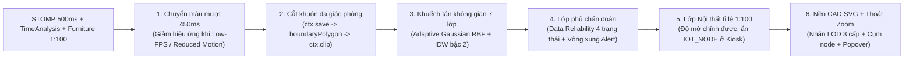

# Kiến Trúc Frontend & Bản Đồ Nhiệt Không Gian 2D / Frontend & 2D Spatial Heatmap Architecture

> **Cơ sở kiểm chứng / Verified From:** [`frontend/src/`](../../frontend/src), [`floorplan/page.tsx`](../../frontend/src/app/%28protected%29/floorplan/page.tsx), [`FloorplanCanvas.tsx`](../../frontend/src/features/floorplan/components/FloorplanCanvas.tsx), [`tqb-floorplan-presets.ts`](../../frontend/src/config/tqb-floorplan-presets.ts), [`floorplan-hmi.config.ts`](../../frontend/src/config/floorplan-hmi.config.ts), [`furniture-catalog.ts`](../../frontend/src/config/furniture-catalog.ts).

---

## 1. Cấu Trúc Thư Mục & 16 Tuyến Trang App Router / Directory Structure & 16 App Router Routes

```text
frontend/src/
├── app/
│   ├── layout.tsx, page.tsx
│   ├── login/page.tsx                          # Đăng nhập & hiển thị đếm ngược 429
│   ├── kiosk/page.tsx                          # Public Kiosk không cần login (FE-VIZ-09)
│   └── (protected)/                            # Bọc bảo vệ qua AppShell
│       ├── dashboard/page.tsx                  # Tổng quan quản lý / overview summary
│       ├── floorplan/page.tsx                  # Không gian HMI Bản đồ nhiệt 2D (3,461 LOC)
│       ├── alerts/page.tsx                     # Trung tâm xử lý cảnh báo toàn tòa nhà
│       ├── rooms/[id]/page.tsx                 # Chi tiết 1 phòng + biểu đồ lịch sử
│       ├── telemetry-explorer/page.tsx         # Tra cứu & xuất dữ liệu chuỗi thời gian
│       ├── profile/page.tsx                    # Hồ sơ cá nhân & đổi mật khẩu
│       └── admin/                              # Khu vực quản trị
│           ├── rooms/page.tsx                  # Quản lý phòng & ngưỡng cảnh báo
│           ├── rooms/[id]/polygon/page.tsx     # Biên tập đa giác CAD & vị trí node
│           ├── devices/page.tsx                # Quản lý thiết bị IoT
│           ├── devices/[id]/page.tsx           # Chi tiết trạm & cấp lại API Key
│           ├── devices/discovery/page.tsx      # Hàng đợi thiết bị mới phát hiện (Auto-Discovery)
│           ├── users/page.tsx                  # Quản lý tài khoản & assignedZones
│           └── roles/page.tsx                  # Ma trận vai trò & quyền RBAC
├── config/                                     # env.ts, thresholds.ts, floorplan-hmi.config.ts,
│                                               # furniture-catalog.ts, tqb-floorplan-presets.ts (33 presets)
├── features/                                   # alert, auth, devices, floorplan (9 UI components), iam, rooms, telemetry
└── lib/
    ├── floorplan/                              # 15 module thuần: coords, polygon, idw, weatherPalette,
    │                                           # clustering, labelLayout, reliability, furnitureGeometry,
    │                                           # timeAnalysis, deepLink, exportReport, floorTreeBuilder,
    │                                           # alertWorkflow, metricTransition, popoverPosition
    ├── http/                                   # client.ts, refresh-queue.ts, error-mapper.ts
    ├── rbac/                                   # capabilities.ts, scope-parser.ts
    ├── realtime/                               # stomp-client.ts (Singleton), use-room-stream.ts
    └── __tests__/                              # 13 suite kiểm thử Vitest (146 tests + axe-core)
```

---

## 2. Quản Lý Trạng Thái, HTTP Single-Flight & STOMP Singleton / State, HTTP Single-Flight & STOMP Singleton

- **HTTP Client & Single-Flight Refresh ([`client.ts`](../../frontend/src/lib/http/client.ts), [`refresh-queue.ts`](../../frontend/src/lib/http/refresh-queue.ts))**: Mọi API đi qua `unwrapEnvelope` (bắt buộc `code === 1000`), ánh xạ lỗi sang tiếng Việt qua [`vi.ts`](../../frontend/src/messages/vi.ts) và đọc header `Retry-After` khi gặp `429`. Khi nhiều request cùng lúc gặp `401`, `SingleFlightRefreshCoordinator` gom lại thành đúng 1 lệnh `POST /api/v1/auth/refresh` rồi phát lại kết quả.
- **Bảo mật phiên ([`auth/store.ts`](../../frontend/src/features/auth/store.ts))**: `accessToken` chỉ lưu trong RAM Zustand; `refreshToken` lưu trong `sessionStorage` (`aiot_refresh_token`) hoặc `localStorage` khi chạy Kiosk (`aiot_kiosk_refresh_token`), đồng bộ đăng nhập/đăng xuất đa tab qua `BroadcastChannel('aiot_auth_channel')`. Mọi mutation nhạy cảm chứa `rawApiKey` cấu hình `gcTime: 0`.
- **RBAC UI ([`capabilities.ts`](../../frontend/src/lib/rbac/capabilities.ts))**: Ánh xạ JWT `scope` sang các cờ năng lực (`canViewFloorplan`, `canManageRooms`, `canViewDevices`, `canAcknowledgeAlert`, v.v.) để tách biệt giao diện Quản lý, Kỹ thuật và Bạn đọc.
- **Realtime STOMP Singleton ([`stomp-client.ts`](../../frontend/src/lib/realtime/stomp-client.ts))**: Duy trì tối đa 1 kết nối WebSocket tại `/ws-aiot`, tự tiêm JWT mới nhất ở `beforeConnect`, tự `resubscribeAll()` khi reconnect và chuyển sang HTTP polling `15s` (`TIMING_CONFIG.fallbackPollingMs`) nếu rớt WebSocket.

---

## 3. Kiến Trúc Bản Đồ Nhiệt Không Gian 2D (HMI CAD 1:100) / 2D Spatial Heatmap Architecture

**[VI]** Giao diện `/floorplan` được thiết kế chuyên biệt theo phong cách **HMI/BMS thực tế cho Quản lý Thư viện Tạ Quang Bửu**, sử dụng nền 5 bản vẽ AutoCAD SVG [`tqb-floor-1.svg` .. `tqb-floor-5.svg`](../../frontend/public/floorplans/) kích thước chuẩn `76.0m × 57.2m` (`TQB_BUILDING_ASPECT_RATIO = 57.2 / 76.0`) và 33 preset phòng (`F1: 7, F2: 3, F3: 8, F4: 2, F5: 13` trong [`tqb-floorplan-presets.ts`](../../frontend/src/config/tqb-floorplan-presets.ts)).

**[EN]** The `/floorplan` workspace adopts a restrained **HMI/BMS design** on top of 5 AutoCAD SVG floorplans (`tqb-floor-1..5.svg`, `76.0m × 57.2m`, `33` room presets across floors 1–5) optimized for Library Managers, Technicians, and Kiosk guests.



### 3.1. Bộ Thành Phần Nghiệp Vụ Quản Lý / Manager-First Workspace Components
1. **Dải tóm tắt Quản lý ([`ManagerSummaryStrip.tsx`](../../frontend/src/features/floorplan/components/ManagerSummaryStrip.tsx))**: Hiển thị tức thì số cảnh báo mở, cảnh báo tồn đọng quá `15 phút` (`TIMING_CONFIG.overdueAlertMs`), số phòng `Tốt (≥75) / Lưu ý (60–74) / Xấu (<60 hoặc HIGH/CRITICAL)`, và thời điểm cập nhật; bấm vào từng thẻ để lọc trực tiếp trên bản đồ.
2. **Cây điều hướng WAI-ARIA `Tầng → Phòng` ([`FloorRoomTree.tsx`](../../frontend/src/features/floorplan/components/FloorRoomTree.tsx), [`floorTreeBuilder.ts`](../../frontend/src/lib/floorplan/floorTreeBuilder.ts))**: Hỗ trợ đầy đủ phím điều hướng `↑ ↓ ← → Home End Enter`, tìm kiếm/lọc, tổng hợp trạng thái tầng từ phòng con và đồng bộ chọn + auto-zoom 2 chiều với canvas (`fitPolygonToViewport`).
3. **Bản đồ thu nhỏ & Zoom mượt ([`FloorplanMinimap.tsx`](../../frontend/src/features/floorplan/components/FloorplanMinimap.tsx), [`coords.ts`](../../frontend/src/lib/floorplan/coords.ts))**: Zoom từ `1.0x` đến `4.0x` (wheel, touch pinch, pan, nút `+/−/reset`, fullscreen); hiện minimap khi `scale >= 1.15`.
4. **Semantic Zoom 3 cấp & Gom cụm ([`labelLayout.ts`](../../frontend/src/lib/floorplan/labelLayout.ts), [`clustering.ts`](../../frontend/src/lib/floorplan/clustering.ts))**:
   - `Overview` (`scale < 1.25x`): hiện mã phòng và gom cụm node cảm biến khi khoảng cách `< 44px` (`FLOORPLAN_INTERACTION_CONFIG.clusterRadiusPx`).
   - `Intermediate` (`1.25x <= scale < 1.85x`): hiện pill trạng thái và chỉ số chính; tiếp tục gom cụm khi `scale < 1.55x` (`clusterMaxScale = 1.55`) và tách thành từng node đơn lẻ từ **`scale >= 1.55x`**.
   - `Detail` (`scale >= 1.85x`): bung nhãn chi tiết, hiện bàn đọc/nội thất đầy đủ mà không đè nhãn nhờ thuật toán né va chạm 8 hướng (`computeLabelPlacements`).
5. **7 Lớp Dữ liệu, Bảng màu Mù màu & 4 Ký hiệu hình học ([`weatherPalette.ts`](../../frontend/src/lib/floorplan/weatherPalette.ts))**:
   - 7 lớp: `comfortScore`, `noiseAvg`, `temperature`, `humidity`, `lux`, `pm2_5`, `wifiRssi`.
   - Mọi trạng thái luôn kết hợp màu sắc với ký hiệu hình học (`●` Tốt / Bình thường, `▲` Lưu ý, `◆` Cảnh báo, `○` Không dữ liệu) kèm kiểm chứng tương phản WCAG (`getWcagContrastRatio`) và giả lập mù màu (`simulateColorVisionDeficiency`).
6. **Lớp Độ tin cậy Dữ liệu 4 trạng thái ([`reliability.ts`](../../frontend/src/lib/floorplan/reliability.ts))**: Phân loại điểm lưới và phòng thành `MEASURED` (`fieldPresence >= 0.55`), `INTERPOLATED` (`0.25..0.55`), `BLINDSPOT` (`< 0.25` hoặc offline) và `STALE` (`> 5 phút` không có tin mới).
7. **Alert Inspector Drawer & Chuyển cảnh báo ([`AlertInspectorDrawer.tsx`](../../frontend/src/features/floorplan/components/AlertInspectorDrawer.tsx), [`alertWorkflow.ts`](../../frontend/src/lib/floorplan/alertWorkflow.ts))**: Panel trượt cho phép xem tuổi sự cố, đề xuất SOP, gán người xử lý, nhập ghi chú và chuyển trạng thái `NEW → ACKNOWLEDGED → IN_PROGRESS → RESOLVED`.
8. **Biên tập Nội thất Tỉ lệ 1:100 ([`FurnitureLayerEditor.tsx`](../../frontend/src/features/floorplan/components/FurnitureLayerEditor.tsx), [`furnitureGeometry.ts`](../../frontend/src/lib/floorplan/furnitureGeometry.ts))**: Thư viện mở rộng dạng dữ liệu tại [`furniture-catalog.ts`](../../frontend/src/config/furniture-catalog.ts) (`DESK`, `CHAIR`, `BOOKSHELF`, `COUNTER`, `PC_TERMINAL`, `IOT_NODE`, `DOOR`); hỗ trợ kéo thả, xoay, snap lưới `0.25m`, căn hàng, Undo/Redo, kiểm tra OBB va chạm & biên phòng trước khi `PUT /api/v1/rooms/{id}/furniture`.
9. **Phân tích Thời gian, Deep Link & Xuất Báo cáo ([`TimeComparisonBar.tsx`](../../frontend/src/features/floorplan/components/TimeComparisonBar.tsx), [`timeAnalysis.ts`](../../frontend/src/lib/floorplan/timeAnalysis.ts), [`deepLink.ts`](../../frontend/src/lib/floorplan/deepLink.ts), [`exportReport.ts`](../../frontend/src/lib/floorplan/exportReport.ts))**: Chế độ `live`, `compare_1h`, `playback`, `typical_day`; đồng bộ tham số URL 2 chiều (`floor`, `roomId`, `deviceId`, `hardwareId`, `alertId`, `layer`, `scale`, `tx`, `ty`, `timeMode`, `hour`, `statusFilter`); xuất ảnh `PNG` và báo cáo `PDF` sẵn sàng trình bày.
10. **Chế độ Kiosk (`FE-VIZ-09`)**: Trên `/kiosk`, gọi API `/api/v1/public/**`, ẩn toàn bộ `IOT_NODE` qua `filterVisibleFurnitureItems`, không tải `DeviceResponse` và tổng hợp `AnonymousMicroZone` cho sinh viên tìm bàn đọc.
