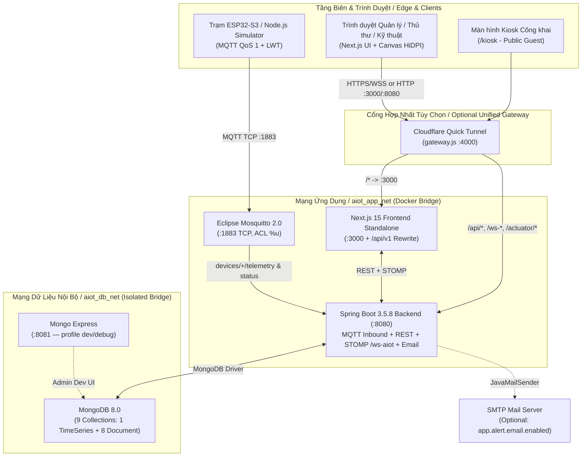

# Kiến Trúc Tổng Thể Hệ Thống / System Architecture

> **Đối tượng đọc / Audience:** Software Architect, Tech Lead, Backend / Frontend / DevOps Engineers.  
> **Cơ sở kiểm chứng / Sources:** [`docker-compose.yml`](../../docker-compose.yml), [`SecurityConfig.java`](../../src/main/java/com/example/AIoTLibTQB/configuration/SecurityConfig.java), [`MqttConfig.java`](../../src/main/java/com/example/AIoTLibTQB/configuration/MqttConfig.java), [`WebSocketConfig.java`](../../src/main/java/com/example/AIoTLibTQB/configuration/WebSocketConfig.java), [`frontend/next.config.ts`](../../frontend/next.config.ts), [`tools/cloudflared/gateway.js`](../../tools/cloudflared/gateway.js).

---

## 1. Sơ Đồ Kiến Trúc Tổng Thể 6 Tầng / 6-Layer System Context Diagram

**[VI]** **AIoTLibTQB** được thiết kế theo kiến trúc hướng sự kiện lai (**Hybrid Event-Driven & REST**): lớp thu thập IoT đi qua **MQTT Broker** vào **Java 21 Virtual Threads**, phân nhánh song song xuống **MongoDB TimeSeries** và **STOMP WebSocket Conflation (500ms)**, trong khi trình duyệt thao tác cấu hình và phân tích lịch sử qua **REST API (`/api/v1/**`)**. Toàn bộ hệ thống container được tách làm 2 mạng Docker cô lập (`aiot_app_net` và `aiot_db_net`) để MongoDB không lộ trực tiếp ra bên ngoài.

**[EN]** **AIoTLibTQB** implements a **Hybrid Event-Driven & REST Architecture**: IoT ingestion flows over **MQTT** into **Java 21 Virtual Threads**, fanning out to **MongoDB TimeSeries** persistence and **500ms STOMP WebSocket conflation**, while operator workflows and analytics execute over **REST (`/api/v1/**`)**. Docker containers are segmented across two isolated bridge networks (`aiot_app_net` and `aiot_db_net`) so MongoDB is never directly exposed to application edge containers.

---

## 2. Phân Tích Ranh Giới Mạng & Cổng Giao Tiếp / Network Boundaries & Ports

| Dịch vụ / Service | Cổng Expose (Host) | Mạng Docker / Networks | Cơ chế cách ly & bảo vệ / Security & Isolation |
| :--- | :---: | :--- | :--- |
| **`mongodb`** (`mongo:8.0`) | `127.0.0.1:27017` | `aiot_db_net` | Chỉ gắn loopback trên host; chỉ `backend` và `mongo-express` truy cập được trong Docker. |
| **`mongo-express`** (`1.0.2`) | `127.0.0.1:8081` | `aiot_db_net` | Chỉ khởi chạy khi kèm `--profile dev` hoặc `--profile debug`; bảo vệ bằng Basic Auth. |
| **`mosquitto`** (`eclipse-mosquitto:2.0`) | `127.0.0.1:1883` | `aiot_app_net` | Không ẩn danh (`allow_anonymous false`); chặn brute-force/DoS (`max_connections 200`, `max_packet_size 65536`), phân quyền ACL theo `%u`. |
| **`backend`** (Java 21 / Spring Boot) | `8080` | `aiot_db_net`, `aiot_app_net` | Cầu nối duy nhất giữa tầng ứng dụng và `mongodb`; `RateLimitFilter` Bucket4j; JWT `HS512` & RBAC/ABAC. |
| **`frontend`** (Next.js 15 Standalone) | `3000` | `aiot_app_net` | Khung SSR + App Router; viết lại `/api/v1/:path*` về Backend nội bộ trong [`next.config.ts`](../../frontend/next.config.ts) kèm Security Headers (`X-Frame-Options: SAMEORIGIN`, `X-Content-Type-Options: nosniff`). |
| **`simulator`** (Node.js 20 Alpine) | *(no ports)* | `aiot_app_net` | Chỉ kết nối tới `mosquitto:1883` và `backend:8080` sau khi cả 2 đạt `service_healthy`. |
| **`gateway.js`** (`tools/cloudflared`) | `4000` *(host script)* | Host loopback | Gộp Frontend (`:3000`) và Backend (`:8080`) về cùng origin `4000` để cấp HTTPS/WSS qua `cloudflared` mà không lỗi Mixed Content hay CORS. |

---

## 3. Luồng Dữ Liệu Xuyên Tầng / Cross-Tier Data & Control Paths

1. **Đường dẫn Nóng (Hot Ingestion Path — Sub-second):**
   - `ESP32-S3 / Simulator` $\xrightarrow{\text{MQTT QoS 1}}$ `Mosquitto` $\xrightarrow{\text{MqttPahoAdapter}}$ `VirtualThread Executor` $\xrightarrow{\text{MqttMessageDispatcherService}}$ `TelemetrySanitizerService` $\rightarrow$ `ComfortScoreService` $\rightarrow$ `LatestTelemetryCache` $\xrightarrow{\text{500ms Scheduler}}$ `TelemetryConflationService` $\xrightarrow{\text{STOMP /ws-aiot}}$ `Next.js FloorplanCanvas`.
2. **Đường dẫn Lưu trữ Lịch sử & Truy vấn (Cold Persistence & Analytics Path):**
   - `MqttMessageDispatcherService` xin giấy phép `Semaphore(30, true)` (timeout `3000ms`) $\rightarrow$ ghi nối tiếp (`insert`) vào MongoDB TimeSeries `telemetry_records` (TTL `90 ngày = 7,776,000s`) $\rightarrow$ Frontend tra cứu biểu đồ qua `GET /api/v1/telemetry/room/{id}/buckets` chạy Aggregation `$dateTrunc` trên MongoDB (tối đa `1000` buckets).
3. **Đường dẫn Điều phối Sự cố & Thông báo (Incident & Notification Path):**
   - `AlertRuleEngine` đánh giá FSM bất đồng bộ bên ngoài lock I/O $\rightarrow$ lưu `Alert` (`@Version`) $\rightarrow$ phát `/topic/alerts` & `/topic/zones/{zoneId}/alerts` $\rightarrow$ `AlertEmailNotificationService` gửi email SMTP tức thì cho `CRITICAL` hoặc leo thang định kỳ `60s` cho `HIGH` chưa ACK sau `10 phút`.

---

## 4. Tích Hợp Bên Ngoài / External Integrations

| Hệ thống tích hợp / Integration | Giao thức / Protocol | Thành phần code / Module | Trạng thái / Status |
| :--- | :--- | :--- | :--- |
| **MQTT Hardware Fleet** | MQTT v3.1.1 TCP (`:1883`) | [`MqttConfig`](../../src/main/java/com/example/AIoTLibTQB/configuration/MqttConfig.java) | Hoạt động (chưa bật TLS mặc định) |
| **SMTP Email Server** | SMTP (`JavaMailSender`) | [`AlertEmailNotificationService`](../../src/main/java/com/example/AIoTLibTQB/service/AlertEmailNotificationService.java) | Bật qua `ALERT_EMAIL_ENABLED=true` (mặc định `false`) |
| **Cloudflare Quick Tunnel** | HTTPS / WSS Tunnel | [`gateway.js`](../../tools/cloudflared/gateway.js) | Công cụ demo/chia sẻ nhanh qua `:4000` |
| **Swagger / OpenAPI Runtime** | HTTP REST | — | Không tích hợp (`springdoc` không có trong `pom.xml`) |
