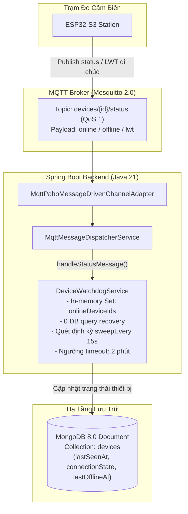
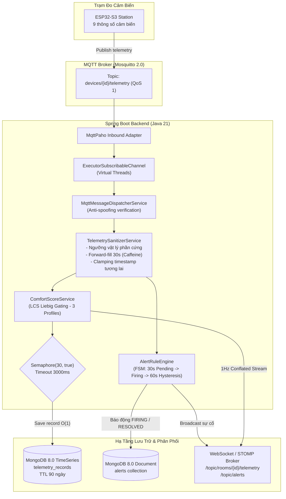
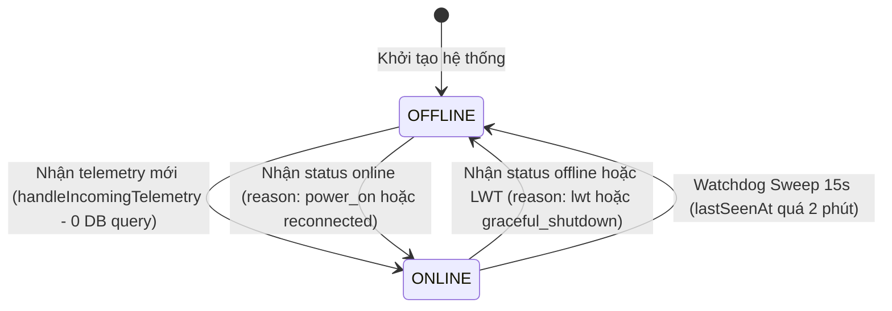
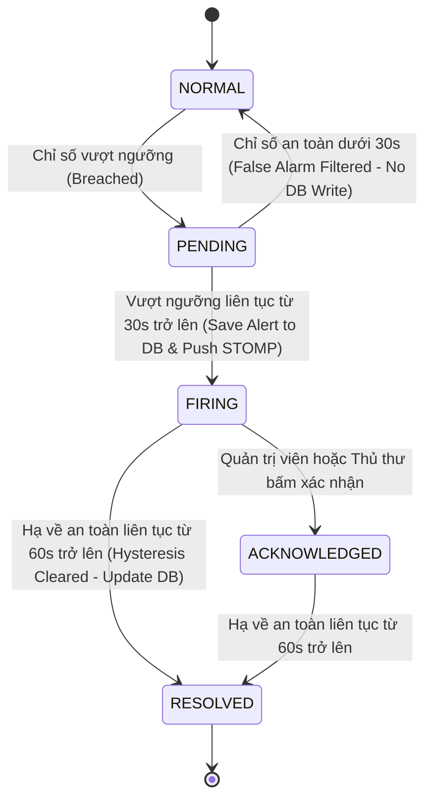

# Ingestion Pipeline: Quy Trình Thu Nạp & Xử Lý Dữ Liệu IoT Thời Gian Thực

## 1. Mục Tiêu
Tài liệu này cung cấp đặc tả kỹ thuật chi tiết về **Đường ống thu nạp dữ liệu (Ingestion Pipeline)** trong hệ sinh thái AIoTLibTQB. Mục tiêu chính bao gồm:
- Mô tả kiến trúc luồng dữ liệu thời gian thực từ các trạm đo ESP32-S3 thông qua MQTT Broker (Eclipse Mosquitto 2.0) vào Spring Boot Backend.
- Trình bày quy trình làm sạch vật lý 3 lớp: lọc ngưỡng phần cứng, bù trượt suy hao dữ liệu bằng thuật toán Forward-fill 30 giây (và quy tắc loại trừ `noisePeak`), kẹp timestamp chống sai lệch thời gian thực.
- Phân tích cơ chế giám sát sống còn (Device Watchdog) với kiến trúc tối ưu in-memory 0-query cho luồng dữ liệu thông thường.
- Làm rõ Động cơ Cảnh báo Máy trạng thái hữu hạn (Alert FSM) 4 bước có độ trễ bộ đệm chống báo động giả (debouncing & hysteresis).
- Đặc tả cơ chế điều tiết tải ghi CSDL MongoDB TimeSeries bằng `Semaphore(30, true)` tương thích hoàn hảo với Java 21 Virtual Threads.

---

## 2. Đối Tượng Đọc
- **Backend Engineers & Architects**: Nắm bắt kiến trúc tích hợp Spring Integration MQTT, điều phối luồng bất đồng bộ trên Virtual Threads, kiểm soát tải và tương tác MongoDB.
- **Embedded / IoT Firmware Engineers**: Hiểu rõ hợp đồng dữ liệu (Data Contract), dải đo vật lý bắt buộc, chu kỳ truyền thông, định dạng JSON và cơ chế di chúc LWT.
- **Data Engineers**: Nắm vững vòng đời dữ liệu từ dạng thô (raw) đến dạng chuẩn hóa (sanitized) và kỹ thuật lưu trữ chuỗi thời gian.
- **QA / Test Automation Engineers**: Thiết kế các kịch bản kiểm thử biên, giả lập sự cố mạng (network flap), mất kết nối đột ngột, và bão bản tin (burst traffic).

---

## 3. Nội Dung Chi Tiết

### 3.1. Tổng Quan Kiến Trúc Ingestion Pipeline

Hệ sinh thái AIoTLibTQB vận hành theo mô hình hướng sự kiện (Event-Driven Architecture). Mạch ESP32-S3 định kỳ gửi dữ liệu vi khí hậu và trạng thái sống còn lên Eclipse Mosquitto Broker. Để phân định ranh giới trách nhiệm và tối ưu hóa xử lý, hệ thống tách bạch đường ống thu nạp thành 2 luồng độc lập:

#### Sơ đồ 3A: Luồng Giám Sát Kết Nối Trạm Đo (Device Lifecycle & Connection Watchdog Pipeline)
*Mục đích:* Thể hiện luồng xử lý bản tin trạng thái (`status`), di chúc LWT và tiến trình quét nền phát hiện thiết bị mất kết nối với kiến trúc in-memory 0-DB query.



#### Sơ đồ 3B: Luồng Thu Thập & Xử Lý Chỉ Số Cảm Biến (Telemetry Ingestion & Fanout Pipeline)
*Mục đích:* Thể hiện chuỗi xử lý gói tin vi khí hậu: Virtual Threads Inbound Channel, Anti-spoofing, Bộ lọc 3 lớp, LCS Liebig Gating, Động cơ cảnh báo FSM, Semaphore điều tiết ghi TimeSeries và phát tán STOMP 1Hz.



#### A. Cấu Hình MQTT Inbound Adapter
Cấu hình tích hợp được định nghĩa tường minh tại `src/main/java/com/example/AIoTLibTQB/configuration/MqttConfig.java`:
- **Factory & Connection Options** (`MqttConfig.java:27-39`):
  - Client ID: Sinh tự động dựa trên cấu hình hệ thống.
  - `cleanSession = true`: Không duy trì hàng đợi cũ khi client backend khởi động lại.
  - `automaticReconnect = true`: Tự động phục hồi kết nối socket tới Mosquitto khi broker khởi động lại.
  - `keepAliveInterval = 30s`, `connectionTimeout = 10s`.
- **Kênh thực thi Virtual Threads** (`MqttConfig.java:42-44`):
  ```java
  @Bean
  public MessageChannel mqttInboundChannel() {
      return new ExecutorSubscribableChannel(Executors.newVirtualThreadPerTaskExecutor());
  }
  ```
  *Ý nghĩa kiến trúc*: Mỗi gói tin MQTT được tiếp nhận sẽ được bàn giao ngay lập tức cho một Virtual Thread (luồng ảo Project Loom) độc lập để xử lý. Điều này đảm bảo Inbound Channel không bao giờ bị nghẽn (backpressure) bởi các tác vụ I/O chặn phía sau (như truy vấn CSDL hoặc tính toán LCS).
- **Inbound Channel Adapter** (`MqttConfig.java:47-60`):
  - Lắng nghe đồng thời 2 topic thông qua wildcard:
    - Telemetry: `devices/+/telemetry` (`mqtt.default-telemetry-topic`).
    - Status: `devices/+/status` (`mqtt.default-status-topic`).
  - Mức chất lượng dịch vụ: `QoS = 1` (At least once).
  - Bộ chuyển đổi định dạng: `DefaultPahoMessageConverter`.

#### B. Phân Luồng Bản Tin & Chống Giả Mạo (Anti-Spoofing)
Dịch vụ điều phối `MqttMessageDispatcherService` (`src/main/java/com/example/AIoTLibTQB/service/MqttMessageDispatcherService.java:85-120`):
- Sử dụng Java Regex Pattern để phân luồng topic nhận được từ header `MqttHeaders.RECEIVED_TOPIC`:
  - `^devices/([^/]+)/status$` -> Trích xuất `topicHardwareId`, chuyển đến `handleStatusMessage()`.
  - `^devices/([^/]+)/telemetry$` -> Trích xuất `topicHardwareId`, chuyển đến `handleTelemetryMessage()`.
- **Cơ chế Chống Giả Mạo (Anti-Spoofing Verification)**:
  - Khi node gửi payload JSON, trường bên trong body (`statusPayload.getHardwareId()` hoặc `telemetryPayload.getHardwareId()`) được đối chiếu nghiêm ngặt với `topicHardwareId` lấy từ đường dẫn topic MQTT (`MqttMessageDispatcherService.java:127-131, 187-191`).
  - Nếu xuất hiện sự sai lệch (ví dụ trạm kết nối qua topic của node `ESP32_ROOM_101` nhưng gửi payload giả mạo `ESP32_ROOM_102`), hệ thống lập tức hủy bản tin, ghi nhật ký cảnh báo mức `WARN` và ngắt quy trình xử lý để ngăn chặn tấn công giả mạo dữ liệu cảm biến.

---

### 3.2. Quy Trình Làm Sạch Dữ Liệu Vật Lý (Physical Data Sanitization)

Dữ liệu thô từ mạng cảm biến IoT không thể đưa trực tiếp vào thuật toán tính điểm hay lưu trữ vì thường xuyên xuất hiện xung nhiễu điện từ, lỗi truyền thông, hoặc cảm biến suy hao. Lớp `TelemetrySanitizerService` (`src/main/java/com/example/AIoTLibTQB/service/TelemetrySanitizerService.java`) thiết lập bộ lọc 3 lớp nghiêm ngặt:

#### Lớp 1: Lọc Ngưỡng Vật Lý Phần Cứng (Hardware Bounds Clamping)
Hệ thống đối chiếu số đo với giới hạn vật lý của linh kiện bán dẫn thực tế (`TelemetrySanitizerService.java:24-35`):

| Chỉ số cảm biến | Tên trường DTO | Cảm biến phần cứng | Ngưỡng Min | Ngưỡng Max | Đơn vị | Cơ sở quy chuẩn kỹ thuật |
| :--- | :--- | :--- | :---: | :---: | :---: | :--- |
| **Tiếng ồn trung bình** | `noiseAvg` | INMP441 MEMS ($L_{eq}$) | `30.0` | `110.0` | dBA | Ngưỡng nghe con người; 30 dBA là phòng câm tuyệt đối |
| **Tiếng ồn đỉnh tức thời**| `noisePeak`| INMP441 MEMS ($L_{peak}$)| `30.0` | `130.0` | dBA | Ngưỡng đau tai; phát hiện va đập, rơi đồ |
| **Bụi siêu mịn PM1.0** | `pm1_0` | Sensirion SPS30 | `0.0` | `1000.0` | $\mu\text{g/m}^3$ | Dải đo quang học tán xạ laser SPS30 |
| **Bụi mịn PM2.5** | `pm2_5` | Sensirion SPS30 | `0.0` | `1000.0` | $\mu\text{g/m}^3$ | Dải đo quang học; tiêu chuẩn WHO |
| **Bụi trung bình PM4.0** | `pm4_0` | Sensirion SPS30 | `0.0` | `1000.0` | $\mu\text{g/m}^3$ | Dải đo hạt bụi hô hấp |
| **Bụi thô PM10** | `pm10` | Sensirion SPS30 | `0.0` | `1000.0` | $\mu\text{g/m}^3$ | Dải đo bụi khí quản |
| **Nhiệt độ không khí** | `temperature` | Sensirion SHT30/31 | `0.0` | `60.0` | $^\circ\text{C}$ | Dải làm việc cảm biến nhiệt trong nhà |
| **Độ ẩm tương đối** | `humidity` | Sensirion SHT30/31 | `0.0` | `100.0` | %RH | Thang bão hòa hơi nước trong không khí |
| **Cường độ ánh sáng** | `lux` | BH1750 (16-bit) | `0.0` | `65535.0` | Lux | Thanh ghi tràn 16-bit bộ chuyển đổi ADC quang |

*Hành vi xử lý*: Nếu giá trị nằm ngoài dải `[Min, Max]` (hoặc gửi số âm, gửi giá trị rác khi bus I2C bị nghẽn), hệ thống loại bỏ giá trị đó và chuyển sang kiểm tra cơ chế Forward-fill (`TelemetrySanitizerService.java:146-156`).

#### Lớp 2: Thuật Toán Forward-Fill Trong Cửa Sổ 30 Giây
- **Vấn đề thực tế**: Trong môi trường truyền thông không dây, thỉnh thoảng một gói tin bị mất một phần dữ liệu cảm biến (ví dụ cảm biến SHT30 phản hồi chậm khiến trường nhiệt ẩm bị `null`). Nếu lập tức coi chỉ số đó là thiếu, thuật toán LCS sẽ phải tái phân bổ trọng số liên tục hoặc điểm số bị gián đoạn.
- **Giải pháp**: Cơ chế lưu đệm trạng thái trượt qua Caffeine Cache `fieldCache` (`TelemetrySanitizerService.java:41-44`):
  - Cấu trúc khóa: `{deviceId}:{fieldKey}` (ví dụ: `dev_01:env.temperature`).
  - Dung lượng cache tối đa: `50,000` phần tử, tự giải phóng sau `10 phút` không truy cập (`expireAfterAccess`).
  - Cửa sổ hiệu lực: `FORWARD_FILL_WINDOW = Duration.ofSeconds(30)`.
- **Quy tắc thực thi** (`TelemetrySanitizerService.java:142-167`):
  - **Trường hợp 1**: Dữ liệu cảm biến mới hợp lệ: Ghi nhận giá trị vào cache kèm mốc thời gian `Instant.now()`, trả về giá trị này.
  - **Trường hợp 2**: Dữ liệu cảm biến bị `null` hoặc ngoài dải vật lý: Tra cứu `lastKnown` từ cache. Nếu khoảng thời gian $\Delta t = \text{now} - \text{lastKnown.timestamp} \le 30\,\text{giây}$, hệ thống kế thừa (forward-fill) giá trị cũ. Nếu $\Delta t > 30\,\text{giây}$ (sự cố hỏng hóc phần cứng kéo dài), giá trị được giữ nguyên là `null` để không tạo ra dữ liệu ảo.

> **ĐIỂM LỆCH KỸ THUẬT QUAN TRỌNG ĐÃ XÁC NHẬN: LOẠI TRỪ `noisePeak`**  
> Trong khi 8 thông số cảm biến còn lại đều áp dụng Forward-fill, phương thức `sanitizePeakWithoutForwardFill` (`TelemetrySanitizerService.java:94-106`) **tuyệt đối không áp dụng Forward-fill cho `noisePeak`**.  
> *Lý giải nguyên lý âm học*: `noisePeak` đại diện cho một xung âm thanh tức thời (impulse noise) ngẫu nhiên như tiếng làm rơi cuốn sách, tiếng sập cửa, tiếng kéo ghế. Xung âm này chỉ tồn tại trong vài mili-giây tại chu kỳ đo đó. Nếu thực hiện forward-fill xung âm 85 dBA trong suốt 30 giây tiếp theo, hệ thống sẽ mô phỏng sai lệch rằng thư viện đang phải chịu một vụ nổ âm thanh kéo dài, dẫn đến kích hoạt báo động sai (false positive alert) và kéo sập điểm LCS một cách vô lý.

#### Lớp 3: Kẹp Timestamp Chuẩn Hóa (Clamping & Normalization)
Được triển khai tại `MqttMessageDispatcherService.java:308-333`:
- Nhận diện linh hoạt định dạng Epoch:
  - Nếu `rawTimestamp >= 100_000_000_000L` ($\ge 10^{11}$): Chuẩn hóa dạng Epoch Milliseconds.
  - Nếu nhỏ hơn: Chuẩn hóa dạng Epoch Seconds.
- **Rào chắn chống sai lệch thời gian**:
  1. *Thiết bị mất nguồn reset RTC*: ESP32-S3 chưa kịp đồng bộ NTP qua Wi-Fi có thể phát timestamp = 0 hoặc ngày tháng năm 1970. Nếu `timestamp.isBefore(2020-01-01T00:00:00Z)`, hệ thống kẹp về `Instant.now()` của máy chủ.
  2. *Thiết bị lệch giờ tương lai*: Nếu mạch phát timestamp chạy nhanh hơn giờ máy chủ quá 60 giây (`parsed.isAfter(now.plusSeconds(60))`), hệ thống kẹp về `Instant.now()`.
  3. *Chế độ lưu trữ đệm ngoại tuyến (Offline Store-and-Forward)*: Nếu mạch bị mất Wi-Fi, lưu dữ liệu vào bộ nhớ Flash rồi gửi bù sau vài giờ (timestamp hợp lệ nằm từ 2020 đến hiện tại), backend **bảo toàn nguyên vẹn** mốc thời gian quá khứ này để lưu vào MongoDB TimeSeries, giúp đồ thị lịch sử hiển thị chính xác.

#### Loại Bỏ Bản Tin Rỗng (Empty Record Discard)
Tại `MqttMessageDispatcherService.java:238-241`, sau khi đi qua Sanitizer, nếu tất cả các cụm chỉ số `acoustics`, `airQuality`, `environment` đều là `null` (do cảm biến ngắt kết nối hoàn toàn và bộ đệm 30s đã cạn), bản tin sẽ bị hủy ngay lập tức (`isEmptyMetrics(sanitized) == true`). Hệ thống không lưu bản ghi rác này vào CSDL TimeSeries.

---

### 3.3. Quản Lý Trạng Thái Thiết Bị & Watchdog Service

Việc giám sát hàng trăm trạm đo IoT phân tán trong thư viện đòi hỏi phát hiện kịp thời các sự cố đứt dây, mất nguồn hoặc lỗi Wi-Fi mà không được làm suy giảm hiệu năng xử lý của máy chủ.



#### A. Kiến Trúc 0-Query Phục Hồi Kết Nối Nhanh (`DeviceWatchdogService.java`)
Lớp `DeviceWatchdogService` (`src/main/java/com/example/AIoTLibTQB/service/DeviceWatchdogService.java`) duy trì một tập hợp trong RAM:
```java
Set<String> offlineDeviceHardwareIds = ConcurrentHashMap.newKeySet();
```
- **Tối ưu hóa luồng Telemetry Ingestion thông thường** (`DeviceWatchdogService.java:184-208`):
  - Khi có gói telemetry từ trạm đo gửi về, Ingestion Pipeline gọi `deviceWatchdogService.handleIncomingTelemetry(hardwareId)`.
  - Phương thức thực hiện `offlineDeviceHardwareIds.remove(hardwareId)`:
    - **Nếu thiết bị đang ONLINE bình thường**: Hardware ID không tồn tại trong tập offline, lệnh trả về `false`. Hệ thống tiếp tục xử lý telemetry mà **KHÔNG tốn bất kỳ câu truy vấn MongoDB nào** để kiểm tra trạng thái!
    - **Nếu thiết bị đang bị đánh dấu OFFLINE**: Lệnh xóa thành công khỏi set và trả về `true`. Hệ thống kích hoạt phục hồi:
      1. Cập nhật MongoDB: `$set connectionState = ONLINE`, `lastSeenAt = now`.
      2. Tự động giải quyết cảnh báo `DEVICE_OFFLINE` qua `alertService.resolveDeviceOfflineAlert()`.
      3. Xóa bộ đệm RAM `deviceMetadataCache.invalidate(hardwareId)`.

#### B. Tiến Trình Quét Nền Định Kỳ Phát Hiện Thiết Bị Ngoại Tuyến
- **Chu kỳ quét**: Chạy ngầm mỗi 15 giây qua `@Scheduled(fixedRate = 15000)` (`DeviceWatchdogService.java:71-75`).
- **Ngưỡng ngoại tuyến**: `threshold = clock.instant().minus(2, ChronoUnit.MINUTES)`.
- **Quy trình xử lý trạm quá 2 phút không gửi tin** (`DeviceWatchdogService.java:84-149`):
  1. Quét các thiết bị thỏa mãn `isActive == true` và `(lastSeenAt < threshold OR lastSeenAt == null)`.
  2. Nếu thiết bị chưa bị đánh dấu OFFLINE:
     - Cập nhật MongoDB qua `mongoTemplate.updateFirst()`: `connectionState = OFFLINE`, `lastOfflineAt = now`.
     - Đưa `hardwareId` vào tập in-memory `offlineDeviceHardwareIds`.
     - Kích hoạt cảnh báo hệ thống `DEVICE_OFFLINE` qua `AlertService`.
     - Xóa cache metadata thiết bị.

#### C. Throttling Ghi Nhận `lastSeenAt` Chống Phóng Đại Tải Ghi (Write Amplification)
Nếu mỗi chu kỳ đo (ví dụ 5s/lần) đều thực hiện lệnh ghi cập nhật trường `lastSeenAt` vào bảng `devices`, MongoDB sẽ phải chịu tải ghi khổng lồ trên collection thường.  
*Giải pháp*: `MqttMessageDispatcherService.java:69-77, 216-230` áp dụng bộ nhớ đệm Caffeine `lastSeenThrottleCache` với cửa sổ **30 giây**. Trừ khi thiết bị vừa được phục hồi từ trạng thái OFFLINE, mốc thời gian `lastSeenAt` chỉ được cập nhật xuống MongoDB tối đa **1 lần mỗi 30 giây** cho mỗi thiết bị.

#### D. Xử Lý Bản Tin Trạng Thái Status & Di Chúc LWT
- **Bản tin chủ động / bình thường** (`devices/+/status`):
  - Khi node cấp nguồn gửi `status: "online"`, `reason: "power_on"`, cập nhật `connectionState = ONLINE`, cập nhật phiên bản firmware (`firmwareVersion`).
- **Bản tin di chúc (Last Will and Testament — LWT)**:
  - Khi node bị mất điện đột ngột hoặc đứt cáp mạng, TCP socket bị ngắt mà không gửi MQTT DISCONNECT. Hết thời gian Keep-alive (30s), Eclipse Mosquitto tự động phát bản tin di chúc đã đăng ký từ trước: `{"hardware_id":"...","status":"offline","reason":"lwt"}` vào topic status (`MqttMessageDispatcherService.java:134-170`).
  - Backend lập tức chuyển `connectionState = OFFLINE`, phát sinh cảnh báo `DEVICE_OFFLINE` mà không cần đợi đến chu kỳ quét 2 phút của Watchdog.

#### E. Thiết Bị Chưa Khai Báo (Unregistered Device Discovery Queue)
Nếu nhận được bản tin từ một trạm đo có `hardwareId` chưa được Admin đăng ký trong CSDL:
- Telemetry bị drop, không ghi vào bảng TimeSeries để chống làm bẩn dữ liệu.
- Thiết bị được đưa vào hàng đợi `DiscoveredDeviceService` (`MqttMessageDispatcherService.java:174, 196-200`) lưu tạm trong RAM 10 phút kèm chỉ số sóng `wifiRssi`, phục vụ màn hình Admin "Khám phá thiết bị mới" để phê duyệt 1-click.

---

### 3.4. Động Cơ Cảnh Báo Thời Gian Thực (Alert Rule Engine FSM)

Được triển khai tại `AlertRuleEngine.java:28-265`. Hệ thống áp dụng máy trạng thái hữu hạn 4 bước để lọc bỏ hoàn toàn các xung nhiễu ngắn hạn và chống hiện tượng bật/tắt cảnh báo liên tục (flapping / chattering).



#### Chi Tiết 4 Bước Trạng Thái FSM:
1. **NORMAL (Bình Thường)**:
   - Trạng thái mặc định khi chỉ số nằm trong ngưỡng cho phép (hoặc `fsmMap.get(key) == null`).
2. **PENDING (Cảnh Báo Chờ - Debounce 30 Giây)**:
   - Khi phát hiện chỉ số vi phạm (ví dụ $noise\_avg > 65\,\text{dBA}$ hoặc $PM_{2.5} > 50\,\mu\text{g/m}^3$).
   - Hệ thống khởi tạo `FsmState` trong RAM với `status = PENDING`, `pendingSince = now`.
   - **Đặc điểm tối ưu**: Hoàn toàn **không ghi CSDL MongoDB**. Nếu sinh viên chỉ nói to một câu rồi im lặng trong vòng 10 giây, chỉ số quay về an toàn, FSM lập tức hủy `PENDING` và giải phóng bộ nhớ. Không sinh ra cảnh báo rác.
3. **FIRING (Báo Động Thực Sự)**:
   - Nếu trạng thái vi phạm kéo dài liên tục vượt quá `PENDING_WINDOW = Duration.ofSeconds(30)`:
     - Trạng thái chuyển thành `FIRING`.
     - Tạo bản ghi `Alert` (`AlertRuleEngine.java:204-215`), lưu vào MongoDB với `status = FIRING`.
     - Phát tin nhắn thời gian thực qua kênh WebSocket STOMP `/topic/alerts`.
     - Người vận hành có thể chuyển trạng thái sang `ACKNOWLEDGED` khi đang xử lý hiện trường.
4. **RESOLVED (Phục Hồi An Toàn - Hysteresis 60 Giây)**:
   - Khi chỉ số đo đạc giảm xuống dưới ngưỡng quy định:
     - Hệ thống kích hoạt cửa sổ trễ hồi phục `HYSTERESIS_WINDOW = Duration.ofSeconds(60)`.
     - Nếu trong 60 giây này có bất kỳ một xung đột biến nào vượt ngưỡng trở lại, đồng hồ 60s bị reset về 0 (`state.setRecoverySince(null)`).
     - Chỉ khi chỉ số nằm trong vùng an toàn **liên tục trọn vẹn 60 giây**, cảnh báo mới chính thức chuyển sang `RESOLVED`, cập nhật trường `resolvedAt = now` trong CSDL, thông báo qua WebSocket và xóa khỏi bộ nhớ RAM `fsmMap`.

#### Quy Chuẩn Ngưỡng Kích Hoạt Cảnh Báo (`AlertRuleEngine.java:37-40`):
- `NOISE_AVG`: Mức ồn trung bình $> 65.0$ dBA (Ô nhiễm tiếng ồn phòng tự học).
- `NOISE_PEAK`: Xung âm thanh đỉnh $> 75.0$ dBA (Va đập mạnh, tiếng thét, sự cố âm học).
- `TEMPERATURE`: Nhiệt độ phòng $> 32.0^\circ\text{C}$ (Lỗi hệ thống điều hòa HVAC).
- `PM2_5`: Bụi mịn $> 50.0\,\mu\text{g/m}^3$ (Chất lượng không khí ở mức không lành mạnh theo WHO).

#### Thiết Kế An Toàn Cho Java 21 Virtual Threads
Trong phương thức `evaluateMetric()` (`AlertRuleEngine.java:172-265`):
- Toàn bộ việc chuyển dịch trạng thái FSM diễn ra trong khối hàm lambda `fsmMap.compute()`.
- **Nguyên tắc an toàn**: Mọi thao tác I/O chặn (Blocking I/O) bao gồm `alertRepository.save()` và `realtimePublisher.publishAlert()` được đưa hoàn toàn ra ngoài khối `compute()` (`AlertRuleEngine.java:258-265`). Điều này loại trừ hoàn toàn nguy cơ ghim luồng thực thi nền tảng (Carrier Thread Pinning) khi chạy trên Virtual Threads.

---

### 3.5. Kiểm Soát Tải Đồng Thời & Ghi CSDL MongoDB

Khi mạng lưới hàng trăm cảm biến cùng gửi dữ liệu dồn dập (ví dụ sau khi mất điện và toàn bộ trạm đo khởi động lại đồng thời), lưu lượng có thể gây ra hiện tượng bão bản tin (Thundering Herd / Packet Burst).

#### A. Rào Chắn Giới Hạn Tải Bằng `Semaphore(30, true)`
Triển khai tại `MqttMessageDispatcherService.java:70, 80, 270-301`:
```java
private static final int MONGO_WRITE_PERMITS = 30;
private static final long MONGO_ACQUIRE_TIMEOUT_MS = 3000;

final Semaphore mongoWriteSemaphore = new Semaphore(MONGO_WRITE_PERMITS, true);
```
- **Nguyên lý hoạt động**:
  - `MONGO_WRITE_PERMITS = 30`: Giới hạn tối đa 30 thao tác ghi đồng thời vào MongoDB. Con số này được chuẩn hóa để phù hợp với kích thước Connection Pool của MongoDB Driver (mặc định 100 kết nối, dành 30 kết nối cho Ingestion, phần còn lại cho REST API và WebSocket query).
  - `fairness = true` (Fair Semaphore): Đảm bảo các Virtual Threads xếp hàng theo thứ tự FIFO công bằng, tránh tình trạng luồng bị đói tài nguyên (Thread Starvation).
  - `tryAcquire(3000, TimeUnit.MILLISECONDS)`: Virtual Thread chờ cấp giấy phép tối đa 3 giây.
- **Xử lý quá tải (Backpressure & Dropping)**:
  - Nếu CSDL MongoDB gặp sự cố nghẽn I/O đĩa cứng kéo dài quá 3 giây, Virtual Thread sẽ từ bỏ việc ghi bản ghi đó, nhả tài nguyên và ghi log cảnh báo:  
    `WARN: MongoDB write throttled: semaphore acquisition timed out after 3000ms for hardwareId=...`
  - Cơ chế này bảo vệ hệ thống không bị tràn bộ nhớ Heap (OOM) và không làm treo Virtual Thread Pool.

#### B. Cache Đệm Metadata Thiết Bị 2 Tầng (`DeviceMetadataCache`)
Để gắn `roomId` và kiểm tra quyền hoạt động của thiết bị, Ingestion Pipeline cần thông tin metadata của trạm đo:
- Thay vì truy vấn CSDL cho mỗi bản tin, lớp `DeviceMetadataCache` sử dụng Caffeine Cache:
  - Lưu trữ: `{hardwareId} -> DeviceMetadata(id, hardwareId, roomId, zoneId, isActive)`.
  - Hiệu quả: Tỷ lệ trúng bộ đệm (Cache Hit Rate) đạt trên $99.8\%$, giảm thiểu tối đa áp lực đọc lên MongoDB.
  - Vô hiệu hóa cache (Cache Invalidation): Khi thiết bị đổi phòng, đổi trạng thái active hoặc bị Watchdog chuyển offline, cache tương ứng lập tức bị xóa qua `deviceMetadataCache.invalidate(hardwareId)`.

#### C. Điều Tiết Phân Phối WebSocket STOMP (Conflation 1Hz)
Để bảo vệ trình duyệt của người dùng không bị "đơ" vì nhận quá nhiều tin nhắn WebSocket khi trạm đo gửi tần suất cao, lớp `TelemetryConflationService` gom và điều tiết dữ liệu vi khí hậu:
- Tần suất phát tin tối đa: **1 Hz** (1 tin/giây/phòng).
- Bản tin mới nhất trong giây đó sẽ được gửi lên kênh STOMP `/topic/rooms/{roomId}/telemetry`.

#### D. Bảng Thông Số Kỹ Thuật 4 Tầng Caffeine Cache Nội Bộ (In-Memory Cache Architecture)
Nhằm đạt hiệu năng xử lý hàng chục nghìn gói tin/giây với độ trễ thấp và loại bỏ nhu cầu duy trì hạ tầng cụm Redis bên ngoài, Spring Boot Backend triển khai 4 bộ đệm Caffeine Cache chuyên biệt:

| Tên Bộ Đệm | Vị Trí Triển Khai | Sức Chứa (Capacity) | Chính Sách Hết Hạn (Eviction Policy) | Cấu Trúc Khóa (Cache Key) | Mục Đích Nghiệp Vụ & Tối Ưu Hệ Thống |
| :--- | :--- | :---: | :---: | :--- | :--- |
| **RateLimit Cache** | `RateLimitFilter.java` | `10,000` entries | `expireAfterAccess(10, MINUTES)` | `Client-IP` hoặc `username` | Lưu trữ token bucket của Bucket4j cho từng địa chỉ IP/User; chống tấn công dò mật khẩu brute-force và DoS API xác thực. |
| **TelemetrySanitizer Cache** | `TelemetrySanitizerService.java` | `50,000` entries | `expireAfterAccess(10, MINUTES)` | `{deviceId}:{fieldKey}` | Lưu giá trị cảm biến hợp lệ gần nhất; phục vụ cơ chế bù suy hao 30s Forward-fill (tuyệt đối không áp dụng cho `noisePeak`). |
| **LastSeenAt Throttle Cache** | `MqttMessageDispatcherService.java` | `10,000` entries | `expireAfterWrite(30, SECONDS)` | `hardwareId` | Điều tiết tần suất ghi cập nhật `lastSeenAt` trên MongoDB xuống tối đa 1 lần / 30 giây / thiết bị; loại trừ hiện tượng phóng đại tải ghi (Write Amplification). |
| **ComfortScore RoomType Cache** | `ComfortScoreService.java` | `1,000` entries | `expireAfterWrite(10, MINUTES)` | `roomId` | Lưu đệm phân loại phòng (`RoomType`: STUDY_ROOM, BOOK_STORAGE, CIRCULATION_HALL) để chọn profile Liebig tức thì mà không cần truy vấn bảng `rooms`. |

---

## 4. Mục "Đọc Tiếp"
Để hiểu sâu hơn về toàn bộ kiến trúc và các phân hệ kế tiếp của AIoTLibTQB, vui lòng tham khảo:
- [02-architecture.md](./02-architecture.md): Sơ đồ kiến trúc tổng thể và luồng tương tác giữa các thành phần hệ thống.
- [04-lcs-algorithm.md](./04-lcs-algorithm.md): Thuật toán tính điểm tiện nghi thư viện (LCS) áp dụng nguyên lý thùng gỗ Liebig.
- [05-data-model.md](./05-data-model.md): Mô hình dữ liệu chi tiết, cấu trúc TimeSeries Collection và kỹ thuật Downsampling Aggregation.
- [09-firmware-iot.md](./09-firmware-iot.md): Đặc tả phần cứng vi điều khiển ESP32-S3, 9 cảm biến vật lý và giao thức MQTT.
- [10-conventions.md](./10-conventions.md): Quy ước lập trình bắt buộc về Virtual Threads, Semaphore và xử lý bất đồng bộ.
