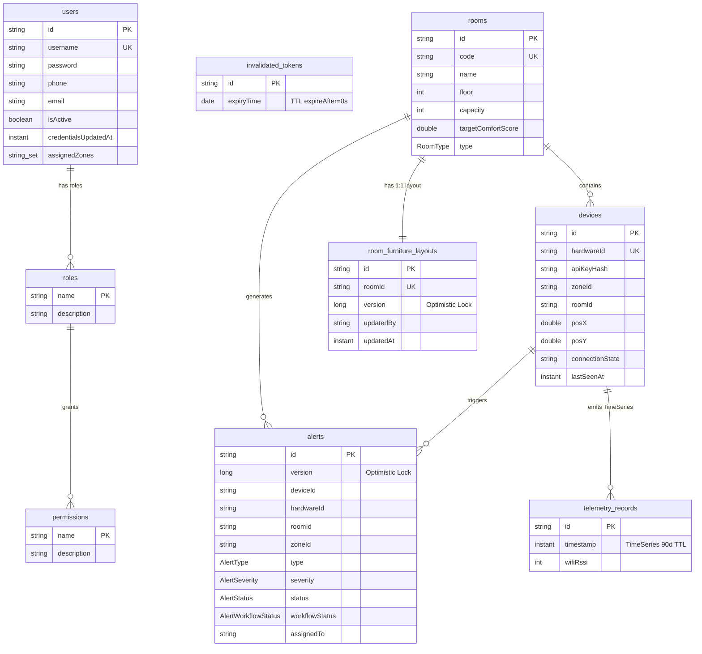
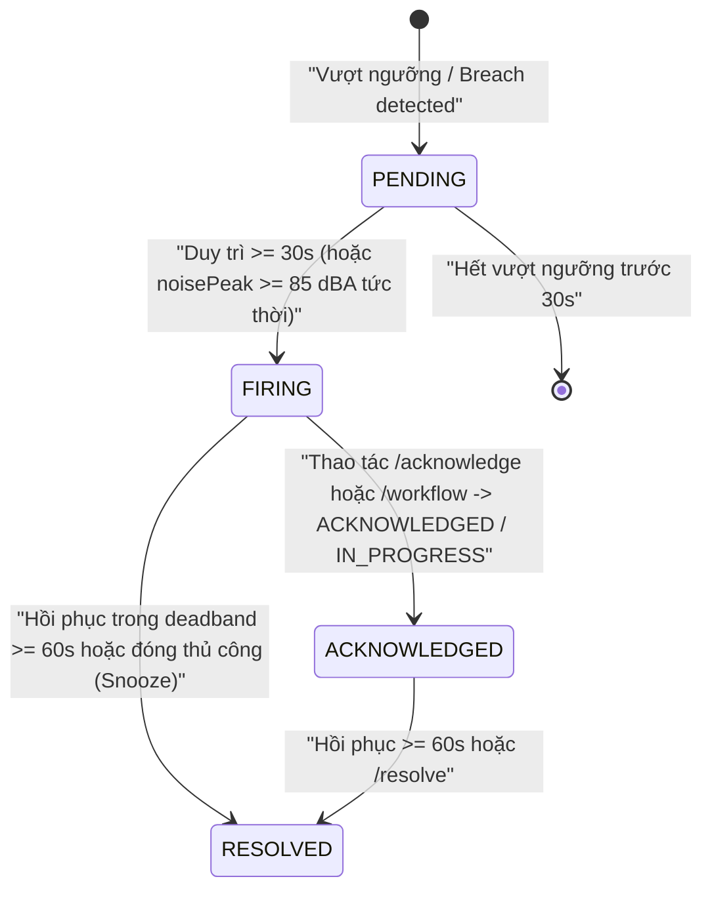

# Mô Hình Dữ Liệu & Kiến Trúc MongoDB 8.0 / Data Model & MongoDB Schema

> **Cơ sở kiểm chứng / Verified From:** `18` lớp trong [`document/`](../../src/main/java/com/example/AIoTLibTQB/document) và `7` enums trong [`enums/`](../../src/main/java/com/example/AIoTLibTQB/enums) (`9` collections thực tế trên MongoDB `8.0`).

---

## 1. Sơ Đồ Thực Thể Quan Hệ / Entity-Relationship Diagram (ERD)

---

## 2. Từ Điển Dữ Liệu 9 Collections / Data Dictionary (9 Collections)

### 2.1. TimeSeries Collection: `telemetry_records` ([`TelemetryRecord.java`](../../src/main/java/com/example/AIoTLibTQB/document/TelemetryRecord.java))

**[VI]** Cấu hình `@TimeSeries(collection = "telemetry_records", timeField = "timestamp", metaField = "metadata", granularity = Granularity.SECONDS, expireAfter = "7776000s")` — tự động xóa dữ liệu sau **90 ngày** (`7,776,000s`).  
**[EN]** Native MongoDB TimeSeries collection with `SECONDS` granularity and automatic **90-day TTL expiration** (`7,776,000s`).

- **Indexes**:
  - `telemetry_device_time_idx`: `{'metadata.deviceId': 1, 'timestamp': -1}`
  - `telemetry_room_time_idx`: `{'metadata.roomId': 1, 'timestamp': -1}`
- **Embedded Sub-documents**:
  - `metadata` (`TelemetryMetadata`): `deviceId`, `hardwareId`, `roomId`
  - `acoustics` (`AcousticMetrics`): `noiseAvg` (`dBA`), `noisePeak` (`dBA`)
  - `airQuality` (`AirQualityMetrics`): `pm1_0`, `pm2_5`, `pm4_0`, `pm10` (`µg/m³`)
  - `environment` (`EnvironmentMetrics`): `temperature` (`°C`), `humidity` (`%RH`), `lux` (`Lux`)
  - `comfortScore` (`ComfortScoreRecord`): `overall`, `grade`, `acousticScore`, `airScore`, `thermalScore`, `lightScore`
  - `wifiRssi` (`Integer`, `dBm`)

### 2.2. 8 Document Collections / Standard Document Collections

| Collection | Class | Unique / Compound Indexes | Trường khóa & chú thích / Key Fields & Notes |
| :--- | :--- | :--- | :--- |
| **`users`** | [`User`](../../src/main/java/com/example/AIoTLibTQB/document/User.java) | `username` (unique) | `password` (BCrypt 10), `phone`, `email` (dùng gửi SMTP escalation), `isActive`, `credentialsUpdatedAt` (thu hồi JWT cũ), `roles`, `assignedZones` (ABAC). |
| **`roles`** | [`Role`](../../src/main/java/com/example/AIoTLibTQB/document/Role.java) | `_id = name` | `name` (`ADMIN`, `LIBRARIAN`, `ZONE_MANAGER`, `MAINTENANCE`, `VIEWER`, `USER`, `DEVICE`), `description`, `permissions`. |
| **`permissions`** | [`Permission`](../../src/main/java/com/example/AIoTLibTQB/document/Permission.java) | `_id = name` | `14` quyền chuẩn được seed bởi `ApplicationInitConfig`. |
| **`invalidated_tokens`** | [`InvalidatedToken`](../../src/main/java/com/example/AIoTLibTQB/document/InvalidatedToken.java) | `expiryTime` (`expireAfter="0s"`) | `id` = JWT ID (`jti`); tự xóa tại thời điểm token hết hạn kết hợp job `02:00` hàng ngày. |
| **`rooms`** | [`Room`](../../src/main/java/com/example/AIoTLibTQB/document/Room.java) | `code` (unique) | `floor`, `capacity`, `targetComfortScore`, `boundaryPolygon` (`List<Point2D>`), `type` (`RoomType`), `thresholds` (`RoomThresholdConfig`), `createdAt`, `updatedAt`. |
| **`room_furniture_layouts`** | [`RoomFurnitureLayout`](../../src/main/java/com/example/AIoTLibTQB/document/RoomFurnitureLayout.java) | `roomId` (unique) | **`@Version Long version`** (Optimistic Locking), `items` (`List<FurnitureItemDoc>`), `updatedBy`, `updatedAt`, `auditHistory` (`List<FurnitureAuditEntry>`). |
| **`devices`** | [`Device`](../../src/main/java/com/example/AIoTLibTQB/document/Device.java) | `hardwareId` (unique), `idx_active_lastseen`, indexed `zoneId`, `roomId` | `apiKeyHash` (BCrypt 10), `posX`/`posY` `[0.0, 1.0]`, `deviceType`, `location`, `firmwareVersion`, `isActive`, `connectionState` (`ONLINE`/`OFFLINE`), `lastSeenAt`, `lastOfflineAt`. |
| **`alerts`** | [`Alert`](../../src/main/java/com/example/AIoTLibTQB/document/Alert.java) | `idx_alert_device_type_status`, `idx_alert_hardware_type_status`, `idx_alert_status_started`, `idx_alert_zone_status_started` | **`@Version Long version`**, `metricType`, `severity` (`LOW..CRITICAL`), `severityRank` (`1..4`), `status` (`AlertStatus`), `workflowStatus` (`AlertWorkflowStatus`), `assignedTo`, `handlingNote`, `inProgressAt`, `currentValue`, `threshold`, `recommendedAction` (SOP). |

### 2.3. Ràng Buộc Nội Thất 1:100 (`FurnitureItemDoc` & `FurnitureAuditEntry`)

- `FurnitureItemDoc`: `id` (`max 80`), `typeId` (`max 60`, vd `DESK`, `CHAIR`, `BOOKSHELF`, `COUNTER`, `PC_TERMINAL`, `IOT_NODE`, `DOOR`), `label` (`max 120`), `x`, `y` ∈ `[0.0, 1.0]`, `widthM`, `depthM` ∈ `[0.1, 25.0]` *(mét thực)*, `rotationDeg` (default `0.0`), `locked` (`Boolean`, default `false`).
- `FurnitureAuditEntry`: `timestamp`, `username`, `actionSummary`, `version`.

---

## 3. Enums & Vòng Đời Trạng Thái / Enums & State Machines

### 3.1. Danh mục Enums chính / Core Enums
- **`RoomType`**: `STUDY_ROOM`, `BOOK_STORAGE`, `CIRCULATION_HALL`
- **`AlertType`**: `NOISE_EXCEEDED`, `AIR_UNHEALTHY`, `DEVICE_OFFLINE`, `SENSOR_MALFUNCTION`
- **`AlertSeverity`**: `LOW(1)`, `MEDIUM(2)`, `HIGH(3)`, `CRITICAL(4)`
- **`AlertStatus`** *(Engine FSM)*: `PENDING`, `FIRING`, `ACKNOWLEDGED`, `RESOLVED`
- **`AlertWorkflowStatus`** *(Manager UI Workflow)*: `NEW`, `ACKNOWLEDGED`, `IN_PROGRESS`, `RESOLVED`

### 3.2. Sơ Đồ Chuyển Trạng Thái Cảnh Báo Kép / Dual Alert State Machine

> **[VI] Quy tắc tiến tới trên `AlertWorkflowStatus`:** API `PATCH /api/v1/alerts/{id}/workflow` chỉ cho phép chuyển tiến đơn điệu (`NEW → ACKNOWLEDGED → IN_PROGRESS → RESOLVED`), không cho phép lùi trạng thái ngược lại và bỏ qua nếu cảnh báo đã `RESOLVED`.  
> **[EN] Monotonic `AlertWorkflowStatus` Progression:** `PATCH /api/v1/alerts/{id}/workflow` strictly enforces forward-only workflow progression (`NEW → ACKNOWLEDGED → IN_PROGRESS → RESOLVED`) and idempotently returns once `RESOLVED`.

---

## 4. Hệ Quy Chiếu Không Gian 2D / 2D Spatial Coordinate Normalization

- Mọi tọa độ phòng `Room.boundaryPolygon` (`List<Point2D>`) và tọa độ thiết bị `Device.(posX, posY)` cùng nội thất `FurnitureItemDoc.(x, y)` lưu dưới dạng **tọa độ chuẩn hóa `[0.0, 1.0]`** với gốc `(0.0, 0.0)` ở góc trên-trái trên khung tòa nhà tỷ lệ thực **`76.0m × 57.2m`**.
- Phía Backend ([`FurnitureGeometryValidator`](../../src/main/java/com/example/AIoTLibTQB/service/FurnitureGeometryValidator.java)) và Frontend ([`furnitureGeometry.ts`](../../frontend/src/lib/floorplan/furnitureGeometry.ts)) đều quy đổi `[0, 1]` sang mét thực (`x * 76.0`, `y * 57.2`) trước khi kiểm tra đa giác bao và thuật toán tách trục (SAT) chống chồng lấn giữa các vật thể không phải `DOOR` / `IOT_NODE`.
