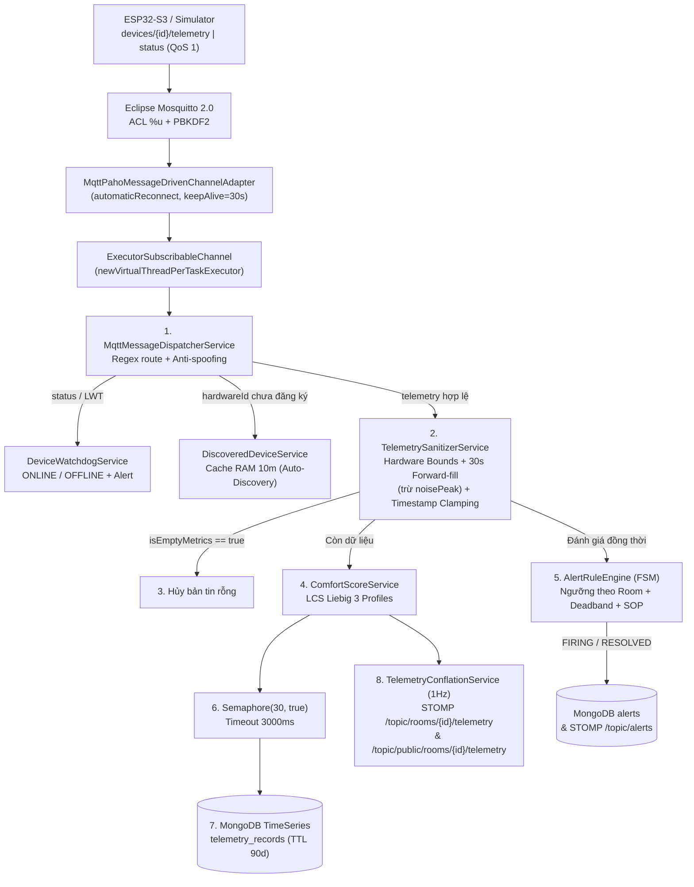
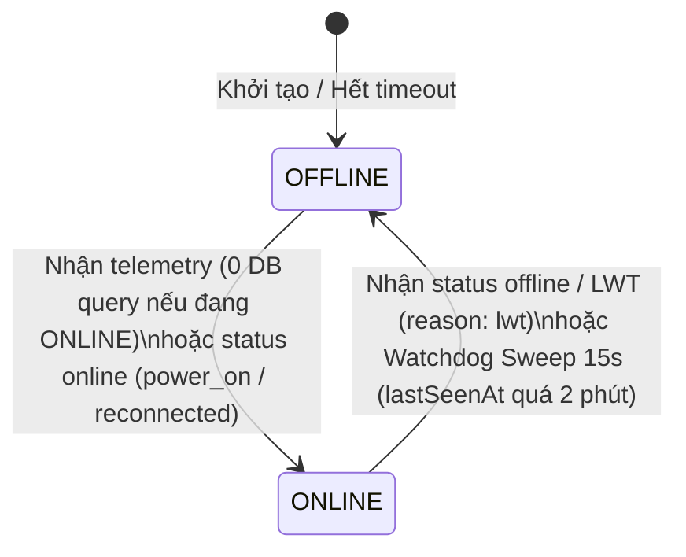
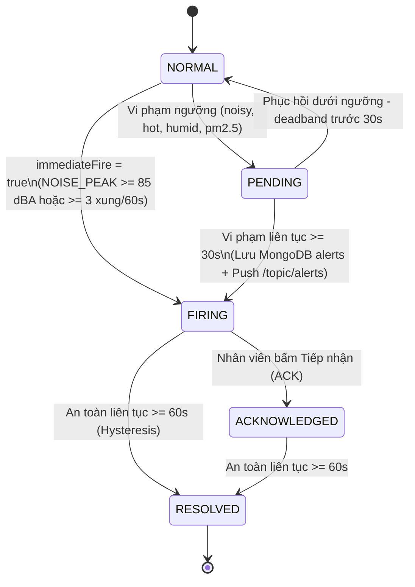

# 04 — Pipeline Thu Nạp Dữ Liệu, Watchdog & Động Cơ Cảnh Báo

> **Tài liệu**: `docs/04-ingestion-and-alerts.md` | **Phiên bản**: 2.1 | **Mã nguồn SSOT**: [`MqttConfig`](../src/main/java/com/example/AIoTLibTQB/configuration/MqttConfig.java), [`MqttMessageDispatcherService`](../src/main/java/com/example/AIoTLibTQB/service/MqttMessageDispatcherService.java), [`TelemetrySanitizerService`](../src/main/java/com/example/AIoTLibTQB/service/TelemetrySanitizerService.java), [`DeviceWatchdogService`](../src/main/java/com/example/AIoTLibTQB/service/DeviceWatchdogService.java), [`AlertRuleEngine`](../src/main/java/com/example/AIoTLibTQB/service/AlertRuleEngine.java), [`AlertSopCatalog`](../src/main/java/com/example/AIoTLibTQB/configuration/AlertSopCatalog.java), [`TelemetryConflationService`](../src/main/java/com/example/AIoTLibTQB/service/TelemetryConflationService.java)
>
> [!NOTE]
> **TL;DR**: Gói tin MQTT QoS 1 từ Eclipse Mosquitto 2.0 đi vào kênh `ExecutorSubscribableChannel` trên **Java 21 Virtual Threads**, qua kiểm tra Anti-spoofing, bộ lọc vật lý 3 lớp (kèm ngoại lệ **không forward-fill `noisePeak`**), tính điểm LCS Liebig, đánh giá **Alert FSM động theo `RoomType`** (`30s` Pending, `60s` Hysteresis, Dual Noise Peak + SOP Catalog), giới hạn ghi MongoDB bằng `Semaphore(30, true)` và phát STOMP WebSocket ở nhịp `1Hz`.

---

## 1. Kiến trúc Pipeline Thu Nạp (8 Bước & 2 Luồng Độc Lập)

### 1.1. Cấu hình MQTT Inbound & Anti-Spoofing
- [`MqttConfig`](../src/main/java/com/example/AIoTLibTQB/configuration/MqttConfig.java): Thiết lập `cleanSession = true`, `automaticReconnect = true`, `keepAliveInterval = 30s`, `connectionTimeout = 10s`. Lắng nghe đồng thời `devices/+/telemetry` và `devices/+/status` với `QoS = 1`.
- [`MqttMessageDispatcherService`](../src/main/java/com/example/AIoTLibTQB/service/MqttMessageDispatcherService.java): Trích `topicHardwareId` bằng Regex `^devices/([^/]+)/status$` và `^devices/([^/]+)/telemetry$`, đối chiếu bắt buộc `topicHardwareId.equalsIgnoreCase(payload.getHardwareId())`. Nếu sai lệch (giả mạo định danh), bản tin bị hủy ngay và ghi log `WARN`.
- Thiết bị có `hardwareId` chưa đăng ký trong DB bị drop telemetry (tránh làm bẩn TimeSeries) và được đẩy vào hàng đợi RAM `DiscoveredDeviceService` (TTL `10m`) để Admin duyệt trên `/admin/devices/discovery`.

---

## 2. Bộ Lọc Vật Lý 3 Lớp (`TelemetrySanitizerService`)

### 2.1. Lớp 1 — Giới hạn Vật lý Phần cứng
Mọi giá trị ngoài dải `[Min, Max]` dưới đây bị loại bỏ và chuyển sang bước Forward-fill (`TelemetrySanitizerService#sanitize`):

| Trường DTO (`TelemetryPayload`) | Cảm biến tham chiếu | Min | Max | Đơn vị | Forward-fill `30s` |
| :--- | :--- | :---: | :---: | :---: | :---: |
| `acoustics.noiseAvg` | INMP441 ($L_{eq}$) | `30.0` | `110.0` | dBA | Có |
| `acoustics.noisePeak` | INMP441 ($L_{peak}$) | `30.0` | `130.0` | dBA | **KHÔNG** (`sanitizePeakWithoutForwardFill`) |
| `airQuality.pm1_0`, `pm2_5`, `pm4_0`, `pm10` | Sensirion SPS30 | `0.0` | `1000.0` | µg/m³ | Có |
| `environment.temperature` | Sensirion SHT30/31 | `0.0` | `60.0` | °C | Có |
| `environment.humidity` | Sensirion SHT30/31 | `0.0` | `100.0` | %RH | Có |
| `environment.lux` | ROHM BH1750 (16-bit) | `0.0` | `65535.0` | Lux | Có |

### 2.2. Lớp 2 — Forward-fill 30s & Ngoại lệ `noisePeak`
- Bộ đệm `fieldCache` (Caffeine, max `50,000` entries, `expireAfterAccess(10m)`) lưu `{deviceId}:{fieldKey} -> LastKnownValue`.
- Nếu một trường bị `null` hoặc ngoài dải vật lý nhưng bản ghi hợp lệ gần nhất cách hiện tại $\le 30\text{s}$ (`FORWARD_FILL_WINDOW`), server tự động bù giá trị gần nhất để tránh gián đoạn đường cong LCS.
- **Ngoại lệ `noisePeak`**: Phương thức `TelemetrySanitizerService#sanitizePeakWithoutForwardFill` tuyệt đối không bù xung âm đỉnh. Xung âm thanh (tiếng làm rơi sách, kéo ghế) chỉ tồn tại vài mili-giây; nếu forward-fill trong `30s` sẽ bóp méo bản chất âm học và gây báo động giả kéo dài.

### 2.3. Lớp 3 — Chuẩn hóa Timestamp & Hủy Bản Tin Rỗng
- **Nhận diện Epoch**: Nếu `rawTimestamp >= 100_000_000_000L` hiểu là Epoch milliseconds; nhỏ hơn hiểu là Epoch seconds.
- **Clamping (`MqttMessageDispatcherService#resolveTimestamp`)**:
  - `parsed.isBefore(2020-01-01T00:00:00Z)` (mạch mất nguồn chưa sync NTP) $\rightarrow$ kẹp về `Instant.now()`.
  - `parsed.isAfter(now.plusSeconds(60))` (lệch giờ tương lai quá 60s) $\rightarrow$ kẹp về `Instant.now()`.
  - Mốc quá khứ hợp lệ (2020 $\to$ hiện tại) từ chế độ **Offline Store-and-Forward** được **bảo toàn nguyên vẹn** để giữ đúng biểu đồ lịch sử.
- **Empty Record Discard**: Nếu sau khi lọc cả 3 nhóm `acoustics`, `airQuality`, `environment` đều rỗng (`isEmptyMetrics == true`), bản tin bị hủy trước khi tính LCS và ghi DB.

---

## 3. Giám Sát Sống Còn Thiết Bị (`DeviceWatchdogService`)

- **Phục hồi 0-DB-Query (`DeviceWatchdogService#handleIncomingTelemetry`)**: Duy trì `Set<String> offlineDeviceHardwareIds = ConcurrentHashMap.newKeySet()`. Khi có gói telemetry đến, gọi `offlineDeviceHardwareIds.remove(hardwareId)`: nếu thiết bị đang `ONLINE`, trả về `false` ngay lập tức mà **không tốn câu truy vấn MongoDB nào**. Nếu trả `true` (vừa hồi phục từ `OFFLINE`), mới cập nhật DB `connectionState = ONLINE`, đóng cảnh báo `DEVICE_OFFLINE` (`resolvedBy = "SYSTEM"`) và xóa cache metadata.
- **Quét nền 15s (`DeviceWatchdogService#scanOfflineDevices`)**: `@Scheduled(fixedRate = 15000)` kiểm tra các thiết bị `isActive == true` có `lastSeenAt < now - 2m` (hoặc `null`) bằng index `idx_active_lastseen`, chuyển `OFFLINE` và tạo cảnh báo `DEVICE_OFFLINE`.
- **Giảm tải ghi `lastSeenAt`**: `MqttMessageDispatcherService` dùng `lastSeenThrottleCache` (`30s`) để mỗi trạm đo chỉ cập nhật `lastSeenAt` xuống MongoDB tối đa 1 lần / 30 giây (trừ lúc vừa chuyển trạng thái `OFFLINE -> ONLINE`).
- **LWT (`Last Will and Testament`)**: Khi mạch đứt socket TCP quá keep-alive 30s mà không gửi `DISCONNECT`, Mosquitto tự phát `{"hardware_id":"...","status":"offline","reason":"lwt"}` lên `devices/{id}/status`, backend chuyển `OFFLINE` ngay không cần đợi 2 phút.

---

## 4. Động Cơ Cảnh Báo Thời Gian Thực (`AlertRuleEngine`)

### 4.1. Bộ Luật Động Theo Phòng, Deadbands & Dual Noise Peak
`AlertRuleEngine#resolveRoomContext` đọc cấu hình `Room.thresholds` trộn với mặc định theo `RoomType` (`RoomThresholdConfig#defaultFor`) và đệm trong `roomContextCache` (`10m`), tự động `invalidateRoomCache` khi gọi `PUT /api/v1/rooms/{id}/thresholds`.

| Metric (`metricType`) | Loại cảnh báo (`AlertType`) | Mức độ (`AlertSeverity`) | Điều kiện kích hoạt & Ngưỡng mặc định | Deadband hồi phục (`HYSTERESIS = 60s`) |
| :--- | :--- | :---: | :--- | :---: |
| **`NOISE_AVG`** | `NOISE_EXCEEDED` | `MEDIUM` | `noiseAvg > noiseAvgMax` (`65.0` Study / `70.0` Storage, Hall), chờ Pending `30s` | `2.0` dBA |
| **`NOISE_PEAK`** *(Tức thời)* | `NOISE_EXCEEDED` | `CRITICAL` | `noisePeak >= noisePeakImmediate` (`85.0` dBA) $\rightarrow$ **Báo động ngay (`immediateFire`)** | `2.0` dBA (dưới `noisePeakMax - 2.0`) |
| **`NOISE_PEAK`** *(Xung lặp)* | `NOISE_EXCEEDED` | `HIGH` | `noisePeak > noisePeakMax` (`75.0` Study / `80.0` Storage, Hall) **$\ge 3$ xung trong `60s`** $\rightarrow$ **Báo động ngay** | `2.0` dBA |
| **`TEMPERATURE`** | `AIR_UNHEALTHY` | `MEDIUM` | `temperature > tempMax` (`32.0` Study, Hall / `24.0` Storage), chờ Pending `30s` | `0.8` °C |
| **`HUMIDITY_HIGH`** | `AIR_UNHEALTHY` | `HIGH` | Chỉ `BOOK_STORAGE`: `humidity > humidityMax` (`60.0` %RH), chờ Pending `30s` | `2.0` %RH |
| **`HUMIDITY_LOW`** | `AIR_UNHEALTHY` | `MEDIUM` | Chỉ `BOOK_STORAGE`: `humidity < humidityMin` (`45.0` %RH), chờ Pending `30s` | `2.0` %RH |
| **`PM2_5`** | `AIR_UNHEALTHY` | `HIGH` | `pm2_5 > pm25Max` (`50.0` Study, Hall / `35.0` Storage), chờ Pending `30s` | `5.0` µg/m³ |
| **`DEVICE_OFFLINE`** | `DEVICE_OFFLINE` | `HIGH` | Quá `120s` không có tin hoặc nhận MQTT LWT | Tự đóng khi có tin mới |

### 4.2. Hướng dẫn Quy trình Chuẩn (`AlertSopCatalog`) & Phục hồi Sau Restart
- **SOP Catalog**: Khi phát sinh hoặc migrate cảnh báo, `AlertSopCatalog#resolveSop` gắn trực tiếp khuyến nghị hành động (`recommendedAction`) theo `metricType`, `AlertType` và `RoomType` (ví dụ: bật máy hút ẩm `45–55%RH` cho `BOOK_STORAGE`, nhắc bạn đọc sang phòng nhóm Tầng 5 cho `STUDY_ROOM`, tăng lọc HEPA cho `PM2_5`).
- **Startup Rehydration (`@PostConstruct`)**: `AlertRuleEngine#rehydrateActiveAlerts` chạy `migrateLegacyAlertsSeverity()` (bù `severity`, `severityRank`, `metricType`, `recommendedAction` cho dữ liệu cũ) rồi nạp lại toàn bộ cảnh báo `FIRING` / `ACKNOWLEDGED` vào `fsmMap` (`{targetId}:{metricType}`) để không mất trạng thái theo dõi hysteresis khi backend khởi động lại.
- **An toàn Virtual Threads**: Khối `fsmMap.compute(...)` chỉ tính toán trong RAM; các thao tác Blocking I/O (`alertRepository.save`, `realtimePublisher.publishAlert`) nằm hoàn toàn ngoài `compute()`. *(Lưu ý: riêng danh sách xung ngắn `noisePeakPulsesMap` dùng `synchronized (pulses)` trên `ArrayList<Instant>` thuần RAM trong vài nanô-giây, không chứa bất kỳ thao tác I/O nào.)*

---

## 5. Kiểm Soát Tải & Bảng Tổng Hợp Bộ Đệm In-Memory

- **Điều tiết ghi TimeSeries (`MqttMessageDispatcherService`)**: `Semaphore(30, true)` (FIFO fair) với thời gian chờ tối đa `3000ms`. Nếu MongoDB nghẽn I/O quá 3s, virtual thread thả bỏ gói tin an toàn (load shedding) để tránh cạn pool kết nối và OOM.
- **STOMP Conflation `1Hz` (`TelemetryConflationService`)**: Gom bản tin theo `roomId`, bỏ qua trùng lặp chữ ký dữ liệu và đẩy xuống `/topic/rooms/{roomId}/telemetry` cùng `/topic/public/rooms/{roomId}/telemetry` ở chu kỳ `1000ms` (`@Scheduled(fixedRate = 1000)`).

| Thành phần Bộ đệm / Đồng bộ | Lớp chứa | Dung lượng / Cơ chế | Chính sách Hết hạn / Timeout | Mục đích |
| :--- | :--- | :---: | :---: | :--- |
| **`DeviceMetadataCache`** | `DeviceMetadataCacheImpl` | Max `10,000` | `expireAfterWrite(30m)` | Cache `{hardwareId -> roomId, zoneId, isActive}` |
| **`DiscoveredDeviceService`** | `DiscoveredDeviceService` | Max `1,000` | `expireAfterWrite(10m)` | Hàng đợi auto-discovery thiết bị chưa đăng ký |
| **`lastSeenThrottleCache`** | `MqttMessageDispatcherService` | Max `10,000` | `expireAfterWrite(30s)` | Giới hạn ghi `lastSeenAt` tối đa 1 lần / 30s / node |
| **`fieldCache`** | `TelemetrySanitizerService` | Max `50,000` | `expireAfterAccess(10m)` | Bộ nhớ Forward-fill `30s` cho 8 chỉ số (trừ `noisePeak`) |
| **`roomTypeCache`** | `ComfortScoreService` | Max `1,000` | `expireAfterWrite(10m)` | Cache `RoomType` phục vụ chấm điểm LCS |
| **`roomContextCache`** | `AlertRuleEngine` | Max `1,000` | `expireAfterWrite(10m)` | Cache `RoomType + RoomThresholdConfig` cho Alert FSM |
| **`ipBuckets`** | `RateLimitFilter` | Max `10,000` | `expireAfterAccess(10m)` | Token bucket Bucket4j chống brute-force & spam |
| **`LatestTelemetryCache`** | `LatestTelemetryCacheImpl` | `ConcurrentHashMap` | Ghi đè theo `deviceId` / `roomId` | Truy vấn `/latest` dưới 2ms, 0 DB hit |
| **`offlineDeviceHardwareIds`** | `DeviceWatchdogService` | `ConcurrentHashMap.newKeySet()` | Xóa khi nhận telemetry/online | Phục hồi 0-DB-query cho thiết bị đang `ONLINE` |

---

**Đọc tiếp**: [03 — Thuật toán LCS](./03-lcs-algorithm.md) · [05 — Mô hình Dữ liệu MongoDB](./05-data-model.md) · [10 — Phần cứng IoT & Simulator](./10-iot-hardware-and-simulator.md) · [11 — Quy chuẩn Phát triển](./11-conventions.md)
