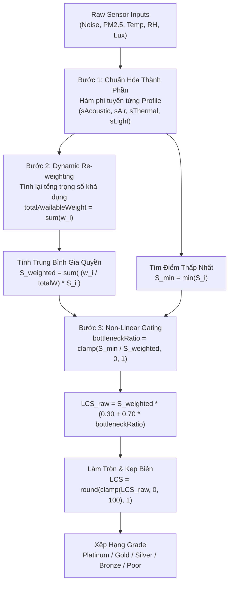

# Thuật Toán LCS (Library Comfort Score) & Nguyên Lý Thùng Gỗ Liebig

## 1. Mục Tiêu
Tài liệu này đặc tả cơ sở khoa học, công thức toán học và thiết kế thuật toán **Điểm Tiện Nghi Thư Viện (Library Comfort Score — LCS)** trong hệ thống AIoTLibTQB. Mục tiêu chính bao gồm:
- Trình bày triết lý ứng dụng **Nguyên lý Thùng gỗ Liebig (Liebig's Law of the Minimum)** nhằm phản ánh chính xác chất lượng môi trường không gian học tập và bảo tồn tài liệu.
- Quy chuẩn hóa công thức tính toán phi tuyến (Piecewise Linear & Non-linear Gating Formula) cho 4 nhóm chỉ số: Âm học, Không khí, Nhiệt ẩm, Ánh sáng theo 3 tiêu chuẩn quốc tế: **ISO 11799**, **ASHRAE 55**, và **WHO Air Quality Guidelines**.
- Đặc tả ma trận trọng số và thuật toán **Tái phân bổ trọng số động (Dynamic Re-weighting)** khi mạng cảm biến bị khuyết thiếu một số đầu đo.
- Cung cấp ví dụ tính tay có số liệu cụ thể (Worked Numerical Examples) từng bước giúp lập trình viên và kiểm thử viên đối soát kết quả.
- Tổng hợp các ca kiểm thử biên (Boundary Test Cases) dựa trên bộ test JUnit 5 thực tế tại `ComfortScoreServiceTest.java`.
- Ghi nhận trạng thái cấu hình hiện tại và đề xuất kiến trúc trong mục `TODO: cần xác nhận`.

---

## 2. Đối Tượng Đọc
- **Backend Engineers**: Cài đặt, bảo trì và tối ưu hóa động cơ tính toán trong `ComfortScoreService.java`.
- **Data Scientists & Algorithm Engineers**: Nghiên cứu, tinh chỉnh hàm phân phối điểm số và mô hình vi khí hậu.
- **Library Domain Experts & Quản Trị Viên**: Nắm rõ tiêu chí đánh giá chất lượng phòng học và quy chuẩn bảo quản kho sách cổ.
- **QA / Test Automation Engineers**: Thiết kế ma trận kiểm thử tự động, xác minh tính toàn vẹn của thuật toán qua các ngưỡng biên.

---

## 3. Nội Dung Chi Tiết

### 3.1. Triết Lý & Cơ Sở Khoa Học: Nguyên Lý Thùng Gỗ Liebig

Trong sinh thái học nông nghiệp, **Định luật Tối thiểu của Justus von Liebig (Liebig's Law of the Minimum)** khẳng định:  
> *"Sự phát triển của sinh vật bị khống chế bởi yếu tố dinh dưỡng khan hiếm nhất (thanh gỗ ngắn nhất của chiếc thùng), chứ không phải bởi tổng lượng tài nguyên dồi dào có sẵn (những thanh gỗ dài nhất)."*

```
         +-----------------------------+
         |    THÙNG GỖ LIEBIG MÔI TRƯỜNG |
         +-----------------------------+
         |   Nhiệt độ:   [====================] 100đ
         |   Ánh sáng:   [====================] 100đ
         |   Không khí:  [====================] 100đ
         |   Âm thanh:   [====] 20đ   <-- Mức nước rò rỉ!
         +-----------------------------+
           ==> Điểm LCS tổng thể sụp đổ theo thanh âm thanh!
```

#### Hạn Chế Của Cách Tính Trung Bình Cộng Truyền Thống
Nhiều hệ thống IoT dân dụng tính điểm tiện nghi bằng phương pháp trung bình cộng gia quyền thông thường ($S_{score} = \sum w_i S_i$). Phương pháp này tiềm ẩn rủi ro rất lớn:
- *Ví dụ*: Một phòng tự học có chất lượng không khí hoàn hảo (100đ), nhiệt ẩm lý tưởng (100đ), ánh sáng chuẩn mực (100đ), nhưng tiếng ồn ở mức công trường xây dựng 85 dBA (0đ).
- Nếu tính trung bình theo trọng số: $S_{score} = 0.35 \times 0 + 0.30 \times 100 + 0.20 \times 100 + 0.15 \times 100 = 65.0\,\text{điểm}$ (Xếp loại **Silver — Đạt chuẩn**!).
- *Thực tế*: Không một bạn đọc nào có thể tập trung học tập trong môi trường 85 dBA. Cách tính trung bình cộng đã "che giấu" thảm họa âm học bằng sự hoàn hảo của các yếu tố khác.

#### Cơ Chế Non-Linear Gating Của AIoTLibTQB
Để giải quyết bài toán trên, AIoTLibTQB áp dụng công thức chặn phi tuyến (Non-linear Gating Factor) mô phỏng rò rỉ của thùng gỗ:
$$\text{bottleneckRatio} = \frac{S_{min}}{S_{weighted}}$$
$$\text{LCS} = S_{weighted} \times \left( 0.30 + 0.70 \times \text{bottleneckRatio} \right)$$

- Khi mọi yếu tố đồng đều ($S_{min} = S_{weighted} \implies \text{bottleneckRatio} = 1.0$): Hệ số phạt bằng 1.0, $\text{LCS} = S_{weighted}$.
- Khi xuất hiện thanh gỗ ngắn nhất bị sụp đổ ($S_{min} \to 0 \implies \text{bottleneckRatio} \to 0$): $\text{LCS} \to S_{weighted} \times 0.30$. Điểm số tổng thể bị kéo sập xuống tối đa chỉ còn **30% điểm trung bình**, ngay lập tức rơi vào mức **Poor** để cảnh báo thủ thư can thiệp.

#### 3.1.2. So Sánh Đối Sánh: Giải Thuật Liebig Non-Linear Gating vs Chuẩn AirGradient GO IAQS

Nhằm đánh giá tính ưu việt của giải thuật LCS trong môi trường thư viện học thuật, bảng đối chiếu dưới đây so sánh mô hình Liebig Gating của AIoTLibTQB với chuẩn đánh giá chất lượng không khí học tập **AirGradient GO IAQS** (Indoor Air Quality Score):

| Tiêu Chí Đánh Giá | Chuẩn Công Nghiệp AirGradient GO IAQS | Giải Thuật AIoTLibTQB Liebig Non-linear Gating | Nhận Xét & Ưu Thế Của AIoTLibTQB |
| :--- | :--- | :--- | :--- |
| **Phạm vi giám sát** | Tập trung vào chất lượng không khí: PM2.5, CO2, TVOC, NOx, Nhiệt ẩm | Giám sát toàn diện 4 trục: **Âm học**, **Bụi mịn**, **Nhiệt ẩm**, **Chiếu sáng** | AIoTLibTQB mở rộng trục Âm học ($L_{eq}, L_{peak}$) và Ánh sáng ($Lux$), là 2 yếu tố sống còn với môi trường đọc sách và bảo tồn tài liệu. |
| **Hàm tổng hợp điểm** | Trung bình số học hoặc phân đoạn cực đại (Worst-case pollutant categorical mapping) | **Non-linear Gating Factor**: Phạt sụp đổ phi tuyến theo tỷ số nút cổ chai $S_{min} / S_{weighted}$ | Loại bỏ hiện tượng trung bình cộng bù trừ (Masking effect); nếu tiếng ồn quá tải hoặc bụi mịn nguy hại, điểm tiện nghi bị sập xuống mức Poor ngay cả khi các chỉ số khác 100 điểm. |
| **Độ nhạy yếu tố giới hạn** | Cố định bậc thang (Step function: Good/Fair/Poor) | Hàm liên tục trơn (Continuous gating factor): $\text{LCS} = S_{weighted} \times (0.30 + 0.70 \times \text{ratio})$ | Không bị giật bậc tại các điểm tiếp giáp; phản ánh mượt mà trên biểu đồ xu hướng thời gian thực. |
| **Xử lý khi khuyết cảm biến** | Thường gán giá trị mặc định hoặc coi là 0 / loại khỏi tính toán | **Tái phân bổ trọng số động (Dynamic Re-weighting)**: Chuẩn hóa lại tổng trọng số khả dụng $\sum w'_i = 1.0$ | Không phạt nhầm thiết bị chưa gắn cảm biến (không ép $S_{min} = 0$), bảo toàn độ chính xác của chỉ số tổng hợp. |
| **Độ trễ và phân loại phòng** | Dùng một ngưỡng tĩnh cho mọi phòng học | Phân chia **3 Profiles chuyên biệt**: `STUDY_ROOM`, `BOOK_STORAGE`, `CIRCULATION_HALL` | Tối ưu hóa theo chuẩn quốc tế: ISO 11799 cho kho sách cổ, ASHRAE 55 cho phòng tự học, tối ưu dải ánh sáng và mức ồn theo từng công năng. |

---

### 3.2. Công Thức Tính Toán Chi Tiết Từng Bước

Được triển khai trong mã nguồn tại `src/main/java/com/example/AIoTLibTQB/service/ComfortScoreService.java:84-157`:



#### Bước 1: Chuẩn Hóa 9 Chỉ Số Cảm Biến Về Thang Điểm $S_i \in [0, 100]$

##### 1.1. Điểm Thành Phần Âm Học ($S_{acoustic}$)
Hàm `calculateAcousticScore()` (`ComfortScoreService.java:160-216`):
- **Profile `STUDY_ROOM`** (Chuẩn ANSI/ASA S12.60 & WHO):
  - $L_{avg} \le 35.0\,\text{dBA}$: $S_{base} = 100.0$
  - $35.0 < L_{avg} \le 55.0\,\text{dBA}$: $S_{base} = 100.0 - (L_{avg} - 35.0) \times 1.5$
  - $55.0 < L_{avg} \le 70.0\,\text{dBA}$: $S_{base} = 70.0 - (L_{avg} - 55.0) \times \frac{40.0}{15.0}$
  - $70.0 < L_{avg} \le 80.0\,\text{dBA}$: $S_{base} = 30.0 - (L_{avg} - 70.0) \times 3.0$
  - $L_{avg} > 80.0\,\text{dBA}$: $S_{base} = 0.0$
  - **Phạt xung âm tức thời (Peak Acoustic Penalty)**: Nếu $L_{peak} > 70.0\,\text{dBA}$:
    $$\text{penalty} = \min(20.0, (L_{peak} - 70.0) \times 1.0)$$
    $$S_{acoustic} = \max(0.0, S_{base} - \text{penalty})$$
- **Profile `BOOK_STORAGE`** (Kho sách quý không có người học, chỉ tránh chấn động âm thanh cực lớn làm rơi sách):
  - $L_{avg} \le 60.0\,\text{dBA}$: $S_{acoustic} = 100.0$
  - $60.0 < L_{avg} \le 85.0\,\text{dBA}$: $S_{acoustic} = \max(0.0, 100.0 - (L_{avg} - 60.0) \times 4.0)$
  - $L_{avg} > 85.0\,\text{dBA}$: $S_{acoustic} = 0.0$ (Không áp dụng phạt xung đỉnh).
- **Profile `CIRCULATION_HALL`** (Sảnh dịch vụ mượn trả, chấp nhận tiếng trao đổi bình thường):
  - $L_{avg} \le 50.0\,\text{dBA}$: $S_{base} = 100.0$
  - $50.0 < L_{avg} \le 65.0\,\text{dBA}$: $S_{base} = 100.0 - (L_{avg} - 50.0) \times \frac{20.0}{15.0}$
  - $65.0 < L_{avg} \le 75.0\,\text{dBA}$: $S_{base} = 80.0 - (L_{avg} - 65.0) \times 4.0$
  - $75.0 < L_{avg} \le 85.0\,\text{dBA}$: $S_{base} = 40.0 - (L_{avg} - 75.0) \times 4.0$
  - $L_{avg} > 85.0\,\text{dBA}$: $S_{base} = 0.0$
  - Phạt nếu $L_{peak} > 80.0\,\text{dBA}$: $\text{penalty} = \min(15.0, (L_{peak} - 80.0) \times 1.0)$.

##### 1.2. Điểm Thành Phần Chất Lượng Không Khí Bụi Mịn ($S_{air}$ — $\text{PM}_{2.5}$)
Hàm `calculateAirScore()` (`ComfortScoreService.java:219-257`):
- **Profile `STUDY_ROOM` & `BOOK_STORAGE`** (Chuẩn WHO & Bảo vệ tài liệu):
  - $\text{PM}_{2.5} \le 10.0\,\mu\text{g/m}^3$: $100.0$ điểm (Khuyến nghị WHO).
  - $10.0 < \text{PM}_{2.5} \le 15.0$: $100.0 - (\text{PM}_{2.5} - 10.0) \times 3.0$
  - $15.0 < \text{PM}_{2.5} \le 35.0$: $85.0 - (\text{PM}_{2.5} - 15.0) \times 1.25$
  - $35.0 < \text{PM}_{2.5} \le 55.0$: $60.0 - (\text{PM}_{2.5} - 35.0) \times 1.5$
  - $55.0 < \text{PM}_{2.5} \le 100.0$: $\max\left(0.0, 30.0 - (\text{PM}_{2.5} - 55.0) \times \frac{30.0}{45.0}\right)$
  - $\text{PM}_{2.5} > 100.0\,\mu\text{g/m}^3$: $0.0$ điểm.
- **Profile `CIRCULATION_HALL`** (Mật độ lưu thông cao, dải đo nới lỏng):
  - $\text{PM}_{2.5} \le 15.0$: $100.0$ điểm.
  - $15.0 < \text{PM}_{2.5} \le 25.0$: $100.0 - (\text{PM}_{2.5} - 15.0) \times 1.5$
  - $25.0 < \text{PM}_{2.5} \le 45.0$: $85.0 - (\text{PM}_{2.5} - 25.0) \times 1.25$
  - $45.0 < \text{PM}_{2.5} \le 65.0$: $60.0 - (\text{PM}_{2.5} - 45.0) \times 1.5$
  - $65.0 < \text{PM}_{2.5} \le 100.0$: $\max\left(0.0, 30.0 - (\text{PM}_{2.5} - 65.0) \times \frac{30.0}{35.0}\right)$
  - $\text{PM}_{2.5} > 100.0$: $0.0$ điểm.

##### 1.3. Điểm Thành Phần Nhiệt Ẩm ($S_{thermal}$)
Hàm `calculateThermalScore()` (`ComfortScoreService.java:260-356`):
- **Profile `STUDY_ROOM`** (Chuẩn ASHRAE 55 — Tiện nghi người học):
  - Nhiệt độ tối ưu $[23.5, 25.5]^\circ\text{C}$ ($S_T = 100.0$). Lệch ra ngoài phạt $8.0\,\text{điểm}/^\circ\text{C}$:
    $$S_T = \max(0.0, 100.0 - |\Delta T| \times 8.0)$$
  - Độ ẩm tối ưu $[40.0, 60.0]\%\text{RH}$ ($S_{RH} = 100.0$). Lệch ra ngoài phạt $2.0\,\text{điểm}/\%$:
    $$S_{RH} = \max(0.0, 100.0 - |\Delta RH| \times 2.0)$$
  - Tổng hợp: $S_{thermal} = 0.70 \times S_T + 0.30 \times S_{RH}$ (hoặc lấy 100% chỉ số nếu 1 trong 2 bị thiếu).
- **Profile `BOOK_STORAGE`** (Chuẩn ISO 11799 & IFLA — Bảo tồn tài liệu):
  - Nhiệt độ tối ưu $[18.0, 22.0]^\circ\text{C}$ ($S_T = 100.0$). Nếu $T < 18^\circ\text{C}$: phạt nhẹ $5.0\,\text{điểm}/^\circ\text{C}$. Nếu $T > 22^\circ\text{C}$: phạt rất nặng **$12.0\,\text{điểm}/^\circ\text{C}$** (nhiệt cao đẩy nhanh tốc độ axit hóa làm giòn và ố vàng giấy).
  - Độ ẩm tối ưu $[45.0, 55.0]\%\text{RH}$ ($S_{RH} = 100.0$). Nếu $RH < 45\%$: phạt $3.0\,\text{điểm}/\%$. Nếu $RH > 55\%$: phạt rất nặng **$6.0\,\text{điểm}/\%$** (ẩm cao kích thích bào tử nấm mốc phá hủy gáy sách và sợi xenlulozo).
  - Tổng hợp: $S_{thermal} = 0.50 \times S_T + 0.50 \times S_{RH}$ (trọng số nhiệt và ẩm ngang nhau).
- **Profile `CIRCULATION_HALL`**:
  - Nhiệt độ tối ưu $[24.0, 26.5]^\circ\text{C}$ (phạt lệch $8.0\,\text{điểm}/^\circ\text{C}$).
  - Độ ẩm tối ưu $[40.0, 65.0]\%\text{RH}$ (phạt lệch $2.0\,\text{điểm}/\%$).
  - Tổng hợp: $S_{thermal} = 0.60 \times S_T + 0.40 \times S_{RH}$.

##### 1.4. Điểm Thành Phần Chiếu Sáng ($S_{light}$)
Hàm `calculateLightScore()` (`ComfortScoreService.java:359-414`):
- **Profile `STUDY_ROOM`** (Chuẩn EN 12464-1 — Chiếu sáng nơi làm việc trong nhà):
  - Tối ưu $[400.0, 600.0]\,\text{Lux}$: $100.0$ điểm.
  - Thiếu sáng ($Lux < 400$): Nếu $Lux \le 50$: $0.0$ điểm (quá tối). Từ $50 - 400$: $S_{light} = \frac{Lux - 50}{3.5}$.
  - Thừa sáng / chói lóa ($Lux > 600$): Từ $600 - 1200$: giảm về $50$ điểm. Từ $1200 - 2000$: giảm về $0$ điểm. Trên $2000\,\text{Lux}$: $0.0$ điểm.
- **Profile `BOOK_STORAGE`** (Chuẩn ISO 11799 — Tối ưu phòng tối bảo tồn):
  - Ánh sáng tối ưu $\le 100.0\,\text{Lux}$: $100.0$ điểm.
  - Từ $100 - 200\,\text{Lux}$: giảm $0.5\,\text{điểm}/\text{Lux}$.
  - Từ $200 - 500\,\text{Lux}$: giảm dốc về $0$.
  - Vượt quá $500.0\,\text{Lux}$: $0.0$ điểm (bức xạ quang học phá hủy màu mực cổ và keo dán).
- **Profile `CIRCULATION_HALL`**:
  - Tối ưu $[300.0, 500.0]\,\text{Lux}$: $100.0$ điểm. Dưới 50 hoặc trên 2000 Lux về 0 điểm.

---

#### Bước 2: Tái Phân Bổ Trọng Số Động (Dynamic Re-Weighting)
Khi một trạm đo IoT chưa lắp đủ cảm biến hoặc một đầu đo bị suy hao (ví dụ node không có cảm biến bụi mịn SPS30), hệ thống **tuyệt đối không gán $S_{air} = 0$** (vì nếu gán 0 điểm sẽ kích hoạt phạt sập Liebig oan uổng), mà tự động tái phân bổ tỷ lệ (`ComfortScoreService.java:100-139`):

$$W_{available} = \sum_{i \in \text{Available}} w_i$$
$$w'_i = \frac{w_i}{W_{available}}$$
$$S_{weighted} = \sum_{i \in \text{Available}} \left( w'_i \times S_i \right)$$

*Ý nghĩa*: Tổng trọng số thực tế $\sum w'_i$ luôn được chuẩn hóa đúng bằng $1.0$ ($100\%$), đảm bảo thang đo không bị méo mó.

##### Ví dụ Minh Họa Tái Phân Bổ Trọng Số Khi Thiếu Cảm Biến:
- Xét phòng tự học (`STUDY_ROOM`) với ma trận trọng số danh định 4 trục:
  - $w_{acoustic} = 0.35$ (Âm thanh 35%)
  - $w_{air} = 0.30$ (Bụi mịn 30%)
  - $w_{thermal} = 0.20$ (Nhiệt ẩm 20%)
  - $w_{light} = 0.15$ (Ánh sáng 15%)
- Giả sử trạm đo hỏng cảm biến bụi SPS30 (khuyết $S_{air}$):
  - Tổng trọng số khả dụng: $W_{available} = 0.35 + 0.20 + 0.15 = 0.70$.
  - Trọng số sau khi tái phân bổ:
    - $w'_{acoustic} = \frac{0.35}{0.70} = 0.500$ (Tăng từ 35% lên 50.0%)
    - $w'_{thermal} = \frac{0.20}{0.70} \approx 0.286$ (Tăng từ 20% lên 28.6%)
    - $w'_{light} = \frac{0.15}{0.70} \approx 0.214$ (Tăng từ 15% lên 21.4%)
    - Kiểm tra tổng: $0.500 + 0.286 + 0.214 = 1.000$ (Đúng 100%).
  - Điểm nút cổ chai $S_{min}$ chỉ xét trên tập các chỉ số khả dụng: $S_{min} = \min(S_{acoustic}, S_{thermal}, S_{light})$. Yếu tố bị khuyết hoàn toàn không tham gia vào việc xác định nút thắt cổ chai, bảo đảm không gây ra báo động giả.

---

#### Bước 3: Áp Dụng Phạt Liebig & Xếp Hạng Tiện Nghi
Triển khai tại `ComfortScoreService.java:140-156`:
1. Tìm điểm thành phần thấp nhất trong các cảm biến khả dụng:
   $$S_{min} = \min_{i \in \text{Available}} (S_i)$$
2. Tính tỷ số nghẽn thắt nút cổ chai (Bottleneck Ratio):
   $$\text{bottleneckRatio} = \text{clamp}\left(0.0, 1.0, \frac{S_{min}}{S_{weighted}}\right)$$
3. Tính điểm thô và kẹp dải $[0, 100]$:
   $$\text{LCS}_{raw} = S_{weighted} \times \left( 0.30 + 0.70 \times \text{bottleneckRatio} \right)$$
   $$\text{LCS} = \text{round}\left(\text{clamp}(0.0, 100.0, \text{LCS}_{raw}), 1\right)$$
4. Xác định hạng tiện nghi (Grade Mapping — `ComfortScoreService.java:416-431`):
   - $\text{LCS} \ge 90.0$: **Platinum** (Không gian hoàn hảo)
   - $\text{LCS} \ge 75.0$: **Gold** (Tiện nghi tối ưu)
   - $\text{LCS} \ge 60.0$: **Silver** (Đạt chuẩn tiện nghi)
   - $\text{LCS} \ge 45.0$: **Bronze** (Chấp nhận được)
   - $\text{LCS} < 45.0$: **Poor** (Kém / Không đạt chuẩn)

---

### 3.3. Ma Trận Trọng Số & Ngưỡng Cấu Hình Theo Loại Phòng

Được thiết lập cố định tại `ComfortScoreService.java:442-448`:

| Loại Không Gian (`RoomType`) | Trọng số Âm học ($w_{acoustics}$) | Trọng số Bụi mịn ($w_{air}$) | Trọng số Nhiệt ẩm ($w_{thermal}$) | Trọng số Ánh sáng ($w_{light}$) | Tiêu Chuẩn Tham Chiếu |
| :--- | :---: | :---: | :---: | :---: | :--- |
| **`STUDY_ROOM`**<br/>Phòng đọc sách & tự học yên tĩnh | **0.35** (35%) | 0.30 (30%) | 0.20 (20%) | 0.15 (15%) | ANSI/ASA S12.60, EN 12464-1, ASHRAE 55 |
| **`BOOK_STORAGE`**<br/>Kho bảo quản & lưu trữ sách quý | 0.05 (5%) | 0.30 (30%) | **0.50** (50%) | 0.15 (15%) | ISO 11799, IFLA Preservation Guidelines |
| **`CIRCULATION_HALL`**<br/>Sảnh mượn trả & dịch vụ bạn đọc | 0.20 (20%) | 0.30 (30%) | 0.25 (25%) | 0.25 (25%) | TCVN 8681, Tiêu chuẩn chiếu sáng công cộng |

*Phân tích tính thích ứng*:
- Trong `STUDY_ROOM`, tiếng ồn là nhân tố quyết định năng suất tư duy nên chiếm trọng số cao nhất (35%).
- Trong `BOOK_STORAGE`, sách không "nghe" thấy tiếng động, nhưng nhiệt độ cao và nấm mốc do ẩm ướt là nguyên nhân hàng đầu hủy hoại giấy cổ, do đó Nhiệt ẩm chiếm trọng số tối thượng (50%).

---

### 3.4. Ví Dụ Tính Tay Có Số Liệu Cụ Thể (Worked Numerical Examples)

#### Ví Dụ 1: Phòng Tự Học (`STUDY_ROOM`) Gặp Thảm Họa Tiếng Ồn
Giả sử trạm đo `ESP32_ROOM_101` gửi dữ liệu đo đạc:
- Âm học: $L_{avg} = 85.0\,\text{dBA}$, $L_{peak} = 90.0\,\text{dBA}$.
- Không khí: $\text{PM}_{2.5} = 5.0\,\mu\text{g/m}^3$.
- Môi trường: $T = 24.0^\circ\text{C}$, $RH = 50.0\%$, $Lux = 500.0\,\text{Lux}$.

**Bước 1: Tính điểm thành phần $S_i$**:
- Âm học ($L_{avg} = 85.0 > 80.0$): $S_{acoustic} = 0.0$ điểm.
- Không khí ($\text{PM}_{2.5} = 5.0 \le 10.0$): $S_{air} = 100.0$ điểm.
- Nhiệt ẩm ($T = 24.0 \in [23.5, 25.5] \implies S_T = 100.0$; $RH = 50.0 \in [40, 60] \implies S_{RH} = 100.0$):
  $$S_{thermal} = 0.70 \times 100.0 + 0.30 \times 100.0 = 100.0\,\text{điểm}$$
- Ánh sáng ($Lux = 500.0 \in [400, 600]$): $S_{light} = 100.0$ điểm.

**Bước 2: Tính trung bình có trọng số $S_{weighted}$**:
$$S_{weighted} = (0.35 \times 0.0) + (0.30 \times 100.0) + (0.20 \times 100.0) + (0.15 \times 100.0)$$
$$S_{weighted} = 0.0 + 30.0 + 20.0 + 15.0 = 65.0\,\text{điểm}$$

**Bước 3: Áp dụng phạt thùng gỗ Liebig**:
- Điểm thấp nhất: $S_{min} = \min(0.0, 100.0, 100.0, 100.0) = 0.0$.
- Tỷ số nghẽn: $\text{bottleneckRatio} = \frac{0.0}{65.0} = 0.0$.
- Tính điểm LCS:
  $$\text{LCS} = 65.0 \times \left( 0.30 + 0.70 \times 0.0 \right) = 65.0 \times 0.30 = 19.5\,\text{điểm}$$
- **Kết luận**: $\text{LCS} = 19.5$ điểm $\implies$ Xếp hạng **Poor**.  
  *Minh chứng code*: Khớp 100% với unit test `studyRoom_noiseDisaster_activatesLiebigBottleneck()` tại `ComfortScoreServiceTest.java:59-75`.

---

#### Ví Dụ 2: Kho Sách Quý (`BOOK_STORAGE`) Vi Phạm Nghiêm Trọng Chuẩn ISO 11799
Giả sử trạm đo trong kho lưu trữ gửi số liệu:
- Âm học: $L_{avg} = 55.0\,\text{dBA}$.
- Không khí: $\text{PM}_{2.5} = 6.0\,\mu\text{g/m}^3$.
- Môi trường: $T = 28.0^\circ\text{C}$ (quá nhiệt), $RH = 70.0\%$ (nguy cơ nấm mốc cực cao), $Lux = 50.0\,\text{Lux}$.

**Bước 1: Tính điểm thành phần $S_i$**:
- Âm học ($L_{avg} = 55.0 \le 60.0$): $S_{acoustic} = 100.0$ điểm.
- Không khí ($\text{PM}_{2.5} = 6.0 \le 10.0$): $S_{air} = 100.0$ điểm.
- Ánh sáng ($Lux = 50.0 \le 100.0$): $S_{light} = 100.0$ điểm.
- Nhiệt ẩm:
  + Nhiệt độ $T = 28.0^\circ\text{C} > 22.0^\circ\text{C}$ (Lệch $+6.0^\circ\text{C}$, phạt $12.0\,\text{đ}/^\circ\text{C}$):
    $$S_T = 100.0 - (28.0 - 22.0) \times 12.0 = 100.0 - 72.0 = 28.0\,\text{điểm}$$
  + Độ ẩm $RH = 70.0\% > 55.0\%$ (Lệch $+15.0\%$, phạt $6.0\,\text{đ}/\%$):
    $$S_{RH} = 100.0 - (70.0 - 55.0) \times 6.0 = 100.0 - 90.0 = 10.0\,\text{điểm}$$
  + Điểm nhiệt ẩm tổng hợp (trọng số $0.5 / 0.5$):
    $$S_{thermal} = 0.50 \times 28.0 + 0.50 \times 10.0 = 14.0 + 5.0 = 19.0\,\text{điểm}$$

**Bước 2: Tính trung bình có trọng số $S_{weighted}$** ($w = [0.05, 0.30, 0.50, 0.15]$):
$$S_{weighted} = (0.05 \times 100.0) + (0.30 \times 100.0) + (0.50 \times 19.0) + (0.15 \times 100.0)$$
$$S_{weighted} = 5.0 + 30.0 + 9.5 + 15.0 = 59.5\,\text{điểm}$$

**Bước 3: Áp dụng phạt thùng gỗ Liebig**:
- Điểm thấp nhất: $S_{min} = S_{thermal} = 19.0$.
- Tỷ số nghẽn: $\text{bottleneckRatio} = \frac{19.0}{59.5} \approx 0.3193$.
- Tính điểm LCS:
  $$\text{LCS}_{raw} = 59.5 \times \left( 0.30 + 0.70 \times 0.3193 \right) = 59.5 \times (0.30 + 0.2235) = 59.5 \times 0.5235 \approx 31.1\,\text{điểm}$$
- **Kết luận**: $\text{LCS} = 31.1$ điểm $\implies$ Xếp hạng **Poor**. Môi trường lập tức bị cảnh báo đỏ vì nguy cơ nấm mốc phá hủy tài liệu lịch sử.

---

#### Ví Dụ 3: Khuyết Cảm Biến PM2.5 & Ánh Sáng (Dynamic Re-Weighting)
Giả sử một trạm đo tiết kiệm chỉ gắn cảm biến âm thanh và nhiệt ẩm đặt tại phòng tự học `STUDY_ROOM`:
- Số đo: $L_{avg} = 30.0\,\text{dBA}$ ($100$ điểm), $T = 24.5^\circ\text{C}$ ($100$ điểm), $RH = 50.0\%$ ($100$ điểm).
- Thiếu hoàn toàn: `pm2_5 = null`, `lux = null`.

**Bước 1 & 2: Tái phân bổ trọng số**:
- Trọng số cơ sở: $w_{acoustic} = 0.35$, $w_{thermal} = 0.20$. (Tổng trọng số khả dụng $W_{available} = 0.35 + 0.20 = 0.55$).
- Chuẩn hóa lại trọng số:
  $$w'_{acoustic} = \frac{0.35}{0.55} \approx 0.6364 \quad (63.64\%)$$
  $$w'_{thermal} = \frac{0.20}{0.55} \approx 0.3636 \quad (36.36\%)$$
- Tính trung bình gia quyền:
  $$S_{weighted} = (0.6364 \times 100.0) + (0.3636 \times 100.0) = 100.0\,\text{điểm}$$
- Điểm thấp nhất: $S_{min} = 100.0 \implies \text{bottleneckRatio} = 1.0 \implies \text{LCS} = 100.0$ điểm.
- **Kết luận**: Đạt $100.0$ điểm **Platinum**, hai trường `airScore` và `lightScore` trong `ComfortScoreRecord` trả về `null` chính xác (`ComfortScoreServiceTest.java:193-212`).

---

### 3.5. Danh Mục Test Cases Kiểm Thử Biên (Boundary Test Cases)

Bộ kiểm thử tự động tại `src/test/java/com/example/AIoTLibTQB/service/ComfortScoreServiceTest.java` bao phủ 10 kịch bản biên quan trọng:

| STT | Tên Unit Test Method | Profile Kiểm Thử | Tình Huống Biên & Giá Trị Đo | Kết Quả Mong Đợi | Dòng Code Kiểm Thử |
| :---: | :--- | :--- | :--- | :--- | :--- |
| 1 | `studyRoom_idealEnvironment_returns100Platinum` | `STUDY_ROOM` | Môi trường lý tưởng: $L_{avg}=30, \text{PM}=8, T=24.5, RH=50, Lux=500$ | $LCS = 100.0$, Grade = `Platinum` | `ComfortScoreServiceTest.java:37-55` |
| 2 | `studyRoom_noiseDisaster_activatesLiebigBottleneck` | `STUDY_ROOM` | $L_{avg}=85.0$ (0đ), các chỉ số khác 100đ | $S_{min}=0, LCS=19.5$, Grade = `Poor` | `ComfortScoreServiceTest.java:57-75` |
| 3 | `studyRoom_peakAcousticPenalty_appliedCorrectly` | `STUDY_ROOM` | $L_{avg}=35.0$ (100đ), xung âm $L_{peak}=85.0$ ($>70$ phạt 15đ) | $S_{acoustic}=85.0, LCS=85.0$, Grade = `Gold` | `ComfortScoreServiceTest.java:77-92` |
| 4 | `bookStorage_idealConservation_returns100Platinum` | `BOOK_STORAGE` | $T=20^\circ\text{C}, RH=50\%, Lux=50, \text{PM}=6, L_{avg}=55$ | $LCS = 100.0$, Grade = `Platinum` | `ComfortScoreServiceTest.java:98-115` |
| 5 | `bookStorage_highHumidityAndTemp_severelyPenalized` | `BOOK_STORAGE` | $T=28.0^\circ\text{C}$ (phạt 72đ), $RH=70\%$ (phạt 90đ) | $S_{thermal}=19.0, LCS=19.0$, Grade = `Poor` | `ComfortScoreServiceTest.java:117-134` |
| 6 | `bookStorage_brightLight_severelyPenalized` | `BOOK_STORAGE` | Ánh sáng chói $Lux = 600.0$ ($>500$ phạt về 0) | $S_{light}=0.0, LCS=0.0$, Grade = `Poor` | `ComfortScoreServiceTest.java:136-150` |
| 7 | `circulationHall_counterNoise_acceptedNormally` | `CIRCULATION_HALL`| Tiếng ồn quầy mượn sách $L_{avg} = 65.0\,\text{dBA}$ | $S_{acoustic}=80.0, LCS=80.0$, Grade = `Gold` | `ComfortScoreServiceTest.java:156-170` |
| 8 | `circulationHall_idealServiceArea_returnsPlatinum` | `CIRCULATION_HALL`| Môi trường sảnh tiêu chuẩn: $L_{avg}=48, \text{PM}=14, T=25, Lux=400$ | $LCS = 100.0$, Grade = `Platinum` | `ComfortScoreServiceTest.java:172-186` |
| 9 | `dynamicReweighting_missingSensors_reweightsAccurately` | `STUDY_ROOM` | Khuyết thiếu $\text{PM}_{2.5}$ và $Lux$, chỉ có âm thanh và nhiệt ẩm | Tái phân bổ $0.35/0.55$ và $0.20/0.55$, $LCS=100.0$ | `ComfortScoreServiceTest.java:192-212` |
| 10 | `resolveRoomType_cachedCorrectly` | Hệ thống | Cache tra cứu `RoomType` bằng Caffeine Cache | Lần 1 gọi DB, lần 2 hit cache 0 DB query | `ComfortScoreServiceTest.java:233-255` |

---

### 3.6. Hiện Trạng Cấu Hình & Các Hạn Chế Cần Xác Nhận

```
+-------------------------------------------------------------------------------+
|                        TODO: CẦN XÁC NHẬN [LCS_DYNAMIC_CONFIG]                |
+-------------------------------------------------------------------------------+
| Hiện trạng mã nguồn:                                                          |
| 1. Toàn bộ trọng số ProfileWeights (acoustic, air, thermal, light) và các     |
|    ngưỡng piecewise linear đang được HARDCODED cố định dưới dạng Java code    |
|    tại ComfortScoreService.java:160-448.                                      |
| 2. Chưa có REST API (ví dụ PUT /api/v1/rooms/{id}/comfort-weights) hoặc bảng  |
|    CSDL trong MongoDB để Thủ thư/Quản trị viên tùy chỉnh trọng số theo mùa    |
|    hoặc theo yêu cầu triển lãm đặc thù.                                       |
|                                                                               |
| Đề xuất kiến trúc tương lai:                                                  |
| - Bổ sung trường dynamicProfileConfig vào Document Room.                      |
| - Thêm endpoint quản trị cấu hình kèm cơ chế invalidate Caffeine Cache       |
|   roomTypeCache khi có cập nhật mới.                                          |
+-------------------------------------------------------------------------------+
```

---

## 4. Mục "Đọc Tiếp"
Để tìm hiểu sâu hơn về cách tích hợp thuật toán LCS vào các tầng kiến trúc khác:
- [03-ingestion-pipeline.md](./03-ingestion-pipeline.md): Cách thức pipeline tiếp nhận dữ liệu cảm biến và chuyển giao cho `ComfortScoreService`.
- [05-data-model.md](./05-data-model.md): Chi tiết cấu trúc lưu trữ `ComfortScoreRecord` trong MongoDB TimeSeries Collection.
- [07-api-reference.md](./07-api-reference.md): Các endpoint REST trả về điểm LCS và lịch sử tiện nghi phòng đọc.
- [08-frontend.md](./08-frontend.md): Cách giao diện hiển thị huy hiệu phân hạng (Platinum, Gold...) và bản đồ nhiệt tiện nghi 2D.
