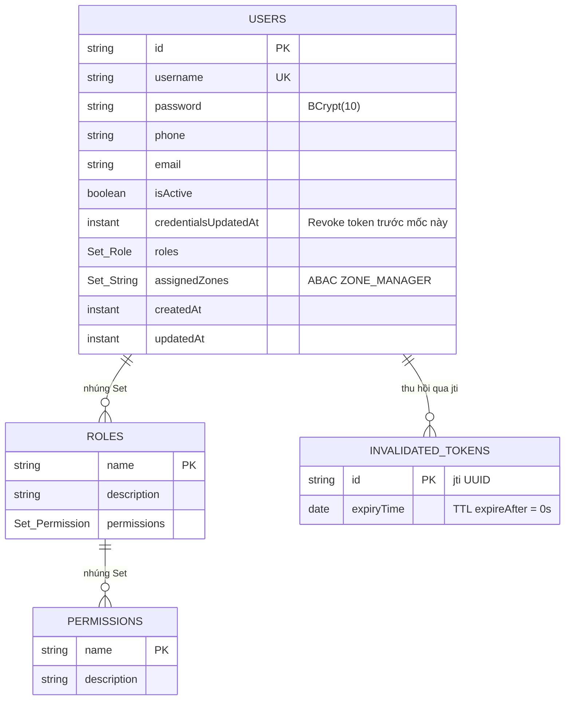
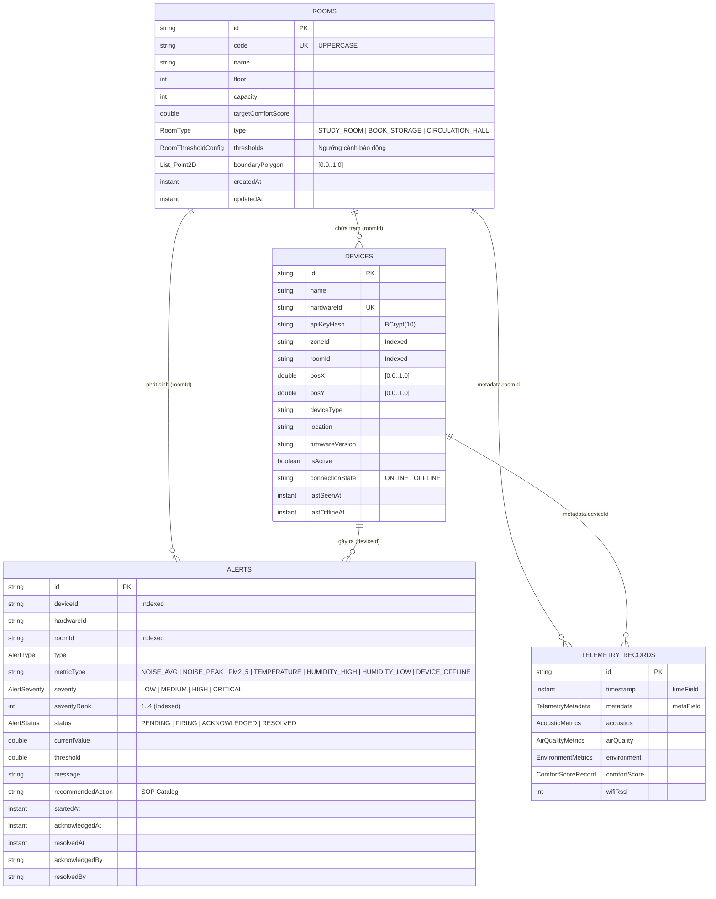

# 05 — Mô Hình Dữ Liệu & Kiến Trúc MongoDB 8.0

> **Tài liệu**: `docs/05-data-model.md` | **Phiên bản**: 2.1 | **Mã nguồn SSOT**: [`document/*.java`](../src/main/java/com/example/AIoTLibTQB/document/TelemetryRecord.java), [`TelemetryService`](../src/main/java/com/example/AIoTLibTQB/service/TelemetryService.java), [`ApplicationInitConfig`](../src/main/java/com/example/AIoTLibTQB/configuration/ApplicationInitConfig.java)
>
> [!NOTE]
> **TL;DR**: Cơ sở dữ liệu `aiot_identity_db` trên **MongoDB 8.0** gồm **1 TimeSeries Collection** (`telemetry_records`, `Granularity.SECONDS`, tự hủy sau **90 ngày** / `7,776,000s`) và **7 Document Collections** (`users`, `roles`, `permissions`, `rooms`, `devices`, `alerts`, `invalidated_tokens`). Dữ liệu lịch sử sử dụng **Aggregation Pipeline `$dateTrunc`** kèm hạn ngạch $\le 1000$ buckets.

---

## 1. Sơ Đồ Thực Thể Quan Hệ (Modular Domain ERD)

### 1.1. Sơ đồ Miền Bảo mật & Quản trị Người dùng (IAM)

### 1.2. Sơ đồ Miền Không gian, Thiết bị, Cảnh báo & Chuỗi thời gian

---

## 2. TimeSeries Collection: `telemetry_records`

Định nghĩa tại [`TelemetryRecord`](../src/main/java/com/example/AIoTLibTQB/document/TelemetryRecord.java):

- **Thuộc tính TimeSeries**: `timeField = "timestamp"`, `metaField = "metadata"` (`deviceId`, `hardwareId`, `roomId`), `granularity = Granularity.SECONDS`, `expireAfter = "7776000s"` (90 ngày).
- **Lợi ích Columnar Bucket Compression**: MongoDB 8.0 tự động gom các bản ghi cùng `metadata` vào các bucket nén tại `system.buckets.telemetry_records`, tiết kiệm 70–85% dung lượng và xóa theo từng bucket khi quá hạn 90 ngày mà không phân mảnh đĩa.
- **2 Compound Indexes**:
  - `telemetry_device_time_idx`: `{'metadata.deviceId': 1, 'timestamp': -1}` (tối ưu `/telemetry/device/{deviceId}/latest` và lịch sử thiết bị).
  - `telemetry_room_time_idx`: `{'metadata.roomId': 1, 'timestamp': -1}` (tối ưu `/telemetry/room/{roomId}/buckets`).

| Đường dẫn trường | Kiểu Java / BSON | Ý nghĩa & Giới hạn |
| :--- | :--- | :--- |
| `timestamp` | `Instant` / UTC Date | `timeField`, đã qua timestamp clamping |
| `metadata.{deviceId, hardwareId, roomId}` | `TelemetryMetadata` | `metaField` bất biến theo trạm đo |
| `acoustics.{noiseAvg, noisePeak}` | `Double` | `noiseAvg [30, 110]`, `noisePeak [30, 130]` (dBA) |
| `airQuality.{pm1_0, pm2_5, pm4_0, pm10}` | `Double` | Bụi mịn quang học `[0, 1000]` µg/m³ |
| `environment.{temperature, humidity, lux}` | `Double` | Nhiệt `[0, 60]` °C, Ẩm `[0, 100]` %, Sáng `[0, 65535]` Lux |
| `comfortScore.{overall, grade, acousticScore, airScore, thermalScore, lightScore}` | `ComfortScoreRecord` | Điểm LCS `[0, 100]` và hạng (`Platinum`–`Poor`) |
| `wifiRssi` | `Integer` | Cường độ Wi-Fi (dBm) |

---

## 3. Chi Tiết 7 Document Collections

| Collection | Lớp Java SSOT | Indexes & Ràng buộc chính | Ghi chú thiết kế |
| :--- | :--- | :--- | :--- |
| **`users`** | [`User`](../src/main/java/com/example/AIoTLibTQB/document/User.java) | `@Indexed(unique = true) username` | `password` băm BCrypt(10); nhúng `Set<Role>` và `Set<String> assignedZones`; `credentialsUpdatedAt` thu hồi mọi JWT cũ tức thì |
| **`roles`** | [`Role`](../src/main/java/com/example/AIoTLibTQB/document/Role.java) | `@Id name` | 7 vai trò hệ thống, nhúng `Set<Permission>` |
| **`permissions`** | [`Permission`](../src/main/java/com/example/AIoTLibTQB/document/Permission.java) | `@Id name` | 14 quyền hạn nguyên tử |
| **`rooms`** | [`Room`](../src/main/java/com/example/AIoTLibTQB/document/Room.java) | `@Indexed(unique = true) code` | `code` tự chuẩn hóa `trim().toUpperCase()`; nhúng `RoomThresholdConfig thresholds` và `List<Point2D> boundaryPolygon` |
| **`devices`** | [`Device`](../src/main/java/com/example/AIoTLibTQB/document/Device.java) | `@Indexed(unique = true) hardwareId`, `@Indexed zoneId`, `@Indexed roomId`, compound `idx_active_lastseen {'isActive': 1, 'lastSeenAt': 1}` | `apiKeyHash` lưu bằng BCrypt(10); `idx_active_lastseen` phục vụ Watchdog quét 15s không Full Scan |
| **`alerts`** | [`Alert`](../src/main/java/com/example/AIoTLibTQB/document/Alert.java) | `@Indexed` trên `deviceId`, `roomId`, `severityRank`; 3 compound indexes: `idx_alert_device_type_status`, `idx_alert_hardware_type_status`, `idx_alert_status_started` | Hỗ trợ sort theo `severityRank` (`LOW=1..CRITICAL=4`), `metricType` (`NOISE_AVG`, `HUMIDITY_HIGH`...), `recommendedAction` (SOP) và `resolvedBy` (`"SYSTEM"` hoặc username) |
| **`invalidated_tokens`** | [`InvalidatedToken`](../src/main/java/com/example/AIoTLibTQB/document/InvalidatedToken.java) | `@Id` (`jti`), `@Indexed(expireAfter = "0s") expiryTime` | Blacklist tự dọn cấp kernel khi token gốc hết hạn + cron 02:00 AM dự phòng |

---

## 4. Biểu Diễn Không Gian 2D Chuẩn Hóa `[0.0, 1.0]`

- Cả `Room.boundaryPolygon` (`List<Point2D>`) lẫn vị trí trạm `Device.(posX, posY)` dùng hệ quy chiếu chuẩn hóa `[0.0, 1.0]` (gốc `(0, 0)` tại góc trên bên trái, `(1, 1)` tại góc dưới bên phải của khung mặt bằng tầng tỉ lệ `76.0m × 57.2m`).
- **Phân tách trách nhiệm Backend vs Frontend**: `Point2D` phía Backend là value object `{Double x, Double y}` thuần túy. Toàn bộ kiểm tra hợp lệ đa giác, Ray-casting Point-in-Polygon và nội suy bản đồ nhiệt Gaussian RBF / IDW thực hiện tại Frontend (`frontend/src/lib/floorplan/`).

---

## 5. Downsampling Aggregation Pipeline (`$dateTrunc`)

Triển khai tại `TelemetryService#getBucketsByRoomId` nhằm nén hàng chục nghìn bản ghi thô thành chuỗi thời gian gọn nhẹ cho biểu đồ:
1. **`$match`**: Lọc `metadata.roomId` và khoảng `timestamp` bằng compound index `telemetry_room_time_idx`.
2. **`$group`**: Gom theo `{"$dateTrunc": {"date": "$timestamp", "unit": ..., "binSize": ...}}` cho 3 bước nhảy hợp lệ: `15m` (`minute`, `15`), `1h` (`hour`, `1`), `1d` (`day`, `1`), tính `Avg`/`Min`/`Max` cho `comfortScore`, `temperature`, `humidity`, `noiseAvg`, `pm2_5`, `lux` và `sampleCount`.
3. **`$sort`**: Tăng dần theo `_id` (`{"_id": 1}`).
- **Hạn ngạch bảo vệ**: Trước khi chạy Aggregation, nếu `(end - start) / stepSeconds > 1000` (hoặc thiếu tham số hợp lệ), trả về `AppException(ErrorCode.TOO_MANY_BUCKETS)` (HTTP 400).

---

## 6. Chiến Lược Khởi Tạo & Gieo Mầm Dữ Liệu (`ApplicationInitConfig`)

Khi Spring Boot khởi động, [`ApplicationInitConfig`](../src/main/java/com/example/AIoTLibTQB/configuration/ApplicationInitConfig.java) chạy idempotent:
1. Tạo đủ **14 Permissions** và **7 Roles** (`ADMIN`, `LIBRARIAN`, `ZONE_MANAGER`, `MAINTENANCE`, `VIEWER`, `USER`, `DEVICE`).
2. Khởi tạo tài khoản `admin` nếu chưa tồn tại dựa trên `INITIAL_ADMIN_PASSWORD` (`app.security.initial-admin-password`). Trong profile `prod` / `production`, nếu biến này trống hoặc không cấu hình, ứng dụng **dừng khởi động ngay** (`IllegalStateException`) để tránh mật khẩu mặc định.
3. Gieo phòng/thiết bị mẫu phục vụ demo được tách sang script idempotent `npm run provision` tại `tools/iot-simulator/src/provision.js` (`14 rooms / 23 devices` theo bản vẽ CAD).

---

**Đọc tiếp**: [04 — Ingestion & Cảnh báo](./04-ingestion-and-alerts.md) · [06 — Bảo mật & RBAC](./06-security-and-rbac.md) · [07 — REST API & Mã lỗi](./07-api-reference.md) · [09 — Bản đồ nhiệt Không gian 2D](./09-spatial-heatmap-2d.md)
