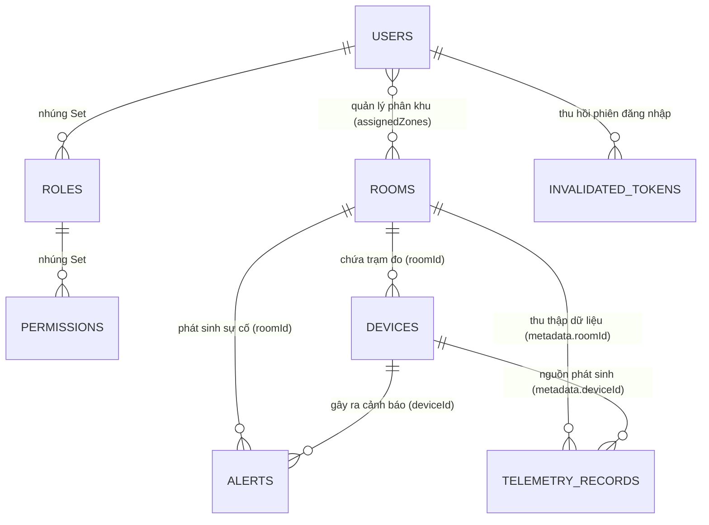
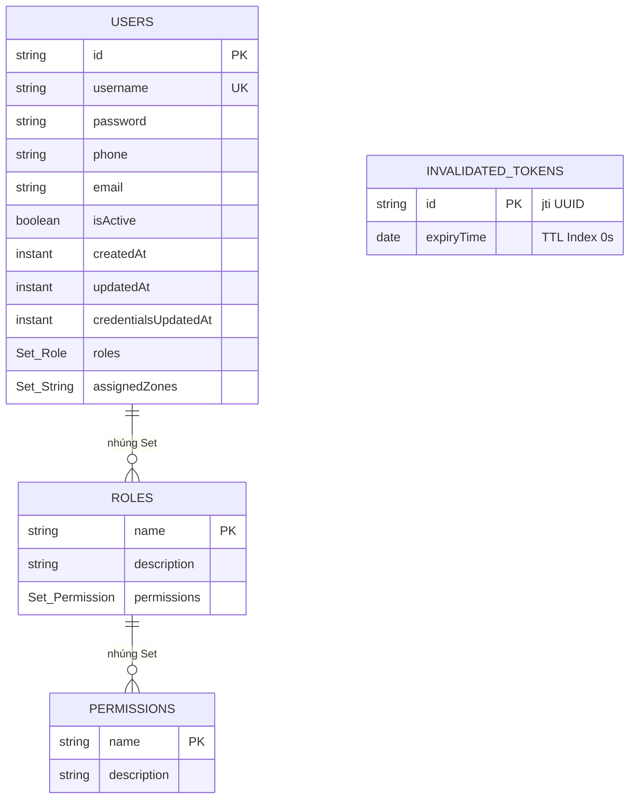
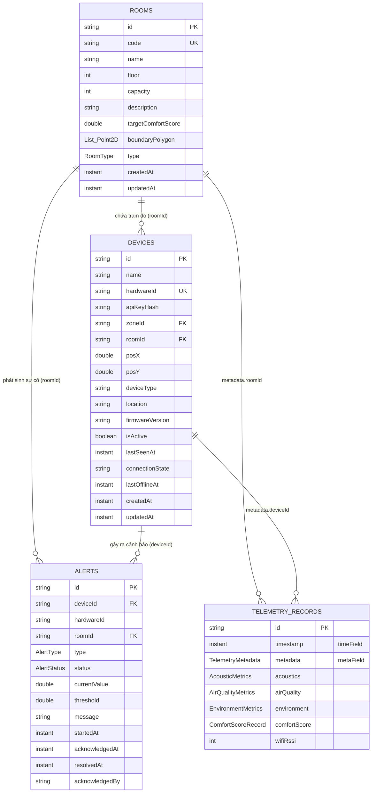
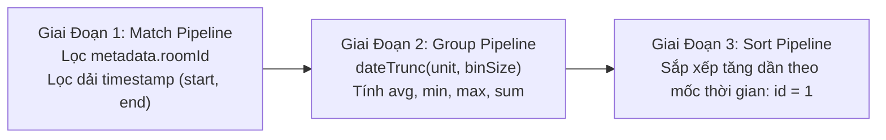

# Mô Hình Dữ Liệu & Kiến Trúc CSDL MongoDB

## 1. Mục Tiêu
Tài liệu này cung cấp đặc tả kiến trúc dữ liệu toàn diện của hệ sinh thái AIoTLibTQB trên nền tảng **MongoDB 8.0**. Mục tiêu chính bao gồm:
- Định nghĩa chi tiết cấu trúc tài liệu (Document Schema), kiểu dữ liệu (Java & BSON), ràng buộc tính toàn vẹn và chiến lược đánh chỉ mục (Indexing Strategy) cho toàn bộ 8 collections trong CSDL `aiot_identity_db`.
- Phân tích kiến trúc **Chuỗi Thời Gian (TimeSeries Collection)** `telemetry_records`, bao gồm cấu hình nén khối (bucket compression), tính hạt thời gian (`granularity = SECONDS`) và chính sách tự động xóa sau 90 ngày (`expireAfter = 7776000s`).
- Trình bày mô hình biểu diễn hình học không gian 2D trên mặt bằng thư viện thông qua mảng đa giác `Room.boundaryPolygon` và tọa độ chuẩn hóa `Device.(posX, posY)`.
- Thiết lập sơ đồ thực thể quan hệ (Mermaid Entity-Relationship Diagram — ERD) thể hiện liên kết giữa người dùng, quyền hạn, phòng, thiết bị, cảnh báo và chuỗi số đo.
- Đặc tả kỹ thuật nén mẫu và hạ độ phân giải (Downsampling Aggregation Pipeline) sử dụng toán tử `$dateTrunc` cho các khoảng thời gian 15 phút, 1 giờ, 1 ngày kèm hạn ngạch bảo vệ giới hạn $\le 1000$ buckets.

---

## 2. Đối Tượng Đọc
- **Backend Engineers & Data Architects**: Triển khai các Entity Document Spring Data MongoDB, tối ưu hóa truy vấn Aggregation và bảo trì cơ chế chỉ mục.
- **Database Administrators (DBA) & DevOps**: Giám sát hiệu năng I/O, dung lượng đĩa cứng của TimeSeries collection, cấu hình bộ nhớ WiredTiger và chính sách sao lưu.
- **Frontend Engineers**: Nắm vững cấu trúc tọa độ 2D của phòng và thiết bị để trực quan hóa chính xác trên bản đồ Canvas/SVG mặt bằng thư viện.
- **QA Engineers**: Kiểm tra ràng buộc duy nhất (Unique constraints), tính hợp lệ của dữ liệu và vòng đời tự hủy của token (TTL).

---

## 3. Nội Dung Chi Tiết

### 3.1. Sơ Đồ Thực Thể Quan Hệ Phân Theo Miền (Modular Domain ERD)

Toàn bộ hệ thống được lưu trữ trong CSDL MongoDB `aiot_identity_db`, bao gồm 7 collection tài liệu thông thường và 1 collection TimeSeries chuyên dụng. Nhằm tối ưu hóa khả năng đọc hiểu và tránh quá tải trực quan, mô hình dữ liệu được phân rã thành Sơ đồ Thực thể Khái niệm cấp cao kèm theo 2 ERD chi tiết cho từng miền nghiệp vụ độc lập:

#### Sơ đồ 5A: Sơ Đồ Thực Thể Khái Niệm Cấp Cao (High-Level Conceptual ERD)
*Mục đích:* Nắm bắt trực quan toàn bộ cấu trúc cơ sở dữ liệu và quan hệ giữa 8 collections mà không bị choáng ngợp bởi hàng chục thuộc tính chi tiết.



#### Sơ đồ 5B: Sơ Đồ Chi Tiết Miền Bảo Mật & Quản Trị Người Dùng (IAM Domain ERD)
*Mục đích:* Đặc tả chi tiết các thuộc tính, ràng buộc duy nhất và cơ chế thu hồi token (blacklist TTL) phục vụ phân hệ xác thực và phân quyền RBAC.



#### Sơ đồ 5C: Sơ Đồ Chi Tiết Miền Không Gian, Thiết Bị & Chuỗi Thời Gian (Space, IoT & TimeSeries ERD)
*Mục đích:* Đặc tả chi tiết thuộc tính hình học mặt bằng phòng đọc (`boundaryPolygon`), cấu hình phần cứng trạm đo ($posX, posY$), vòng đời cảnh báo và schema chuỗi thời gian nén `telemetry_records`.



---

### 3.2. Cấu Trúc TimeSeries Collection: `telemetry_records`

Được định nghĩa tại `src/main/java/com/example/AIoTLibTQB/document/TelemetryRecord.java:15-53`.

#### A. Đặc Tính Kỹ Thuật MongoDB TimeSeries Engine
```java
@Document(collection = "telemetry_records")
@TimeSeries(
        collection = "telemetry_records",
        timeField = "timestamp",
        metaField = "metadata",
        granularity = Granularity.SECONDS,
        expireAfter = "7776000s"
)
@CompoundIndexes({
        @CompoundIndex(name = "telemetry_device_time_idx", def = "{'metadata.deviceId': 1, 'timestamp': -1}"),
        @CompoundIndex(name = "telemetry_room_time_idx", def = "{'metadata.roomId': 1, 'timestamp': -1}")
})
public class TelemetryRecord { ... }
```

1. **Cơ chế nén dữ liệu khối (Columnar Bucket Compression)**:
   - MongoDB 8.0 tự động gom các bản ghi có cùng `metadata` (cùng phòng hoặc thiết bị) trong một khoảng thời gian ngắn vào các khối dữ liệu nén nội bộ tại collection ngầm `system.buckets.telemetry_records`.
   - **Cấu trúc Bucket nội bộ**:
     - `_id`: ObjectId đại diện cho từng bucket.
     - `control.min.timestamp` và `control.max.timestamp`: Khoảng thời gian bao phủ của bucket.
     - `control.count`: Số lượng mẫu đo trong bucket (tối đa 1000 mẫu hoặc khi đạt kích thước nén tối ưu).
     - `meta`: Tham chiếu trường metadata cố định (`{deviceId, hardwareId, roomId}`).
     - `data`: Mảng dữ liệu nén theo trục cột (Columnar format) cho từng chỉ số đo (`acoustics`, `airQuality`, `environment`, `comfortScore`).
   - Việc phân nhóm theo cột và nén delta-of-delta giúp tăng tỷ lệ nén lên đến **$70\% - 85\%$** so với collection thông thường, giảm thiểu chi phí bộ nhớ đệm RAM WiredTiger và băng thông ổ cứng SSD.
2. **Trường định danh thời gian (`timeField = "timestamp"`)**:
   - Sử dụng kiểu dữ liệu `java.time.Instant` (BSON UTC Date). Đại diện cho mốc thời gian thực tế cảm biến ghi nhận dữ liệu (đã qua chuẩn hóa timestamp clamping).
3. **Trường thông tin siêu dữ liệu (`metaField = "metadata"`)**:
   - Chứa đối tượng con `TelemetryMetadata` (`TelemetryMetadata.java:1-25`) gồm `{deviceId, hardwareId, roomId}`.
   - Trường này là hằng số đối với mỗi trạm đo, đóng vai trò là khóa gom nhóm (Bucket Key) cho TimeSeries engine.
4. **Độ phân giải thời gian (`granularity = Granularity.SECONDS`)**:
   - Phù hợp với tần suất gửi bản tin từ trạm đo ESP32-S3 (chu kỳ từ 5 giây đến 10 giây/lần). Engine sẽ định cỡ bucket tối ưu trong khoảng từ vài phút đến tối đa 1 giờ cho mỗi bucket nội bộ. Khi số đo gửi tới với tần suất giây, MongoDB sẽ tự động nhóm các mẫu vào cùng bucket mà không phân tán ra nhiều khối rác.
5. **Chính sách lưu trữ tự hủy (Retention Policy — 90 Ngày)**:
   - Thuộc tính: `expireAfter = "7776000s"` (tương đương đúng $90 \times 24 \times 3600 = 7,776,000\,\text{giây}$).
   - *Cơ chế thực thi*: MongoDB TimeSeries background task tự động kiểm tra và xóa toàn bộ bucket khi bucket đó chỉ chứa các điểm đo có tuổi thọ vượt quá 90 ngày. Thao tác xóa diễn ra theo từng bucket nên cực kỳ nhanh chóng và không làm phân mảnh CSDL.

#### B. Cấu Trúc Chi Tiết Các Trường Trong `telemetry_records`

| Tên trường (BSON/Java) | Kiểu dữ liệu BSON | Kiểu dữ liệu Java | Ý nghĩa nghiệp vụ | Ràng buộc & Ghi chú |
| :--- | :--- | :--- | :--- | :--- |
| `_id` | ObjectId / String | `String` | Khóa chính của bản ghi | Tự động sinh |
| `timestamp` | Date (UTC) | `Instant` | Thời điểm đo đạc chuẩn hóa | `timeField`, bắt buộc |
| **`metadata`** | Embedded Doc | `TelemetryMetadata` | Metadata gom cụm TimeSeries | `metaField`, bắt buộc |
| `metadata.deviceId` | String | `String` | ID thiết bị trong bảng `devices` | Compound indexed |
| `metadata.hardwareId` | String | `String` | Hardware ID / MAC của ESP32-S3 | e.g. `ESP32_ROOM_101` |
| `metadata.roomId` | String | `String` | ID phòng gắn thiết bị | Compound indexed |
| **`acoustics`** | Embedded Doc | `AcousticMetrics` | Chỉ số âm học môi trường | Có thể null nếu hỏng cảm biến |
| `acoustics.noiseAvg` | Double | `Double` | Độ ồn trung bình ($L_{eq}$, dBA) | Dải hợp lệ: `[30.0, 110.0]` |
| `acoustics.noisePeak`| Double | `Double` | Độ ồn đỉnh tức thời ($L_{peak}$, dBA) | Dải: `[30.0, 130.0]`. **Không forward-fill** |
| **`airQuality`** | Embedded Doc | `AirQualityMetrics` | Chỉ số bụi mịn hạt quang học | Nhóm cảm biến SPS30 |
| `airQuality.pm1_0` | Double | `Double` | Bụi siêu mịn $\text{PM}_{1.0}$ ($\mu\text{g/m}^3$) | Dải hợp lệ: `[0.0, 1000.0]` |
| `airQuality.pm2_5` | Double | `Double` | Bụi mịn $\text{PM}_{2.5}$ ($\mu\text{g/m}^3$) | Dải: `[0.0, 1000.0]`. Tiêu chuẩn WHO |
| `airQuality.pm4_0` | Double | `Double` | Bụi trung bình $\text{PM}_{4.0}$ ($\mu\text{g/m}^3$) | Dải hợp lệ: `[0.0, 1000.0]` |
| `airQuality.pm10` | Double | `Double` | Bụi thô $\text{PM}_{10}$ ($\mu\text{g/m}^3$) | Dải hợp lệ: `[0.0, 1000.0]` |
| **`environment`** | Embedded Doc | `EnvironmentMetrics` | Vi khí hậu & Chiếu sáng | Nhóm SHT3x và BH1750 |
| `environment.temperature`| Double| `Double` | Nhiệt độ không khí ($^\circ\text{C}$) | Dải hợp lệ: `[0.0, 60.0]` |
| `environment.humidity` | Double | `Double` | Độ ẩm tương đối (%RH) | Dải hợp lệ: `[0.0, 100.0]` |
| `environment.lux` | Double | `Double` | Cường độ ánh sáng (Lux) | Dải hợp lệ: `[0.0, 65535.0]` |
| **`comfortScore`** | Embedded Doc | `ComfortScoreRecord` | Kết quả tính toán tiện nghi | Động cơ LCS tính toán |
| `comfortScore.overall` | Double | `Double` | Điểm LCS tổng hợp (0 - 100) | Đã áp dụng phạt Liebig |
| `comfortScore.grade` | String | `String` | Xếp loại chất lượng | `Platinum`, `Gold`, `Silver`, `Bronze`, `Poor` |
| `comfortScore.acousticScore` | Double | `Double` | Điểm thành phần âm học | Thang điểm 0 - 100 |
| `comfortScore.airScore` | Double | `Double` | Điểm thành phần không khí | Thang điểm 0 - 100 |
| `comfortScore.thermalScore` | Double | `Double` | Điểm thành phần nhiệt ẩm | Thang điểm 0 - 100 |
| `comfortScore.lightScore` | Double | `Double` | Điểm thành phần ánh sáng | Thang điểm 0 - 100 |
| `wifiRssi` | Int32 | `Integer` | Cường độ sóng Wi-Fi (dBm) | e.g. `-58` |

#### C. Chiến Lược Đánh Chỉ Mục Phức Hợp (Compound Indexes) & Cơ Chế Ánh Xạ TimeSeries
Trên TimeSeries Collection, việc đánh chỉ mục phức hợp có cơ chế hoạt động đặc thù do dữ liệu được lưu dưới dạng bucket:
1. `telemetry_device_time_idx`: `{'metadata.deviceId': 1, 'timestamp': -1}`  
   - *Cơ chế ánh xạ ngầm của MongoDB*: Chỉ mục này được tự động chuyển đổi thành chỉ mục trên collection bucket:  
     `{'meta.deviceId': 1, 'control.max.timestamp': -1, 'control.min.timestamp': -1}`.
   - *Mục đích*: Tối ưu hóa truy vấn lịch sử hoặc bản tin mới nhất theo thiết bị (`GET /api/v1/telemetry/device/{deviceId}/latest`). Thay vì quét toàn bộ các bản ghi, engine chỉ cần định vị đúng bucket chứa thời điểm mới nhất, giảm độ phức tạp xuống $O(\log N)$.
2. `telemetry_room_time_idx`: `{'metadata.roomId': 1, 'timestamp': -1}`  
   - *Cơ chế ánh xạ ngầm*: `{'meta.roomId': 1, 'control.max.timestamp': -1, 'control.min.timestamp': -1}`.
   - *Mục đích*: Tối ưu hóa truy vấn chuỗi thời gian theo phòng và các pipeline Downsampling Aggregation theo không gian phòng (`GET /api/v1/telemetry/room/{roomId}/buckets`), hỗ trợ toán tử `$dateTrunc` đọc trực tiếp dữ liệu từ các khối bucket liên tục mà không sinh ra I/O ngẫu nhiên.

---

### 3.3. Chi Tiết 7 Collections Thông Thường

#### 1. Collection `users` (`User.java:15-50`)
Lưu trữ thông tin tài khoản người dùng, phân quyền vai trò và phạm vi khu vực quản lý.

| Tên trường | Kiểu dữ liệu | Index & Constraints | Ý nghĩa nghiệp vụ |
| :--- | :--- | :--- | :--- |
| `id` | `String` | `@Id` (BSON ObjectId) | Khóa chính duy nhất |
| `username` | `String` | `@Indexed(unique = true)` | Tên đăng nhập hệ thống duy nhất |
| `password` | `String` | `@NotNull` | Mật khẩu băm an toàn bằng `BCryptPasswordEncoder` |
| `phone` | `String` | Tùy chọn | Số điện thoại liên hệ của nhân viên |
| `email` | `String` | Tùy chọn | Địa chỉ email nhận thông báo cảnh báo |
| `isActive` | `boolean` | Mặc định `true` | Trạng thái cho phép đăng nhập vào hệ thống |
| `createdAt` | `Instant` | `@CreatedDate` | Mốc thời gian tạo tài khoản |
| `updatedAt` | `Instant` | `@LastModifiedDate` | Mốc thời gian chỉnh sửa hồ sơ gần nhất |
| `credentialsUpdatedAt` | `Instant` | Kiểm tra thu hồi token | Mốc đổi mật khẩu. Mọi token phát hành trước mốc này bị coi là vô hiệu |
| `roles` | `Set<Role>` | Nhúng (Embedded) | Danh sách vai trò gán cho người dùng (ADMIN, LIBRARIAN...) |
| `assignedZones` | `Set<String>` | Nhúng (Embedded) | Danh sách mã khu vực phụ trách (phân quyền cho `ZONE_MANAGER`) |

#### 2. Collection `roles` (`Role.java:1-26`)
Định nghĩa vai trò người dùng trong cơ chế phân quyền RBAC.

| Tên trường | Kiểu dữ liệu | Index & Constraints | Ý nghĩa nghiệp vụ |
| :--- | :--- | :--- | :--- |
| `name` | `String` | `@Id` | Tên vai trò (khóa chính): `ADMIN`, `LIBRARIAN`, `ZONE_MANAGER`, `MAINTENANCE`, `VIEWER`, `USER`, `DEVICE` |
| `description` | `String` | Tùy chọn | Mô tả trách nhiệm và phạm vi của vai trò |
| `permissions` | `Set<Permission>` | Nhúng (Embedded) | Tập hợp các quyền hạn chi tiết gắn liền với vai trò |

#### 3. Collection `permissions` (`Permission.java:1-24`)
Danh mục quyền hạn cơ sở (14 permissions) được hệ thống bảo vệ.

| Tên trường | Kiểu dữ liệu | Index & Constraints | Ý nghĩa nghiệp vụ |
| :--- | :--- | :--- | :--- |
| `name` | `String` | `@Id` | Mã quyền hạn (khóa chính), ví dụ: `READ_SENSOR_DATA`, `MANAGE_DEVICES`, `ACKNOWLEDGE_ALERT` |
| `description` | `String` | Tùy chọn | Mô tả chi tiết hành động mà quyền hạn này cho phép thực hiện |

#### 4. Collection `rooms` (`Room.java:15-50`)
Đại diện cho phòng đọc, kho sách, hoặc sảnh mượn trả trong Thư viện Tạ Quang Bửu.

| Tên trường | Kiểu dữ liệu | Index & Constraints | Ý nghĩa nghiệp vụ |
| :--- | :--- | :--- | :--- |
| `id` | `String` | `@Id` | Định danh phòng duy nhất |
| `code` | `String` | `@Indexed(unique = true)` | Mã phòng viết hoa không trùng lặp (ví dụ: `P101`, `KHO201`, `SANH1`), tự động chuẩn hóa qua `trim().toUpperCase()` |
| `name` | `String` | `@NotNull` | Tên phòng hiển thị trên giao diện (ví dụ: "Phòng Tự Học Yên Tĩnh Tầng 1") |
| `floor` | `Integer` | Lọc phân trang tầng | Vị trí tầng đặt phòng trong tòa nhà thư viện |
| `capacity` | `Integer` | KPI sức chứa | Sức chứa tối đa bạn đọc |
| `description` | `String` | Tùy chọn | Diễn giải chức năng và đặc thù sử dụng |
| `targetComfortScore` | `Double` | Ngưỡng KPI tiện nghi | Điểm tiện nghi mục tiêu mong muốn (mặc định $\ge 80.0$) |
| `boundaryPolygon` | `List<Point2D>` | Mảng tọa độ 2D | Danh sách các đỉnh đa giác không gian khép kín biểu diễn phòng |
| `type` | `RoomType` | Mặc định `STUDY_ROOM` | Phân loại phòng: `STUDY_ROOM`, `BOOK_STORAGE`, `CIRCULATION_HALL` |
| `createdAt` | `Instant` | `@CreatedDate` | Thời điểm tạo phòng |
| `updatedAt` | `Instant` | `@LastModifiedDate` | Thời điểm cập nhật ranh giới hoặc thông tin phòng |

#### 5. Collection `devices` (`Device.java:15-67`)
Quản trị trạm đo vi khí hậu ESP32-S3 và trạng thái kết nối phần cứng.

| Tên trường | Kiểu dữ liệu | Index & Constraints | Ý nghĩa nghiệp vụ |
| :--- | :--- | :--- | :--- |
| `id` | `String` | `@Id` | Định danh thiết bị trong hệ thống |
| `name` | `String` | `@NotNull` | Tên gợi nhớ thiết bị (ví dụ: "Node Giám Sát Cửa Sổ Phòng 101") |
| `hardwareId` | `String` | `@Indexed(unique = true)` | Định danh phần cứng duy nhất / Địa chỉ MAC (e.g. `ESP32_ROOM_101`) |
| `apiKeyHash` | `String` | BCrypt(10) Hash | Chuỗi băm khóa bí mật `rawApiKey` dùng cho xác thực phần cứng và phân quyền Mosquitto MQTT PBKDF2 |
| `zoneId` | `String` | `@Indexed` | Mã phân khu quản lý (dùng để kiểm tra quyền truy cập của `ZONE_MANAGER`) |
| `roomId` | `String` | `@Indexed` | ID phòng chứa thiết bị (`rooms.id`) |
| `posX` | `Double` | Chuẩn hóa $[0.0, 1.0]$ | Tọa độ X tương đối trên bản vẽ mặt bằng |
| `posY` | `Double` | Chuẩn hóa $[0.0, 1.0]$ | Tọa độ Y tương đối trên bản vẽ mặt bằng |
| `deviceType` | `String` | Mặc định `ESP32-S3` | Chủng loại vi điều khiển |
| `location` | `String` | Tùy chọn | Mô tả vị trí lắp đặt vật lý (e.g. "Cột 2, cạnh kệ sách số 4") |
| `firmwareVersion`| `String` | Cập nhật từ status | Phiên bản firmware nhúng đang chạy |
| `isActive` | `boolean` | Mặc định `true` | Cờ kích hoạt. Nếu `false`, backend từ chối nhận telemetry |
| `lastSeenAt` | `Instant` | Indexed | Mốc thời gian nhận tín hiệu gần nhất (được throttle 30s) |
| `connectionState`| `String` | `ONLINE` / `OFFLINE` | Trạng thái kết nối phần cứng thời gian thực |
| `lastOfflineAt` | `Instant` | Tùy chọn | Mốc thời gian gần nhất chuyển sang ngoại tuyến |
| `createdAt` | `Instant` | `@CreatedDate` | Thời điểm đăng ký thiết bị vào hệ thống |
| `updatedAt` | `Instant` | `@LastModifiedDate` | Thời điểm cập nhật cấu hình thiết bị |

- **Compound Index quan trọng**:
  `idx_active_lastseen`: `{'isActive': 1, 'lastSeenAt': 1}`  
  *Mục đích*: Tối ưu hóa truy vấn quét định kỳ 15 giây/lần của `DeviceWatchdogService` để tìm các trạm đo có `lastSeenAt < now - 2m` mà không phải duyệt tuần tự toàn bộ bảng (Full Collection Scan).
- **Hàng đợi Khám phá Thiết bị Lạ (Unregistered Device Discovery Queue)**:
  Khi một node ESP32 gửi tin có `hardwareId` chưa đăng ký trong CSDL, backend sẽ đưa thiết bị vào hàng đợi RAM `DiscoveredDeviceService` với thời gian sống TTL 10 phút kèm chỉ số sóng `wifiRssi`, hỗ trợ Admin phát hiện và gán phòng 1-click mà không làm bẩn CSDL TimeSeries.

#### 6. Collection `alerts` (`Alert.java:16-59`)
Lưu vết các sự cố môi trường và mất kết nối thiết bị.

| Tên trường | Kiểu dữ liệu | Index & Constraints | Ý nghĩa nghiệp vụ |
| :--- | :--- | :--- | :--- |
| `id` | `String` | `@Id` | Mã sự cố cảnh báo duy nhất |
| `deviceId` | `String` | `@Indexed` | ID thiết bị ghi nhận sự cố |
| `hardwareId` | `String` | Tra cứu nhanh | Hardware ID của thiết bị |
| `roomId` | `String` | `@Indexed` | ID phòng xảy ra cảnh báo |
| `type` | `AlertType` | Enum | Loại cảnh báo: `NOISE_EXCEEDED`, `AIR_UNHEALTHY`, `DEVICE_OFFLINE`, `SENSOR_MALFUNCTION` |
| `status` | `AlertStatus` | Enum | Trạng thái FSM: `PENDING`, `FIRING`, `ACKNOWLEDGED`, `RESOLVED` |
| `currentValue` | `Double` | Tùy chọn | Giá trị đo được tại thời điểm kích hoạt cảnh báo |
| `threshold` | `Double` | Tùy chọn | Ngưỡng quy chuẩn bị vi phạm |
| `message` | `String` | `@NotNull` | Thông điệp cảnh báo hiển thị cho thủ thư/kỹ thuật viên |
| `startedAt` | `Instant` | `@CreatedDate` | Thời điểm sự cố bắt đầu phát sinh |
| `acknowledgedAt`| `Instant` | Tùy chọn | Thời điểm nhân viên bấm nút xác nhận đang xử lý |
| `resolvedAt` | `Instant` | Tùy chọn | Thời điểm sự cố được khắc phục xong |
| `acknowledgedBy`| `String` | Tùy chọn | Tên tài khoản người dùng đã bấm xác nhận |

- **Chỉ mục tối ưu hóa cảnh báo**:
  1. `idx_alert_device_type_status`: `{'deviceId': 1, 'type': 1, 'status': 1, 'startedAt': -1}`
  2. `idx_alert_hardware_type_status`: `{'hardwareId': 1, 'type': 1, 'status': 1}`
  3. `idx_alert_status_started`: `{'status': 1, 'startedAt': -1}`: Tối ưu cho API lấy danh sách cảnh báo đang diễn ra và đếm số lượng cảnh báo chưa đọc (`unread-count`).

#### 7. Collection `invalidated_tokens` (`InvalidatedToken.java:11-25`)
Danh sách đen (Blacklist) lưu trữ các mã định danh JWT ID (`jti`) bị thu hồi sau khi người dùng đăng xuất hoặc khi thực hiện Refresh Token Rotation.

| Tên trường | Kiểu dữ liệu | Index & Constraints | Ý nghĩa nghiệp vụ |
| :--- | :--- | :--- | :--- |
| `id` | `String` | `@Id` | Chuỗi UUID ngẫu nhiên của JWT (`jti` claim) |
| `expiryTime` | `Date` | `@Indexed(expireAfter = "0s")` | Mốc thời gian hết hạn nguyên bản của token |

- **Cơ chế TTL Index Tự Động Giải Phóng Bộ Nhớ**:
  - Trường `expiryTime` được đánh chỉ mục TTL với `expireAfter = "0s"`.
  - MongoDB background reaper thread (chạy định kỳ 60s/lần) tự động quét và xóa sạch các bản ghi có `expiryTime <= new Date()`.
  - *Hiệu quả*: Collection luôn giữ dung lượng bộ nhớ tối thiểu, không cần lập trình các cron job phức tạp để dọn dẹp token rác.

---

### 3.4. Biểu Diễn Không Gian 2D & Tọa Độ Đa Giác

Hệ thống hỗ trợ trực quan hóa vị trí phòng và phân bố cảm biến trên mặt bằng thư viện:

```
(0,0) +-------------------------------------------------------+ (1.0, 0)
      |  Khu vực Sảnh Mượn Trả (CIRCULATION_HALL)             |
      |  +-----------------------+                            |
      |  | boundaryPolygon:      |        [Node ESP32]        |
      |  | [(0.1, 0.1),          |        posX: 0.75          |
      |  |  (0.4, 0.1),          |        posY: 0.35          |
      |  |  (0.4, 0.5),          |                            |
      |  |  (0.1, 0.5)]          |                            |
      |  +-----------------------+                            |
      |                                                       |
      |  Khu vực Phòng Tự Học Yên Tĩnh (STUDY_ROOM)           |
(0, 1.0) +----------------------------------------------------+ (1.0, 1.0)
```

#### A. Chuẩn Hóa Tọa Độ Tương Đối $[0.0, 1.0]$
- Cả `Room.boundaryPolygon` (`Point2D { x, y }` - `Point2D.java:1-15`) và tọa độ thiết bị `Device.posX`, `Device.posY` đều sử dụng hệ quy chiếu tọa độ tương đối chuẩn hóa trong khoảng $[0.0, 1.0]$:
  - Tọa độ $(0.0, 0.0)$: Góc trên cùng bên trái của mặt bằng tầng.
  - Tọa độ $(1.0, 1.0)$: Góc dưới cùng bên phải của mặt bằng tầng.
- *Lợi ích thiết kế*: Cho phép ứng dụng Frontend (Next.js/React Canvas/SVG) phóng to, thu nhỏ responsive linh hoạt trên mọi kích thước màn hình mà không làm lệch vị trí tương đối giữa trạm đo và biên phòng.

#### B. Phân Định Trách Nhiệm Xử Lý Hình Học Giữa Backend và Frontend

```
+-------------------------------------------------------------------------------+
|                      TODO: CẦN XÁC NHẬN [SPATIAL_RAY_CASTING]                 |
+-------------------------------------------------------------------------------+
| Hiện trạng mã nguồn Backend:                                                  |
| 1. Lớp Point2D.java chỉ là class dữ liệu thuần túy {Double x, Double y}.     |
| 2. Backend KHÔNG thực hiện thuật toán hình học Ray-Casting hay Point-in-       |
|    Polygon để tự động phát hiện thiết bị (posX, posY) thuộc về phòng nào.     |
| 3. Mối quan hệ giữa Device và Room hiện được gán thủ công thông qua trường    |
|    khóa ngoại device.roomId và device.zoneId khi Admin tạo/sửa thiết bị.      |
| 4. Thuật toán kiểm tra điểm trong đa giác và dựng bản đồ nhiệt nội suy        |
|    (Gaussian RBF / IDW Heatmap) được thực thi 100% tại Client Frontend.       |
|                                                                               |
| Đề xuất kiến trúc tương lai:                                                  |
| - Bổ sung Spatial Index GeoJSON (2dsphere) vào MongoDB nếu có yêu cầu tính   |
|   toán ranh giới động phía máy chủ.                                           |
+-------------------------------------------------------------------------------+
```

---

### 3.5. Kỹ Thuật Truy Vấn Tối Ưu: Downsampling Aggregation Pipeline (`$dateTrunc`)

Khi người dùng mở màn hình biểu đồ lịch sử vi khí hậu trong 1 ngày, 1 tuần hoặc 1 tháng, nếu backend trả về toàn bộ hàng chục nghìn điểm đo thô (mỗi 5s/điểm), trình duyệt sẽ bị quá tải DOM và nghẽn băng thông mạng.  
Lớp `TelemetryService` (`src/main/java/com/example/AIoTLibTQB/service/TelemetryService.java:146-183`) triển khai kỹ thuật hạ độ phân giải dữ liệu (Downsampling) trực tiếp bên trong MongoDB engine thông qua toán tử `$dateTrunc`.

#### A. Cấu Hình Khoảng Thời Gian (Interval Config)
Hệ thống hỗ trợ 3 bước nhảy thời gian chuẩn hóa (`TelemetryService.java:45-55`):
- `15m`: Gom cụm theo chu kỳ **15 phút** (`unit: "minute", binSize: 15`). Dùng cho biểu đồ 24 giờ.
- `1h`: Gom cụm theo chu kỳ **1 giờ** (`unit: "hour", binSize: 1`). Dùng cho biểu đồ 7 ngày.
- `1d`: Gom cụm theo chu kỳ **1 ngày** (`unit: "day", binSize: 1`). Dùng cho báo cáo tháng/quý.

#### B. Pipeline 3 Giai Đoạn Chi Tiết



1. **Giai đoạn 1 — `$match`**:
   Lọc chính xác theo phòng và dải thời gian yêu cầu, tận dụng tối đa Compound Index `telemetry_room_time_idx`:
   ```json
   {
     "$match": {
       "metadata.roomId": "room_p101",
       "timestamp": {
         "$gte": ISODate("2026-10-01T00:00:00Z"),
         "$lte": ISODate("2026-10-07T23:59:59Z")
       }
     }
   }
   ```

2. **Giai đoạn 2 — `$group` (Cắt lát thời gian bằng `$dateTrunc`)**:
   Nhóm các bản ghi vào từng xô thời gian (bucket) và tính toán các chỉ số thống kê tổng hợp ($avg$, $min$, $max$, và tổng số mẫu $sampleCount$):
   ```json
   {
     "$group": {
       "_id": {
         "$dateTrunc": {
           "date": "$timestamp",
           "unit": "hour",
           "binSize": 1
         }
       },
       "comfortScoreAvg": { "$avg": "$comfortScore.overall" },
       "comfortScoreMin": { "$min": "$comfortScore.overall" },
       "comfortScoreMax": { "$max": "$comfortScore.overall" },
       "tempAvg": { "$avg": "$environment.temperature" },
       "tempMin": { "$min": "$environment.temperature" },
       "tempMax": { "$max": "$environment.temperature" },
       "humidityAvg": { "$avg": "$environment.humidity" },
       "humidityMin": { "$min": "$environment.humidity" },
       "humidityMax": { "$max": "$environment.humidity" },
       "noiseAvg": { "$avg": "$acoustics.noiseAvg" },
       "noiseMin": { "$min": "$acoustics.noiseAvg" },
       "noiseMax": { "$max": "$acoustics.noiseAvg" },
       "pm25Avg": { "$avg": "$airQuality.pm2_5" },
       "pm25Min": { "$min": "$airQuality.pm2_5" },
       "pm25Max": { "$max": "$airQuality.pm2_5" },
       "luxAvg": { "$avg": "$environment.lux" },
       "luxMin": { "$min": "$environment.lux" },
       "luxMax": { "$max": "$environment.lux" },
       "sampleCount": { "$sum": 1 }
     }
   }
   ```

3. **Giai đoạn 3 — `$sort`**:
   Sắp xếp chuỗi thời gian theo thứ tự tăng dần (`{ "_id": 1 }`) để client vẽ đồ thị trực tiếp mà không cần sắp xếp lại ở frontend.

#### C. Cơ Chế Bảo Vệ Hạn Ngạch Truy Vấn ($\le 1000$ Buckets)
Tại `TelemetryService.java:95-103`:
- Trước khi thực thi Aggregation, hệ thống tính toán trước số lượng bucket lý thuyết sinh ra:
  $$\text{bucketCount} = \frac{\Delta t_{\text{range}}}{\Delta t_{\text{interval}}}$$
- Nếu `bucketCount > 1000`, hệ thống từ chối truy vấn ngay lập tức và trả về ngoại lệ:
  `AppException(ErrorCode.TOO_MANY_BUCKETS)` (HTTP 400).
- *Ý nghĩa bảo vệ*: Ngăn chặn người dùng cố tình gửi request với dải đo 1 năm nhưng chọn bước nhảy 15 phút, gây cạn kiệt bộ nhớ RAM MongoDB và quá tải Tomcat thread.

---

## 4. Mục "Đọc Tiếp"
Để tìm hiểu sâu hơn về luồng dữ liệu nạp vào các mô hình này và cách thức bảo mật truy cập:
- [03-ingestion-pipeline.md](./03-ingestion-pipeline.md): Đường ống thu nạp dữ liệu từ MQTT Broker và kiểm soát hạn ngạch ghi MongoDB.
- [04-lcs-algorithm.md](./04-lcs-algorithm.md): Công thức toán học tính toán `ComfortScoreRecord` nhúng trong `TelemetryRecord`.
- [06-security-rbac.md](./06-security-rbac.md): Chi tiết cơ chế mã hóa mật khẩu, phân quyền vai trò và bảo vệ bộ sưu tập `invalidated_tokens`.
- [07-api-reference.md](./07-api-reference.md): Danh mục đầy đủ các REST API truy vấn và thao tác trên các collections này.
