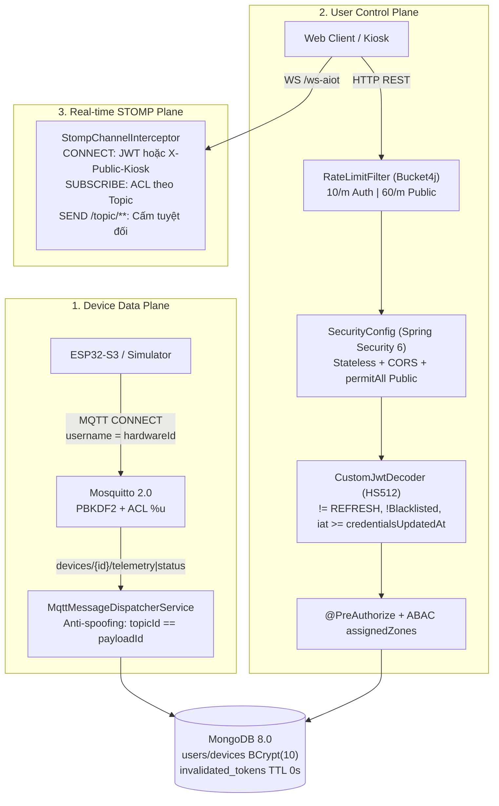

# 06 — Bảo Mật, Xác Thực JWT & Phân Quyền RBAC

> **Tài liệu**: `docs/06-security-and-rbac.md` | **Phiên bản**: 2.1 | **Mã nguồn SSOT**: [`SecurityConfig`](../src/main/java/com/example/AIoTLibTQB/configuration/SecurityConfig.java), [`CustomJwtDecoder`](../src/main/java/com/example/AIoTLibTQB/configuration/CustomJwtDecoder.java), [`AuthenticationService`](../src/main/java/com/example/AIoTLibTQB/service/AuthenticationService.java), [`RateLimitFilter`](../src/main/java/com/example/AIoTLibTQB/configuration/RateLimitFilter.java), [`StompChannelInterceptor`](../src/main/java/com/example/AIoTLibTQB/configuration/StompChannelInterceptor.java), [`acl.conf`](../mosquitto/config/acl.conf)
>
> [!NOTE]
> **TL;DR**: **AIoTLibTQB** phòng thủ trên 3 mặt phẳng độc lập: (1) **Device Plane** dùng PBKDF2 + Mosquitto ACL `%u` + Anti-spoofing + BCrypt(10) API Key; (2) **User Plane** dùng Dual JWT `HS512`, Single-Use Refresh Token Rotation, Blacklist TTL, thu hồi tức thời qua `credentialsUpdatedAt`, Bucket4j Rate Limit và `7 Roles × 14 Permissions` + ABAC `assignedZones`; (3) **STOMP Plane** kiểm soát từng frame `CONNECT`/`SUBSCRIBE`/`SEND` kèm chế độ Kiosk nặc danh chỉ đọc `/topic/public/rooms/**`.

---

## 1. Kiến Trúc An Ninh 3 Mặt Phẳng

---

## 2. Spring Security 6 & Bucket4j Rate Limiting

### 2.1. Tuyến đường Công khai (`SecurityConfig`)
- **Public POST (`PUBLIC_POST_ENDPOINTS`)**: `/api/v1/users` (đăng ký), `/api/v1/auth/login`, `/api/v1/auth/introspect`, `/api/v1/auth/logout`, `/api/v1/auth/refresh`, `/api/v1/devices/authenticate`.
- **Public GET (`PUBLIC_GET_ENDPOINTS`)**: `/api/v1/public/**` (dành cho Kiosk & sinh viên, không lộ `deviceId`/`hardwareId`).
- **Infra**: `OPTIONS /**` (CORS pre-flight), `/actuator/health`, `/actuator/info`, `/ws-aiot/**` (xác thực chuyển xuống STOMP frame `CONNECT`). Mọi request khác đều phải xác thực (`anyRequest().authenticated()`).
- **CORS & CSRF**: Đọc `cors.allowed-origins` (mặc định `http://localhost:3000`), tắt CSRF do dùng Stateless Bearer Token.

### 2.2. Bộ lọc Giới hạn Tần suất (`RateLimitFilter`)
Sử dụng `bucket4j-core` (`8.10.1`) gắn trước `UsernamePasswordAuthenticationFilter` (`ipBuckets`: Caffeine max `10,000`, `expireAfterAccess(10m)`):
- **Auth & Device Auth (`10 req/phút/IP`, key `clientIp:path`)**: Áp dụng cho `POST /api/v1/auth/{login,refresh,introspect}`, `/api/v1/devices/authenticate`, `/api/v1/users`.
- **Public Kiosk (`60 req/phút/IP`, key `clientIp:PUBLIC_API`)**: Áp dụng cho `/api/v1/public` và `/api/v1/public/**`.
- **Xử lý Proxy tin cậy**: Chỉ tin tưởng header `X-Forwarded-For` nếu `remoteAddr` nằm trong loopback hoặc danh sách `security.rate-limit.trusted-proxies`. Khi vượt ngưỡng trả về HTTP `429` (`ErrorCode.TOO_MANY_REQUESTS`, code `4029`) kèm header `Retry-After`.

---

## 3. Vòng Đời JWT (`HS512`), Rotation & Thu Hồi Tức Thời

Triển khai tại [`AuthenticationService`](../src/main/java/com/example/AIoTLibTQB/service/AuthenticationService.java) và [`CustomJwtDecoder`](../src/main/java/com/example/AIoTLibTQB/configuration/CustomJwtDecoder.java) với khóa `jwt.secret-key` tối thiểu **64 ký tự** (512-bit cho `JWSAlgorithm.HS512`):

| Thuộc tính | Access Token | Refresh Token | Device Token |
| :--- | :--- | :--- | :--- |
| **Thời hạn (`exp`)** | `1 giờ` (`jwt.expiration-hours`) | `24 giờ` (`jwt.refreshable-hours`) | `8 giờ` |
| **Claim `tokenType`** | `"ACCESS"` | `"REFRESH"` | `"DEVICE"` |
| **Subject (`sub`)** | `user.username` | `user.username` | `device.hardwareId` |
| **Claim `scope`** | Roles & Permissions | *Không có* | `"DEVICE WRITE_SENSOR_DATA"` |
| **Claims khác** | `userId`, `jti` | `userId`, `jti` | `deviceId`, `zoneId`, `deviceType`, `jti` |

- **Single-Use Refresh Token Rotation (`AuthenticationService#refreshToken`)**: Kiểm tra chữ ký, hạn dùng, `tokenType == "REFRESH"` và `invalidated_tokens`. Đưa ngay `jti` của Refresh Token cũ vào `invalidated_tokens`, rồi phát hành cặp Access + Refresh mới.
- **Thu hồi tức thời khi đổi mật khẩu (`CustomJwtDecoder`)**: Khi đổi mật khẩu (`UserService#changePassword`), `user.credentialsUpdatedAt` cập nhật thành `Instant.now()`. Validator của `CustomJwtDecoder` từ chối mọi token có `iat` trước `credentialsUpdatedAt`, đồng thời từ chối dùng Refresh Token làm Bearer Token API (`tokenType == "REFRESH"` bị chặn).
- **Dọn dẹp Blacklist 2 lớp**: (1) MongoDB TTL Index `expireAfter = "0s"` trên `invalidated_tokens.expiryTime` tự xóa ở kernel, và (2) `@Scheduled(cron = "0 0 2 * * ?")` trong `AuthenticationService#cleanExpiredTokens` dọn dự phòng lúc 02:00 sáng.

---

## 4. Ma Trận Phân Quyền `7 Roles × 14 Permissions` & ABAC `assignedZones`

### 4.1. Ma trận Khởi tạo (`ApplicationInitConfig`)

| Permission | `ADMIN` | `LIBRARIAN` | `ZONE_MANAGER` | `MAINTENANCE` | `VIEWER` | `USER` | `DEVICE` |
| :--- | :---: | :---: | :---: | :---: | :---: | :---: | :---: |
| `READ_SENSOR_DATA` | ✅ | ✅ | ✅ | ✅ | ✅ | ❌ | ❌ |
| `READ_SENSOR_DETAIL` | ✅ | ✅ | ✅ | ❌ | ❌ | ❌ | ❌ |
| `WRITE_SENSOR_DATA` | ✅ | ❌ | ❌ | ❌ | ❌ | ❌ | ✅ |
| `VIEW_ALERTS` | ✅ | ✅ | ✅ | ✅ | ✅ | ❌ | ❌ |
| `ACKNOWLEDGE_ALERT` | ✅ | ✅ | ✅ | ✅ | ❌ | ❌ | ❌ |
| `MANAGE_ALERT_CONFIG` | ✅ | ✅ | ❌ | ❌ | ❌ | ❌ | ❌ |
| `MANAGE_DEVICES` | ✅ | ✅ | ❌ | ❌ | ❌ | ❌ | ❌ |
| `VIEW_DEVICE_STATUS` | ✅ | ✅ | ✅ | ✅ | ❌ | ❌ | ❌ |
| `MANAGE_ZONES` | ✅ | ❌ | ❌ | ❌ | ❌ | ❌ | ❌ |
| `VIEW_ZONE_SUMMARY` | ✅ | ✅ | ✅ | ✅ | ✅ | ❌ | ❌ |
| `GENERATE_REPORT` | ✅ | ✅ | ✅ | ❌ | ❌ | ❌ | ❌ |
| `VIEW_ANALYTICS` | ✅ | ✅ | ✅ | ✅ | ❌ | ❌ | ❌ |
| `MANAGE_USERS` | ✅ | ❌ | ❌ | ❌ | ❌ | ❌ | ❌ |
| `MANAGE_ROLES` | ✅ | ❌ | ❌ | ❌ | ❌ | ❌ | ❌ |
| **Tổng quyền** | **14** | **10** | **8** | **6** | **3** | **0\*** | **1** |

> [!NOTE]
> \* Vai trò `USER` (mặc định khi tự đăng ký qua `POST /api/v1/users`) có 0 permission tường minh nhưng giữ role authority `USER` để tương thích ngược trên các endpoint đọc phòng, thiết bị và telemetry cơ bản (`/rooms`, `/devices`, `/telemetry/**`). Khách vãng lai (`PUBLIC_GUEST`) không có bản ghi tài khoản mà truy cập nặc danh qua `/api/v1/public/**` và kênh STOMP `/topic/public/rooms/**`.

### 4.2. Phân quyền Phạm vi Khu vực (ABAC `assignedZones`)
Người dùng mang vai trò `ZONE_MANAGER` (không đồng thời có `ADMIN`/`LIBRARIAN`) chỉ truy cập được dữ liệu trong các phân khu thuộc `User.assignedZones`:
- `DeviceService`: Kiểm tra `device.zoneId` trước khi xem chi tiết/cập nhật thiết bị, nếu ngoài phạm vi ném `ErrorCode.ZONE_ACCESS_DENIED` (`4031`).
- `TelemetryService`: Kiểm tra `checkDeviceAccess` và `checkRoomAccess` cho tất cả API `/telemetry/**`.
- `AlertServiceImpl`: Tự động lọc truy vấn `GET /api/v1/alerts` và `unread-count` theo các phòng/thiết bị thuộc `assignedZones`.

---

## 5. Bảo Mật Thiết Bị IoT & Mosquitto Broker

- **API Key Băm `BCrypt(10)` (`DeviceService#generateAndHashApiKey`)**: Sinh chuỗi ngẫu nhiên 32 ký tự hex (UUID v4 không gạch ngang), trả về **1 lần duy nhất** khi đăng ký hoặc gọi `/regenerate-key`, lưu `apiKeyHash` bằng `BCryptPasswordEncoder(10)`. Khi xác thực `POST /api/v1/devices/authenticate`, đối chiếu qua `passwordEncoder.matches()`.
- **Mosquitto ACL theo thiết bị ([`acl.conf`](../mosquitto/config/acl.conf))**:
  - Tài khoản backend `aiot_backend` đọc `devices/+/telemetry`, `devices/+/status`, `$SYS/#` và ghi `devices/+/command`.
  - Mạch IoT dùng `username = hardwareId` bị cô lập qua biến `%u`: chỉ được `write` vào `devices/%u/telemetry`, `devices/%u/status` và `read` trên `devices/%u/command`. Mật khẩu broker khởi tạo bằng `mosquitto_passwd` (PBKDF2/SHA512) qua `mosquitto/docker-entrypoint.sh`.
- **Anti-spoofing**: Ngay cả khi vượt qua broker ACL, `MqttMessageDispatcherService` vẫn xác nhận `topicHardwareId == payload.hardwareId` trước khi xử lý.

---

## 6. Bảo Mật Kênh WebSocket STOMP (`StompChannelInterceptor`)

[`StompChannelInterceptor`](../src/main/java/com/example/AIoTLibTQB/configuration/StompChannelInterceptor.java) kiểm soát mọi frame STOMP đến `/ws-aiot`:

| Lệnh STOMP | Điều kiện Cho phép | Hành vi Khi Vi phạm |
| :--- | :--- | :--- |
| **`CONNECT`** | Có `Authorization: Bearer <token>` (hoặc `token`) hợp lệ **HOẶC** header `X-Public-Kiosk: true` (phiên nặc danh, `user = null`). | Ném `MessageDeliveryException` & đóng kết nối |
| **`SUBSCRIBE`** | - **Phiên nặc danh (`user == null`)**: Chỉ được đăng ký `/topic/public/rooms/**`. - **`/topic/alerts`**: Yêu cầu `VIEW_ALERTS` hoặc vai trò `ADMIN`, `LIBRARIAN`, `ZONE_MANAGER`, `MAINTENANCE`, `VIEWER`. - **`/topic/rooms/**`**: Chặn vai trò `DEVICE`. | Ném `MessageDeliveryException` |
| **`SEND`** | Cấm mọi client gửi trực tiếp lên bất kỳ đích nào bắt đầu bằng `/topic/`. | Ném `MessageDeliveryException` (`Client SEND to broker topics is forbidden`) |

---

**Đọc tiếp**: [05 — Mô hình Dữ liệu](./05-data-model.md) · [07 — REST API, STOMP & Mã lỗi](./07-api-reference.md) · [10 — Phần cứng IoT & Simulator](./10-iot-hardware-and-simulator.md) · [11 — Quy chuẩn Phát triển](./11-conventions.md)
