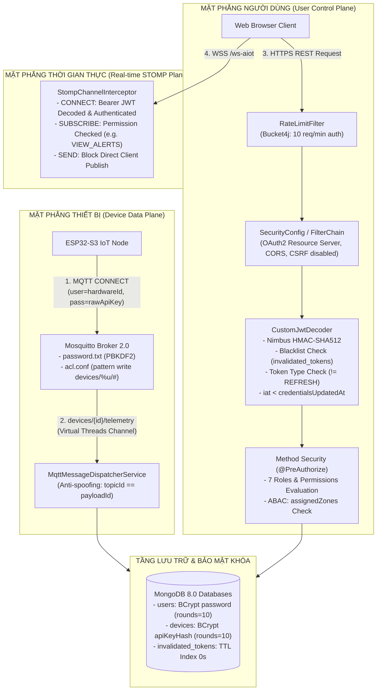
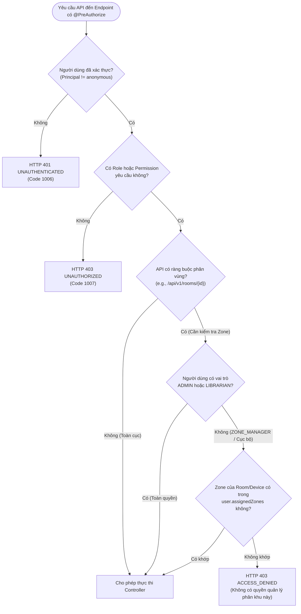
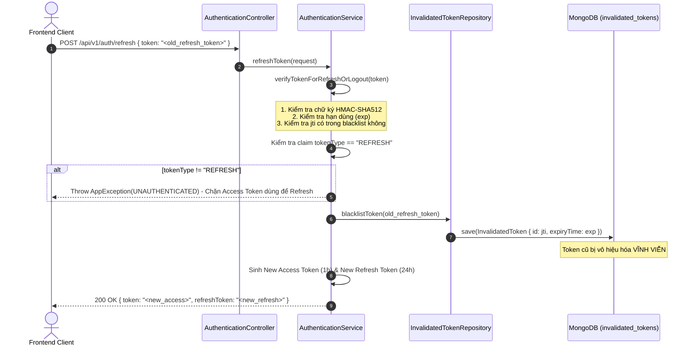
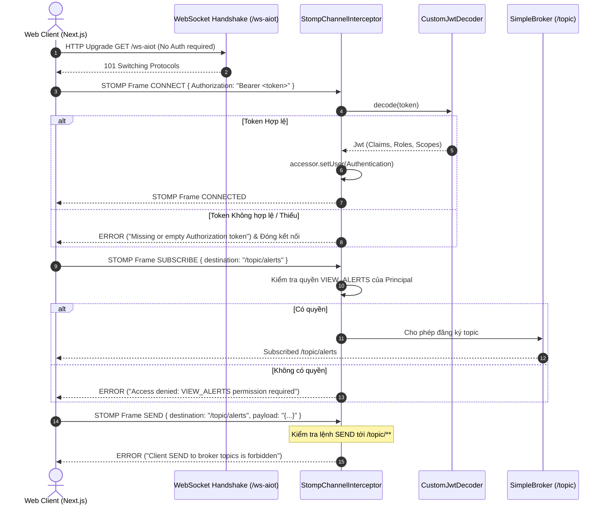

# KIẾN TRÚC BẢO MẬT, XÁC THỰC JWT VÀ PHÂN QUYỀN RBAC (AIoTLibTQB)

> **Tài liệu**: `docs/06-security-rbac.md`  
> **Dự án**: AIoTLibTQB — Hệ thống Giám sát Vi khí hậu & Âm học Thông minh Thư viện Tạ Quang Bửu  
> **Phiên bản**: 2.0 (Toàn diện & Đã kiểm chứng thực địa mã nguồn)  
> **Nguyên tắc kỹ thuật**: Mã nguồn thực tế là nguồn sự thật tối thượng (*Code is the Single Source of Truth*). Mọi mô tả kiến trúc, thuật toán băm, vòng đời token và phân quyền đều được đối chiếu trực tiếp với mã nguồn đang chạy.

---

## 1. MỤC TIÊU

Tài liệu này đặc tả toàn bộ hạ tầng an ninh, cơ chế kiểm soát truy cập và quản lý danh tính đa tầng trong hệ sinh thái AIoTLibTQB:
1. **Kiến trúc xác thực đa tầng (Defense-in-Depth)**: Kiểm soát an ninh từ tầng biên mạng IoT (Mosquitto Broker ACL), cổng giao tiếp REST API (Spring Security, JWT Nimbus, Bucket4j Rate Limiting), đến tầng giao tiếp thời gian thực WebSocket STOMP.
2. **Vòng đời Token & Cơ chế Thu hồi**: Chi tiết hóa thuật toán ký HMAC-SHA512 (`HS512`), cơ chế xoay vòng Refresh Token một lần (Single-use Rotation), và giải pháp vô hiệu hóa tức thời (Instant Invalidation) khi đổi mật khẩu qua mốc thời gian `credentialsUpdatedAt`.
3. **Danh sách đen Token (Token Blacklist)**: Giải pháp lưu trữ tập trung trên MongoDB Collection `invalidated_tokens` kết hợp chỉ mục tự hủy TTL Index (`expireAfter = "0s"`), giải phóng tài nguyên bộ nhớ tự động không cần tác vụ định kỳ thủ công.
4. **Ma trận Phân quyền 7 Vai trò $\times$ 14 Quyền hạn**: Công bố mô hình phân quyền vai trò (Role-Based Access Control - RBAC) và phân quyền phân vùng địa lý (`assignedZones`) cho vai trò Quản lý phân khu (`ZONE_MANAGER`).
5. **Minh bạch hóa Điểm lệch Kiến trúc (Architectural Drift)**: Làm rõ các điểm khác biệt giữa tài liệu yêu cầu ban đầu và mã nguồn thực tế (Vai trò `DEVICE` thay cho `PUBLIC_GUEST`, băm API Key bằng `BCrypt` thay vì SHA-256).

---

## 2. ĐỐI TƯỢNG ĐỌC

Tài liệu này được biên soạn cho:
- **Kỹ sư Backend & Software Architects**: Nắm vững luồng cấu hình Spring Security, cơ chế giải mã JWT `CustomJwtDecoder`, bộ lọc chặn khung STOMP `StompChannelInterceptor`, và thiết kế bảo mật chống giả mạo Hardware ID.
- **Kỹ sư Bảo mật & Kiểm toán An toàn Thông tin (Security Engineers & Auditors)**: Thẩm định các giải pháp mã hóa, lưu trữ secret, ma trận phân quyền RBAC và khả năng chống tấn công brute-force, replay attack, hoặc token leakage.
- **Kỹ sư Frontend & Nhúng IoT (Next.js & ESP32-S3 Developers)**: Hiểu định dạng token, quy trình Refresh Token, các header xác thực STOMP bắt buộc và cách sử dụng API Key an toàn.
- **Kỹ sư Kiểm thử (QA / Automation Testers)**: Thiết kế các kịch bản kiểm thử phân quyền biên (Permission boundaries), kiểm tra truy cập trái phép phân vùng (`ZONE_ACCESS_DENIED`), và vòng đời token.

---

## 3. NỘI DUNG CHI TIẾT

### 3.1. Tổng quan Kiến trúc Bảo mật Đa tầng & Đa Mặt Phẳng (Multi-Plane Security Architecture)

Hệ thống AIoTLibTQB áp dụng nguyên tắc phòng thủ đa chiều (Defense-in-Depth) thông qua việc phân lập an ninh thành 3 mặt phẳng hoạt động độc lập (Mặt phẳng Thiết bị, Mặt phẳng Người dùng Web, Mặt phẳng WebSocket STOMP) cùng đồ thị thẩm định quyền hạn chặt chẽ:

#### Sơ đồ 6A: Kiến Trúc Bảo Mật Đa Mặt Phẳng (Multi-Plane Security Architecture)
*Mục đích:* Tách bạch rõ ràng 3 mặt phẳng an ninh độc lập và tầng lưu trữ khóa bảo mật.



#### Sơ đồ 6B: Luồng Thẩm Định Quyền Hạn RBAC & Cách Ly Phân Vùng ABAC (RBAC & ABAC Evaluation Pipeline)
*Mục đích:* Mô tả chi tiết cây quyết định kiểm tra phiên đăng nhập, vai trò RBAC và kiểm tra phân vùng địa lý `assignedZones` (ABAC).



---

### 3.2. Kiến Trúc Xác Thực & Phân Quyền Spring Security

Kiến trúc bảo mật ứng dụng được định cấu hình tại `SecurityConfig.java`:
- **Đường dẫn**: `src/main/java/com/example/AIoTLibTQB/configuration/SecurityConfig.java:23-104`
- **Phiên bản bảo mật**: Spring Security 6 (Spring Boot 3.5.8), kích hoạt bằng các chú thích:
  ```java
  @Configuration
  @EnableWebSecurity
  @EnableMethodSecurity
  public class SecurityConfig { ... }
  ```

#### 3.2.1. Danh mục Endpoints Công Khai (Permit All)
Các endpoint POST công khai được khai báo trong hằng số `PUBLIC_POST_ENDPOINTS` (`SecurityConfig.java:28-35`):
1. `POST /api/v1/users`: Đăng ký tài khoản người dùng mới.
2. `POST /api/v1/auth/login`: Xác thực đăng nhập lấy cặp Access/Refresh token.
3. `POST /api/v1/auth/introspect`: Kiểm tra trạng thái hiệu lực của token.
4. `POST /api/v1/auth/logout`: Đăng xuất và thu hồi token vào blacklist.
5. `POST /api/v1/auth/refresh`: Cấp lại Access token mới qua Refresh token hợp lệ.
6. `POST /api/v1/devices/authenticate`: Node IoT ESP32-S3 gửi HardwareId + API Key để lấy Device Token.

Ngoài ra, hệ thống cho phép không cần xác thực đối với:
- `OPTIONS /**`: Cho phép pre-flight request của CORS.
- `/actuator/health`, `/actuator/info`: Phục vụ Docker / Kubernetes health probe giám sát uptime.
- `/ws-aiot/**`: Bắt tay WebSocket nâng cấp HTTP ban đầu (việc xác thực token được hoãn lại đến khung STOMP `CONNECT` trong `StompChannelInterceptor`).

Mọi request khác mặc định bắt buộc phải xác thực (`anyRequest().authenticated()`).

#### 3.2.2. Giới Hạn Tần Suất Truy Cập (Rate Limiting Filter)
Để chống lại các cuộc tấn công brute-force mật khẩu và làm cạn kiệt tài nguyên máy chủ, hệ thống gắn bộ lọc `RateLimitFilter` trước `UsernamePasswordAuthenticationFilter`:
- **Đường dẫn**: `src/main/java/com/example/AIoTLibTQB/configuration/RateLimitFilter.java:1-85`
- **Thư viện áp dụng**: `bucket4j-core` phiên bản `8.10.1`.
- **Cấu hình Bucket**:
  - Dung lượng tối đa: **10 tokens**.
  - Tốc độ hồi phục: **10 tokens mỗi 1 phút** (`Bandwidth.classic(10, Refill.greedy(10, Duration.ofMinutes(1)))`).
  - Phạm vi áp dụng: Toàn bộ 6 endpoint thuộc `PUBLIC_POST_ENDPOINTS`.
  - Khóa giới hạn (Bucket Key): Địa chỉ IP của Client (`request.getRemoteAddr()`).
  - Mã phản hồi khi vượt ngưỡng: `HTTP 429 Too Many Requests` với mã lỗi `ErrorCode.TOO_MANY_REQUESTS` (mã code `4029`).

#### 3.2.3. Cấu hình CORS & CSRF
- **CORS (`corsConfigurationSource`)**: Nạp danh sách `cors.allowed-origins` từ cấu hình (mặc định `http://localhost:3000`), hỗ trợ các phương thức `GET, POST, PUT, PATCH, DELETE, OPTIONS`, cho phép `AllowCredentials = true`, và các headers `Authorization, Content-Type`.
- **CSRF**: Vô hiệu hóa (`csrf(AbstractHttpConfigurer::disable)`). Hệ thống hoạt động theo mô hình Stateless REST API và xác thực độc quyền qua header `Authorization: Bearer <token>`, không sử dụng Session Cookie trên trình duyệt, loại bỏ nguy cơ CSRF.

---

### 3.3. Vòng Đời Token (Token Lifecycle) & Cơ Chế Rotation

Toàn bộ logic phát hành và quản lý phiên làm việc JWT được hiện thực tại `AuthenticationService.java`:
- **Đường dẫn**: `src/main/java/com/example/AIoTLibTQB/service/AuthenticationService.java:1-278`
- **Thư viện JWT**: Nimbus JOSE JWT (`10.0.2`).
- **Thuật toán ký**: HMAC-SHA512 (`JWSAlgorithm.HS512`). Khóa bí mật `jwt.secret-key` bắt buộc có độ dài tối thiểu 64 ký tự (512 bits) để đảm bảo độ an toàn mật mã học (`AuthenticationService.java:136, 152`).

#### 3.3.1. Đặc Tả 3 Loại Token Trong Hệ Thống
Hệ thống phân lập rõ ràng 3 chủng loại token với thời gian sống và quyền hạn khác biệt:

| Thuộc tính | Access Token | Refresh Token | Device Token |
| :--- | :--- | :--- | :--- |
| **Mục đích** | Truy cập tài nguyên REST API & WebSocket | Cấp phát lại Access Token khi hết hạn | Dành riêng cho node IoT ESP32-S3 gửi dữ liệu |
| **Thời gian sống (`exp`)** | **1 giờ** (`jwt.expiration-hours: 1`) | **24 giờ** (`jwt.refreshable-hours: 24`) | **8 giờ** (cố định trong mã nguồn) |
| **Claim `tokenType`** | `"ACCESS"` | `"REFRESH"` | `"DEVICE"` |
| **Subject (`sub`)** | `user.getUsername()` | `user.getUsername()` | `device.getHardwareId()` |
| **Claim `scope`** | `ROLE_...` và các `PERMISSION_...` | Không có (tránh rò rỉ quyền trong Refresh) | `"DEVICE WRITE_SENSOR_DATA"` |
| **Các claims bổ sung** | `userId`, `jwtID` (UUID) | `userId`, `jwtID` (UUID) | `deviceId`, `zoneId`, `deviceType`, `jwtID` |
| **Tọa độ mã nguồn** | `AuthenticationService.java:135-158` | `AuthenticationService.java:160-182` | `AuthenticationService.java:188-214` |

#### 3.3.2. Cơ Chế Xoay Vòng Refresh Token Một Lần (Single-Use Token Rotation)
Nhằm triệt tiêu rủi ro lộ Refresh Token (Refresh Token Hijacking), hệ thống áp dụng cơ chế Rotation nghiêm ngặt tại `AuthenticationService.java:102-133`:



**Nguyên lý bảo vệ**:
1. Nếu Refresh Token cũ bị kẻ xấu đánh cắp và sử dụng lại, yêu cầu sẽ bị từ chối ngay lập tức vì `jwtID` đã nằm trong bảng `invalidated_tokens` (`existsById(jwtId) == true`).
2. Nếu client gửi nhầm một Access Token vào endpoint `/refresh`, phương thức `refreshToken` kiểm tra claim `tokenType`. Nếu khác `"REFRESH"`, hệ thống lập tức ném ngoại lệ `UNAUTHENTICATED` (`AuthenticationService.java:105-109`).

#### 3.3.3. Cơ Chế Thu Hồi Tức Thời Khi Đổi Mật Khẩu (Credentials Revocation)
Trong các kiến trúc JWT thông thường, nhược điểm chí mạng là không thể thu hồi token trước hạn mà không dùng stateful session. AIoTLibTQB giải quyết triệt để bài toán này qua dấu mốc thời gian `credentialsUpdatedAt`:
- Khi người dùng đổi mật khẩu thành công (`UserService.java:120`), trường `user.credentialsUpdatedAt` được cập nhật thành `Instant.now()`.
- Trong `CustomJwtDecoder.java:64-91`, validator `userRevocationValidator` kiểm tra:
  ```java
  if (user.getCredentialsUpdatedAt() != null && jwt.getIssuedAt() != null) {
      if (jwt.getIssuedAt().isBefore(user.getCredentialsUpdatedAt())) {
          return OAuth2TokenValidatorResult.failure(
              new OAuth2Error("invalid_token", "Token revoked due to credentials update", null)
          );
      }
  }
  ```
- **Hệ quả**: Toàn bộ Access Token và Refresh Token đã phát hành trước thời điểm đổi mật khẩu sẽ bị vô hiệu hóa ngay tức thì trên toàn bộ hệ thống, buộc người dùng hoặc kẻ chiếm quyền phải xác thực lại bằng mật khẩu mới.

---

### 3.4. Danh Sách Đen Token (Token Blacklist) & MongoDB TTL Index

Hệ thống quản lý token bị thu hồi (do Đăng xuất hoặc Xoay vòng Refresh) bằng collection riêng biệt trong MongoDB:
- **Document**: `src/main/java/com/example/AIoTLibTQB/document/InvalidatedToken.java:1-26`
- **Cấu trúc dữ liệu**:
  ```java
  @Document(collection = "invalidated_tokens")
  public class InvalidatedToken {
      @Id
      String id; // Lưu jwtID (UUID) của token bị thu hồi

      @Indexed(expireAfter = "0s")
      Date expiryTime; // Thời điểm hết hạn gốc của token
  }
  ```

#### 3.4.1. Cơ Chế Phòng Thủ Kép Thu Hồi Token (Dual Defense-in-Depth Token Cleanup)
Hệ thống thiết lập cơ chế phòng vệ 2 lớp kết hợp chặt chẽ giữa tầng CSDL kernel và tầng ứng dụng Spring Boot:

- **Lớp 1: Tự hủy tự động cấp Kernel qua MongoDB TTL Index (`expireAfter = "0s"`)**:
  - Thuộc tính `@Indexed(expireAfter = "0s")` trên trường `expiryTime` thiết lập chỉ mục Time-To-Live. Tiến trình nền `TTLMonitor` của MongoDB (chạy mỗi 60 giây) tự động quét và xóa sạch các token có `expiryTime <= new Date()`.
  - *Tối ưu hóa tài nguyên*: Bản ghi chỉ tồn tại trong blacklist cho đến khi token gốc tự hết hạn. Sau thời điểm đó, token gốc không thể vượt qua bước thẩm định chữ ký và thời hạn của Nimbus JWT, giúp bộ nhớ RAM và đĩa cứng được giải phóng 100% tự động.
- **Lớp 2: Quét dọn định kỳ tầng ứng dụng qua Scheduled Cron Job (02:00 AM)**:
  - Để phòng ngừa trường hợp thread TTL của MongoDB bị nghẽn trong các đợt cao tải hoặc khi node CSDL khởi động lại, hệ thống bổ sung tác vụ quét dọn định kỳ hàng ngày vào lúc 2:00 sáng tại `AuthenticationService.java:272-276`:
  ```java
  @Scheduled(cron = "0 0 2 * * ?")
  public void cleanExpiredTokens() {
      invalidatedTokenRepository.deleteByExpiryTimeBefore(new Date());
      log.info("Cleaned up expired invalidated tokens");
  }
  ```
  - Sự kết hợp này tạo thành lớp rào chắn phòng thủ chiều sâu vững chắc: ngay cả khi một tầng gặp sự cố trễ, tầng còn lại vẫn đảm bảo collection `invalidated_tokens` luôn tinh gọn và không bao giờ bị phình to vô hạn.

---

### 3.5. Ma Trận Phân Quyền 7 Vai Trò (RBAC Matrix)

Dữ liệu phân quyền được khởi tạo và đồng bộ hóa tự động vào MongoDB khi ứng dụng khởi động tại `ApplicationInitConfig.java:42-160`.

#### 3.5.1. Danh mục 14 Quyền Hạn Cơ Sở (Permissions)
Bao gồm các quyền vi mô được cấp phát cho các vai trò tương ứng:

| Mã Quyền Hạn (`Permission.name`) | Diễn Giải Chức Năng Chi Tiết | Tọa Độ Khởi Tạo |
| :--- | :--- | :--- |
| `READ_SENSOR_DATA` | Xem dữ liệu cảm biến cơ bản (giá trị mới nhất, dashboard tóm tắt). | `ApplicationInitConfig.java:44-45` |
| `READ_SENSOR_DETAIL` | Xem raw data đầy đủ, tra cứu lịch sử vi khí hậu độ phân giải cao. | `ApplicationInitConfig.java:46-47` |
| `WRITE_SENSOR_DATA` | Quyền ghi telemetry data (dành riêng cho IoT Node ESP32-S3). | `ApplicationInitConfig.java:48-49` |
| `VIEW_ALERTS` | Xem danh sách cảnh báo vi khí hậu và thiết bị ngoại tuyến. | `ApplicationInitConfig.java:51-52` |
| `ACKNOWLEDGE_ALERT` | Bấm xác nhận đã tiếp nhận và đang xử lý một sự cố cảnh báo. | `ApplicationInitConfig.java:53-54` |
| `MANAGE_ALERT_CONFIG` | Cấu hình ngưỡng cảnh báo, tham số hysteresis, đóng cảnh báo thủ công. | `ApplicationInitConfig.java:55-56` |
| `MANAGE_DEVICES` | Đăng ký, sửa thông tin, cập nhật vị trí và cấp lại API Key thiết bị. | `ApplicationInitConfig.java:58-59` |
| `VIEW_DEVICE_STATUS` | Xem trạng thái kết nối Online/Offline, cường độ sóng RSSI, firmware. | `ApplicationInitConfig.java:60-61` |
| `MANAGE_ZONES` | Tạo, sửa, xóa phòng/khu vực và cấu hình tọa độ đa giác `boundaryPolygon`. | `ApplicationInitConfig.java:63-64` |
| `VIEW_ZONE_SUMMARY` | Xem dashboard tóm tắt toàn bộ phòng và chỉ số LCS tổng quan. | `ApplicationInitConfig.java:65-66` |
| `GENERATE_REPORT` | Xuất báo cáo vi khí hậu và âm học định kỳ (PDF/CSV theo ISO/TCVN). | `ApplicationInitConfig.java:68-69` |
| `VIEW_ANALYTICS` | Xem biểu đồ xu hướng, phân tích thống kê và nén bucket `$dateTrunc`. | `ApplicationInitConfig.java:70-71` |
| `MANAGE_USERS` | Tạo, sửa, cập nhật trạng thái hoạt động tài khoản người dùng. | `ApplicationInitConfig.java:73-74` |
| `MANAGE_ROLES` | Tạo, sửa quyền và vai trò hệ thống (chỉ dành riêng cho ADMIN). | `ApplicationInitConfig.java:75-76` |

#### 3.5.2. Bảng Ma Trận Phân Quyền 7 Vai Trò (RBAC Matrix)
Dưới đây là ma trận phân quyền thực tế trong mã nguồn (`Role.java:3-18`, `ApplicationInitConfig.java:101-160`):

| Quyền Hạn (Permission) | ADMIN | LIBRARIAN | ZONE_MANAGER | MAINTENANCE | VIEWER | USER | DEVICE |
| :--- | :---: | :---: | :---: | :---: | :---: | :---: | :---: |
| **`READ_SENSOR_DATA`** | ✅ | ✅ | ✅ | ✅ | ✅ | ❌ | ❌ |
| **`READ_SENSOR_DETAIL`** | ✅ | ✅ | ✅ | ❌ | ❌ | ❌ | ❌ |
| **`WRITE_SENSOR_DATA`** | ✅ | ❌ | ❌ | ❌ | ❌ | ❌ | ✅ |
| **`VIEW_ALERTS`** | ✅ | ✅ | ✅ | ✅ | ✅ | ❌ | ❌ |
| **`ACKNOWLEDGE_ALERT`** | ✅ | ✅ | ✅ | ✅ | ❌ | ❌ | ❌ |
| **`MANAGE_ALERT_CONFIG`** | ✅ | ✅ | ❌ | ❌ | ❌ | ❌ | ❌ |
| **`MANAGE_DEVICES`** | ✅ | ✅ | ❌ | ❌ | ❌ | ❌ | ❌ |
| **`VIEW_DEVICE_STATUS`** | ✅ | ✅ | ✅ | ✅ | ❌ | ❌ | ❌ |
| **`MANAGE_ZONES`** | ✅ | ❌ | ❌ | ❌ | ❌ | ❌ | ❌ |
| **`VIEW_ZONE_SUMMARY`** | ✅ | ✅ | ✅ | ✅ | ✅ | ❌ | ❌ |
| **`GENERATE_REPORT`** | ✅ | ✅ | ✅ | ❌ | ❌ | ❌ | ❌ |
| **`VIEW_ANALYTICS`** | ✅ | ✅ | ✅ | ✅ | ❌ | ❌ | ❌ |
| **`MANAGE_USERS`** | ✅ | ❌ | ❌ | ❌ | ❌ | ❌ | ❌ |
| **`MANAGE_ROLES`** | ✅ | ❌ | ❌ | ❌ | ❌ | ❌ | ❌ |
| **Tổng số quyền** | **14 / 14** | **10 / 14** | **8 / 14** | **6 / 14** | **3 / 14** | **0** | **1 / 14** |

> **Điểm lệch kiến trúc đã xác minh**:
> - Trong mã nguồn thực tế, vai trò thứ 7 là **`DEVICE`** (`Role.java:17`), không có vai trò `PUBLIC_GUEST` trong CSDL hay JWT.
> - Vai trò `USER` được giữ lại cho tương thích ngược (backward compatibility) và người dùng web thông thường.
> - Bạn đọc vãng lai hoặc màn hình Kiosk công cộng hiện truy cập ở trạng thái **Khách không xác thực (Unauthenticated Guest)**. *(Xem mục Điểm lệch & TODO)*.

---

### 3.6. Phân Quyền Theo Khu Vực Phụ Trách (`assignedZones`)

Hệ thống hỗ trợ cơ chế kiểm soát truy cập dựa trên thuộc tính không gian địa lý (Attribute-Based Access Control) cho vai trò `ZONE_MANAGER`.

#### 3.6.1. Cấu trúc trường `assignedZones`
Trong entity `User.java:34`:
```java
Set<String> assignedZones; // Tập hợp các mã phân khu được gán quyền (ví dụ: ["ZONE_A", "ZONE_B", "TANG_2"])
```

#### 3.6.2. Kiểm tra quyền truy cập thiết bị (`DeviceService.java`)
Tại `DeviceService.java:123-138, 204-206, 222-226`, khi người dùng có vai trò `ZONE_MANAGER` thực hiện thao tác xem chi tiết hoặc cập nhật thiết bị:
```java
if (currentUser.getRoles().stream().anyMatch(r -> "ZONE_MANAGER".equals(r.getName()))) {
    Set<String> zones = currentUser.getAssignedZones();
    if (zones == null || !zones.contains(device.getZoneId())) {
        log.warn("ZONE_MANAGER '{}' attempted unauthorized access to device '{}' in zone '{}'",
                currentUser.getUsername(), device.getId(), device.getZoneId());
        throw new AppException(ErrorCode.ZONE_ACCESS_DENIED);
    }
}
```
Nếu mã phân khu của thiết bị không nằm trong `user.assignedZones`, hệ thống lập tức ném ngoại lệ `AppException(ErrorCode.ZONE_ACCESS_DENIED)` trả về mã lỗi HTTP 403.

#### 3.6.3. Giới hạn tra cứu lịch sử vi khí hậu (`TelemetryService.java`)
Trong `TelemetryService.java:242-293`, các hàm `checkDeviceAccess` và `checkRoomAccess` kiểm tra chéo `assignedZones`. Người quản lý phân khu tầng 1 hoàn toàn không thể xem biểu đồ vi khí hậu hoặc nén bucket của kho lưu trữ sách tại tầng 2.

#### 3.6.4. Lọc danh sách cảnh báo thời gian thực (`AlertServiceImpl.java`)
Tại `AlertServiceImpl.java:93-110`, khi `ZONE_MANAGER` gọi API lấy danh sách cảnh báo (`GET /api/v1/alerts`), hệ thống tự động gán bộ lọc truy vấn MongoDB chỉ trả về các cảnh báo thuộc các thiết bị hoặc phòng nằm trong `assignedZones` của họ.

---

### 3.7. Bảo Mật Thiết Bị & MQTT Broker

An ninh mạng truyền dẫn IoT giữa thiết bị ESP32-S3 và Mosquitto Broker được bảo vệ nghiêm ngặt:

#### 3.7.1. Cơ chế Tạo & Băm API Key Thiết Bị (`DeviceService.java`)
- **Tọa độ**: `src/main/java/com/example/AIoTLibTQB/service/DeviceService.java:326-330`
- **Mã nguồn thực tế**:
  ```java
  private String generateAndHashApiKey(Device device) {
      String rawKey = UUID.randomUUID().toString().replace("-", "");
      device.setApiKeyHash(passwordEncoder.encode(rawKey));
      return rawKey;
  }
  ```
- **Phân tích thuật toán**:
  - Khóa API thô (`rawKey`) là một chuỗi 32 ký tự hexadecimal sinh ra từ UUID phiên bản 4.
  - Chuỗi khóa được băm thông qua `passwordEncoder` — chính là **`BCryptPasswordEncoder(10)`** được định nghĩa tại `SecurityConfig.java:89`.
  - **Điểm lệch kiến trúc**: Bối cảnh ban đầu yêu cầu băm SHA-256. Tuy nhiên, mã nguồn sử dụng BCrypt strength 10. BCrypt sở hữu muối ngẫu nhiên (salt) tích hợp và chi phí tính toán cao, giúp chống lại các cuộc tấn công tra cứu bảng tính sẵn (Rainbow Table Attack) tốt hơn nhiều so với SHA-256 thuần túy.
  - **Bảo mật hiển thị một lần**: Khóa `rawKey` chỉ được trả về **đúng một lần duy nhất** trong phản hồi đăng ký `DeviceRegistrationResponse` (`DeviceService.java:332-345`). CSDL MongoDB chỉ lưu giữ `apiKeyHash`. Khi thiết bị xác thực (`POST /api/v1/devices/authenticate`), hệ thống dùng `passwordEncoder.matches(rawKey, device.getApiKeyHash())`.

#### 3.7.2. Cấu hình Bảo Mật Mosquitto Broker (`acl.conf`)
Tập tin cấu hình phân quyền Mosquitto Broker nằm tại `mosquitto/config/acl.conf`:
- **Tài khoản Backend (`aiot_backend`)**: Toàn quyền đọc dữ liệu telemetry và status, gửi lệnh điều khiển và giám sát broker:
  ```conf
  user aiot_backend
  topic read devices/+/telemetry
  topic read devices/+/status
  topic write devices/+/command
  topic read $SYS/#
  ```
- **Tài khoản Thiết bị IoT (Dynamic Node ACL Pattern `%u`)**:
  ```conf
  # Trạm đo chỉ được phép ghi dữ liệu vào các topic con của chính mình:
  pattern write devices/%u/#
  pattern write devices/%u/telemetry
  pattern write devices/%u/status
  # Trạm đo chỉ được phép lắng nghe lệnh cấu hình gửi trực tiếp tới mình:
  pattern read devices/%u/command
  ```
- **Ý nghĩa và nguyên lý hoạt động của biến `%u`**:
  - Mosquitto tự động thay thế `%u` bằng `username` mà client gửi trong gói tin `MQTT CONNECT`.
  - Trong AIoTLibTQB, `username` bắt buộc phải trùng khớp với `hardwareId` của trạm đo (ví dụ: `ESP32_ROOM_101`).
  - Mạch có định danh `ESP32_ROOM_101` chỉ được phép publish lên `devices/ESP32_ROOM_101/telemetry` hoặc `status`. Mọi nỗ lực publish sang phòng khác (ví dụ: `devices/ESP32_ROOM_102/telemetry`) sẽ bị Mosquitto Broker drop ngay lập tức ở tầng mạng TCP socket (ACL Denied).
  - Ngăn chặn hoàn toàn việc các trạm đo nghe lén (sniff) dữ liệu của nhau, đảm bảo tính toàn vẹn và bảo mật dữ liệu ở tầng giao tiếp mạng biên.
- **Xác thực mật khẩu Broker**: File `password.txt` được tạo bằng tiện ích `mosquitto_passwd` với thuật toán mã hóa mật khẩu PBKDF2/SHA512 (`docker-compose.yml:80-85`), đối chiếu trực tiếp với `rawApiKey` của thiết bị.

#### 3.7.3. Chống Giả Mạo Hardware ID (Spoofing Protection)
Tại Ingestion Pipeline (`MqttMessageDispatcherService.java:127-131, 187-191`), hệ thống đối chiếu bắt buộc:
```java
String payloadHardwareId = telemetryPayload.getHardwareId();
if (!topicHardwareId.equals(payloadHardwareId)) {
    log.warn("Hardware ID spoofing detected: topic='{}' vs payload='{}'", 
             topicHardwareId, payloadHardwareId);
    return; // Hủy ngay lập tức bản tin giả mạo
}
```
Biện pháp này ngăn chặn trường hợp một node bị xâm nhập cố gắng phát tán dữ liệu cảm biến giả dưới danh tính của node khác.

---

### 3.8. Bảo Mật Kênh WebSocket STOMP Inbound Channel

WebSocket STOMP cho phép đẩy dữ liệu vi khí hậu và cảnh báo tức thời xuống giao diện web. Tuy nhiên, việc mở WebSocket nếu không kiểm soát chặt chẽ sẽ tạo ra lỗ hổng bỏ qua Spring Security Filter thông thường. AIoTLibTQB triển khai bộ chặn kênh `StompChannelInterceptor`:
- **Đường dẫn**: `src/main/java/com/example/AIoTLibTQB/configuration/StompChannelInterceptor.java:1-153`



#### 3.8.1. Kiểm soát Khung `CONNECT`
- Client bắt buộc phải đính kèm token trong native header: `Authorization: Bearer <token>` (hoặc `token: <token>`).
- Interceptor gọi `customJwtDecoder.decode(token)` và `jwtAuthenticationConverter.convert(jwt)` để gắn đối tượng `Authentication` vào phiên STOMP. Mọi kết nối không token hoặc token hết hạn sẽ bị đóng kết nối ngay lập tức với lỗi `MessageDeliveryException`.

#### 3.8.2. Kiểm soát Khung `SUBSCRIBE`
- **Topic `/topic/alerts`**: Yêu cầu Principal bắt buộc phải có quyền `VIEW_ALERTS` hoặc thuộc một trong các vai trò giám sát: `ADMIN`, `LIBRARIAN`, `ZONE_MANAGER`, `MAINTENANCE`, `VIEWER` (`StompChannelInterceptor.java:106-124`).
- **Topic `/topic/rooms/{roomId}/telemetry`**: Chặn triệt để vai trò `DEVICE`. Thiết bị IoT không có quyền đọc trộm dữ liệu vi khí hậu của các phòng đọc (`StompChannelInterceptor.java:126-133`).

#### 3.8.3. Kiểm soát Khung `SEND` (Chống Inject Dữ Liệu)
- Khách hàng duyệt web chỉ là đối tượng tiêu thụ (Consumer).
- Tại `StompChannelInterceptor.java:45-50`: Nếu client gửi khung `SEND` tới bất kỳ destination nào bắt đầu bằng `/topic/`, Interceptor lập tức ném lỗi:
  ```java
  throw new MessageDeliveryException("Client SEND to broker topics is forbidden");
  ```
  Chỉ có backend (thông qua `SimpMessagingTemplate`) mới có quyền đẩy tin nhắn lên broker topics.

---

### 3.9. Danh Mục Điểm Lệch Kiến Trúc & TODO Cần Xác Nhận

| Phân Loại | Hạng Mục | Mô Tả Điểm Lệch / Cần Xác Nhận | Minh Chứng Mã Nguồn |
| :--- | :--- | :--- | :--- |
| **Điểm lệch 1** | **Vai trò thứ 7: `DEVICE` thay vì `PUBLIC_GUEST`** | Bối cảnh ban đầu mô tả vai trò `PUBLIC_GUEST`. Trong mã nguồn thực tế, enum `Role` và `ApplicationInitConfig` định nghĩa vai trò thứ 7 là `DEVICE`. Thiết bị IoT ESP32-S3 được cấp token với vai trò này để ghi dữ liệu. Khách vãng lai hiện là Unauthenticated Guest. | `Role.java:17`, `ApplicationInitConfig.java:155` |
| **Điểm lệch 2** | **Thuật toán băm API Key thiết bị** | Bối cảnh mô tả dùng SHA-256. Thực tế `DeviceService.java:328` sử dụng `BCryptPasswordEncoder(10)`. Mosquitto password sử dụng PBKDF2/SHA512. | `DeviceService.java:328`, `SecurityConfig.java:89` |
| **TODO 1** | **`TODO: cần xác nhận` - Public Kiosk Endpoint** | Hiện tại toàn bộ endpoints `/api/v1/telemetry/**` đều yêu cầu quyền xác thực (`hasAnyAuthority(...)`). Cần xác nhận với Product Owner về việc mở thêm endpoint công khai `/api/v1/public/rooms/{id}/comfort-score` cho màn hình Kiosk cảm ứng ngoài cửa phòng đọc. | `TelemetryController.java:30` |

---

## 4. ĐỌC TIẾP

Để nắm bắt toàn diện bức tranh kỹ thuật và cách tích hợp an ninh vào các thành phần khác, hãy tham khảo các tài liệu liên quan:
- **Kiến trúc tổng thể & Luồng dữ liệu**: [`docs/02-architecture.md`](./02-architecture.md)
- **Đường ống thu nạp dữ liệu IoT Ingestion**: [`docs/03-ingestion-pipeline.md`](./03-ingestion-pipeline.md)
- **Mô hình dữ liệu MongoDB & Collections**: [`docs/05-data-model.md`](./05-data-model.md)
- **Đặc tả REST API & Bảng mã lỗi**: [`docs/07-api-reference.md`](./07-api-reference.md)
- **Quy ước kỹ thuật bắt buộc**: [`docs/10-conventions.md`](./10-conventions.md)
