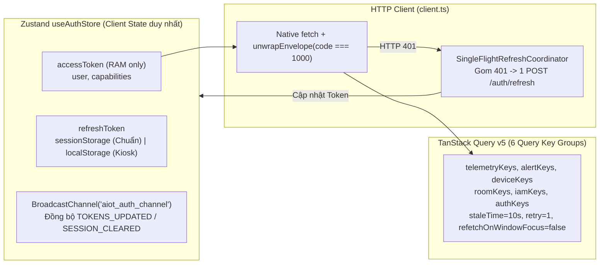

# 08 — Kiến Trúc Frontend (Next.js 15, State, STOMP & Giao Diện)

> **Tài liệu**: `docs/08-frontend-architecture.md` | **Phiên bản**: 2.1 | **Mã nguồn SSOT**: [`frontend/package.json`](../frontend/package.json), [`frontend/src/features/auth/store.ts`](../frontend/src/features/auth/store.ts), [`frontend/src/lib/rbac/capabilities.ts`](../frontend/src/lib/rbac/capabilities.ts), [`frontend/src/lib/realtime/stomp-client.ts`](../frontend/src/lib/realtime/stomp-client.ts)
>
> [!NOTE]
> **TL;DR**: Frontend xây dựng trên **Next.js 15.5 (`output: 'standalone'`)**, **React 19**, **TypeScript Strict** và **Tailwind CSS 3.4 (Light Mode Daylight)** với **16 routes**, chia ranh giới tuyệt đối: **Zustand 5** (`useAuthStore` duy nhất) cho phiên đăng nhập, **TanStack Query 5** cho server cache (kèm STOMP in-place update & fallback polling `15s`), **Native `fetch` + `SingleFlightRefreshCoordinator`** cho HTTP client và **STOMP over Native WebSocket** hỗ trợ cả chế độ Kiosk nặc danh (`/kiosk`).

---

## 1. Tech Stack & Tổ Chức Mã Nguồn (`frontend/src/`)

- **Phiên bản thư viện**: `next ^15.5.28`, `react ^19.0.0`, `typescript ^5.6.3`, `tailwindcss ^3.4.14`, `@tanstack/react-query ^5.59.0`, `zustand ^5.0.1`, `@stomp/stompjs ^7.0.0`, `lucide-react ^0.454.0`, `zod ^3.23.8`, `vitest ^2.1.4` (**33/33 unit tests** tại [`core-standard.test.ts`](../frontend/src/lib/__tests__/core-standard.test.ts)).
- **Quyết định tinh gọn bundle**: Không cài `axios`, không cài `sockjs-client`, không dùng Leaflet/Konva/Three.js; thay bằng Native `fetch`, Native Browser WebSocket và HTML5 2D Canvas.
- **Cấu trúc thư mục chính**:
  - `app/`: 16 routes Next.js App Router + `error.tsx` & `not-found.tsx`.
  - `features/`: `auth`, `rooms`, `devices`, `telemetry`, `alerts`, `floorplan`, `iam` (mỗi feature tách `api.ts`, `queries.ts`, `components/`).
  - `lib/`: `http/` (`client.ts`, `refresh-queue.ts`), `rbac/` (`capabilities.ts`, `scope-parser.ts`), `realtime/` (`stomp-client.ts`, `use-room-stream.ts`), `floorplan/` (`coords.ts`, `polygon.ts`, `idw.ts`, `weatherPalette.ts`, `labelLayout.ts`).
  - `messages/vi.ts`: Từ điển `ERROR_MESSAGES_VI` gồm `1000` + **46 mã lỗi** (47 khóa) + chuỗi UI chuẩn.

### 1.1. Danh mục 16 Routes App Router

| Tuyến đường (Route) | Phân hệ & Chức năng chính | Yêu cầu Phân quyền (`CapabilityMatrix`) |
| :--- | :--- | :--- |
| `/` | Trang gốc tự động điều hướng `/kiosk` (khách) hoặc `/dashboard` (đã đăng nhập) | Công khai |
| `/kiosk` | TV Kiosk sảnh thư viện: gọi `/api/v1/public/rooms`, bật STOMP nặc danh (`X-Public-Kiosk: true`), nhúng `FloorplanCanvas` | Công khai (`Anonymous`) |
| `/login` | Đăng nhập & đăng ký, tự đọc header `Retry-After` để đếm ngược HTTP `429` | Công khai |
| `/dashboard` | Tổng quan toàn thư viện, KPI, Top phòng tiện nghi / cần chú ý, stream 1Hz | `canViewDashboard` |
| `/floorplan` | Bản đồ số CAD 5 tầng & Heatmap 7 lớp (chi tiết tại [09-spatial-heatmap-2d.md](./09-spatial-heatmap-2d.md)) | `canViewFloorplan` |
| `/rooms/[id]` | Chi tiết phòng & biểu đồ Downsampling Min–Max–Avg (`15m`, `1h`, `1d`) | `canViewRoomDetail` |
| `/alerts` | Trung tâm cảnh báo FSM (`ACK`/`RESOLVE`), toast ghim `HIGH`/`CRITICAL` + âm báo Web Audio, deep-link tới `/floorplan` | `canViewAlerts` |
| `/telemetry-explorer` | Tra cứu dữ liệu cảm biến thô và xuất file CSV | `canViewRawTelemetry` |
| `/profile` | Hồ sơ cá nhân, đổi mật khẩu (kích hoạt `credentialsUpdatedAt`), đăng xuất thu hồi kép | Authenticated |
| `/admin/rooms` | CRUD danh mục phòng đọc, loại phòng và ngưỡng cảnh báo | `canManageRooms` (`canDeleteRoom = ADMIN`) |
| `/admin/rooms/[id]/polygon` | Biên tập đa giác `boundaryPolygon` & kéo thả tọa độ trạm trên nền CAD SVG | `canManageRooms` |
| `/admin/devices` | Quản lý danh sách trạm đo, bật/tắt `isActive` | `canViewDevices` |
| `/admin/devices/discovery` | Hàng đợi Auto-Discovery trạm mới qua MQTT (polling 15s) | `canManageDevices` |
| `/admin/devices/[id]` | Chi tiết trạm, vị trí 2D và cấp lại `rawApiKey` 1 lần (`gcTime: 0`) | `canManageDevices` |
| `/admin/users` | CRUD tài khoản, gán vai trò & `assignedZones` cho `ZONE_MANAGER` | `canManageUsers` |
| `/admin/roles` | Ma trận phân quyền động `7 Roles × 14 Permissions` | `canManageRoles` |

---

## 2. State Management, HTTP Single-Flight & RBAC Guard

### 2.1. Bảo mật Token & Single-Flight Refresh
- **`accessToken` chỉ sống trong RAM** (`useAuthStore`): không ghi Cookie hay Web Storage để phòng XSS. `refreshToken` lưu ở `sessionStorage` (`aiot_refresh_token`) cho người dùng chuẩn và `localStorage` (`aiot_kiosk_refresh_token`) chỉ khi kích hoạt phiên Kiosk dài hạn.
- **Single-Flight Refresh Queue (`SingleFlightRefreshCoordinator`)**: Khi nhiều request đồng thời nhận HTTP `401`, chỉ duy nhất 1 request `POST /api/v1/auth/refresh` được phát đi; các request khác đợi chung `inFlightPromise` rồi tự động retry với token mới, triệt tiêu xung đột xoay vòng Refresh Token (RTR).
- **Bảo mật `rawApiKey`**: Các mutation đăng ký thiết bị và `regenerate-key` đặt `gcTime: 0` trong TanStack Query để không lưu khóa thô trong cache.

### 2.2. Layout Guard (`AppShell`) & Ma trận Năng lực (`CapabilityMatrix`)
- **Không dùng Next.js `middleware.ts`**: Edge Middleware không đọc được `sessionStorage`, nên bảo vệ route thực hiện qua `AppShell` bọc `app/(protected)/layout.tsx` kết hợp kiểm tra sâu tại từng trang con (hiển thị `ErrorBanner` mã `1007` nếu thiếu capability).
- **`CapabilityMatrix` ([`capabilities.ts`](../frontend/src/lib/rbac/capabilities.ts))**: Toàn bộ kiểm tra quyền dùng các cờ trừu tượng (`canDeleteRoom = isAdmin`, `canManageRooms`, `canViewAlerts`...) đồng bộ với `@PreAuthorize` ở Backend, cấm rải chuỗi kiểm tra role thô ngoài `src/lib/rbac/`.

---

## 3. Kết Nối Realtime STOMP (`AiotStompManager`)

Triển khai Singleton tại [`stomp-client.ts`](../frontend/src/lib/realtime/stomp-client.ts) qua Native WebSocket `ENV.WS_URL` (`ws://localhost:8080/ws-aiot`), `reconnectDelay: 5000ms`, heartbeat `10000ms`:
- **Hai chế độ kích hoạt**:
  1. **Phiên đăng nhập (`activate(false)`)**: `beforeConnect` đọc `accessToken` mới nhất từ RAM gán `Authorization: Bearer <token>`; subscribe `/topic/rooms/{roomId}/telemetry` và `/topic/alerts` (nếu `canViewAlerts`).
  2. **Phiên Kiosk công khai (`activate(true)`)**: Nếu không có token, gửi header `X-Public-Kiosk: true` để Backend cho phép subscribe `/topic/public/rooms/{roomId}/telemetry` theo thời gian thực (`stompConnected`).
- **Chống nhảy lùi thời gian (`mergeRealtimeTelemetry`)**: Bỏ qua frame có `timestamp` cũ hơn dữ liệu đang hiển thị trong `queryClient.setQueryData(...)`.
- **Fallback Polling & Sanitized Logging**: Khi STOMP ngắt kết nối, `useRoomLatestTelemetryQuery` tự động chuyển sang HTTP polling chu kỳ `15s` và hiện biểu ngữ trạng thái trên `AppShell`. `onStompError` chỉ log `frame.headers['message']`, tuyệt đối không ghi header chứa token.

---

## 4. Quy Chuẩn Giao Diện Light Mode, Trạng Thái & Khả Năng Tiếp Cận

- **Design Tokens ([`tailwind.config.ts`](../frontend/tailwind.config.ts))**: Chủ đề sáng mặc định (**Daylight Light Mode**): nền `canvas (#FAFAF9)` / `canvas-subtle (#F1F5F9)`, chữ `slate-900` / `slate-500`, màu nhấn điều hướng `brand-600 (#4F46E5)`, viền `subtle (#E2E8F0)`, thang bo góc nén (`rounded-lg = 8px`, `rounded-xl = 10px`, `rounded-2xl = 12px`).
- **Typography**: Phông `Be Vietnam Pro` (`--font-sans`) và `JetBrains Mono` (`--font-mono`) kết hợp `tabular-nums` cho toàn bộ số liệu cảm biến `1Hz` nhằm chống giật layout.
- **4 Trạng thái UI bắt buộc**: *Loading* (Skeleton khớp bố cục), *Empty* (thông điệp ngữ cảnh + CTA), *Error / Stale* (chỉ báo dữ liệu cũ `> 5 phút` qua `isTelemetryStale`, huy hiệu `"Mô phỏng"` cho `isSynthetic: true`), và *Realtime Active* (nhịp pulse $\le 300\text{ms}$).
- **A11Y & Deep-link Cảnh báo**: Song song với Canvas 2D luôn có bảng dữ liệu văn bản cho Screen Reader (`aria-live="assertive"` với cảnh báo `FIRING`); nút **"Tiếp nhận"** trên `/alerts` dùng `resolveAlertFloorplanTarget` dẫn thẳng tới `/floorplan?floor=...&roomId=...&deviceId=...&layer=...&alertId=...`.

---

**Đọc tiếp**: [07 — REST API & Mã lỗi](./07-api-reference.md) · [09 — Bản đồ nhiệt Không gian 2D](./09-spatial-heatmap-2d.md) · [11 — Quy chuẩn Phát triển](./11-conventions.md)
