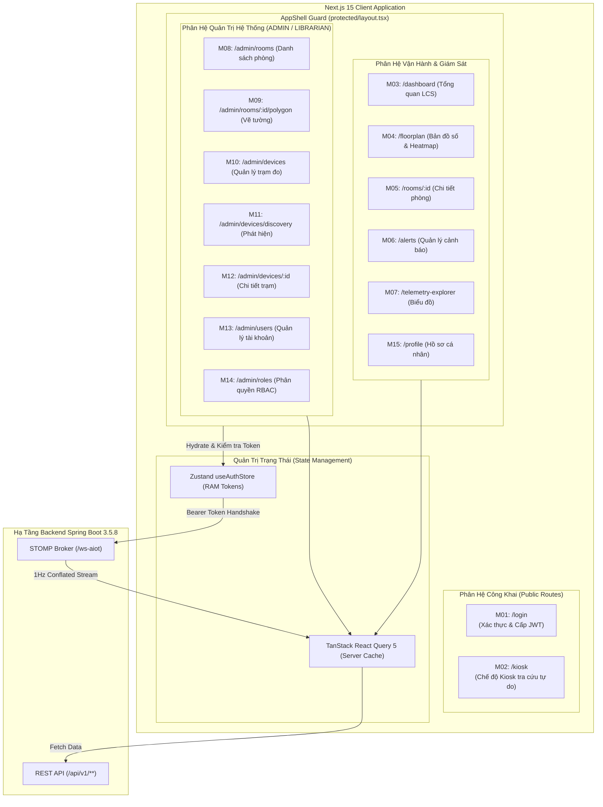
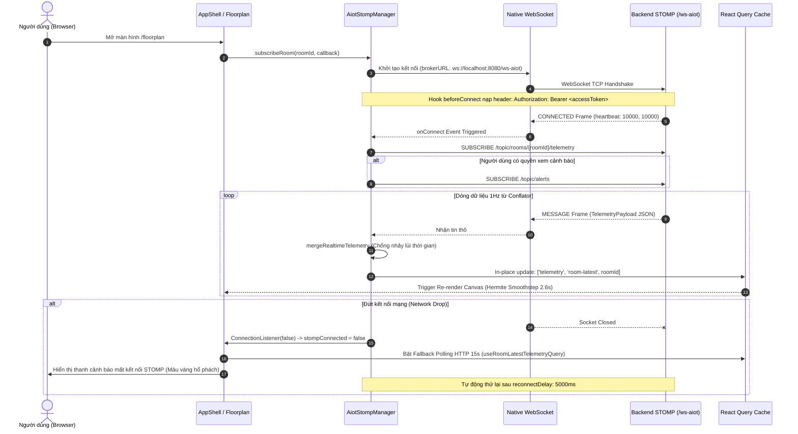
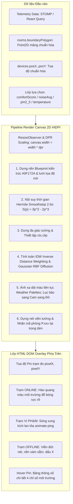
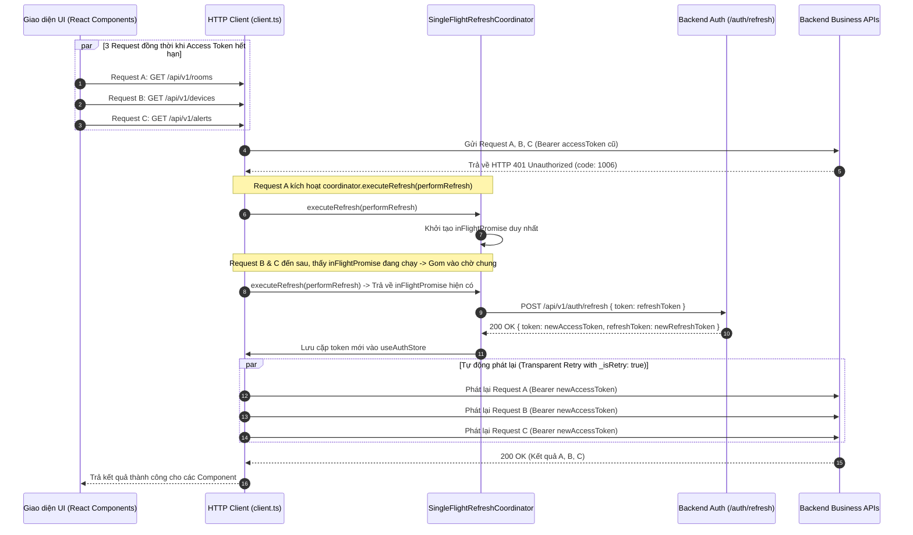

# TÀI LIỆU KỸ THUẬT: KIẾN TRÚC FRONTEND NEXT.JS 15, QUẢN LÝ STATE, REALTIME STOMP & BẢN ĐỒ NHIỆT 2D

> **Dự án**: AIoTLibTQB — Hệ thống Giám sát Vi khí hậu & Âm học Thư viện Tạ Quang Bửu  
> **Mã tài liệu**: `docs/08-frontend.md`  
> **Phiên bản tài liệu**: 1.0.0  
> **Trạng thái**: Hoàn thiện (Production-Ready)  
> **Thư mục mã nguồn tương ứng**: `frontend/`

---

## 1. Mục tiêu (Objective)

Tài liệu này cung cấp bức tranh toàn diện và chi tiết nhất về mặt kiến trúc, thiết kế kỹ thuật và các quyết định triển khai mã nguồn của ứng dụng Frontend trong hệ sinh thái AIoTLibTQB. Văn bản hướng dẫn các kỹ sư phần mềm nắm bắt:
1. Cấu trúc tổ chức mã nguồn theo mô hình **Next.js 15 App Router**, **React 19**, **TypeScript** và **Tailwind CSS 3.4**.
2. Ranh giới kiến trúc tuyệt đối giữa **Client State** (Zustand 5) và **Server Cache State** (TanStack React Query 5).
3. Kiến trúc kết nối thời gian thực **STOMP over Native WebSocket** (`@stomp/stompjs` 7), cơ chế tự phục hồi, chống nhảy lùi thời gian (anti-temporal jump) và fallback HTTP polling 15s.
4. Kỹ thuật dựng mặt bằng không gian 2D và trực quan hóa vi khí hậu trên **Native HTML5 Canvas HiDPI**, cắt đa giác vách tường (`ctx.clip()`), thuật toán nội suy nhiệt độ/âm học **Gaussian RBF Diffusion / IDW**, và hiệu ứng chuyển động khử nhấp nháy **Hermite Smoothstep 2.6s**.
5. Cơ chế kiểm soát truy cập và bảo vệ tuyến đường (Route Protection) qua **Layout Guard `AppShell`** và **Ma trận Năng lực `CapabilityMatrix`**, cùng hàng đợi xử lý làm mới phiên **Single-Flight Refresh Queue** trên nền Native `fetch`.
6. Đối chiếu điểm lệch kiến trúc so với bối cảnh thiết kế ban đầu và các hạng mục cần xác nhận (`TODO: cần xác nhận`).

---

## 2. Đối tượng đọc (Target Audience)

- **Frontend Engineers / UI-UX Developers**: Nắm vững cấu trúc thư mục, quy tắc viết hook, quy chuẩn phân tầng UI Primitives, cơ chế render Canvas và quản lý State.
- **Fullstack / Backend Engineers**: Hiểu rõ hợp đồng dữ liệu (API Envelope, WebSocket STOMP Topic, phân quyền JWT Scope, xử lý mã lỗi HTTP 401/429).
- **System Architects & DevOps**: Nắm bắt cơ chế bundle standalone, cấu hình biến môi trường (`ENV`), chính sách bảo mật HTTP Security Headers, kiểm thử Vitest và hiệu năng tải trang.
- **QA Engineers**: Hiểu rõ luồng hoạt động của 15 phân hệ màn hình (M01 – M15), các ca kiểm thử biên (edge cases) và cơ chế giả lập lỗi để lập kế hoạch kiểm thử tự động.

---

## 3. Nội dung chi tiết (Detailed Content)

### 3.1. Tổng quan Kiến trúc Công nghệ & Cấu trúc Thư mục App Router

Mã nguồn giao diện người dùng của dự án AIoTLibTQB nằm trọn vẹn trong thư mục `frontend/`. Ứng dụng được biên dịch ở chế độ độc lập (`output: 'standalone'`) và kích hoạt kiểm tra nghiêm ngặt `reactStrictMode: true` (`frontend/next.config.ts:4-6`).

#### 3.1.1. Bảng Phiên bản Công nghệ Cốt lõi

| Công nghệ / Thư viện | Phiên bản | Tệp cấu hình / Khai báo | Vai trò & Đặc tính triển khai |
| :--- | :--- | :--- | :--- |
| **Next.js** | `^15.5.28` | `frontend/package.json:18` | App Router, Server/Client Components, Standalone Build, Security Headers |
| **React & React-DOM** | `^19.0.0` | `frontend/package.json:19-20` | Khai thác React 19 Hooks (`useTransition`, `useMemo`, `useCallback`, `useRef`) |
| **TypeScript** | `^5.6.3` | `frontend/package.json:35` | Strict mode (`strict: true`), ES2022 target, bundler module resolution (`tsconfig.json:3-11`) |
| **Tailwind CSS** | `^3.4.14` | `frontend/package.json:34` | Dark mode class, bảng màu thương hiệu brand-50..950, bo góc nén (`tailwind.config.ts:12-55`) |
| **Zustand** | `^5.0.1` | `frontend/package.json:23` | Quản lý Client State tập trung cho Auth Session và Tokens |
| **TanStack React Query**| `^5.60.5` | `frontend/package.json:15` | Quản trị Server Cache State, deduping, background refetch, in-place updates |
| **@stomp/stompjs** | `^7.0.0` | `frontend/package.json:14` | Client STOMP thuần kết nối Native WebSocket (không dùng SockJS) |
| **Lucide React** | `^0.454.0` | `frontend/package.json:17` | Hệ thống Icon đồ họa vector hiện đại, kích thước tối ưu |
| **Zod** | `^3.23.8` | `frontend/package.json:22` | Xác thực Schema dữ liệu form nhập liệu |
| **Vitest & Testing Lib**| `^2.1.4` | `frontend/package.json:26-36`| Môi trường kiểm thử đơn vị tự động (18/18 tests đạt 100% tại `npm test`) |

#### 3.1.2. Cấu trúc Thư mục Frontend (`frontend/src/`)

```
frontend/
├── next.config.ts                # Cấu hình Next.js standalone, headers an ninh (DENY frame, nosniff)
├── tailwind.config.ts            # Phổ màu indigo brand (#6366F1), font Be Vietnam Pro & JetBrains Mono
├── tsconfig.json                 # Đường dẫn alias @/* trỏ về ./src/*
├── package.json                  # Định nghĩa dependencies và scripts kiểm thử/biên dịch
└── src/
    ├── app/                      # Next.js App Router (15 Phân hệ màn hình M01 - M15)
    │   ├── layout.tsx            # Root HTML Layout, nạp Google Fonts & AppProviders
    │   ├── globals.css           # Cấu hình CSS biến hệ thống, Tailwind base/components
    │   ├── providers.tsx         # QueryClientProvider & ToastProvider
    │   ├── page.tsx              # Root index -> Redirect ngay lập tức về /dashboard
    │   ├── login/                # M01: Đăng nhập/Đăng ký, đếm ngược 429
    │   ├── kiosk/                # M02: TV Kiosk sảnh thư viện, tương phản cao, auto-refresh 30s
    │   └── (protected)/          # Nhóm Route bảo vệ bọc trong Layout Guard AppShell
    │       ├── layout.tsx        # Bọc các route nội bộ bên trong <AppShell>
    │       ├── dashboard/        # M03: Tổng quan thư viện, KPI, Top phòng tiện nghi
    │       ├── floorplan/        # M04: Bản đồ nhiệt 2D Heatmap vi khí hậu 4 lớp
    │       ├── rooms/[id]/       # M05: Chi tiết phòng & biểu đồ nén Min-Max-Avg (15m, 1h, 1d)
    │       ├── alerts/           # M06: Trung tâm cảnh báo sự cố & máy trạng thái FSM
    │       ├── telemetry-explorer/# M07: Tra cứu số liệu cảm biến thô (<=24h) & xuất file CSV
    │       ├── profile/          # M15: Hồ sơ cá nhân, đổi mật khẩu, đăng xuất thu hồi token
    │       └── admin/
    │           ├── rooms/        # M08: Quản trị danh sách phòng đọc
    │           │   └── [id]/polygon/ # M09: Trình biên tập đa giác phòng & kéo thả trạm đo
    │           ├── devices/      # M10: Quản lý trạm đo, trạng thái ONLINE/OFFLINE
    │           │   ├── discovery/# M11: Hàng đợi tự động phát hiện trạm đo mới (Auto-Discovery)
    │           │   └── [id]/     # M12: Cấu hình ngưỡng cảnh báo & cấp lại rawApiKey 1 lần
    │           ├── users/        # M13: Quản trị người dùng & gán phân vùng assignedZones
    │           └── roles/        # M14: Ma trận phân quyền động (Dynamic RBAC Matrix)
    ├── components/
    │   ├── layout/               # AppShell.tsx (Header, Sidebar, Navigation Guard, Alert Bell)
    │   └── ui/                   # primitives.tsx (Skeleton, EmptyState, ErrorBanner, GradeBadge, ModalDialog...)
    ├── config/                   # env.ts (chuẩn hóa API_BASE_URL, WS_URL), thresholds.ts (ngưỡng LCS/Sensor)
    ├── features/                 # Kiến trúc Feature-Driven (mỗi feature gồm api.ts, queries.ts, store.ts, components)
    │   ├── alerts/               # Quản lý sự cố & cảnh báo vi khí hậu
    │   ├── auth/                 # Xác thực, store Zustand duy nhất, quản lý token
    │   ├── devices/              # Quản lý thiết bị ESP32-S3 & mã khóa rawApiKey
    │   ├── floorplan/            # Canvas 2D, IDW, Hermite smoothstep, Pin trạm đo
    │   ├── iam/                  # Quản trị người dùng, vai trò & quyền hạn
    │   ├── rooms/                # Quản lý không gian, phòng đọc, đa giác biên
    │   └── telemetry/            # Số liệu vi khí hậu, biểu đồ nén, xuất CSV
    ├── lib/
    │   ├── floorplan/            # coords.ts, polygon.ts (Ray casting), idw.ts, weatherPalette.ts
    │   ├── format/               # formatters chuẩn hóa ngày giờ, chỉ số cảm biến
    │   ├── http/                 # client.ts (Native fetch wrapper), refresh-queue.ts (Single-flight)
    │   ├── rbac/                 # capabilities.ts (CapabilityMatrix), scope-parser.ts
    │   └── realtime/             # stomp-client.ts (AiotStompManager), use-room-stream.ts
    ├── messages/                 # vi.ts (Từ điển 33 mã lỗi tiếng Việt bóc tách từ backend)
    └── types/                    # api.ts (Hợp đồng dữ liệu TypeScript đồng bộ 100% với backend)
```

#### 3.1.3. Danh mục 15 Màn hình Giao diện (M01 – M15)

| Mã Phân Hệ | Tên Màn Hình | Tuyến Đường (Route) | Tệp Mã Nguồn Thực Tế | Phân Quyền Yêu Cầu |
| :---: | :--- | :--- | :--- | :--- |
| **M01** | Đăng nhập & Đăng ký | `/login` | `frontend/src/app/login/page.tsx` | Công khai (`Public`). Tự đếm ngược khi dính Rate Limit 429 |
| **M02** | TV Kiosk Sảnh Thư viện | `/kiosk` | `frontend/src/app/kiosk/page.tsx` | Công khai (`Public`). Dark Mode tương phản cao, auto-refresh 30s |
| **M03** | Dashboard Tổng quan | `/dashboard` | `frontend/src/app/(protected)/dashboard/page.tsx` | Đã đăng nhập (`canViewDashboard`) |
| **M04** | Bản đồ 2D & Heatmap Vi khí hậu | `/floorplan` | `frontend/src/app/(protected)/floorplan/page.tsx` | Đã đăng nhập (`canViewFloorplan`) |
| **M05** | Chi tiết Phòng & Biểu đồ Nén | `/rooms/[id]` | `frontend/src/app/(protected)/rooms/[id]/page.tsx` | Đã đăng nhập. Biểu đồ nén Min-Max-Avg (15m, 1h, 1d) |
| **M06** | Trung tâm Cảnh báo Sự cố | `/alerts` | `frontend/src/app/(protected)/alerts/page.tsx` | Yêu cầu `canViewAlerts`. Quản lý FSM ACK/RESOLVE |
| **M07** | Tra cứu Lịch sử Cảm biến Thô | `/telemetry-explorer` | `frontend/src/app/(protected)/telemetry-explorer/page.tsx` | Yêu cầu `canViewRawTelemetry`. Tra cứu $\le 24\text{h}$, xuất CSV |
| **M08** | Quản trị Phòng đọc | `/admin/rooms` | `frontend/src/app/(protected)/admin/rooms/page.tsx` | Yêu cầu `canManageRooms` (`ADMIN`, `LIBRARIAN`) |
| **M09** | Trình Biên tập Đa giác Mặt bằng | `/admin/rooms/[id]/polygon` | `frontend/src/app/(protected)/admin/rooms/[id]/polygon/page.tsx` | Yêu cầu `canManageRooms`. Chỉnh đỉnh đa giác, kéo thả trạm |
| **M10** | Quản lý Trạm đo Thiết bị | `/admin/devices` | `frontend/src/app/(protected)/admin/devices/page.tsx` | Yêu cầu `canViewDevices` |
| **M11** | Tự động Phát hiện Thiết bị Mới | `/admin/devices/discovery` | `frontend/src/app/(protected)/admin/devices/discovery/page.tsx` | Yêu cầu `canManageDevices`. Duyệt thiết bị mới xuất xưởng |
| **M12** | Chi tiết Thiết bị & Cấp lại Khóa | `/admin/devices/[id]` | `frontend/src/app/(protected)/admin/devices/[id]/page.tsx` | Yêu cầu `canManageDevices`. Cấu hình ngưỡng & cấp lại `rawApiKey` |
| **M13** | Quản trị Người dùng & Phân vùng | `/admin/users` | `frontend/src/app/(protected)/admin/users/page.tsx` | Yêu cầu `canManageUsers` (`ADMIN`). Gán `assignedZones` |
| **M14** | Ma trận Phân quyền Động (RBAC) | `/admin/roles` | `frontend/src/app/(protected)/admin/roles/page.tsx` | Yêu cầu `canManageRoles` (`ADMIN`). Bật/tắt 7 vai trò $\times$ 14 quyền |
| **M15** | Hồ sơ Cá nhân & Đăng xuất | `/profile` | `frontend/src/app/(protected)/profile/page.tsx` | Đã đăng nhập. Tự đổi mật khẩu, thu hồi kép token khi logout |

#### Sơ đồ 8A: Kiến Trúc Tuyến Đường & Phân Hệ Giao Diện (Frontend Modular Route Topology)
*Mục đích:* Phân cụm 15 màn hình giao diện theo 3 phân hệ chức năng rõ rệt (Public, Giám sát, Quản trị), thể hiện liên kết qua Layout Guard (`AppShell.tsx`), quản trị State và kết nối hạ tầng Backend.



---

### 3.2. Phân định Tuyệt đối Kiến trúc State: Client State vs Server Cache State

Kiến trúc phần mềm Frontend của AIoTLibTQB tuân thủ nghiêm ngặt nguyên lý phân tách trách nhiệm: **Không đưa Server State vào Client Store** và **Không lưu UI State tạm thời vào Global Store**.

```
+---------------------------------------------------------------------------------------+
|                                    FRONTEND STATE                                     |
+-------------------------------------------+-------------------------------------------+
|              CLIENT STATE                 |            SERVER CACHE STATE             |
|        (Zustand 5 - useAuthStore)         |         (TanStack React Query 5)          |
+-------------------------------------------+-------------------------------------------+
| - Tệp nguồn: src/features/auth/store.ts   | - Tệp nguồn: src/features/*/queries.ts    |
| - Quy mô: Duy nhất 1 Store toàn cục       | - Quy mô: 6 nhóm Query Keys module hóa    |
| - Dữ liệu quản trị:                       | - Cấu hình mặc định:                      |
|   + accessToken (Chỉ lưu trong RAM)       |   + staleTime: 10,000ms (10 giây)         |
|   + refreshToken:                         |   + retry: 1 (chỉ thử lại 1 lần)          |
|     * Người dùng chuẩn: sessionStorage    |   + refetchOnWindowFocus: false           |
|     * TV Kiosk: localStorage              | - Các nhóm Query Keys:                    |
|   + user: UserResponse | null             |   + telemetryKeys                         |
|   + capabilities: CapabilityMatrix        |   + alertKeys                             |
|   + hydrated, isKioskSession              |   + deviceKeys                            |
| - Cơ chế đồng bộ đa Tab:                  |   + roomKeys                              |
|   + BroadcastChannel('aiot_auth_channel') |   + iamKeys                               |
|   + TOKENS_UPDATED / SESSION_CLEARED      |   + authKeys                              |
| - Gắn kết tự động với HTTP & STOMP:       | - In-place Cache Update:                  |
|   + registerAuthTokenAccessor             |   + STOMP stream ghi đè trực tiếp         |
|   + stompManager.configure               |   + gcTime: 0 cho rawApiKey nhạy cảm      |
+-------------------------------------------+-------------------------------------------+
|                               LOCAL UI STATE (React useState)                         |
| - Độc lập tại từng trang: selectedFloor, selectedLayer, selectedRoomId, vertices...   |
| - Tự động giải phóng bộ nhớ khi component unmount, không gây ô nhiễm global state.    |
+---------------------------------------------------------------------------------------+
```

#### 3.2.1. Client State — Zustand Store Duy Nhất (`useAuthStore`)

Toàn bộ ứng dụng chỉ duy trì **duy nhất 1 store Zustand** tại `frontend/src/features/auth/store.ts:35-175`:

1. **Quản lý Tokens An Toàn Bộ Nhớ**:
   - `accessToken`: Lưu trữ **duy nhất trong bộ nhớ RAM** (Javascript process memory) của Zustand state (`store.ts:36, 77`). Tuyệt đối không ghi ra Cookie hay Storage nhằm triệt tiêu nguy cơ rò rỉ qua tấn công XSS.
   - `refreshToken`:
     - Với người dùng tiêu chuẩn: Lưu trong `sessionStorage` dưới khóa `aiot_refresh_token` (`store.ts:58`). Khi đóng tab hoặc tắt trình duyệt, phiên làm việc lập tức tự hủy.
     - Với chế độ TV Kiosk sảnh (`/kiosk`): Lưu trong `localStorage` dưới khóa `aiot_kiosk_refresh_token` (`store.ts:55`), cho phép Smart TV tự phục hồi phiên sau khi mất điện hoặc tự khởi động lại.
   - Quét tĩnh mã nguồn xác nhận: lệnh `localStorage.setItem` chỉ xuất hiện duy nhất 1 lần trong toàn bộ dự án tại `store.ts:55` phục vụ Kiosk.

2. **Cơ chế Đồng bộ Đa Tab (Cross-Tab Synchronization)**:
   - Sử dụng `BroadcastChannel('aiot_auth_channel')` (`store.ts:13, 62, 96, 123`).
   - Khi một tab đăng nhập hoặc tự làm mới token (`TOKENS_UPDATED`), kênh phát sóng cập nhật `accessToken` và `refreshToken` mới cho toàn bộ các tab đang mở, đồng thời kích hoạt `stompManager.activate()`.
   - Khi một tab đăng xuất (`SESSION_CLEARED`), toàn bộ các tab còn lại lập tức hủy bỏ phiên làm việc, xóa trắng thông tin bộ nhớ và gọi `stompManager.deactivate()`.

3. **Tích hợp Tự động với Hạ tầng HTTP Client & STOMP**:
   - `registerAuthTokenAccessor` (`store.ts:178-184`): Đăng ký trực tiếp hàm truy xuất token cho `client.ts` mà không tạo vòng lặp phụ thuộc (circular dependency).
   - `stompManager.configure` (`store.ts:186-189`): Cung cấp nguồn token động và cờ kiểm tra quyền `canViewAlerts` cho bộ điều phối STOMP.

#### 3.2.2. Server Cache State — TanStack React Query (`@tanstack/react-query`)

Hạ tầng React Query được khởi tạo tại `frontend/src/app/providers.tsx:8-19`:
- `staleTime: 10000` (10 giây): Ngăn chặn tình trạng bắn request dư thừa trong các tương tác qua lại của người dùng.
- `retry: 1`: Thử lại tối đa 1 lần nếu phát sinh lỗi đường truyền tạm thời.
- `refetchOnWindowFocus: false`: Không tự động fetch lại khi đổi tab màn hình, nhường quyền cập nhật cho kênh WebSocket thời gian thực.

Hệ thống 6 nhóm Query Keys module hóa:
1. **`telemetryKeys`** (`src/features/telemetry/queries.ts:7-13`):
   - `telemetryKeys.summary`: `['telemetry', 'summary']` -> Hook `useOverviewSummaryQuery`.
   - `telemetryKeys.roomLatest(roomId)`: `['telemetry', 'room-latest', roomId]` -> Hook `useRoomLatestTelemetryQuery` (tự động bật fallback poll 15s khi mất STOMP).
   - `telemetryKeys.roomBuckets(...)`: `['telemetry', 'buckets', roomId, interval, start, end]` -> Hook `useRoomBucketsQuery` phục vụ biểu đồ nén Min-Max-Avg.
   - `telemetryKeys.rawHistory(...)`: `['telemetry', 'raw', mode, targetId, start, end]` -> Hook `useRawTelemetryQuery` xuất dữ liệu thô.
2. **`alertKeys`** (`src/features/alerts/queries.ts:6-8`):
   - `alertKeys.list(params)`: `['alerts', 'list', params]` -> Hook `useAlertsQuery`.
   - `alertKeys.unreadCount`: `['alerts', 'unread-count']` -> Hook `useUnreadAlertsCountQuery`.
   - Mutations: `useAcknowledgeAlertMutation`, `useResolveAlertMutation` (tự động `invalidateQueries({ queryKey: alertKeys.all })`).
3. **`deviceKeys`** (`src/features/devices/queries.ts:10-18`):
   - `deviceKeys.list(params)`: `['devices', 'list', params]` -> Hook `useDevicesQuery`.
   - `deviceKeys.detail(id)`: `['devices', 'detail', id]` -> Hook `useDeviceDetailQuery`.
   - `deviceKeys.discovered`: `['devices', 'discovered']` -> Hook `useDiscoveredDevicesQuery` (polling tự động mỗi 15 giây).
   - **Bảo mật tuyệt đối khóa `rawApiKey`**: Thiết lập `gcTime: 0` tại `useRegisterDeviceMutation` và `useRegenerateDeviceKeyMutation` (`queries.ts:59, 81`), đảm bảo mã khóa hex hiển thị 1 lần không bao giờ bị lưu vết trong cache React Query.
4. **`roomKeys`** (`src/features/rooms/queries.ts:7-10`):
   - `roomKeys.list(params)`: `['rooms', 'list', params]` -> Hook `useRoomsQuery`.
   - `roomKeys.detail(id)`: `['rooms', 'detail', id]` -> Hook `useRoomDetailQuery`.
5. **`iamKeys`** (`src/features/iam/queries.ts:12-16`):
   - `iamKeys.users(params)`, `iamKeys.roles`, `iamKeys.permissions`.
6. **`authKeys`** (`src/features/auth/queries.ts:10-11`):
   - `authKeys.myInfo`: `['auth', 'myInfo']` -> Hook `useMyInfoQuery`.

---

### 3.3. Kết nối Thời gian thực STOMP over Native WebSocket

#### 3.3.1. Thư viện & Quyết định Kiến trúc Không dùng SockJS
- **Thư viện**: Sử dụng gói chuẩn `@stomp/stompjs` phiên bản `^7.0.0` (`frontend/package.json:14`).
- **Quyết định kỹ thuật**: **Tuyệt đối không sử dụng thư viện `sockjs-client`**. Trong môi trường hiện đại của Next.js 15 và các trình duyệt thế hệ mới, Native WebSocket API (`ws://` hoặc `wss://`) đã được hỗ trợ 100%. STOMP Client kết nối thẳng tới đường dẫn cấu hình `brokerURL: ENV.WS_URL` (`frontend/src/lib/realtime/stomp-client.ts:79`). Quyết định này giúp loại bỏ hoàn toàn các lỗi xung đột DOM, giảm kích thước bundle và tăng tốc độ bắt tay (handshake).
- **Địa chỉ WebSocket**: Lấy từ biến môi trường `process.env.NEXT_PUBLIC_WS_URL || 'ws://localhost:8080/ws-aiot'` (`frontend/src/config/env.ts:4`), khớp chính xác với endpoint cấu hình tại Backend `WebSocketConfig.java`.

#### 3.3.2. Quản trị Đăng ký Kênh Tập trung (AiotStompManager)

Kết nối được điều phối duy nhất qua Singleton `stompManager` (`frontend/src/lib/realtime/stomp-client.ts:43-234`):

1. **Kênh Cảnh báo Toàn cục (`/topic/alerts`)**:
   - Khởi tạo tại `ensureAlertSubscription()` (`stomp-client.ts:203`).
   - **Bảo mật phân quyền phía Client**: Kênh chỉ kích hoạt lệnh `SUBSCRIBE` khi `canSubscribeAlertsGetter() === true` (`capabilities.canViewAlerts`). Khi có sự cố mới chuyển sang trạng thái `FIRING`, hệ thống cập nhật danh sách cảnh báo trong cache và kích hoạt Toast âm thanh/thị giác trên Header (`AppShell.tsx:98-106`).
2. **Kênh Cảm biến Vi khí hậu theo Phòng (`/topic/rooms/{roomId}/telemetry`)**:
   - Khởi tạo tại `ensureRoomSubscription(roomId)` (`stomp-client.ts:217`).
   - Được quản lý tự động theo vòng đời của màn hình thông qua hook `useRoomTelemetryStream(roomId)` (`frontend/src/lib/realtime/use-room-stream.ts:28-52`).
   - Khi người dùng đổi phòng hoặc rời khỏi màn hình bản đồ tầng, hàm cleanup tự động gọi `unsubscribe()` để giải phóng tài nguyên trên Broker (`stomp-client.ts:171`).
   - Khi nhận bản tin, dữ liệu được ghi đè trực tiếp (in-place) vào 2 vị trí cache của React Query: `['telemetry', 'room-latest', roomId]` và `['telemetry', 'device-latest', deviceId]` (`use-room-stream.ts:38-48`).



#### 3.3.3. Tái Kết nối, Xử lý Token & Chống Nhảy lùi Thời gian

1. **Thông số Tự Phục Hồi (Auto-Reconnect)**:
   - `reconnectDelay: 5000` (5 giây tự động thử lại khi mất kết nối) (`stomp-client.ts:80`).
   - `heartbeatIncoming: 10000`, `heartbeatOutgoing: 10000` (nhịp tim kiểm tra 10 giây/lần hai chiều) (`stomp-client.ts:81-82`).
2. **Nạp Bearer Token Động qua `beforeConnect`**:
   - `beforeConnect: () => { ... }` (`stomp-client.ts:83-93`): Trước mỗi lần bắt tay STOMP, đọc trực tiếp token mới nhất từ Zustand RAM memory và gán vào header `Authorization: Bearer <token>`.
   - Khi token được làm mới tại `useAuthStore.setTokens()`, nếu STOMP client đang hoạt động thì tự động cập nhật lại `client.connectHeaders` và tái đăng ký lại các kênh (`stomp-client.ts:69-75`).
3. **Khử Rò rỉ Thông tin Nhạy cảm trong Log (Sanitized Logging)**:
   - Khi nhận sự kiện lỗi STOMP `onStompError`, hệ thống chỉ ghi lại tiêu đề thông điệp `frame.headers['message']` (`stomp-client.ts:101-106`), tuyệt đối không ghi log toàn bộ header chứa Bearer token ra console.
4. **Thuật toán Chống Nhảy lùi Thời gian (Anti-temporal Jump - FE-RT-06)**:
   - Do độ trễ mạng Internet, các gói tin WebSocket có thể đến không theo thứ tự thời gian.
   - Hàm thuần túy `mergeRealtimeTelemetry(current, incoming)` (`stomp-client.ts:8-21`) so sánh timestamp:
     $$\text{incomingMs} < \text{currentMs} \implies \text{Hủy bản tin đến muộn, giữ nguyên trạng thái mới nhất}$$
5. **Cơ chế Dự phòng (Fallback Polling) & 1Hz Conflator**:
   - Backend Spring Boot tích hợp bộ điều tiết `TelemetryConflationService` gom và phát dữ liệu ở tần số chuẩn 1Hz tại `/ws-aiot`.
   - Phía Frontend, khi STOMP kết nối (`stompConnected === true`), toàn bộ polling HTTP bị tắt (`refetchInterval: false`).
   - Khi STOMP mất kết nối, hệ thống tự động kích hoạt polling HTTP 15s (`useRoomLatestTelemetryQuery` có `refetchInterval: 15000`) và hiển thị thông báo trạng thái trên Header `AppShell.tsx:357-367`.

---

### 3.4. Hiển thị Mặt bằng 2D & Trực quan hóa Vi khí hậu (Spatial 2D & Heatmap)

Mô-đun hiển thị mặt bằng không gian 2D là thành phần kỹ thuật phức tạp và quan trọng nhất của giao diện, được triển khai tại `frontend/src/features/floorplan/components/FloorplanCanvas.tsx:1-626`.

#### 3.4.1. Kỹ thuật Render Native Canvas HiDPI kết hợp HTML DOM Overlay
- **Giải pháp Native**: Dùng trực tiếp **HTML5 2D Canvas Context** (`canvas.getContext('2d')`) kết hợp một lớp **HTML DOM Overlay** nằm đè phía trên (`FloorplanCanvas.tsx:260, 481-622`).
- **Quyết định loại bỏ thư viện ngoài**: Tuyệt đối không sử dụng Leaflet, OpenLayers, Konva, Fabric.js hay Three.js. Giải pháp Native Canvas giúp dung lượng bundle của trang `/floorplan` chỉ vỏn vẹn **148 kB** (First Load JS), tối ưu hóa tốc độ tải trang trên các thiết bị di động và TV Kiosk cấu hình yếu.
- **Khử răng cưa HiDPI (devicePixelRatio - FE-VIZ-06)**:
  - Theo dõi kích thước khung chứa bằng `ResizeObserver` (`FloorplanCanvas.tsx:182-203`).
  - Nhân tỉ lệ pixel thực tế của màn hình `window.devicePixelRatio` vào `canvas.width` và `canvas.height`, sau đó áp dụng biến đổi tỉ lệ `ctx.scale(dpr, dpr)` (`FloorplanCanvas.tsx:251-264`). Nhờ đó, các đường nét kiến trúc và hạt màu nội suy hiển thị cực kỳ sắc nét trên màn hình Retina/4K.

#### 3.4.2. Hệ Tọa độ Chuẩn hóa $[0.0, 1.0]$ & Cắt Khuôn Đa giác Tường (`ctx.clip()`)
1. **Tọa độ Chuẩn hóa Độc lập Màn hình**:
   - Đỉnh đa giác biên của phòng `rooms.boundaryPolygon` (`Point2D { x, y }`) và vị trí đặt trạm đo `devices (posX, posY)` đều được lưu dưới dạng số thực chuẩn hóa trong đoạn $[0.0, 1.0]$.
   - Các hàm chuyển đổi hai chiều thuần túy tại `frontend/src/lib/floorplan/coords.ts:5-24`:
     $$\text{pixelX} = \text{normalizedX} \times \text{canvasWidth}, \quad \text{pixelY} = \text{normalizedY} \times \text{canvasHeight}$$
2. **Cắt Đa giác Nghiêm ngặt (Strict Polygon Clipping - FE-VIZ-03)**:
   - Thuật toán dựng đường bao khép kín theo mảng đỉnh phòng: `ctx.beginPath() -> ctx.moveTo -> ctx.lineTo -> ctx.closePath()` (`FloorplanCanvas.tsx:356-364`).
   - Thiết lập vùng cắt khuôn bằng lệnh **`ctx.clip()`** (`frontend/src/lib/floorplan/weatherPalette.ts:164-171`). Toàn bộ hiệu ứng loang nhiệt và tán xạ âm thanh bên trong phòng bị chặn tuyệt đối tại vách tường, không bị lem màu ra hành lang hoặc phòng bên cạnh.
3. **Tính toán Trọng tâm Hình học (Centroid)**:
   - Hàm `computeVisualPolygonCenter` (`frontend/src/lib/floorplan/polygon.ts:13-37`) tính trọng tâm đa giác để gắn nhãn mã phòng (VD: `P.101`) và giá trị chỉ số môi trường ở vị trí trung tâm trực quan nhất.

#### 3.4.3. Bản đồ Nhiệt Vi khí hậu (Heatmap Diffusion & IDW Interpolation)

Được triển khai tại `frontend/src/lib/floorplan/weatherPalette.ts` và `frontend/src/lib/floorplan/idw.ts`:

1. **Thuật toán Nội suy Đa Trạm Đo**:
   - Khi phòng có $\ge 2$ trạm đo cảm biến `ONLINE`: Sử dụng thuật toán **Nội suy Trọng số Khoảng cách Nghịch đảo (IDW - Inverse Distance Weighting)** kết hợp hàm phong bì suy giảm Gaussian RBF (`0.26` desk dispersion envelope) (`FloorplanCanvas.tsx:334-343`, `idw.ts:18-42`):
     $$w_i(x, y) = \frac{1}{(d_i + \epsilon)^p}, \quad V(x, y) = \frac{\sum w_i V_i}{\sum w_i} \times e^{-\frac{d_{\min}^2}{2\sigma^2}}$$
   - Khi phòng chỉ có 1 trạm đo hoặc chỉ có giá trị cấp phòng: Tán xạ đều từ vị trí trạm đo với độ dốc mờ dần về phía vách tường.
2. **Bốn Lớp Hiển thị Môi trường (Heatmap Layers)**:
   - `comfortScore`: Điểm tiện nghi tổng hợp LCS (0–100) theo nguyên lý thùng gỗ Liebig (`FloorplanCanvas.tsx:35`).
   - `noiseAvg`: Độ ồn tương đương ($L_{\text{Aeq}}$, dBA) (`FloorplanCanvas.tsx:38`).
   - `pm2_5`: Nồng độ bụi mịn PM2.5 ($\mu\text{g/m}^3$) (`FloorplanCanvas.tsx:40`).
   - `temperature`: Nhiệt độ không khí phòng (°C) (`FloorplanCanvas.tsx:42`).
3. **Bảng màu Thời tiết Khí tượng (Weather Palettes)**:
   - Bảng màu liên tục `WEATHER_PALETTES` (`weatherPalette.ts:18-62`) chuyển tiếp mượt mà từ xanh ngọc lục bảo (`#10B981`), xanh lá (`#22C55E`), hổ phách (`#F59E0B`), cam (`#F97316`) đến đỏ cảnh báo (`#EF4444`).
4. **Khử Nhấp nháy & Chuyển động Mượt mà (Hermite Smoothstep 2.6s - FE-VIZ-04)**:
   - Khi có bản tin telemetry mới, giá trị nhiệt độ hoặc điểm số không đổi màu giật cục mà lướt êm qua hàm bậc ba Hermite Smoothstep với thời gian chuyển tiếp 2.6 giây (`FloorplanCanvas.tsx:216-230`):
     $$S(p) = 3p^2 - 2p^3 \quad (\text{với } p = \frac{\text{elapsed}}{\text{duration}}, \quad S'(0) = S'(1) = 0)$$
   - Đảm bảo gia tốc ban đầu và giảm tốc kết thúc bằng 0, triệt tiêu hoàn toàn hiện tượng nhấp nháy chuyển trạng thái.
   - Nhãn số hiển thị trên HTML Pin được tiết lưu (throttle) ở tần số ~12fps (chu kỳ 80ms) (`FloorplanCanvas.tsx:234`) để không gây nghẽn luồng xử lý giao diện.



#### 3.4.4. Trực quan hóa Trạng thái Trạm đo & Cảnh báo Vi phạm
- **Trạm `ONLINE`**: Pin tròn có màu sắc tương ứng chỉ số môi trường hiện tại, kèm hiệu ứng đổ bóng hào quang rực rỡ (`FloorplanCanvas.tsx:546-554`).
- **Trạm Vi phạm Ngưỡng (`isAbnormal`)**: Khi nhiệt độ $\ge 24.5^\circ\text{C}$, độ ồn $\ge 50\,\text{dBA}$, hoặc bụi mịn $\text{PM}_{2.5} \ge 22\,\mu\text{g/m}^3$, trạm đo tự động kích hoạt hiệu ứng sóng xung kích tỏa ra xung quanh (`animate-ping`) (`FloorplanCanvas.tsx:505-525`).
- **Trạm `OFFLINE`**: Pin chuyển sang viền nét đứt, nền xám sẫm, hiển thị biểu tượng dấu `✕` (`FloorplanCanvas.tsx:543`).
- **Phòng Mất Kết Nối Toàn Bộ**: Tường phòng chuyển sang màu xám Slate `#64748B`, hiển thị nhãn `N/A (Offline)` (`FloorplanCanvas.tsx:351, 377`).
- **Tương tác Chuột & Khả năng Tiếp cận (A11y)**:
  - Nhấp chuột trên Canvas: Sử dụng thuật toán Ray Casting `isPointInPolygon` (`frontend/src/lib/floorplan/polygon.ts:39-66`) để xác định phòng được click và mở Drawer thông tin chi tiết phòng (`FloorplanCanvas.tsx:444-452`).
  - Khả năng tiếp cận Screen Reader (`FE-A11Y-05`): Bên dưới Canvas, trang `floorplan/page.tsx` cung cấp bảng dữ liệu văn bản song song liệt kê toàn bộ các phòng và thông số đo đạc, đảm bảo người khiếm thị đọc được qua trình đọc màn hình.

#### 3.4.5. Trình Biên tập Đa giác Mặt bằng & Tọa độ Trạm đo (M09 - Polygon Editor)
Tuyến đường `/admin/rooms/[id]/polygon` (`frontend/src/app/(protected)/admin/rooms/[id]/polygon/page.tsx:1-250`) cung cấp công cụ tương tác đồ họa cho Quản trị viên:
1. Chấm điểm thêm đỉnh đa giác khép kín trên mặt phẳng phòng.
2. Di chuyển các đỉnh bằng thao tác kéo-thả chuột (drag-and-drop).
3. Kiểm tra tính hợp lệ hình học qua hàm `validateBoundaryPolygon` (`frontend/src/lib/floorplan/polygon.ts:74-124`): Tối thiểu 3 đỉnh, không có đoạn thẳng tự cắt nhau (self-intersecting), diện tích đa giác hữu hạn $> 0$.
4. Kéo-thả tọa độ trạm đo (`posX`, `posY`) trên bản đồ phòng, tự động kiểm tra trạm đo có nằm lọt trong lòng đa giác tường (`isPointInPolygon`) trước khi cho phép lưu dữ liệu.

---

### 3.5. Điều hướng, Bảo vệ Tuyến đường & Tầng HTTP Client

#### 3.5.1. Cơ chế Bảo vệ Tuyến đường: Layout Guard & CapabilityMatrix
1. **Lý do không sử dụng `middleware.ts` của Next.js**:
   - Next.js Edge Middleware chạy trên môi trường Edge Runtime biệt lập của máy chủ, **không thể truy cập được `sessionStorage`** của trình duyệt người dùng (nơi lưu trữ Refresh Token).
   - Vì vậy, dự án áp dụng mô hình **Client-Side Layout Guard** chuẩn mực thông qua component `AppShell` tại `frontend/src/app/(protected)/layout.tsx:9`.
2. **Luồng Kiểm soát tại `AppShell.tsx`**:
   - Khi tải trang, `AppShell` gọi `hydrateFromStorage()` (`store.ts:115`): Nếu cả `accessToken` và `refreshToken` đều không tồn tại, hệ thống lập tức gọi `router.replace('/login')` (`AppShell.tsx:68-86`).
3. **Ma trận Năng lực Tập trung (`CapabilityMatrix`)**:
   - Được định nghĩa tại `frontend/src/lib/rbac/capabilities.ts:7-124`.
   - **Quy tắc kiểm soát nghiêm ngặt**: Quét tĩnh toàn bộ codebase xác nhận **0 lần sử dụng chuỗi kiểm tra thô `.includes('ADMIN')` bên ngoài thư mục `src/lib/rbac/`**.
   - Các màn hình và Menu điều hướng chỉ kiểm tra các cờ năng lực trừu tượng từ `useAuthStore((s) => s.capabilities)`:
     - `canViewDashboard`, `canViewFloorplan`, `canViewAlerts`, `canViewRawTelemetry`.
     - `canManageRooms`, `canViewDevices`, `canManageDevices`, `canManageUsers`, `canManageRoles`.
4. **Bảo vệ Cấp 2 tại Từng Trang Con (Deep Route Protection)**:
   - Nếu người dùng cố tình nhập URL trực tiếp trên thanh địa chỉ (ví dụ người dùng thường truy cập `/admin/roles`), trang con kiểm tra `if (!capabilities.canManageRoles)` và hiển thị ngay `ErrorBanner` kèm mã lỗi `1007` ("Bạn không có quyền thực hiện thao tác này") (`admin/roles/page.tsx:74-80`).

#### 3.5.2. Tầng HTTP Client & Single-Flight Refresh Queue

Được xây dựng tại `frontend/src/lib/http/`:

1. **Cô lập Tầng Mạng (`FE-ARC-01`)**:
   - Toàn bộ các component UI tuyệt đối không gọi `fetch` trực tiếp. Mọi tương tác mạng đều đóng gói qua các hàm trong `src/features/*/api.ts` và custom hooks trong `src/features/*/queries.ts`.
2. **Hàng đợi Single-Flight Refresh Queue (`FE-AUTH-03`)**:
   - Triển khai qua lớp `SingleFlightRefreshCoordinator` tại `frontend/src/lib/http/refresh-queue.ts:9-26`.
   - **Bài toán bão 401 (401 Request Storm)**: Khi một trang web đồng thời phát ra 5–10 request (ví dụ tải danh sách phòng, thiết bị, cảnh báo) và `accessToken` vừa hết hạn, toàn bộ các request này đều đồng loạt nhận mã lỗi HTTP `401`. Nếu không kiểm soát, trình duyệt sẽ gửi 10 request refresh token đồng thời, gây lỗi xoay vòng token (Token Rotation Race Condition) và khiến tài khoản bị khóa nhầm do nghi ngờ bị tấn công replay.
   - **Giải pháp Single-Flight**: `SingleFlightRefreshCoordinator` gom toàn bộ các request 401 đang chờ và chỉ phát **duy nhất 1 cuộc gọi `POST /api/v1/auth/refresh`**. Các request còn lại dùng chung `inFlightPromise` này. Khi có Access Token mới, tất cả các request đang chờ được tự động thử lại (`_isRetry: true`) một cách hoàn toàn trong suốt (`frontend/src/lib/http/client.ts:133-136`).
   - Nếu cuộc gọi refresh thất bại (Refresh Token đã hết hạn trong DB), hệ thống gọi `clearSession()`, xóa sạch token và chuyển hướng người dùng về trang `/login` (`client.ts:67, 79`).



3. **Bóc tách Phong bì Chuẩn `ApiResponse<T>` (`FE-API-02`)**:
   - Hàm `unwrapEnvelope<T>` tại `frontend/src/lib/http/client.ts:27-50`:
     - Nếu `code === 1000`: Trích xuất và trả về `payload.result as T`.
     - Nếu `code !== 1000`: Tự động ném ngoại lệ `ApiError` chứa mã lỗi nghiệp vụ của backend.
4. **Từ điển 33 Mã Lỗi Tiếng Việt & Đếm Ngược Lỗi 429 (`FE-API-03`)**:
   - Ánh xạ toàn bộ mã lỗi từ `1001` đến `9999` sang thông báo tiếng Việt tại `frontend/src/messages/vi.ts:1-49`.
   - Tự động bắt mã lỗi HTTP `429` (Too Many Requests), đọc header `Retry-After` và hiển thị đồng hồ đếm ngược chờ thử lại tại màn hình đăng nhập (`client.ts:117-120, 140`, `login/page.tsx:34-40`).

---

### 3.6. Đối chiếu Bối cảnh & Điểm Lệch Kiến Trúc (Architectural Drift)

Dựa trên nguyên tắc kiểm toán thực địa: **Mã nguồn thực tế là nguồn sự thật tối thượng**, nhóm biên soạn ghi nhận các điểm lệch kỹ thuật và các nội dung mở sau:

#### 3.6.1. Bảng Đối Chiếu Điểm Lệch Kỹ Thuật

| STT | Khía Cạnh | Mô Tả Trong Bối Cảnh Ban Đầu (`ORIGINAL_REQUEST.md`) | Hiện Trạng Thực Tế Trong Mã Nguồn Frontend | Phân Loại & Đánh Giá Kiến Trúc |
| :---: | :--- | :--- | :--- | :--- |
| **1** | **Danh mục 7 vai trò RBAC** | `ADMIN`, `LIBRARIAN`, `ZONE_MANAGER`, `MAINTENANCE`, `USER`, `VIEWER`, **`PUBLIC_GUEST`** | Khai báo type `RoleName`: `ADMIN`, `LIBRARIAN`, `ZONE_MANAGER`, `MAINTENANCE`, `VIEWER`, `USER`, **`DEVICE`** (`types/api.ts:56-63`). Không có role `PUBLIC_GUEST`. | **Điểm lệch kiến trúc**: Role thứ 7 trong hệ thống là `DEVICE` (dành cho mạch ESP32). Khách vãng lai (`PUBLIC_GUEST`) được hỗ trợ dưới dạng phiên nặc danh không cần đăng nhập tại `/login` và TV Kiosk `/kiosk`. |
| **2** | **Thư viện WebSocket STOMP** | "Sử dụng `@stomp/stompjs` và `sockjs-client`" | Mã nguồn chỉ cài `@stomp/stompjs` 7, **không cài `sockjs-client`**. Kết nối thẳng qua Native Browser WebSocket (`ws://localhost:8080/ws-aiot`). | **Tối ưu hóa mã nguồn**: Next.js 15 và các trình duyệt hiện đại không cần SockJS fallback, giúp giảm kích thước bundle và tăng độ ổn định đường truyền. |
| **3** | **Thư viện HTTP Client** | "Axios/Fetch interceptor bắt mã lỗi 401/403" | Mã nguồn **không cài đặt Axios**. Xây dựng HTTP Client tùy biến trên nền Native `fetch` của ES2022 (`client.ts:60-168`). | **Tối ưu hóa hiệu năng**: Native fetch giúp giảm kích thước gói bundle JavaScript tải về trình duyệt người dùng. |
| **4** | **Cơ chế Route Guard** | "middleware.ts, AuthGuard, RoleGuard theo 7 roles" | **Không có tệp `middleware.ts`**. Toàn bộ route bảo vệ được bọc qua Layout Guard (`AppShell.tsx`) và Ma trận năng lực `CapabilityMatrix`. | **Thiết kế phù hợp**: Next.js Edge Middleware không đọc được `sessionStorage` của trình duyệt. Layout Guard là giải pháp chuẩn cho mô hình token lưu trong RAM/sessionStorage. |
| **5** | **Cấu trúc Zustand Stores** | "Zustand stores trong thư mục `store/` hoặc `stores/` (authStore, filterStore, floorplanStore...)" | **Không có thư mục `store/`**. Chỉ có DUY NHẤT 1 store Zustand là `useAuthStore` tại `features/auth/store.ts`. Bộ lọc và tọa độ là React `useState`. | **Quy ước phân bổ State**: Tránh lạm dụng Global State cho các trạng thái giao diện tạm thời, cục bộ của từng màn hình. |
| **6** | **Kênh Đăng Ký STOMP** | Đăng ký riêng rẽ: `/topic/telemetry`, `/topic/devices/{id}/telemetry`, `/topic/alerts`, `/topic/devices/{id}/status` | Frontend chỉ đăng ký 2 kênh: `/topic/alerts` và `/topic/rooms/{roomId}/telemetry`. Dữ liệu thiết bị được trích xuất từ metadata của bản tin phòng. | **Thiết kế gom kênh (Channel Aggregation)**: Giảm thiểu số lượng subscription đồng thời lên Broker máy chủ. |

#### 3.6.2. Danh Mục Các Mục Cần Xác Nhận (TODO Items)

1. `TODO: cần xác nhận [PUBLIC_GUEST_VS_DEVICE]`: Cần thống nhất trong tài liệu toàn hệ thống rằng 7 vai trò có tài khoản định danh trong CSDL gồm `ADMIN`, `LIBRARIAN`, `ZONE_MANAGER`, `MAINTENANCE`, `VIEWER`, `USER`, và `DEVICE`. Khách vãng lai xem bảng điểm thư viện là người dùng nặc danh (Anonymous) tại màn hình TV Kiosk.
2. `TODO: cần xác nhận [SOCKJS_FALLBACK]`: Cần kiểm tra môi trường mạng nội bộ thực tế tại Thư viện Tạ Quang Bửu xem hệ thống tường lửa/proxy của Đại học Bách Khoa Hà Nội có chặn giao thức WebSocket (`ws://`, `wss://`) trên các cổng 8080/443 hay không để quyết định có cần bổ sung `sockjs-client` dự phòng hay không.
---

### 3.7. Cẩm Nang Phong Cách Giao Diện (UI Style Guide)

Hệ thống giao diện Next.js 15 của AIoTLibTQB được xây dựng dựa trên hệ thống Design Tokens và quy chuẩn Tailwind CSS đồng bộ:

#### 3.7.1. Bảng Màu Chuẩn (Color Palette & Semantic Tokens)
- **Primary / Brand**: Hệ màu Indigo (`indigo-600` làm màu chủ đạo `#4F46E5`, `indigo-500` cho hover, `indigo-50` cho nền active). Sử dụng cho thanh điều hướng, nút hành động chính và các tiêu đề phân hệ.
- **Neutrals / Nền & Văn bản**: Hệ màu Slate:
  - Text chính: `text-slate-900` (Light mode) / `text-slate-100` (Dark mode).
  - Text thứ cấp: `text-slate-500` / `text-slate-400`.
  - Nền trang web: `bg-slate-50` / `bg-slate-950`.
  - Nền thẻ Card: `bg-white` / `bg-slate-900`.
  - Viền phân cách: `border-slate-200` / `border-slate-800`.
- **Màu Sắc Ngữ Nghĩa Vi Khí Hậu & Trạng Thái (Semantic Status)**:
  - **Emerald** (`emerald-500` / `emerald-600`): Hạng LCS Platinum, Gold; Trạng thái trạm đo `ONLINE`; Chỉ số môi trường an toàn theo chuẩn WHO/ASHRAE.
  - **Amber** (`amber-500` / `amber-600`): Hạng LCS Silver, Bronze; Trạng thái cảnh báo `PENDING`; Cần lưu ý theo dõi.
  - **Rose / Red** (`red-500` / `red-600`): Hạng LCS Poor; Cảnh báo `FIRING`; Trạng thái trạm đo `OFFLINE` hoặc sự cố cảm biến.

#### 3.7.2. Kiểu Chữ & Hiển Thị Số Đo (Typography & Numeric Formatting)
- **Phông chữ chủ đạo**: `Be Vietnam Pro` (Google Fonts), tối ưu hóa hiển thị tiếng Việt, nét chữ hiện đại và cân đối hình học.
- **Hiển thị Số liệu Cảm biến**: Bắt buộc sử dụng class `tabular-nums` kết hợp font đơn không gian (`font-mono`) cho toàn bộ các thông số đo đạc ($L_{eq}$, $PM_{2.5}$, Nhiệt độ, Độ ẩm, Lux). Điều này đảm bảo khi số đo nhảy theo tần suất thời gian thực 1Hz, các con số không làm rung lắc hay thay đổi độ rộng của thẻ hiển thị (Layout Shift Prevention).

#### 3.7.3. Quy Chuẩn Bo Góc, Đổ Bóng & Component Classes
- **Bo góc (Border Radius)**:
  - Thẻ chứa nội dung (`.card`): `rounded-xl` (12px).
  - Nút bấm (`.btn-*`), ô nhập liệu (`input`), nhãn trạng thái (`badge`): `rounded-lg` (8px).
  - Hộp thoại nổi Modal, Tooltip bản đồ nhiệt: `rounded-2xl` (16px).
- **Component Classes Mẫu**:
  - `.card`: `bg-white dark:bg-slate-900 border border-slate-200 dark:border-slate-800 rounded-xl p-5 shadow-sm hover:shadow-md transition-shadow`
  - `.btn-primary`: `inline-flex items-center justify-center px-4 py-2 bg-indigo-600 hover:bg-indigo-700 text-white font-medium rounded-lg transition-colors shadow-sm focus:ring-2 focus:ring-indigo-500 focus:ring-offset-2`
  - `.badge-status`: `inline-flex items-center gap-1.5 px-2.5 py-0.5 rounded-full text-xs font-semibold`
- **Bộ Icon Thống Nhất**: `lucide-react` phiên bản `^0.460.0`, kích thước chuẩn `w-4 h-4` cho nút bấm và `w-5 h-5` cho tiêu đề widget.

---

### 3.8. Ma Trận Khớp Nối API $\leftrightarrow$ Màn Hình (M01-M15) & 16 Quy Chuẩn Đồng Bộ Cốt Lõi (D1-D16)

Dựa trên báo cáo kiểm toán khớp nối `docs/frontend/01_gap_report.md` và tiêu chuẩn `FRONTEND_STANDARD.md`, toàn bộ 15 màn hình giao diện được tích hợp với Backend API theo ma trận chuẩn hóa:

| Mã MH | Tên Màn Hình | Endpoint Backend Tích Hợp | Query Hook & API Function | Trạng Thái Tích Hợp |
| :---: | :--- | :--- | :--- | :---: |
| **M01** | Đăng nhập | `POST /api/v1/auth/login` | `useLogin()` (`features/auth/api.ts`) | **ĐÃ HOÀN TẤT** |
| **M02** | Kiosk Sảnh | `GET /api/v1/rooms`, `GET /telemetry/room/{id}/latest` | `useRooms()`, `useLatestTelemetry()` | **ĐÃ HOÀN TẤT** |
| **M03** | Dashboard | `GET /api/v1/rooms`, `GET /telemetry/room/{id}/latest`, `/alerts` | `useDashboardSummary()`, STOMP stream | **ĐÃ HOÀN TẤT** |
| **M04** | Floorplan 2D | `GET /api/v1/rooms/{id}`, `/devices`, STOMP `/telemetry` | `useFloorplanData()`, Canvas IDW render | **ĐÃ HOÀN TẤT** |
| **M05** | Chi Tiết Phòng | `GET /api/v1/rooms/{id}`, `GET /telemetry/room/{id}/buckets` | `useRoomBuckets(15m, 1h, 1d)` | **ĐÃ HOÀN TẤT** |
| **M06** | Alert Center | `GET /api/v1/alerts`, `POST /alerts/{id}/acknowledge` | `useAlerts()`, `useAcknowledgeAlert()` | **ĐÃ HOÀN TẤT** |
| **M07** | Telemetry Explorer | `GET /api/v1/telemetry/device/{id}/raw`, `/export-csv` | `useRawTelemetry()`, Export CSV utility | **ĐÃ HOÀN TẤT** |
| **M08** | Admin Rooms | `GET, POST, DELETE /api/v1/rooms` | `useRooms()`, `useCreateRoom()`, `useDeleteRoom()` | **ĐÃ HOÀN TẤT** |
| **M09** | Polygon Editor | `PUT /api/v1/rooms/{id}/polygon` | `useUpdateRoomPolygon()` | **ĐÃ HOÀN TẤT** |
| **M10** | Admin Devices | `GET /api/v1/devices`, `PATCH /devices/{id}/status` | `useDevices()`, `useToggleDeviceStatus()` | **ĐÃ HOÀN TẤT** |
| **M11** | Device Discovery | `GET /api/v1/devices/discovered`, `POST /devices` | `useDiscoveredDevices()`, `useRegisterDevice()` | **ĐÃ HOÀN TẤT** |
| **M12** | Device Detail | `GET /api/v1/devices/{id}`, `POST /regenerate-key` | `useDevice()`, `useRegenerateKey()` | **ĐÃ HOÀN TẤT** |
| **M13** | Admin Users | `GET, POST, PUT, DELETE /api/v1/users` | `useUsers()`, `useCreateUser()`, `useUpdateUser()` | **ĐÃ HOÀN TẤT** |
| **M14** | Admin RBAC | `GET, PUT /api/v1/roles`, `GET /api/v1/permissions` | `useRoles()`, `usePermissions()`, `useUpdateRole()` | **ĐÃ HOÀN TẤT** |
| **M15** | Profile | `GET /api/v1/users/myInfo`, `POST /change-password` | `useMyInfo()`, `useChangePassword()`, `useLogout()` | **ĐÃ HOÀN TẤT** |

#### Tóm Tắt 16 Quy Chuẩn Kỹ Thuật Đồng Bộ Cốt Lõi (D1 – D16):
- **D1 (Vỏ bọc)**: Luôn unwrap `ApiResponse<T>` trước khi trả về TanStack Query (`client.ts:unwrapEnvelope`).
- **D2 (Phân trang)**: Đồng bộ cấu trúc `PageResponse<T>` (0-indexed page, totalElements, totalPages).
- **D3 (Single-Flight)**: Gom toàn bộ 401 concurrent requests vào 1 refresh duy nhất (`SingleFlightRefreshCoordinator`).
- **D4 (RAM Token)**: Không lưu Access Token vào localStorage; chỉ lưu trong RAM Zustand và sessionStorage cho SSR rehydration.
- **D5 (RTR)**: Sau mỗi lần refresh thành công, cập nhật ngay lập tức `refreshToken` mới nhận được.
- **D6 (Thu hồi tức thời)**: Hỗ trợ vô hiệu hóa khi đổi mật khẩu (`credentialsUpdatedAt`).
- **D7 (Bảo vệ RBAC)**: Dùng `CapabilityMatrix` kiểm tra quyền thay vì hardcode role checks trên giao diện.
- **D8 (ABAC Zone)**: Người dùng có `ZONE_MANAGER` chỉ thấy các phòng thuộc `assignedZones`.
- **D9 (Native WS)**: Kết nối STOMP trực tiếp qua browser WebSocket, không phụ thuộc thư viện SockJS.
- **D10 (Throttling 1Hz)**: Nhận bản tin conflated từ `/topic/rooms/{id}/telemetry` để cập nhật React Query cache.
- **D11 (Lọc cảnh báo)**: Chỉ người dùng có `VIEW_ALERTS` mới được phép subscribe `/topic/alerts`.
- **D12 (Canvas HiDPI)**: Tự động nhân tỷ lệ `window.devicePixelRatio` khi vẽ Heatmap trên màn hình Retina.
- **D13 (Hàm nội suy IDW)**: Dùng lũy thừa nghịch đảo khoảng cách kết hợp Hermite Smoothstep 2.6s.
- **D14 (Độ trễ Fallback)**: Tự động chuyển sang chế độ Polling 5s khi kết nối STOMP bị đứt quá 30s.
- **D15 (Từ điển lỗi)**: Ánh xạ toàn bộ 46 mã lỗi từ backend sang tiếng Việt qua `messages/vi.ts`.
- **D16 (Rate Limit 429)**: Tự động đọc header `Retry-After` và hiển thị đồng hồ đếm ngược trên giao diện.

---

## 4. Mục "Đọc tiếp" (Next Reading)

Để hiểu sâu sắc hơn về các thành phần liên quan và cơ chế phối hợp toàn diện của hệ thống AIoTLibTQB, khuyến nghị người đọc tiếp tục tham khảo các tài liệu kỹ thuật sau:
- [Kiến trúc Tổng thể & Sơ đồ Luồng Dữ liệu](02-architecture.md): Xem sơ đồ luồng dữ liệu tổng quát từ thiết bị ESP32-S3, Broker Mosquitto, Backend Spring Boot đến Frontend Next.js.
- [Đường ống Tiếp nhận Dữ liệu & Thiết bị Sống còn](03-ingestion-pipeline.md): Tìm hiểu cơ chế làm sạch số đo, forward-fill 30s, kẹp timestamp và Device Watchdog phía máy chủ.
- [An ninh Bảo mật, Xác thực JWT & Phân quyền RBAC](06-security-rbac.md): Chi tiết cấu trúc JWT Claims, thuật toán băm SHA-512, cơ chế xoay vòng Refresh Token và ma trận 7 vai trò $\times$ 14 quyền hạn.
- [Danh mục Đặc tả API RESTful](07-api-reference.md): Toàn bộ danh mục endpoint, định dạng phong bì `ApiResponse<T>`, tham số truy vấn và danh mục 33 mã lỗi chuẩn.
- [Đặc tả Kỹ thuật Firmware IoT & Thiết bị ESP32-S3](09-firmware-iot.md): Cấu hình phần cứng cảm biến, chuẩn đóng gói JSON MQTT và cơ chế xác thực API Key bằng mã băm BCrypt.
- [Cẩm nang Vận hành & Cài đặt Môi trường (Runbook)](11-onboarding-runbook.md): Hướng dẫn từng bước khởi chạy hệ thống cục bộ bằng Docker Compose, Maven và Node.js.
