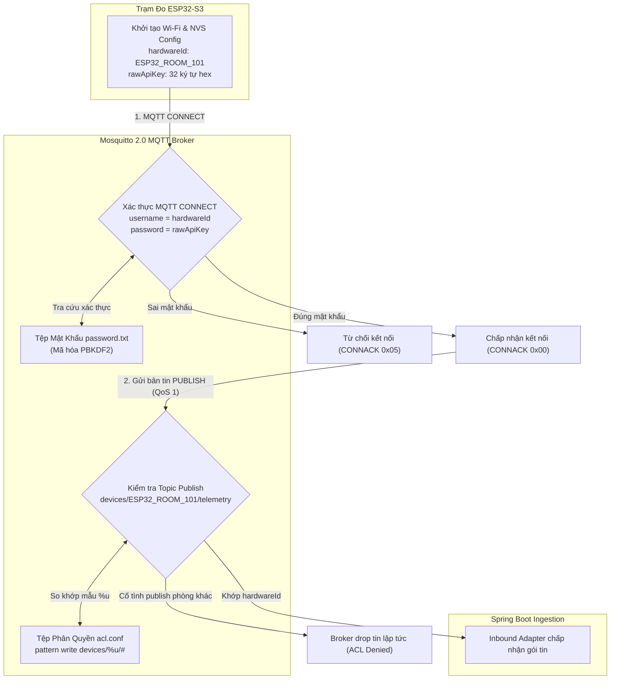
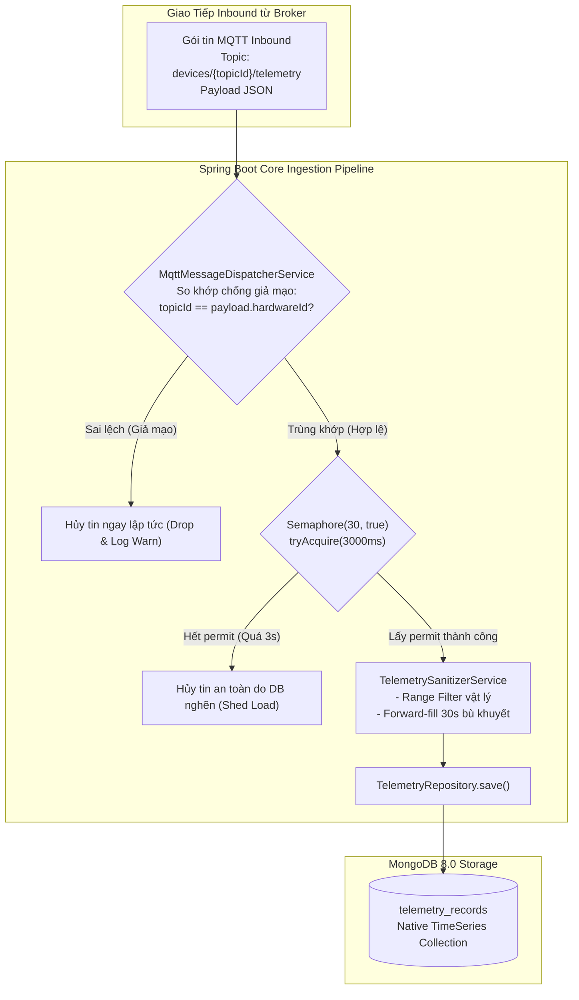

# TÀI LIỆU KỸ THUẬT: ĐẶC TẢ IOT FIRMWARE, THIẾT BỊ ESP32-S3, GIAO THỨC MQTT & BỘ GIẢ LẬP MẠCH ĐO

> **Dự án**: AIoTLibTQB — Hệ thống Giám sát Vi khí hậu & Âm học Thư viện Tạ Quang Bửu  
> **Mã tài liệu**: `docs/09-firmware-iot.md`  
> **Phiên bản tài liệu**: 1.0.0  
> **Trạng thái**: Hoàn thiện (Production-Ready)  
> **Mã nguồn liên quan**: `src/main/java/.../service/`, `mosquitto/`, `tools/iot-simulator/`, `docs/implementation/HARDWARE_HANDOVER_SPEC.md`

---

## 1. Mục tiêu (Objective)

Tài liệu này là cẩm nang kỹ thuật toàn diện dành cho đội ngũ phát triển Firmware nhúng (Embedded Engineers), kỹ sư phần cứng IoT và kỹ sư kiểm thử (QA/DevOps) của hệ sinh thái AIoTLibTQB. Mục tiêu chính bao gồm:
1. Quy chuẩn hóa thông số kiến trúc phần cứng vi điều khiển **ESP32-S3** và cụm 4 cảm biến vật lý đo đạc 9 chỉ số môi trường.
2. Thiết lập hợp đồng dữ liệu chuẩn xác cho các gói tin **MQTT Telemetry** và **Status/LWT** đẩy lên Eclipse Mosquitto 2.0.
3. Làm rõ dải đo vật lý của 9 thông số cảm biến, cơ chế **Forward-Fill 30s** (loại trừ `noise_peak`), và quy tắc thời gian Unix Epoch UTC.
4. Đặc tả cơ chế an ninh hai lớp: Phân quyền Broker ACL theo khuôn mẫu `%u` và xác thực thiết bị qua **API Key băm `BCrypt(10)`**.
5. Giới thiệu cơ chế hòa mạng tự động **Auto-Discovery** và bộ giả lập mạch đo **IoT Simulator** (`tools/iot-simulator/`) phục vụ kiểm thử 10 kịch bản thực địa.
6. Cung cấp mã nguồn C++/Arduino mẫu chuẩn hóa và ghi nhận các điểm lệch kiến trúc so với bối cảnh thiết kế ban đầu.

---

## 2. Đối tượng đọc (Target Audience)

- **Embedded Firmware Engineers**: Lập trình firmware C++/ESP-IDF/Arduino cho vi điều khiển ESP32-S3, cấu hình giao tiếp I2S, I2C, UART và ngăn xếp MQTT client.
- **Hardware & Electronics Engineers**: Thiết kế sơ đồ nguyên lý mạch (schematic), bố trí linh kiện PCB, chọn lựa module cảm biến và tính toán năng lượng tiêu thụ.
- **Backend / Ingestion Engineers**: Nắm vững cấu trúc payload JSON, bộ lọc giá trị vật lý và quy trình tiếp nhận bản tin trên nền Java 21 Virtual Threads.
- **DevOps & System Administrators**: Cấu hình MQTT Broker Mosquitto, chính sách phân quyền ACL, giám sát kết nối và triển khai cụm dịch vụ Docker.
- **QA / Test Automation Engineers**: Vận hành bộ công cụ giả lập `iot-simulator`, mô phỏng các ca kiểm thử quá tải, đứt mạng, xung ồn và ô nhiễm bụi.

---

## 3. Nội dung chi tiết (Detailed Content)

### 3.1. Kiến trúc Phần cứng Trạm đo ESP32-S3 & Cụm Cảm biến Vật lý

Trạm đo giám sát không gian thư viện được thiết kế xoay quanh vi điều khiển trung tâm **ESP32-S3**, kết hợp cùng cụm cảm biến chuyên dụng đáp ứng các tiêu chuẩn quốc tế ISO 11799 (bảo tồn tài liệu), ASHRAE 55 (tiện nghi nhiệt) và WHO / ANSI S12.60 (chất lượng không khí & âm học).

#### 3.1.1. Vi điều khiển Trung tâm (MCU Core)
- **Model**: ESP32-S3 Series (Espressif Systems).
- **Kiến trúc CPU**: Dual-core 32-bit Xtensa LX7, tần số xung nhịp lên đến **240 MHz**.
- **Tập lệnh mở rộng**: Hỗ trợ các chỉ lệnh tăng tốc vector (Vector Instructions) phục vụ tính toán nhanh biến đổi Fourier nhanh (FFT) cho tín hiệu âm thanh thu từ microphone.
- **Bộ nhớ**: 512 KB SRAM nội bộ, tích hợp 8 MB Flash SPI và 8 MB Octal PSRAM ngoài (hỗ trợ đệm dữ liệu lịch sử khi mất kết nối mạng - Offline Store-and-Forward).
- **Kết nối không dây**: Wi-Fi 802.11 b/g/n (2.4 GHz, băng thông lên tới 150 Mbps) và Bluetooth 5.0 (BLE).

#### 3.1.2. Cụm 4 Cảm biến Vật lý Tích hợp

| Phân Nhóm | Cảm Biến Phần Cứng | Giao Thức Giao Tiếp | Chỉ Số Thu Thập | Nguyên Lý Hoạt Động |
| :--- | :--- | :--- | :--- | :--- |
| **Âm học (Acoustics)** | **INMP441** | **I2S (Inter-IC Sound)**<br>DMA 24-bit PCM | `noise_avg`<br>`noise_peak` | Micro silicon MEMS đa hướng kỹ thuật số, độ nhạy cao (-26 dBFS), dải tần 60 Hz – 15 kHz, tính toán trọng số A ($L_{\text{Aeq}}$) trực tiếp trên chip |
| **Bụi mịn (Air Quality)** | **Sensirion SPS30** | **UART / I2C**<br>(Baudrate: 115200) | `pm1_0`<br>`pm2_5`<br>`pm4_0`<br>`pm10` | Cảm biến quang học tán xạ laser (Laser Scattering), đo đồng thời 4 phân đoạn hạt bụi, công nghệ quạt tự làm sạch (self-cleaning) kéo dài tuổi thọ |
| **Vi khí hậu (Environment)** | **Sensirion SHT30 / SHT31** | **I2C**<br>(Địa chỉ: `0x44` hoặc `0x45`) | `temperature`<br>`humidity` | Cảm biến tích hợp màng polyme điện dung và dải nhiệt độ tinh thể, độ chính xác cao: $\pm 0.2^\circ\text{C}$ và $\pm 2\%\,\text{RH}$ |
| **Ánh sáng (Environment)** | **ROHM BH1750 / VEML7700**| **I2C**<br>(Địa chỉ: `0x23` hoặc `0x10`) | `lux` | Cảm biến quang học tuyến tính tích hợp bộ biến đổi ADC 16-bit, dải đo rộng 0 – 65,535 Lux, đáp ứng độ nhạy mắt người (CIE Photopic) |

---

### 3.2. Danh mục 9 Thông số Cảm biến Thời gian thực & Dải đo Vật lý

Hệ thống Backend Spring Boot áp dụng bộ lọc dữ liệu nghiêm ngặt tại `TelemetrySanitizerService.java:24-35`. Mọi số đo nằm ngoài dải `[Min, Max]` vật lý sẽ bị loại bỏ coi như nhiễu phần cứng.

#### 3.2.1. Bảng Thông số Kỹ thuật Chi tiết 9 Chỉ số Môi trường

| STT | Tên Chỉ Số | Tên Trường JSON (`snake_case`) | Tên `@JsonAlias` Được Hỗ Trợ | Đơn Vị Đo | Dải Đo Hợp Lệ [Min, Max] | Độ Chính Xác / Dung Sai | Cảm Biến Vật Lý Tương Ứng |
| :---: | :--- | :--- | :--- | :---: | :---: | :---: | :--- |
| **1** | Độ ồn trung bình | `noise_avg` | `noiseAvg` | **dBA** | **[30.0, 110.0]** | $\pm 1.5$ dBA | INMP441 (I2S MEMS) |
| **2** | Độ ồn đỉnh | `noise_peak` | `noisePeak` | **dBA** | **[30.0, 130.0]** | $\pm 2.0$ dBA | INMP441 (I2S MEMS) |
| **3** | Bụi siêu mịn $\text{PM}_{1.0}$ | `pm1_0` | `pm1` | **$\mu\text{g/m}^3$** | **[0.0, 1000.0]** | $\pm 10\%$ | Sensirion SPS30 |
| **4** | Bụi mịn hô hấp $\text{PM}_{2.5}$ | `pm2_5` | `pm25` | **$\mu\text{g/m}^3$** | **[0.0, 1000.0]** | $\pm 10\%$ | Sensirion SPS30 |
| **5** | Bụi lắng $\text{PM}_{4.0}$ | `pm4_0` | `pm4` | **$\mu\text{g/m}^3$** | **[0.0, 1000.0]** | $\pm 25\%$ | Sensirion SPS30 |
| **6** | Bụi thô $\text{PM}_{10}$ | `pm10` | *(không)* | **$\mu\text{g/m}^3$** | **[0.0, 1000.0]** | $\pm 25\%$ | Sensirion SPS30 |
| **7** | Nhiệt độ không khí | `temperature` | *(không)* | **$^\circ\text{C}$** | **[0.0, 60.0]** | $\pm 0.2^\circ\text{C}$ | Sensirion SHT30/SHT31 |
| **8** | Độ ẩm tương đối | `humidity` | *(không)* | **%RH** | **[0.0, 100.0]** | $\pm 2.0\%$ RH | Sensirion SHT30/SHT31 |
| **9** | Cường độ ánh sáng | `lux` | *(không)* | **Lux** | **[0.0, 65535.0]** | $\pm 20\%$ | BH1750 / VEML7700 |
| *Bổ trợ* | Cường độ sóng Wi-Fi | `wifi_rssi` | `wifiRssi` | **dBm** | **[-90, -30]** | $\pm 1$ dBm | ESP32-S3 Wi-Fi Core |

#### 3.2.2. Quy Tắc Xử Lý Lỗi Đo Đạc & Cơ Chế Forward-Fill 30s Phía Server
1. **Cấm Gửi Mã Lỗi Giả Bằng Số (`-1`, `-999`, `0` dBA)**:
   - Khi một cảm biến bị lỗi đọc tạm thời (VD: cảm biến bụi đang trong chu trình tự làm sạch 10 giây hoặc I2C bus bị nghẽn), firmware **không đưa trường đó vào JSON** hoặc gán giá trị `null`. Tuyệt đối không gửi `-1` hay `0` dBA.
   - Thang đo dBA âm học bắt đầu từ 30.0 dBA. Nếu phòng hoàn toàn tĩnh lặng, firmware phải kẹp giá trị dưới về mức `30.0` dBA.
2. **Kiểm Tra `isnan()` và `isinf()` Trước Khi Đóng Gói**:
   - Biến số thực `float` bị lỗi `NaN` nếu ép chuỗi thẳng vào JSON sẽ tạo payload cú pháp sai (`"temperature": NaN`), khiến bộ phân tích Jackson phía Server ném ngoại lệ và drop toàn bộ gói tin.
3. **Cơ Chế Forward-Fill 30 Giây Phía Server**:
   - `TelemetrySanitizerService.java:36` cấu hình cửa sổ trượt `FORWARD_FILL_WINDOW = Duration.ofSeconds(30)`.
   - Nếu trong gói tin gửi lên có 1 trường bị thiếu hoặc null, Server tự động tìm kiếm giá trị hợp lệ liền trước trong bộ đệm Caffeine Cache (tối đa 30 giây) để điền bù vào số liệu.
4. **Quy Tắc Loại Trừ `noise_peak` Khỏi Forward-Fill**:
   - `TelemetrySanitizerService.java:82, 94-106` triển khai hàm riêng: `sanitizePeakWithoutForwardFill`.
   - **Lý do thiết kế**: Đỉnh tiếng ồn (`noise_peak`) mang tính chất xung kích tức thời (tiếng đập bàn, rơi sách, kéo ghế). Nếu áp dụng forward-fill cho `noise_peak`, một tiếng động ngắn 0.5s sẽ bị kéo dài nhân tạo thành 30s, dẫn đến kích hoạt cảnh báo FSM sai lệch tại `AlertRuleEngine.java`. Do đó, `noise_peak` chỉ được ghi nhận đúng tại thời điểm xảy ra và lập tức biến mất ở chu kỳ tiếp theo nếu không còn xung âm.

---

### 3.3. Định Dạng Gói Tin JSON Chuẩn (MQTT Topic & Payloads)

Toàn bộ dữ liệu trao đổi giữa thiết bị và MQTT Broker là chuỗi JSON mã hóa **UTF-8**, giao vận qua giao thức MQTT v3.1.1 (TCP, QoS 1, Retain false).

#### 3.3.1. Gói Tin Dữ Liệu Đo Telemetry (`devices/{hardwareId}/telemetry`)

- **Topic**: `devices/{hardwareId}/telemetry` *(Ví dụ: `devices/ESP32_ROOM_101/telemetry`)*
- **Thao tác**: `PUBLISH` định kỳ từ mạch lên Server (QoS: `1`, Retain: `false`).

```json
{
  "hardware_id": "ESP32_ROOM_101",
  "timestamp": 1728543600000,
  "wifi_rssi": -58,
  "data": {
    "acoustics": {
      "noise_avg": 43.2,
      "noise_peak": 57.8
    },
    "air_quality": {
      "pm1_0": 9.2,
      "pm2_5": 15.6,
      "pm4_0": 19.3,
      "pm10": 22.4
    },
    "environment": {
      "temperature": 24.8,
      "humidity": 52.5,
      "lux": 460.0
    }
  }
}
```

*Đặc tả cấu trúc*:
- `hardware_id` (`String`): Phải trùng khớp 100% với `{hardwareId}` trên đường dẫn Topic.
- `timestamp` (`Long`): Thời gian Unix Epoch UTC. Hỗ trợ cả định dạng **giây (10 chữ số)** và **mili-giây (13 chữ số)** (`MqttMessageDispatcherService.java:308-333`).
- `wifi_rssi` (`Integer`): Cường độ sóng Wi-Fi tính bằng dBm (số nguyên âm, ví dụ: `-58`).
- `data` (`Object`): Bắt buộc chứa ít nhất 1 chỉ số cảm biến hợp lệ. Nếu `data` rỗng, Server gọi `isEmptyMetrics()` và hủy bỏ gói tin (`MqttMessageDispatcherService.java:238-241`).

#### 3.3.2. Gói Tin Trạng Thái & Di Chúc Sống Còn LWT (`devices/{hardwareId}/status`)

- **Topic**: `devices/{hardwareId}/status` *(Ví dụ: `devices/ESP32_ROOM_101/status`)*
- **Thao tác**: `PUBLISH` khi vừa khởi động lại VÀ đăng ký làm **Last Will and Testament (LWT)** khi khởi tạo kết nối MQTT.

##### A. Gói Tin Báo Trạng Thái Hoạt Động (`online`)
Mạch chủ động gửi ngay sau khi kết nối mạng Wi-Fi và MQTT thành công:
```json
{
  "hardware_id": "ESP32_ROOM_101",
  "status": "online",
  "reason": "power_on",
  "firmware_version": "1.2.0",
  "uptime_seconds": 15,
  "timestamp": 1728543600000
}
```
*Tác dụng*: Server cập nhật `connectionState = ONLINE`, cập nhật phiên bản code `firmwareVersion` vào hồ sơ thiết bị trong MongoDB, và tự động thu hồi cảnh báo `DEVICE_OFFLINE` nếu trước đó mạch bị rớt mạng.

##### B. Gói Tin Di Chúc Tự Động Khi Mất Nguồn Đột Ngột (`offline` - LWT)
Mạch khai báo thông điệp này trong hàm `mqttClient.connect()` với Broker (Will Topic: `devices/{hardwareId}/status`, Will QoS: `1`, Will Retain: `false`).
```json
{
  "hardware_id": "ESP32_ROOM_101",
  "status": "offline",
  "reason": "lwt"
}
```
*Tác dụng*: Khi mạch mất điện đột ngột hoặc đứt cáp anten không kịp gửi lệnh ngắt kết nối MQTT DISCONNECT, Broker Mosquitto phát hiện hết thời hạn Keep-Alive (30s) và sẽ **tự động phát gói tin LWT này** thay cho mạch.

#### 3.3.3. Kênh Nhận Lệnh Từ Server (`devices/{hardwareId}/command`)
- **Topic**: `devices/{hardwareId}/command` (QoS 1).
- Khi kết nối thành công, firmware gọi `subscribe("devices/" + HARDWARE_ID + "/command")` để sẵn sàng tiếp nhận các bản tin cấu hình chu kỳ gửi tin hoặc kích hoạt nạp phần mềm từ xa (OTA Reboot).

---

### 3.4. Chu Kỳ Đo, Chu Kỳ Phát Tin & Ngưỡng Thời Gian Vận Hành

```
+-----------------------------------------------------------------------------------------+
|                                    TIMING & CYCLES                                      |
+--------------------------+------------------------------+-------------------------------+
|  Sampling Cycle (I2S/I2C)|  Publishing Cycle (MQTT)     |  Server Timeout Safeguards    |
+--------------------------+------------------------------+-------------------------------+
| - Micro INMP441: DMA 24b | - Chu kỳ tiêu chuẩn: 10s-30s | - Device Watchdog: 120s (2m)  |
| - Đo liên tục, lấy mẫu   | - Test nhanh: 5s/lần         | - Watchdog Sweep: 15s/lần     |
|   mỗi 100ms tính Leq     | - Giới hạn tối đa: <= 60s    | - FSM Alert Pending: >= 30s   |
| - SHT31, SPS30: 1s-2s/lần|   (tránh bị Watchdog ngắt)   | - FSM Alert Recovery: >= 60s  |
+--------------------------+------------------------------+-------------------------------+
```

1. **Chu Kỳ Đo Cảm Biến Cục Bộ (Local Sampling)**:
   - Cảm biến âm thanh INMP441: Thu mẫu liên tục qua kênh DMA I2S với tần số lấy mẫu 16 kHz hoặc 32 kHz, tính toán tích phân năng lượng để ra mức áp suất âm thanh tương đương $L_{\text{Aeq}}$ theo từng giây.
   - Cảm biến SPS30 và SHT31: Đọc qua I2C/UART mỗi **1 đến 2 giây/lần**, lưu vào mảng đệm trượt để tính giá trị trung bình chu kỳ.
2. **Chu Kỳ Phát Tin MQTT (Publishing Cycle)**:
   - Chu kỳ chuẩn khuyến nghị trong vận hành thực tế: **từ 10 giây đến 30 giây/lần**.
   - Chu kỳ thử nghiệm trong phòng Lab: **5 giây/lần**.
   - **Giới hạn trần bắt buộc**: Chu kỳ gửi tin **tuyệt đối không được vượt quá 60 giây/lần**.
3. **Cơ Chế Canh Gác Thiết Bị Sống Còn (Device Watchdog Service)**:
   - Tiến trình nền `DeviceWatchdogService.java:71-149` quét MongoDB mỗi **15 giây/lần** (`@Scheduled(fixedRate = 15000)`).
   - Nếu một trạm đo không gửi bất kỳ bản tin nào trong vòng **120 giây (2 phút)** (`lastSeenAt < now - 2m`), Server tự động chuyển trạng thái thiết bị sang **`connectionState = OFFLINE`**, thêm ID vào tập in-memory `offlineDeviceHardwareIds`, và phát sinh cảnh báo sự cố `DEVICE_OFFLINE` lên kênh `/topic/alerts`.
4. **Bộ Lọc Nhiễu FSM Cảnh Báo (30s Window)**:
   - Động cơ cảnh báo `AlertRuleEngine.java:107-250` áp dụng bộ đếm thời gian: Khi các chỉ số vượt ngưỡng (ồn $> 65\,\text{dBA}$, nóng $> 32^\circ\text{C}$, bụi $> 50\,\mu\text{g/m}^3$), hệ thống đưa cảnh báo vào trạng thái `PENDING`. Chỉ khi sự cố duy trì liên tục **$\ge 30$ giây** thì mới chính thức kích hoạt chuông báo động `FIRING`. Sau đó, cần duy trì an toàn liên tục **$\ge 60$ giây** (Hysteresis) mới tự động đóng trạng thái sang `RESOLVED`.
   - Do đó, việc gửi tin đều đặn mỗi 10s–30s là điều kiện tiên quyết để bộ đếm FSM hoạt động chuẩn xác.

---

### 3.5. Cơ Chế Xác Thực Thiết Bị, An Ninh Mạng & Phân Quyền ACL

Hệ sinh thái AIoTLibTQB áp dụng chiến lược bảo mật phòng thủ chiều sâu (Defense-in-Depth) kết hợp giữa tầng biên MQTT Broker và tầng xử lý Ingestion Pipeline:

#### Sơ đồ 9A: Quy Trình Xác Thực & Bắt Tay Kết Nối MQTT Broker (MQTT Authentication Handshake)
*Mục đích:* Mô tả quá trình trạm đo khởi tạo, xác thực tài khoản PBKDF2 trên Broker Mosquitto và kiểm soát quyền ghi theo mẫu ACL `%u`.



#### Sơ đồ 9B: Pipeline Kiểm Định Tính Toàn Vẹn & Chống Giả Mạo (Anti-Spoofing & Ingestion Pipeline)
*Mục đích:* Làm rõ các chốt chặn an ninh tại Backend: So khớp chống giả mạo `topicId == payload.hardwareId`, rào chắn tải Semaphore 30 permits, làm sạch số đo và lưu trữ TimeSeries.



#### 3.5.1. Phân Quyền Tối Thiểu Trên MQTT Broker (Per-Device ACL Isolation)
- Cấu hình tại `mosquitto/config/acl.conf:15-18`:
  ```conf
  # IoT devices: isolated strictly to their own hardwareId (%u) topics
  pattern write devices/%u/telemetry
  pattern write devices/%u/status
  pattern read devices/%u/command
  ```
- **Ý nghĩa bảo mật**: Ký tự `%u` đại diện cho Username đăng nhập MQTT của thiết bị. Khi mạch `ESP32_ROOM_101` đăng nhập với `username = "ESP32_ROOM_101"`, mạch **chỉ có thể** xuất bản tin vào `devices/ESP32_ROOM_101/...` và chỉ có thể đọc lệnh từ `devices/ESP32_ROOM_101/command`. Thiết bị bị giam lỏng tuyệt đối, hoàn toàn không có khả năng nghe trộm hay giả mạo dữ liệu của các phòng đọc khác.
- Mật khẩu thiết bị trên Broker được khởi tạo tự động qua tập lệnh `mosquitto/docker-entrypoint.sh:80-85` từ biến môi trường `MQTT_DEVICE_PASSWORD`.

#### 3.5.2. Chống Giả Mạo Định Danh Trên Tầng Ứng Dụng (Anti-Spoofing Guard)
- Triển khai tại `MqttMessageDispatcherService.java:187-192`:
  ```java
  if (!topicHardwareId.equalsIgnoreCase(payloadHardwareId)) {
      log.warn("Hardware ID spoofing/mismatch detected in telemetry payload. Topic: '{}', Body: '{}'",
               topicHardwareId, payloadHardwareId);
      return; // Drop packet immediately
  }
  ```
- Nếu một kẻ tấn công cố tình kết nối hợp lệ vào topic của mình nhưng lại chèn `hardware_id` của một trạm đo khác vào JSON body, Server lập tức phát hiện sự sai lệch và hủy bỏ gói tin, không cho phép lưu vết vào CSDL.

#### 3.5.3. Xác Thực HTTP API Dự Phòng & Mã Băm `BCrypt(10)`
Ngoài giao thức MQTT, hệ thống cung cấp phương thức xác thực HTTP API RESTful phục vụ các kịch bản dự phòng hoặc trạm đo chuẩn bị nâng cấp firmware:
- **Endpoint**: `POST /api/v1/devices/authenticate` (Công khai, giới hạn tần suất 10 request/phút/IP để chống brute-force).
- **Request Body**:
  ```json
  {
    "hardwareId": "ESP32_ROOM_101",
    "apiKey": "4a7b9c2d1e0f3a8b7c6d5e4f3a2b1c0d"
  }
  ```
- **Response**: `ApiResponse<AuthenticationResponse>` chứa `token` (Device JWT có thời hạn 8 giờ, mang Scope `DEVICE WRITE_SENSOR_DATA`).
- **Cơ Chế Băm API Key**: Khi Quản trị viên khởi tạo trạm đo hoặc cấp lại khóa tại màn hình `/admin/devices/[id]`, hàm `generateAndHashApiKey` (`DeviceService.java:326-330`) sinh một chuỗi ngẫu nhiên 32 ký tự hex (UUID v4), trả về `rawApiKey` **1 lần duy nhất** trên giao diện Web, và băm chuỗi này bằng **`BCryptPasswordEncoder(10)`** (`SecurityConfig.java:88-90`) trước khi ghi vào trường `apiKeyHash` của collection `devices`. Cơ chế này đảm bảo ngay cả khi CSDL bị lộ, khóa gốc của thiết bị cũng không thể bị giải mã ngược.

#### 3.5.4. Quy Trình Hòa Mạng Cắm-Là-Chạy (Auto-Discovery Queue)
Thiết bị mới xuất xưởng không bắt buộc phải được khai báo thủ công trên Web trước khi chạy thử:
1. Kỹ sư nạp firmware và cấp nguồn cho mạch gửi gói tin MQTT lên Server.
2. Khi Server nhận được bản tin từ một `hardwareId` chưa có trong CSDL, hệ thống không lưu vào TimeSeries mà đưa thiết bị vào hàng đợi `DiscoveredDeviceService` (`MqttMessageDispatcherService.java:196-200`).
3. Mạch được lưu tạm trong bộ nhớ RAM trong vòng **10 phút** cùng chỉ số `wifiRssi`, số gói tin đã nhận và thời điểm phát hiện.
4. Quản trị viên chỉ cần truy cập màn hình `/admin/devices/discovery` (M11), bấm nút "Đăng ký", chọn Phòng và Tầng cho mạch là trạm đo chính thức được kích hoạt hòa mạng.

---

### 3.6. Bộ Giả Lập Mạch Đo Độc Lập (IoT Circuit Simulator)

Nhằm phục vụ kiểm thử tích hợp toàn diện, nghiệm thu tải và kiểm chứng các thuật toán tiện nghi mà không cần lắp đặt mạch vật lý, dự án cung cấp bộ công cụ giả lập chuyên dụng đặt tại `tools/iot-simulator/`.

#### 3.6.1. Kiến trúc Bộ Giả Lập (`tools/iot-simulator/`)
- Được viết bằng **Node.js (>= 18)**, sử dụng thư viện `mqtt` v5 kết nối TCP vào Mosquitto Broker.
- **Rào Chắn An Toàn (Safety Guard - `src/safety.js`)**: Nhằm ngăn chặn tai nạn phát dữ liệu giả lập lên Broker môi trường Production, Simulator tích hợp bộ kiểm tra hostname. Mặc định, công cụ chỉ cho phép kết nối vào các địa chỉ nội bộ (`localhost`, `127.0.0.1`, `::1`, `host.docker.internal`). Mọi kết nối ra ngoài Internet sẽ bị từ chối trừ khi có cờ xác nhận tường minh `--force-remote` hoặc biến môi trường `FORCE_REMOTE=true`.
- **Mô Hình Tín Hiệu Toán Học (Mathematical Signal Model - `src/signalModel.js`)**:
  - Mô phỏng chu kỳ biến thiên ngày đêm 24 giờ (Diurnal Cycle): Nhiệt độ đạt đỉnh lúc 14:00 và chạm đáy lúc 04:00 sáng theo hàm hình sin.
  - Tạo nhiễu trắng phân phối chuẩn Gauss (Gaussian Noise) sử dụng biến đổi Box-Muller.
  - Mô phỏng biến động lượng người học: Tăng đột biến tiếng ồn và bụi mịn trong các khung giờ cao điểm (10:00 – 12:00 và 14:00 – 17:00).
- **Đồng Bộ Dữ Liệu Tự Động (Idempotent Provisioning - `src/provision.js`)**:
  - Tự động gọi REST API của Backend để tạo sẵn phân vùng Zone, phòng đọc Room (kèm đa giác biên `boundaryPolygon`) và thiết bị Device từ tệp cấu hình `config/rooms.json`.
  - Đảm bảo tính idempotent: Chạy lại nhiều lần không tạo bản ghi trùng lặp.

#### 3.6.2. Danh Mục 10 Kịch Bản Kiểm Thử Thực Địa (`scenarios.js`)

| # | Tên Kịch Bản | Tham Số CLI (`--scenario`) | Hiện Tượng Mô Phỏng & Mục Đích Kiểm Thử | Dấu Hiệu Xác Minh Phía Server / UI |
| :-: | :--- | :--- | :--- | :--- |
| **1** | **Bình thường (Danh nghĩa)** | `normal`<br>*(hoặc `nominal`)* | Số liệu vi khí hậu và âm học dao động ổn định trong dải an toàn theo chu kỳ ngày đêm. | LCS đạt phân hạng Platinum/Gold (80–95 điểm). Không có cảnh báo. |
| **2** | **Đột biến tiếng ồn** | `noise-spike` | Độ ồn nền vượt 68 dBA và tiếng ồn đỉnh vượt 82 dBA kéo dài $> 30$ giây. | Bộ đếm FSM kích hoạt cảnh báo `NOISE_HIGH` chuyển từ `PENDING` $\rightarrow$ `FIRING`. |
| **3** | **Ô nhiễm bụi mịn** | `pm25-high` | Nồng độ bụi $\text{PM}_{2.5}$ tăng vọt lên mức 68 – 80 $\mu\text{g/m}^3$ ($> 50\,\mu\text{g/m}^3$). | Phát cảnh báo `AIR_POLLUTION_HIGH`. Điểm tiện nghi LCS tụt theo luật Liebig. |
| **4** | **Quá nhiệt & Ẩm ướt** | `heat/humid` | Nhiệt độ phòng vọt lên 35.5 – 36.5°C và độ ẩm đạt 85 – 88% RH. | Kích hoạt cảnh báo vi khí hậu. Bản đồ Heatmap 2D đổi sang tông màu đỏ cam. |
| **5** | **Thiết bị ngắt sóng** | `device-dropout` | 1 trạm đo ngừng gửi tin hoàn toàn quá 120 giây (2 phút). | `DeviceWatchdogService` chuyển trạm sang `OFFLINE`. Pin hiển thị viền đứt nét. |
| **6** | **Chập chờn kết nối** | `flap` | Thiết bị liên tục đảo trạng thái `online`/`offline` mỗi 2.5 giây. | Kiểm thử tính ổn định của giao diện, không gây re-render giật cục. |
| **7** | **Mất nguồn đột ngột** | `lwt` | Ngắt đột ngột socket TCP mà không gửi gói tin MQTT DISCONNECT. | Mosquitto tự động phát bản tin LWT. Server cập nhật `lastOfflineAt` với `reason: lwt`. |
| **8** | **Bản tin lỗi / Rác** | `bad-payload` | Gửi nhiệt độ 250°C, 999 dBA, số âm, gói rỗng `{}`, hoặc lệch `hardware_id`. | `TelemetrySanitizerService` lọc bỏ an toàn; anti-spoofing drop tin; log cảnh báo WARN. |
| **9** | **Bão tải ghi đồng thời** | `burst` | Bắn dồn dập 100 bản tin trong 1 tick để thử tải ghi MongoDB. | Semaphore 30 permits giới hạn luồng ghi, các luồng quá hạn bị drop an toàn, không treo DB. |
| **10**| **Chu kỳ vận hành 24h** | `demo` | Mô phỏng tuần hoàn chu kỳ một ngày vận hành thư viện kèm cờ tua nhanh `--speed`. | Phục vụ trình diễn trực tiếp trên màn hình Dashboard và TV Kiosk. |

*Lưu ý về tên kịch bản*: Trong mã nguồn `tools/iot-simulator/src/scenarios.js:4`, kịch bản danh nghĩa được đặt tên là `normal`. Lệnh chạy chuẩn là `node src/index.js --scenario normal` (khi gõ `nominal`, hệ thống ánh xạ về kịch bản vận hành tiêu chuẩn này).

---

### 3.7. Đoạn Code Cấu Hình Mẫu Cho ESP32-S3 (C++ / Arduino)

Dưới đây là khung chương trình chuẩn hóa cho ESP32-S3 sử dụng hai thư viện phổ biến **`PubSubClient`** và **`ArduinoJson` (phiên bản v7)**, đảm bảo đáp ứng đầy đủ các tiêu chuẩn truyền thông và bảo mật của Server:

```cpp
#include <WiFi.h>
#include <PubSubClient.h>
#include <ArduinoJson.h>
#include <time.h>
#include <math.h>

// 1. Cấu hình Mạng Wi-Fi & MQTT Broker
const char* WIFI_SSID         = "Thuvien_TQB_IoT";
const char* WIFI_PASSWORD     = "TQB_Secure_Pass_2026";
const char* MQTT_BROKER_IP    = "192.168.1.100"; // Địa chỉ IP máy chủ Backend/Mosquitto
const uint16_t MQTT_PORT      = 1883;

// 2. Định danh trạm đo & Phiên bản Firmware
const char* HARDWARE_ID       = "ESP32_ROOM_101"; // Bắt buộc duy nhất cho từng mạch
const char* FIRMWARE_VERSION  = "1.2.0";

// 3. Tài khoản MQTT (Chế độ Production: username = chính HARDWARE_ID của mạch)
const char* MQTT_USERNAME     = "ESP32_ROOM_101";
const char* MQTT_PASSWORD     = "CHANGE_ME_LOCAL_DEV_DEVICE";

// 4. Chu kỳ gửi tin định kỳ (10 giây / lần)
const unsigned long PUBLISH_INTERVAL_MS = 10000;

// Các kênh Topic tương ứng
String topicTelemetry = String("devices/") + HARDWARE_ID + "/telemetry";
String topicStatus    = String("devices/") + HARDWARE_ID + "/status";
String topicCommand   = String("devices/") + HARDWARE_ID + "/command";

WiFiClient espClient;
PubSubClient mqttClient(espClient);
unsigned long lastPublishMs = 0;

// Hàm kiểm tra số đo hợp lệ nằm trong dải [minVal, maxVal] của Server
bool isValidMetric(float val, float minVal, float maxVal) {
    return (!isnan(val) && !isinf(val) && val >= minVal && val <= maxVal);
}

// Lấy mốc thời gian Unix Epoch UTC (mili-giây)
int64_t getEpochUtcMs() {
    struct timeval tv;
    gettimeofday(&tv, NULL);
    return ((int64_t)tv.tv_sec * 1000LL) + ((int64_t)tv.tv_usec / 1000LL);
}

// Bắn bản tin Báo Trạng Thái Hoạt Động (ONLINE)
void publishOnlineStatus() {
    JsonDocument doc;
    doc["hardware_id"]      = HARDWARE_ID;
    doc["status"]           = "online";
    doc["reason"]           = "power_on";
    doc["firmware_version"] = FIRMWARE_VERSION;
    doc["uptime_seconds"]   = millis() / 1000;
    doc["timestamp"]        = getEpochUtcMs();

    char buffer[256];
    serializeJson(doc, buffer);
    mqttClient.publish(topicStatus.c_str(), buffer, false);
}

// Xử lý kết nối và tự động đăng ký Di Chúc LWT
void reconnectMqtt() {
    while (!mqttClient.connected()) {
        Serial.print("[MQTT] Đang kết nối tới Broker...");
        String clientId = String("ESP32_") + HARDWARE_ID + "_" + String(random(0xffff), HEX);

        // Khởi tạo Payload Di chúc LWT
        JsonDocument lwtDoc;
        lwtDoc["hardware_id"] = HARDWARE_ID;
        lwtDoc["status"]      = "offline";
        lwtDoc["reason"]      = "lwt";
        char lwtBuffer[128];
        serializeJson(lwtDoc, lwtBuffer);

        // Kết nối MQTT với Will Topic, Will QoS 1, Will Retain false
        if (mqttClient.connect(clientId.c_str(), MQTT_USERNAME, MQTT_PASSWORD,
                               topicStatus.c_str(), 1, false, lwtBuffer)) {
            Serial.println(" Thành công!");
            publishOnlineStatus();
            mqttClient.subscribe(topicCommand.c_str(), 1);
        } else {
            Serial.printf(" Thất bại, mã lỗi: rc=%d. Thử lại sau 5s...\n", mqttClient.state());
            delay(5000);
        }
    }
}

// Thu thập số đo và xuất bản tin Telemetry JSON chuẩn
void publishTelemetryData() {
    // Thu thập dữ liệu thực tế từ các cảm biến vật lý
    float noiseAvg    = 42.5;  // Đọc từ INMP441 qua I2S DMA
    float noisePeak   = 56.2;  // Đọc đỉnh âm thanh từ INMP441
    float pm1         = 8.5;   // Đọc từ Sensirion SPS30
    float pm25        = 14.2;  // Đọc từ Sensirion SPS30
    float pm4         = 18.0;  // Đọc từ Sensirion SPS30
    float pm10        = 21.0;  // Đọc từ Sensirion SPS30
    float temperature = 24.5;  // Đọc từ Sensirion SHT31
    float humidity    = 52.0;  // Đọc từ Sensirion SHT31
    float lux         = 450.0; // Đọc từ BH1750

    JsonDocument doc;
    doc["hardware_id"] = HARDWARE_ID;
    doc["timestamp"]   = getEpochUtcMs();
    doc["wifi_rssi"]   = WiFi.RSSI();

    JsonObject data = doc["data"].to<JsonObject>();

    // 1. Nhóm Âm học
    if (isValidMetric(noiseAvg, 30.0, 110.0)) {
        JsonObject acoustics = data["acoustics"].to<JsonObject>();
        acoustics["noise_avg"] = round(noiseAvg * 10.0) / 10.0;
        if (isValidMetric(noisePeak, 30.0, 130.0)) {
            acoustics["noise_peak"] = round(noisePeak * 10.0) / 10.0;
        }
    }

    // 2. Nhóm Bụi mịn
    if (isValidMetric(pm25, 0.0, 1000.0)) {
        JsonObject airQuality = data["air_quality"].to<JsonObject>();
        if (isValidMetric(pm1, 0.0, 1000.0)) airQuality["pm1_0"] = round(pm1 * 10.0) / 10.0;
        airQuality["pm2_5"] = round(pm25 * 10.0) / 10.0;
        if (isValidMetric(pm4, 0.0, 1000.0)) airQuality["pm4_0"] = round(pm4 * 10.0) / 10.0;
        if (isValidMetric(pm10, 0.0, 1000.0)) airQuality["pm10"] = round(pm10 * 10.0) / 10.0;
    }

    // 3. Nhóm Vi khí hậu
    if (isValidMetric(temperature, 0.0, 60.0) && isValidMetric(humidity, 0.0, 100.0)) {
        JsonObject environment = data["environment"].to<JsonObject>();
        environment["temperature"] = round(temperature * 10.0) / 10.0;
        environment["humidity"]    = round(humidity * 10.0) / 10.0;
        if (isValidMetric(lux, 0.0, 65535.0)) {
            environment["lux"] = round(lux * 10.0) / 10.0;
        }
    }

    char buffer[512];
    serializeJson(doc, buffer);
    mqttClient.publish(topicTelemetry.c_str(), buffer, false);
    Serial.printf("[MQTT] Xuất bản Telemetry thành công (%u bytes)\n", strlen(buffer));
}

void setup() {
    Serial.begin(115200);
    WiFi.begin(WIFI_SSID, WIFI_PASSWORD);
    while (WiFi.status() != WL_CONNECTED) {
        delay(500);
        Serial.print(".");
    }
    Serial.println("\n[Wi-Fi] Đã kết nối!");

    // Cấu hình đồng bộ giờ NTP chuẩn UTC
    configTime(0, 0, "pool.ntp.org", "time.google.com");
    mqttClient.setServer(MQTT_BROKER_IP, MQTT_PORT);
    mqttClient.setKeepAlive(30); // Khuyến nghị 30 giây
}

void loop() {
    if (!mqttClient.connected()) {
        reconnectMqtt();
    }
    mqttClient.loop();

    unsigned long now = millis();
    if (now - lastPublishMs >= PUBLISH_INTERVAL_MS) {
        lastPublishMs = now;
        publishTelemetryData();
    }
}
```

---

### 3.7.2. Bộ Giả Lập Mạch Đo IoT (IoT Simulator) & Mô Hình Toán Học Tín Hiệu

Nhằm phục vụ kiểm thử tích hợp toàn trình, đo kiểm tải lượng và phát triển giao diện mà không cần phụ thuộc vào phần cứng vật lý trong phòng Lab, dự án AIoTLibTQB xây dựng bộ giả lập mạch đo IoT chuyên nghiệp tại `tools/iot-simulator/` (khởi chạy độc lập hoặc qua Docker container `aiot_simulator`).

#### A. Mô Hình Toán Học Tạo Tín Hiệu Vi Khí Hậu Thực Tế
Bộ giả lập không sinh số ngẫu nhiên phẳng (uniform random) mà áp dụng các mô hình vật lý và toán học xác suất:

1. **Mô hình chu kỳ ngày đêm (Diurnal Sinusoidal Cycle)**:
   - Nhiệt độ và độ ẩm dao động nhịp nhàng theo hàm thời gian sinh học:
     $$T(t) = T_{mean} + A_T \sin\left(\frac{2\pi (t - t_{peak})}{24}\right) + \epsilon_T$$
   - Độ ẩm tương đối $RH(t)$ dao động nghịch pha với nhiệt độ, phản ánh quy luật bay hơi và bão hòa hơi nước.
   - Cường độ ánh sáng $Lux(t)$ mô phỏng chính xác khung giờ mở cửa thư viện (07:00 - 21:00) với mức chiếu sáng nhân tạo $[400, 550]\,\text{Lux}$ và tự động giảm về $[10, 30]\,\text{Lux}$ khi đóng cửa ban đêm.
2. **Biến đổi Box-Muller phân phối chuẩn Gauss (Gaussian Normal Distribution)**:
   - Áp dụng giải thuật biến đổi Box-Muller để tạo nhiễu trắng vật lý $\epsilon \sim \mathcal{N}(0, \sigma^2)$ cho các phép đo:
     $$Z_0 = \sqrt{-2 \ln U_1} \cos(2\pi U_2), \quad Z_1 = \sqrt{-2 \ln U_1} \sin(2\pi U_2)$$
   - Mô phỏng chính xác hiện tượng rung chớp tự nhiên của cảm biến quang học Sensirion SPS30 và cảm biến MEMS âm học INMP441 trong môi trường thực.
3. **Mô hình xung đột tiếng ồn giờ cao điểm (Peak-Hour Acoustic Bursts)**:
   - Ứng dụng quá trình Poisson (Poisson Process) để sinh các xung âm thanh ngẫu nhiên mô phỏng hành vi sinh viên: tiếng kéo ghế, tiếng làm rơi sách, tiếng trao đổi nhóm.

#### B. Danh Mục 10 Kịch Bản Kiểm Thử Tích Hợp Toàn Trình (Scenarios 1 – 10)
Bộ giả lập hỗ trợ cấu hình kích hoạt tức thì 10 kịch bản kiểm định biên thông qua biến môi trường hoặc tham số CLI:

| Mã Kịch Bản | Tên Kịch Bản | Đặc Tả Hành Vi Giả Lập | Mục Đích Kiểm Chứng Hệ Thống |
| :---: | :--- | :--- | :--- |
| **SC-01** | `NORMAL_BASELINE` | Tất cả 9 thông số dao động trong dải chuẩn (Nhiệt $24.5^\circ\text{C}$, Ồn $42\,\text{dBA}$, Bụi $12\,\mu\text{g/m}^3$). | Xác minh hệ thống hoạt động ổn định, tính điểm LCS đạt hạng Platinum/Gold. |
| **SC-02** | `ACOUSTIC_SPIKE` | Phát 1 xung âm thanh tức thời $L_{peak} = 85\,\text{dBA}$ trong 1 chu kỳ, sau đó quay về $45\,\text{dBA}$. | Kiểm chứng **ngoại lệ không forward-fill `noisePeak`** tại Sanitizer và không kích hoạt cảnh báo sai. |
| **SC-03** | `SUSTAINED_NOISE` | Tiếng ồn trung bình $L_{eq} \ge 68\,\text{dBA}$ liên tục trong 45 giây. | Kiểm chứng Động cơ Cảnh báo FSM: Chuyển từ `PENDING` (30s) sang `FIRING` và đẩy tin STOMP. |
| **SC-04** | `AIR_POLLUTION` | Bụi mịn $\text{PM}_{2.5}$ tăng dần từ $15 \to 65\,\mu\text{g/m}^3$. | Kiểm chứng thuật toán **Liebig Non-linear Gating**: Điểm LCS bị kéo sập xuống mức Poor dù các chỉ số khác tốt. |
| **SC-05** | `HVAC_FAILURE` | Nhiệt độ tăng lên $34^\circ\text{C}$, độ ẩm vượt $80\%\text{RH}$. | Kiểm chứng phát sinh cảnh báo vi khí hậu và phạt sập điểm tiện nghi phòng lưu trữ sách quý. |
| **SC-06** | `NETWORK_DROP_LWT` | Đột ngột ngắt kết nối TCP socket mà không gửi MQTT DISCONNECT. | Kiểm chứng Mosquitto tự động phát **bản tin di chúc LWT** và Watchdog chuyển `connectionState = OFFLINE`. |
| **SC-07** | `STORE_AND_FORWARD` | Ngắt mạng 2 giờ, lưu dữ liệu vào đệm rồi gửi bù hàng loạt gói tin có timestamp cũ. | Kiểm chứng thuật toán **Timestamp Clamping**: Bảo toàn mốc thời gian lịch sử trong MongoDB TimeSeries. |
| **SC-08** | `ANTI_SPOOFING_ATTACK`| Node A (`ESP32_ROOM_101`) cố tình publish payload chứa `hardware_id: ESP32_ROOM_102`. | Kiểm chứng Mosquitto Broker ACL `%u` chặn đứng gói tin và Backend Regex hủy tin giả mạo. |
| **SC-09** | `BURST_STRESS_LOAD` | Bơm đồng thời 100 gói tin/giây từ nhiều node ảo. | Kiểm chứng **Rào chắn Semaphore(30, true)** điều tiết ghi DB và Conflation nhả STOMP 1Hz mượt mà. |
| **SC-10** | `SENSOR_MALFUNCTION` | Cảm biến phát giá trị `null` hoặc số âm / tràn số ($9999$). | Kiểm chứng bộ lọc dải đo phần cứng, bù suy hao **Forward-fill 30s** và thuật toán **Dynamic Re-weighting**. |

---

### 3.8. Đối Chiếu Bối Cảnh & Điểm Lệch Kiến Trúc (Architectural Drift)

#### 3.8.1. Bảng Đối Chiếu Hiện Trạng Codebase vs Thiết Kế Ban Đầu

| STT | Khía Cạnh | Mô Tả Ban Đầu (`ORIGINAL_REQUEST.md`) | Hiện Trạng Thực Tế Trong Codebase | Đánh Giá & Ý Nghĩa Kỹ Thuật |
| :---: | :--- | :--- | :--- | :--- |
| **1** | **Thuật toán băm API Key Thiết bị** | "Mosquitto password/API key thiết bị băm SHA-256" | `DeviceService.java:328` dùng `passwordEncoder.encode(rawKey)` với bean **`BCryptPasswordEncoder(10)`** (`SecurityConfig.java:88-90`). Mật khẩu Mosquitto dùng PBKDF2-SHA512. | **Bảo mật vượt trội**: BCrypt tự động tạo muối ngẫu nhiên (salt) chống hoàn toàn các cuộc tấn công tra cứu bảng cầu vồng (Rainbow Table). Cần cập nhật đúng tài liệu kỹ thuật là BCrypt(10). |
| **2** | **Loại trừ Forward-fill cho `noise_peak`** | "Forward-fill trong cửa sổ 30s" (không nêu ngoại lệ) | `TelemetrySanitizerService.java:82` áp dụng forward-fill cho 8 chỉ số nhưng **loại trừ hoàn toàn `noise_peak`**. | **Đặc tả nghiệp vụ chuẩn**: Đỉnh tiếng ồn mang tính chất tức thời. Việc không forward-fill giúp bảo toàn tính chất xung kích và chống báo động giả. |
| **3** | **Cổng kết nối STOMP vs MQTT** | "Mosquitto 2.0 (QoS 1)... STOMP/WebSocket" | Mosquitto chỉ mở cổng TCP `1883`, **không mở cổng WebSocket 9001** (`mosquitto.conf:1`). WebSocket STOMP chạy trên Backend Spring Boot tại cổng `8080` (`/ws-aiot`). | **Kiến trúc tối ưu**: ESP32 giao tiếp TCP với Broker Mosquitto, sau đó Backend tiếp nhận và phát lại STOMP WebSocket qua bộ điều tiết 1Hz Conflator cho giao diện Frontend. |
| **4** | **Danh sách 7 vai trò hệ thống** | 7 vai trò gồm `PUBLIC_GUEST` | Mã nguồn `Role.java:17` và `ApplicationInitConfig.java:153` khởi tạo vai trò thứ 7 là **`DEVICE`** (dành cho node ESP32 với quyền duy nhất `WRITE_SENSOR_DATA`). | **Chuẩn hóa IAM**: Phân định rõ tài khoản máy móc (Machine Account `DEVICE`) với người dùng thông thường. |

#### 3.8.2. Danh Mục Các Mục Cần Xác Nhận (TODO Items)

1. `TODO: cần xác nhận [FIRMWARE_SOURCE]`: Hiện tại repository AIoTLibTQB chứa mã nguồn mẫu C++/Arduino tại tài liệu bàn giao và bộ giả lập Node.js tại `tools/iot-simulator/`. Cần xác nhận với đội ngũ nhúng xem firmware chính thức nạp trên mạch sản xuất được quản lý trong một kho mã nguồn (Git Submodule) riêng biệt hay sẽ đưa trực tiếp vào thư mục `firmware/` của dự án.
2. `TODO: cần xác nhận [MQTTS_PRODUCTION]`: Mosquitto hiện đang cấu hình cổng 1883 TCP plaintext (kèm xác thực user/pass và ACL). Cần xác nhận kế hoạch triển khai MQTTS cổng bảo mật 8883 kèm chứng chỉ số TLS/SSL (X.509 Certificate) cho môi trường triển khai thực tế tại các phòng đọc của thư viện.
3. `TODO: cần xác nhận [DYNAMIC_INTERVAL_COMMAND]`: Kênh `devices/{hardwareId}/command` hiện đã được định nghĩa và subscribe sẵn trên firmware. Cần xác nhận lộ trình Backend phát lệnh điều chỉnh chu kỳ gửi tin từ xa (ví dụ giảm xuống 5s khi có sự cố và tăng lên 30s khi ban đêm).

---

## 4. Mục "Đọc tiếp" (Next Reading)

Để có cái nhìn toàn diện về chu trình xử lý dữ liệu và vận hành hệ thống, người đọc nên tiếp tục tham khảo các tài liệu sau:
- [Kiến trúc Tổng thể Hệ thống & Sơ đồ Luồng Dữ liệu](02-architecture.md): Theo dõi hành trình gói tin từ phần cứng ESP32 qua Mosquitto, Backend và hiển thị lên giao diện Web.
- [Đường ống Tiếp nhận Dữ liệu & Thiết bị Sống còn](03-ingestion-pipeline.md): Chi tiết cơ chế xử lý Inbound MQTT trên Virtual Threads, thuật toán làm sạch số đo và bộ điều tiết 1Hz Conflator.
- [Thuật toán Điểm Tiện nghi Thư viện (LCS)](04-lcs-algorithm.md): Tìm hiểu cách 9 chỉ số cảm biến được tính toán thành điểm số tiện nghi 0–100 theo nguyên lý thùng gỗ Liebig.
- [An ninh Bảo mật, Xác thực JWT & Phân quyền RBAC](06-security-rbac.md): Cơ chế cấp phát token JWT cho thiết bị, mã băm BCrypt và ma trận phân quyền hệ thống.
- [Cẩm nang Vận hành & Cài đặt Môi trường (Runbook)](11-onboarding-runbook.md): Hướng dẫn cài đặt hạ tầng Mosquitto, MongoDB và chạy bộ giả lập IoT Simulator.
- [Từ điển Thuật ngữ & Quy chuẩn Đo lường](12-glossary.md): Bảng tra cứu định nghĩa các thuật ngữ kỹ thuật âm học, chất lượng không khí và vi khí hậu.
