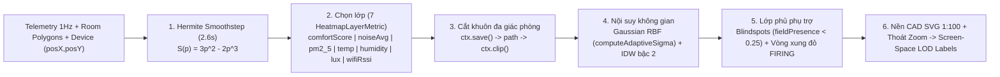

# 09 — Kiến Trúc Bản Đồ Nhiệt Không Gian 2D (TQB CAD 1:100)

> **Tài liệu**: `docs/09-spatial-heatmap-2d.md` | **Phiên bản**: 2.1 | **Mã nguồn SSOT**: [`FloorplanCanvas.tsx`](../frontend/src/features/floorplan/components/FloorplanCanvas.tsx), [`tqb-floorplan-presets.ts`](../frontend/src/config/tqb-floorplan-presets.ts), [`weatherPalette.ts`](../frontend/src/lib/floorplan/weatherPalette.ts), [`idw.ts`](../frontend/src/lib/floorplan/idw.ts), [`polygon.ts`](../frontend/src/lib/floorplan/polygon.ts), [`labelLayout.ts`](../frontend/src/lib/floorplan/labelLayout.ts), [`coords.ts`](../frontend/src/lib/floorplan/coords.ts)
>
> [!NOTE]
> **TL;DR**: Bản đồ không gian 2D khớp 1:1 với bản vẽ AutoCAD 1:100 của Thư viện Tạ Quang Bửu (**5 tầng CAD SVG `tqb-floor-1..5.svg`**, kích thước **`76.0m × 57.2m`**, **33 phòng preset**), kết xuất bằng **Native HTML5 Canvas HiDPI + DOM Overlay** (không dùng Leaflet/Konva) với **7 lớp chỉ số**, **khuếch tán Gaussian RBF thích ứng diện tích + IDW bậc 2**, **cắt đa giác `ctx.clip()`**, **chuyển tiếp Hermite Smoothstep 2.6s**, **Zoom 2 cấp**, **bàn đọc ẩn danh `FE-VIZ-09`** và **LOD nhãn 3 mức chống đè chữ**.

---

## 1. Hệ Tọa Độ AutoCAD 1:100 & 5 Tầng Kiến Trúc (`76.0m × 57.2m`)

- **Tỷ lệ khung chuẩn hóa**: `TQB_BUILDING_ASPECT_RATIO = 57.2 / 76.0 ≈ 0.75263158` (`tqb-floorplan-presets.ts`). Cả `FloorplanCanvas` lẫn trình biên tập `/admin/rooms/[id]/polygon` dùng `ResizeObserver` khóa đúng tỷ lệ này để lớp Vector SVG (`TUONG`, `CUA`, `BTCT`, `THANG`, `NOITHAT`), giếng trời thông tầng (`417.87 m²`), `TQB_LANDMARKS` (4 cầu thang bộ góc, 2 thang máy trung tâm, WC) và mảng `Room.boundaryPolygon` (`[0.0, 1.0]`) khớp tuyệt đối trên mọi màn hình.
- **Phân bổ 33 phòng preset (`TQB_ROOM_PRESETS`) trên 5 tầng**:
  - **Tầng 1** (`tqb-floor-1.svg` — 7 phòng): Sảnh trung tâm & Cửa kiểm soát (`1448.37 m²`), Kho sách Tự chọn Đông/Tây (`264.70 m²` × 2), Khu nhập & phân loại sách đĩa (`186.40 m²`), Căng tin (`97.81 m²`) và các không gian phụ trợ.
  - **Tầng 2** (`tqb-floor-2.svg` — 3 phòng): Phòng Multimedia Tầng 2 (`570.57 m²`, đa giác lõm 8 đỉnh ôm quanh lõi thang máy Bắc), 2 Phòng đọc lớn (`301.30 m²` × 2).
  - **Tầng 3** (`tqb-floor-3.svg` — 8 phòng): Phòng Multimedia Tầng 3 (`570.57 m²`), Phòng đọc Đông/Tây (`301.30 m²` × 2), Phòng Truyền thống (`225.00 m²`), 2 Phòng đọc sách (`127.14 m²` × 2) và các khu chức năng.
  - **Tầng 4** (`tqb-floor-4.svg` — 2 phòng): Phòng Đọc Chuyên ngành lớn & khu tạp chí chuyên sâu.
  - **Tầng 5** (`tqb-floor-5.svg` — 13 phòng): Kết hợp đa quy mô giữa các phòng đọc chuyên ngành lớn (`570.57 m²`, `301.30 m²`) và cụm phòng làm việc nhóm nhỏ (`25.97 – 41.47 m²`).

---

## 2. Pipeline Đồ Họa Canvas HiDPI & Toán Học Nội Suy 7 Lớp

### 2.1. 7 Lớp Chỉ Số (`HeatmapLayerMetric` & `WEATHER_PALETTES`)
Định nghĩa tại [`thresholds.ts`](../frontend/src/config/thresholds.ts) và [`weatherPalette.ts`](../frontend/src/lib/floorplan/weatherPalette.ts):
1. `comfortScore` (`/100`): Điểm tiện nghi LCS tổng hợp (mặc định cho Sinh viên & Kiosk).
2. `noiseAvg` (`dBA`): Giám sát trật tự phòng yên tĩnh (`< 45 dBA`) vs khu thảo luận.
3. `temperature` (`°C`): Theo dõi làm mát HVAC và bức xạ nắng hướng Tây.
4. `pm2_5` (`µg/m³`): Giám sát chất lượng không khí phòng điều hòa kín.
5. `humidity` (`%RH`): Trọng yếu cho `BOOK_STORAGE` & Phòng Truyền thống (chống ẩm mốc $\ge 60\%\text{RH}$).
6. `lux` (`Lux`): Phát hiện vùng thiếu sáng (`< 200 Lux`) hoặc chói nắng (`> 750 Lux`).
7. `wifiRssi` (`dBm`): Trọng yếu cho `MAINTENANCE` kiểm tra suy hao sóng qua cột `BTCT` ($\le -75\text{ dBm}$).

### 2.2. Bán Kính Khuếch Tán Thích Ứng, IDW & Vùng Mù Cảm Biến
- **IDW thuần túy (`idw.ts#computeIdwValue`)**: Sử dụng trọng số nghịch đảo bình phương khoảng cách $w_i(x,y) = (d_i + \epsilon)^{-2}$ với $\epsilon = 10^{-6}$.
- **Bán kính khuếch tán thích ứng (`weatherPalette.ts#computeAdaptiveSigma`)**: Tính diện tích chuẩn hóa thực tế $A = |\text{computePolygonSignedArea}(\text{polygon})|$ và bán kính đặc trưng $r_{\text{char}} = \sqrt{A / (\pi \cdot \max(1, k))}$ để co giãn $\sigma$ theo quy mô phòng: phòng nhóm nhỏ (`< 0.008`, ~`26–41 m²`) dùng $\sigma \in [0.042, 0.068]$ sắc nét; phòng vừa dùng $[0.068, 0.115]$; phòng lớn (`>= 0.035`, ~`301–570 m²`) dùng $[0.095, 0.165]$ hòa trộn mượt giữa 3–4 dãy bàn.
- **Cắt khuôn tường (`ctx.clip()`) & Chống giật màu**: Màu nhiệt luôn bị khóa chặt bên trong `boundaryPolygon` (kiểm tra tính hợp lệ và Ray-casting `isPointInPolygon` trong `polygon.ts`). Chuyển đổi trạng thái theo thời gian đi qua đường cong **Hermite Smoothstep 2.6 giây** $S(p) = 3p^2 - 2p^3$ (gia tốc đầu/cuối bằng 0) và Canvas HiDPI scale theo `window.devicePixelRatio`.
- **Vùng mù cảm biến (`weatherPalette.ts#computeRoomBlindspotRatio`)**: Lấy mẫu lưới $24 \times 24$ bên trong phòng để tính độ phủ trường cảm biến:
  $$\text{fieldPresence}(x, y) = 1 - \exp\left(-2.2 \sum_{i=1}^{k} \exp\left(-\frac{d_i^2}{2\sigma^2}\right)\right)$$
  Các điểm có $\text{fieldPresence} < 0.25$ là vùng mù; khi bật `showBlindspots`, `renderWeatherDiffusionHeatmap` vẽ họa tiết gạch chéo màu hổ phách trực tiếp lên các vùng thiếu trạm đo hoặc có trạm `OFFLINE`.

---

## 3. Phóng Đại 2 Cấp, Touch Gesture & Bảo Mật `FE-VIZ-09`

- **Phóng đại 2 cấp (`Whole-Floor Overview` $\leftrightarrow$ `Room Focus Zoom`) & Cảm ứng**:
  - **Cấp 1 (Toàn tầng)**: Hiển thị toàn bộ mặt bằng, giếng trời, mốc định vị và vòng xung đỏ đứt nét quanh các phòng đang có cảnh báo `FIRING`.
  - **Cấp 2 (Chi tiết phòng)**: Nhấp đúp hoặc chọn gợi ý chỗ ngồi sẽ zoom vào phòng chiếm ~75% khung nhìn, hiện rõ cột `BTCT`, cửa ra vào và từng dãy bàn đọc (`readingBays`). Hỗ trợ Pointer Events **Touch Pinch-Zoom $[1.0, 3.0]$ & Pan** (`clampViewportTransform`, `computePinchScale`).
- **Phân khu Bàn đọc Ẩn danh (`FE-VIZ-09` — `tqb-floorplan-presets.ts#synthesizeAnonymousMicroZones`)**:
  - Người dùng `USER` / `VIEWER` hoặc Kiosk `/kiosk` có `canViewDevices === false` nên không tải danh sách `DeviceResponse` (ẩn `hardwareId`, serial, trạng thái trạm).
  - Thay vì tô phẳng 1 màu, `FloorplanCanvas` tổng hợp các `AnonymousMicroZone` tương ứng bố cục bàn đọc thực tế từ `roomTelemetry` (VD: *Dãy bàn vách kính Bắc*, *Khu trung tâm*, *Góc yên tĩnh*), giúp sinh viên vẫn có heatmap mượt và chọn được chỗ ngồi tốt mà không rò rỉ thông tin phần cứng.

---

## 4. Phân Tầng Nhãn LOD 3 Mức & Ma Trận Công Cụ Theo Vai Trò

### 4.1. LOD 3 Mức & Giải thuật Né Va Chạm (`labelLayout.ts#computeLabelPlacements`)
Việc vẽ nhãn được thực hiện ở lượt cuối **sau lớp CAD SVG và bên ngoài phép biến đổi zoom** để chữ không bị mờ hoặc phình to. `getLodConfig` hỗ trợ 3 mật độ (`clean` mặc định cho Kiosk, `balanced` mặc định cho `/floorplan`, `detailed` cho `MAINTENANCE`):
- Sắp xếp nhãn theo `priority` giảm dần (phòng đang zoom $\rightarrow$ phòng đang chọn $\rightarrow$ diện tích `areaM2`).
- Thử tâm hiển thị (`computeVisualPolygonCenter` hỗ trợ cả đa giác lõm chữ L/U) và 2 vòng dịch 8 hướng thỏa mãn: nằm trong đa giác (`isPointInPolygon`), cách vật cản (`obstacles`) và nhãn ưu tiên cao hơn tối thiểu `4px`, nằm trọn trong `viewport`. Phòng quá hẹp sẽ tự ẩn nhãn tĩnh và bung **Hover Rich Card** khi rê chuột.

### 4.2. Ma trận Công cụ Theo Vai trò (`/floorplan`, `/kiosk`, `/admin/rooms/[id]/polygon`)

| Vai trò | Công cụ chuyên biệt trên Giao diện Không gian 2D |
| :--- | :--- |
| **`USER`, `VIEWER` & `/kiosk`** | **Smart Study Spot Finder** 4 chế độ (`quiet`, `group`, `bright_cool`, `multimedia`) bấm 1 lần phóng to đúng phân khu bàn đọc; `/kiosk` dùng chế độ công khai ẩn phần cứng. |
| **`LIBRARIAN` & `ZONE_MANAGER`** | Bảng Live Alert FSM (`ACK`/`RESOLVE` trực tiếp trên `/floorplan`), theo dõi riêng độ ẩm **Kho sách (`45–60%RH`)**, nút lọc chỉ hiển thị khu vực `assignedZones`. |
| **`MAINTENANCE`** | **Tech & HVAC Diagnostics Overlay**: thống kê `ONLINE/OFFLINE`, cảnh báo sóng yếu (`RSSI <= -75 dBm`), bật **Blindspots**, phát hiện lệch nhiệt cục bộ ($\Delta T \ge 2.0^\circ\text{C}$) giữa các trạm cùng phòng. |
| **`ADMIN`** | **Role View Switcher** xem thử mọi góc nhìn trực tiếp trên `/floorplan`; tại `/admin/rooms/[id]/polygon` xem đường bao mờ phòng lân cận (`siblingRooms`) và bấm **"Nạp đa giác chuẩn từ Bản vẽ TQB"** (`handleLoadTqbPreset`) để áp nhanh tọa độ CAD + phân khu bàn đọc. |

---

**Đọc tiếp**: [08 — Kiến trúc Frontend](./08-frontend-architecture.md) · [05 — Mô hình Dữ liệu 2D](./05-data-model.md) · [12 — Cẩm nang Vận hành](./12-runbook.md)
