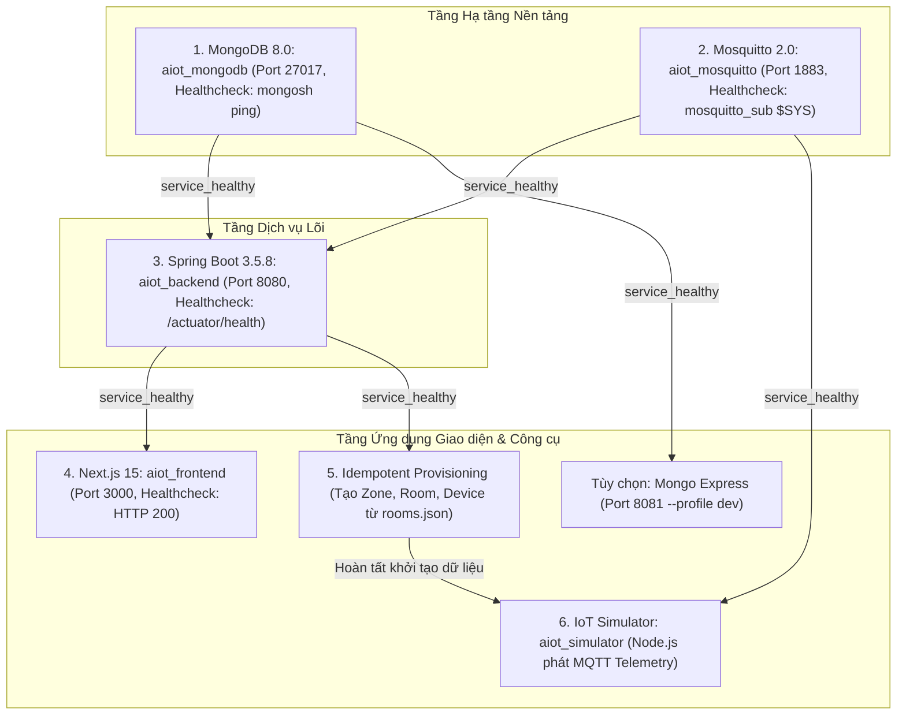

# CẨM NANG VẬN HÀNH: HƯỚNG DẪN CÀI ĐẶT MÔI TRƯỜNG, KHỞI CHẠY HỆ THỐNG & XỬ LÝ SỰ CỐ (RUNBOOK)

> **Dự án**: AIoTLibTQB — Hệ thống Giám sát Vi khí hậu & Âm học Thư viện Tạ Quang Bửu  
> **Mã tài liệu**: `docs/11-onboarding-runbook.md`  
> **Phiên bản tài liệu**: 1.0.0  
> **Trạng thái**: Hoàn thiện (Production-Ready)  
> **Tệp cấu hình liên quan**: `docker-compose.yml`, `.env.example`, `pom.xml`, `frontend/package.json`, `tools/iot-simulator/package.json`

---

## 1. Mục tiêu (Objective)

Tài liệu này đóng vai trò là cẩm nang vận hành (Runbook) chuẩn mực từng bước (step-by-step onboarding guide) giúp các thành viên mới, kỹ sư phát triển Fullstack, kỹ sư DevOps và chuyên viên QA có thể:
1. Thiết lập đầy đủ môi trường phát triển cục bộ (Local Development Environment) đáp ứng đúng tiêu chuẩn kỹ thuật của dự án AIoTLibTQB.
2. Chuẩn bị tệp biến môi trường `.env` an toàn từ bản mẫu `.env.example` với các giá trị placeholder, đảm bảo **không chứa bất kỳ secret thật nào** trong mã nguồn.
3. Khởi động hạ tầng CSDL MongoDB 8.0, Broker Eclipse Mosquitto 2.0, Backend Spring Boot 3.5.8, Frontend Next.js 15 và bộ giả lập IoT Simulator một cách tuần tự hoặc đồng bộ qua Docker Compose.
4. Kiểm tra tính toàn vẹn của quá trình tự động gieo mầm dữ liệu (Auto-seeding) và đồng bộ phân vùng/thiết bị mẫu (Idempotent Provisioning).
5. Tra cứu danh mục mã lỗi, phương pháp chẩn đoán và quy trình khắc phục các sự cố thường gặp (Troubleshooting: lỗi kết nối CSDL, lỗi xác thực Mosquitto, lỗi STOMP WebSocket, lỗi CORS, xung đột cổng).

---

## 2. Đối tượng đọc (Target Audience)

- **Thành viên mới gia nhập dự án (New Onboarding Engineers)**: Cần cài đặt hệ thống chạy được trên máy cá nhân trong vòng dưới 30 phút.
- **Frontend / Backend Developers**: Cần chạy các dịch vụ phụ thuộc (DB, Broker, Simulator) để lập trình và kiểm thử chức năng cục bộ.
- **DevOps / SRE Engineers**: Hiểu rõ cấu trúc mạng Docker, giới hạn tài nguyên CPU/RAM, cơ chế Healthcheck và kịch bản khởi động tự động.
- **QA / Test Automation Engineers**: Thiết lập môi trường test tích hợp (End-to-End Test), phát dữ liệu giả lập từ `iot-simulator` và chạy bộ sưu tập Postman.

---

## 3. Nội dung chi tiết (Detailed Content)

### 3.1. Yêu cầu Môi trường Tiền đề (Prerequisites)

Trước khi tiến hành cài đặt, máy trạm phát triển (Windows 11, macOS hoặc Ubuntu/Linux) cần được cài đặt sẵn các công cụ phần mềm sau:

| Công Cụ / Môi Trường | Phiên Bản Tối Thiểu | Mục Đích Sử Dụng | Lệnh Kiểm Tra Cài Đặt |
| :--- | :--- | :--- | :--- |
| **Docker Engine** | `24.0+` | Đóng gói và chạy các dịch vụ trong container | `docker --version` |
| **Docker Compose** | `v2.20+` (Compose plugin) | Điều phối mạng đa container 6 services | `docker compose version` |
| **Java Development Kit (JDK)** | **Java 21 LTS**<br>(Temurin / Corretto / OpenJDK) | Biên dịch và chạy Backend Spring Boot | `java -version` |
| **Node.js** | **Node.js 20 LTS** trở lên<br>(Đã kiểm chứng tốt trên v20 và v24) | Môi trường chạy Frontend Next.js 15 và IoT Simulator | `node -v` |
| **npm** | `10.0+` | Trình quản lý gói cho Frontend và Simulator | `npm -v` |
| **Apache Maven** | `3.9+`<br>*(Hoặc dùng sẵn `./mvnw`)* | Quản lý phụ thuộc và đóng gói mã nguồn Java | `mvn -v` *(hoặc `./mvnw -v`)* |
| **Git** | `2.40+` | Quản lý phiên bản mã nguồn | `git --version` |

---

### 3.2. Sơ Đồ Phụ Thuộc Khởi Động Dịch Vụ (Startup Dependency Graph)

Hệ thống AIoTLibTQB gồm 6 dịch vụ phối hợp trên 2 mạng ảo nội bộ (`aiot_db_net` và `aiot_app_net`). Việc khởi động phải tuân theo thứ tự phụ thuộc về độ sẵn sàng (Healthcheck readiness):



---

### 3.3. Hướng Dẫn Khởi Chạy Local Từng Bước (Step-by-Step Runbook)

#### Bước 1: Chuẩn bị Mã nguồn & Tệp Cấu hình Môi trường `.env`

1. Clone mã nguồn về máy cục bộ:
   ```bash
   git clone <REPO_URL> AIoTLibTQB
   cd AIoTLibTQB
   ```

2. Tạo tệp `.env` từ tệp mẫu `.env.example`:
   - Trên Linux/macOS:
     ```bash
     cp .env.example .env
     ```
   - Trên Windows PowerShell:
     ```powershell
     Copy-Item .env.example .env
     ```

3. **Cấu hình Biến Môi trường An Toàn (Placeholder Configuration)**:
   Mở tệp `.env` bằng trình biên tập (VS Code, Notepad). Toàn bộ các giá trị mẫu đều sử dụng tiền tố `CHANGE_ME_` an toàn cho môi trường phát triển máy cá nhân.

   > [!CAUTION]
   > **QUY TẮC AN TOÀN BẢO MẬT (ZERO SECRETS IN CODE)**:
   > - Tuyệt đối không đưa mật khẩu sản xuất thật, private key thật hoặc credential URI của hệ thống trường học vào tệp `.env` hoặc commit lên Git.
   > - Chuỗi `JWT_SECRET` **bắt buộc phải có độ dài tối thiểu 64 ký tự** để đáp ứng yêu cầu an toàn của thuật toán ký số `HMAC-SHA512` (Spring Security sẽ từ chối khởi động nếu khóa ngắn hơn 512 bits).

   Bảng giải thích chi tiết các tham số môi trường trong `.env`:

| Biến Môi Trường | Giá Trị Mặc Định Mẫu | Ý Nghĩa Kỹ Thuật & Khuyến Nghị Cấu Hình |
| :--- | :--- | :--- |
| `MONGO_ROOT_USERNAME` | `root` | Tên tài khoản quản trị gốc CSDL MongoDB |
| `MONGO_ROOT_PASSWORD` | `CHANGE_ME_MONGO_ROOT_PASSWORD` | Mật khẩu tài khoản quản trị MongoDB |
| `MONGO_DATABASE` | `aiot_identity_db` | Tên cơ sở dữ liệu mặc định của hệ thống |
| `ME_BASICAUTH_USERNAME` | `admin` | Tên tài khoản đăng nhập Web Mongo Express |
| `ME_BASICAUTH_PASSWORD` | `CHANGE_ME_ME_ADMIN_PASSWORD` | Mật khẩu đăng nhập Web Mongo Express |
| `JWT_SECRET` | *(Chuỗi ngẫu nhiên $\ge 64$ ký tự)* | Khóa bí mật dùng cho thuật toán ký JWT HMAC-SHA512 |
| `INITIAL_ADMIN_PASSWORD` | `CHANGE_ME_ADMIN_PASSWORD` | Mật khẩu khởi tạo tự động cho tài khoản `admin` lúc Backend chạy lần đầu |
| `CORS_ALLOWED_ORIGINS` | `http://localhost:3000` | Danh sách domain Frontend được phép gọi API (phân tách bằng dấu phẩy) |
| `MQTT_USERNAME` | `aiot_backend` | Tài khoản Backend dùng để kết nối và nhận tin từ Mosquitto |
| `MQTT_PASSWORD` | `CHANGE_ME_MQTT_BACKEND_PASSWORD` | Mật khẩu tài khoản Backend trên Broker |
| `MQTT_ADMIN_USERNAME` | `admin` | Tài khoản quản trị toàn quyền Broker Mosquitto |
| `MQTT_ADMIN_PASSWORD` | `CHANGE_ME_MQTT_ADMIN_PASSWORD` | Mật khẩu quản trị Broker Mosquitto |
| `MQTT_DEVICE_PASSWORD` | `CHANGE_ME_MQTT_DEVICE_PASSWORD` | Mật khẩu chung cho các node thiết bị mẫu trên môi trường dev |
| `MQTT_PER_DEVICE_AUTH` | `true` | Cờ kích hoạt kiểm tra ACL theo từng thiết bị (`%u`) |
| `NEXT_PUBLIC_API_BASE_URL`| `http://localhost:8080/api/v1` | Đường dẫn gốc REST API cho giao diện người dùng |
| `NEXT_PUBLIC_WS_URL` | `ws://localhost:8080/ws-aiot` | Đường dẫn kết nối STOMP over Native WebSocket |
| `DEFAULT_SCENARIO` | `demo` *(hoặc `normal`)* | Kịch bản chạy mặc định của bộ giả lập mạch |
| `SIM_INTERVAL_MS` | `5000` | Chu kỳ phát tin telemetry của Simulator (5 giây) |
| `SIM_SPEED` | `1` | Hệ số tua nhanh thời gian (1 = tốc độ thực tế) |
| `FORCE_REMOTE` | `true` | Rào an toàn cho phép container simulator kết nối nội bộ Docker |

---

#### Bước 2: Khởi Chạy Cụm Hạ Tầng Cơ Sở Dữ Liệu & Message Broker

Hạ tầng nền tảng gồm CSDL MongoDB 8.0 và Broker Mosquitto 2.0 cần được khởi động trước tiên:

1. Chạy lệnh Docker Compose nền:
   ```bash
   docker-compose up -d mongodb mosquitto
   ```

2. *(Tùy chọn)* Khởi chạy thêm công cụ trực quan hóa CSDL Mongo Express (cổng 8081):
   ```bash
   docker-compose --profile dev up -d mongo-express
   ```

3. Kiểm tra trạng thái sẵn sàng (Healthcheck status):
   ```bash
   docker-compose ps
   ```
   **Dấu hiệu thành công**: Cả hai container `aiot_mongodb` và `aiot_mosquitto` đều phải hiển thị trạng thái `Up (healthy)`.

4. Kiểm tra cổng lắng nghe mạng:
   - MongoDB: Cổng TCP `27017` (lắng nghe trên `127.0.0.1:27017`).
   - Mosquitto: Cổng TCP `1883` (lắng nghe trên `127.0.0.1:1883`).
   - Mongo Express: Cổng HTTP `8081` (truy cập `http://localhost:8081` với user/pass cấu hình ở biến `ME_BASICAUTH_*`).

---

#### Bước 3: Khởi Chạy Backend Spring Boot 3.5.8

Bạn có thể lựa chọn 1 trong 2 phương án: Chạy bằng mã nguồn trực tiếp (khuyến nghị cho lập trình viên Backend) hoặc chạy hoàn toàn qua Docker.

##### Phương án A: Chạy Cục Bộ Bằng Maven Wrapper (Khuyến Nghị Khi Code)
1. Kiểm tra biến môi trường Java 21:
   ```bash
   java -version
   ```
2. Khởi chạy ứng dụng Spring Boot:
   - Trên Linux/macOS:
     ```bash
     ./mvnw spring-boot:run
     ```
   - Trên Windows PowerShell:
     ```powershell
     .\mvnw.cmd spring-boot:run
     ```

##### Phương án B: Chạy Bằng Docker Compose
```bash
docker-compose up -d backend
```

##### Kiểm Tra Tính Sẵn Sàng & Quá Trình Tự Động Gieo Mầm Dữ Liệu (Auto-seeding)
1. Quan sát nhật ký khởi động (Log):
   Quá trình khởi tạo `ApplicationInitConfig.java:101-250` sẽ tự động thực hiện:
   - Kiểm tra và tự động tạo đủ **14 quyền hạn (Permissions)** trong collection `permissions`.
   - Kiểm tra và tự động tạo đủ **7 vai trò (Roles)**: `ADMIN`, `LIBRARIAN`, `ZONE_MANAGER`, `MAINTENANCE`, `VIEWER`, `USER`, `DEVICE`.
   - Kiểm tra và tự động khởi tạo tài khoản quản trị **`admin`** với mật khẩu thiết lập trong `INITIAL_ADMIN_PASSWORD` (nếu chưa có).
2. Kiểm tra Healthcheck Actuator:
   Mở trình duyệt hoặc dùng lệnh curl kiểm tra:
   ```bash
   curl http://localhost:8080/actuator/health
   ```
   **Kết quả mong đợi**:
   ```json
   {"status":"UP"}
   ```

---

#### Bước 4: Cài Đặt & Khởi Chạy Frontend Next.js 15

1. Chuyển vào thư mục `frontend`:
   ```bash
   cd frontend
   ```

2. Cài đặt các gói phụ thuộc (Dependencies):
   ```bash
   npm install
   ```

3. Kiểm tra tính toàn vẹn tĩnh và kiểm thử đơn vị tự động:
   ```bash
   # Kiểm tra kiểu dữ liệu TypeScript (0 lỗi)
   npm run typecheck

   # Chạy toàn bộ 18 bài kiểm thử đơn vị Vitest (100% PASS)
   npm run test
   ```

4. Khởi chạy máy chủ phát triển (Next.js Dev Server):
   ```bash
   npm run dev
   ```
   Giao diện người dùng sẽ chạy tại địa chỉ: `http://localhost:3000`.

5. Kiểm tra đăng nhập giao diện:
   - Mở trình duyệt truy cập `http://localhost:3000`. Hệ thống sẽ tự động chuyển hướng về trang đăng nhập `/login`.
   - Đăng nhập bằng tài khoản:
     - **Tên đăng nhập**: `admin`
     - **Mật khẩu**: Giá trị đã cấu hình tại `INITIAL_ADMIN_PASSWORD` trong tệp `.env`.
   - Sau khi đăng nhập thành công, bạn sẽ được đưa vào màn hình Dashboard `/dashboard`.

---

#### Bước 5: Đồng Bộ Dữ Liệu Mẫu & Chạy Bộ Giả Lập IoT Simulator

Để có dữ liệu vi khí hậu và âm học hiển thị trực quan trên bản đồ 2D Heatmap, tiến hành phát dữ liệu thử nghiệm từ công cụ `iot-simulator`:

1. Chuyển vào thư mục bộ giả lập:
   ```bash
   cd tools/iot-simulator
   ```

2. Cài đặt các gói phụ thuộc:
   ```bash
   npm install
   ```

3. **Chạy Đồng Bộ Hạ Tầng Mẫu (Idempotent Provisioning)**:
   Script này sẽ tự động đăng nhập vào Backend với quyền `admin` và tạo sẵn danh mục Zone, Room (kèm đa giác biên `boundaryPolygon`) và trạm đo Device từ tệp `config/rooms.json`:
   ```bash
   npm run provision
   ```
   **Dấu hiệu thành công**: Màn hình thông báo `Provisioning completed successfully!` và liệt kê các phòng `P.101`, `P.102`, `Kho sách 201`, `Sảnh mượn trả`.

4. **Khởi Chạy Giả Lập Phát Tín Hiệu Cảm Biến**:
   - Chạy kịch bản vận hành bình thường (`normal`):
     ```bash
     node src/index.js --scenario normal --devices 3 --interval 5
     ```
   - Chạy kịch bản mô phỏng đột biến tiếng ồn để kiểm tra chuông cảnh báo (`noise-spike`):
     ```bash
     node src/index.js --scenario noise-spike --duration 45 --interval 3
     ```
   - Chạy kịch bản tuần hoàn 24h đầy đủ (`demo`):
     ```bash
     node src/index.js --scenario demo --speed 10
     ```

5. **Xác minh trực quan trên Frontend**:
   - Truy cập màn hình **Bản đồ tầng 2D** tại `http://localhost:3000/floorplan`.
   - Quan sát các trạm đo hiển thị trạng thái `ONLINE` có hào quang xanh, nhiệt độ và âm học lan tỏa mượt mà bên trong đa giác phòng qua hiệu ứng Hermite Smoothstep 2.6s.

---

### 3.4. Tùy Chọn: Khởi Chạy Toàn Bộ Hệ Thống (Full-Stack All-in-One) Bằng Docker

Nếu muốn chạy toàn bộ 6 container đồng thời mà không cần cài đặt Node.js hay Java trên máy trạm:

```bash
# 1. Chuẩn bị tệp .env
cp .env.example .env

# 2. Khởi chạy toàn bộ 6 services (mongodb, mosquitto, backend, frontend, simulator)
docker-compose up -d --build

# 3. Theo dõi toàn bộ log hệ thống
docker-compose logs -f
```

Để dừng toàn bộ hệ thống:
```bash
docker-compose down
```
*(Nếu muốn xóa sạch dữ liệu MongoDB và Mosquitto để làm mới từ đầu: `docker-compose down -v`)*.

---

### 3.5. Danh Mục Mã Lỗi & Xử Lý Sự Cố Thường Gặp (Troubleshooting Guide)

#### Sự Cố 1: Backend Báo Lỗi Không Thể Kết Nối Tới MongoDB
- **Hiện tượng**: Backend ném ngoại lệ `MongoSocketOpenException: Exception opening socket` hoặc `MongoSecurityException: Exception authenticating`.
- **Nguyên nhân**:
  1. Container `aiot_mongodb` chưa sẵn sàng hoặc cổng `27017` bị ứng dụng khác trên máy chiếm dụng.
  2. Chuỗi kết nối `MONGO_URI` bị sai lệch thông tin `MONGO_ROOT_USERNAME` hoặc `MONGO_ROOT_PASSWORD`.
- **Cách khắc phục**:
  1. Chạy lệnh `docker-compose ps` để xác nhận container `aiot_mongodb` đang ở trạng thái `healthy`.
  2. Thử kết nối thủ công bằng lệnh ping của Mongo Shell:
     ```bash
     docker exec -it aiot_mongodb mongosh -u root -p CHANGE_ME_MONGO_ROOT_PASSWORD --eval "db.adminCommand('ping')"
     ```
  3. Nếu cổng 27017 bị chiếm dụng bởi một instance MongoDB cài sẵn trên máy (Windows Service), hãy tạm dừng service đó qua `services.msc` hoặc đổi cổng trong `docker-compose.yml`.

---

#### Sự Cố 2: Backend Hoặc Simulator Không Thể Kết Nối MQTT Mosquitto
- **Hiện tượng**: Log Backend hoặc Simulator ghi nhận lỗi `MqttException: Connection lost (32109)` hoặc `Connection refused: Not authorized (rc = 5)`.
- **Nguyên nhân**:
  1. Sai mật khẩu tài khoản `MQTT_PASSWORD` giữa Backend và tệp phân quyền Mosquitto.
  2. Phân quyền ACL `%u` chặn mạch do `hardware_id` gửi lên không trùng với `username` đăng nhập.
- **Cách khắc phục**:
  1. Kiểm tra tệp sinh mật khẩu động của Mosquitto trong container:
     ```bash
     docker exec -it aiot_mosquitto cat /mosquitto/data/password.txt
     ```
  2. Thử dùng lệnh kiểm tra đăng nhập subscriber chuẩn:
     ```bash
     docker exec -it aiot_mosquitto mosquitto_sub -h 127.0.0.1 -p 1883 -u aiot_backend -P CHANGE_ME_LOCAL_DEV_MQTT -t '$SYS/broker/version' -C 1
     ```
  3. Khởi động lại container Mosquitto để entrypoint tự động sinh lại tệp phân quyền:
     ```bash
     docker-compose restart mosquitto
     ```

---

#### Sự Cố 3: Giao Diện Frontend Báo Mất Kết Nối STOMP WebSocket
- **Hiện tượng**: Trên Header của `AppShell` xuất hiện thanh biểu ngữ màu vàng hổ phách cảnh báo mất kết nối thời gian thực, console báo lỗi `[STOMP] Broker error` hoặc `WebSocket connection to 'ws://localhost:8080/ws-aiot' failed`.
- **Nguyên nhân**:
  1. Backend Spring Boot chưa chạy hoặc cấu hình `NEXT_PUBLIC_WS_URL` trỏ sai cổng.
  2. Token JWT của người dùng đã hết hạn khiến bộ chặn STOMP từ chối kết nối.
  3. Tường lửa mạng nội bộ chặn kết nối giao thức WebSocket.
- **Cách khắc phục**:
  1. Kiểm tra biến môi trường tại `frontend/.env.local`: Đảm bảo `NEXT_PUBLIC_WS_URL=ws://localhost:8080/ws-aiot`.
  2. Đăng xuất và đăng nhập lại trên giao diện Web để làm mới Access Token trong RAM.
  3. Khi STOMP mất kết nối, hệ thống sẽ **tự động chuyển sang cơ chế Fallback Polling HTTP 15s** (`useRoomLatestTelemetryQuery`), dữ liệu vẫn được cập nhật định kỳ.

---

#### Sự Cố 4: Lỗi Chặn Nguồn Gốc Chéo CORS (Cross-Origin Resource Sharing)
- **Hiện tượng**: Trình duyệt báo đỏ lỗi `Access to fetch at 'http://localhost:8080/api/v1/...' from origin 'http://localhost:3000' has been blocked by CORS policy`.
- **Nguyên nhân**: Biến môi trường `CORS_ALLOWED_ORIGINS` của Backend không chứa domain của Frontend (ví dụ khi truy cập qua IP mạng LAN `http://192.168.1.50:3000`).
- **Cách khắc phục**:
  Mở tệp `.env`, bổ sung địa chỉ IP hoặc domain vào biến `CORS_ALLOWED_ORIGINS`:
  ```env
  CORS_ALLOWED_ORIGINS=http://localhost:3000,http://127.0.0.1:3000,http://192.168.1.50:3000
  ```
  Sau đó khởi động lại Backend Spring Boot.

---

#### Sự Cố 5: Lỗi Quá Tải Yêu Cầu HTTP 429 (Too Many Requests)
- **Hiện tượng**: Khi gọi API đăng nhập hoặc trạm đo gọi xác thực `POST /api/v1/devices/authenticate`, hệ thống trả về mã lỗi HTTP `429` (Mã lỗi nghiệp vụ `4029`).
- **Nguyên nhân**: Bộ lọc Rate Limit bảo vệ hệ thống khỏi tấn công dò mật khẩu (Brute-force) giới hạn tối đa **10 request / phút / IP** đối với các endpoint công khai.
- **Cách khắc phục**:
  - Giao diện Frontend tự động đọc header `Retry-After` và hiển thị đồng hồ đếm ngược chờ thử lại (ví dụ: "Vui lòng chờ 35 giây..."). Người dùng chỉ cần đợi hết thời gian đếm ngược để bấm lại nút đăng nhập.
  - Trên môi trường test tự động, tránh lặp vòng lặp gọi đăng nhập liên tục mà không có thời gian nghỉ (delay).

---

#### Sự Cố 6: Lỗi Rào Chắn An Toàn Của Simulator (Safety Guard Rejection)
- **Hiện tượng**: Khi chạy Simulator kết nối vào IP máy chủ từ xa, terminal báo lỗi: `Target broker host is remote. To allow connection, rerun with --force-remote flag`.
- **Nguyên nhân**: Module `src/safety.js` chủ động chặn phát dữ liệu giả lập ra ngoài mạng loopback để bảo vệ hệ thống máy chủ thật.
- **Cách khắc phục**:
  Bổ sung cờ `--force-remote` khi chạy lệnh:
  ```bash
  node src/index.js --scenario normal --force-remote
  ```

---

#### Sự Cố 7: Xung Đột Cổng Mạng Khi Khởi Động (Port Conflict)
- **Hiện tượng**: Docker hoặc Spring Boot ném lỗi `Bind for 0.0.0.0:xxxx failed: port is already allocated`.
- **Bảng Tra Cứu Cổng Mạng Mặc Định**:
  - Cổng `27017`: CSDL MongoDB.
  - Cổng `1883`: Broker Mosquitto MQTT.
  - Cổng `8080`: Spring Boot REST API & STOMP WebSocket.
  - Cổng `3000`: Frontend Next.js.
  - Cổng `8081`: Web UI Mongo Express (Dev profile).
- **Cách xử lý**:
  - Trên Windows, tìm tiến trình đang giữ cổng qua PowerShell:
    ```powershell
    Get-NetTCPConnection -LocalPort 8080 | Select-Object OwningProcess
    Stop-Process -Id <PID> -Force
    ```
  - Trên Linux/macOS:
    ```bash
    lsof -i :8080
    kill -9 <PID>
    ```

---

### 3.6. Bảng Kiểm Tra Nghiệm Thu Vận Hành (Onboarding Verification Checklist)

Sau khi hoàn tất toàn bộ các bước khởi chạy, hãy thực hiện bảng kiểm tra (checklist) dưới đây để đảm bảo hệ thống đã hoạt động hoàn hảo 100%:

- [ ] **Hạ tầng Docker**: `docker-compose ps` hiển thị `aiot_mongodb` và `aiot_mosquitto` ở trạng thái `Up (healthy)`.
- [ ] **Backend Health**: Truy cập `http://localhost:8080/actuator/health` trả về `{"status":"UP"}`.
- [ ] **CSDL Khởi tạo**: MongoDB chứa collection TimeSeries `telemetry_records` và các collection `users`, `roles`, `permissions`, `rooms`, `devices`.
- [ ] **Tài khoản Admin**: Đăng nhập thành công tại `http://localhost:3000/login` với tài khoản `admin`.
- [ ] **Frontend Tests**: Lệnh `npm run test` tại thư mục `frontend/` vượt qua 18/18 tests (100%).
- [ ] **Provisioning**: Lệnh `npm run provision` trong `tools/iot-simulator/` hoàn tất không báo lỗi, tạo đủ danh mục phòng.
- [ ] **Simulator Telemetry**: Lệnh `node src/index.js --scenario normal` phát các gói tin MQTT đều đặn mỗi 5 giây.
- [ ] **Bản đồ 2D Heatmap**: Màn hình `http://localhost:3000/floorplan` hiển thị mặt bằng phòng, các trạm đo có pin tròn phát sáng và màu sắc vi khí hậu nội suy mượt mà.
- [ ] **Bảo mật Secret**: Xác nhận không có bất kỳ secret thật nào bị commit vào kho lưu trữ Git.

---

### 3.7. Kịch Bản Nghiệm Thu Phần Cứng Thực Tế & Hướng Dẫn Bộ Giả Lập IoT

#### A. Danh Mục 4 Kịch Bản Nghiệm Thu Phần Cứng Thực Tế (Physical Hardware Acceptance Scenarios)

Nhằm bảo đảm hệ thống vận hành bền bỉ trên môi trường thực địa trước khi Go-Live tại Thư viện Tạ Quang Bửu, đội ngũ kỹ thuật phải thực hiện nghiệm thu theo 4 kịch bản kiểm chứng phần cứng sau:

| STT | Kịch bản kiểm chứng | Chỉ số DoD kỳ vọng | Quy trình thực hiện & Thao tác kiểm chứng thực địa |
| :---: | :--- | :---: | :--- |
| **1** | **Rút nguồn trạm đo vật lý (Power Cutoff & Offline Detection)** | Phát hiện `OFFLINE` $\le 2\text{ phút}$; Tự hồi phục `ONLINE` $\le 5\text{ giây}$ (0 DB query overhead). | 1. Trạm đo ESP32-S3 đang phát dữ liệu bình thường lên Mosquitto.<br>2. Rút cáp nguồn USB/Pin của trạm đo (mô phỏng mất điện đột ngột mà không kịp gửi MQTT LWT).<br>3. Bấm đồng hồ đếm ngược, theo dõi log của `DeviceWatchdogService`: `Watchdog transitioned device <id> to OFFLINE` và kiểm tra API `GET /api/v1/alerts`. Thời gian chuyển trạng thái phải $\le 120$ giây.<br>4. Cắm lại nguồn trạm đo, kiểm tra log `Device restored from OFFLINE to ONLINE` trong vòng $\le 5$ giây, xác nhận phục hồi tức thì trong RAM mà không cần truy vấn CSDL. |
| **2** | **Đo độ trễ toàn trình Realtime (E2E Latency)** | Độ trễ cảm biến $\rightarrow$ Web Client $\le 1.5\text{ giây}$. | 1. Mở Web Dashboard trên trình duyệt, đăng ký lắng nghe kênh `/topic/rooms/{roomId}/telemetry`.<br>2. Thổi nhẹ luồng khí ấm vào cảm biến SHT30/DHT22 hoặc vỗ tay tạo xung âm thanh đột biến gần micro INMP441 của trạm đo.<br>3. Dùng đồng hồ đo khoảng thời gian từ thời điểm kích thích vật lý tại trạm đo đến khi số đo nhiệt độ / âm thanh trên Web Client nhảy giá trị và biểu đồ cập nhật. Thời gian ghi nhận phải $\le 1.5$ giây. |
| **3** | **Điều tiết tần suất Conflation 1Hz (STOMP Throttling)** | Tần suất đẩy dữ liệu mỗi phòng $\le 1\text{ Hz}$ (1 frame/giây). | 1. Cấu hình firmware trạm đo (hoặc dùng simulator kịch bản `burst`) gửi dồn dập 5–10 bản tin telemetry/giây lên broker.<br>2. Mở công cụ DevTools trên trình duyệt (tab **Network** $\rightarrow$ lọc **WS** $\rightarrow$ chọn kết nối `/ws-aiot` $\rightarrow$ xem tab **Messages**).<br>3. Đếm số lượng STOMP frame nhận được trên topic của phòng trong khoảng thời gian 10 giây.<br>4. Tiêu chí đạt: Tổng số frame nhận được phải nằm trong khoảng $10 \pm 1$ frames, chứng minh bộ điều tiết `TelemetryConflationService` hoạt động hoàn hảo. |
| **4** | **Hiệu năng & Kích thước Biểu đồ 7 ngày (Buckets Performance)** | Thời gian phản hồi $\le 200\text{ ms}$; Kích thước payload $\le 50\text{ KB}$. | Thực thi lệnh cURL đo đạc trực tiếp hiệu năng nén chuỗi thời gian `$dateTrunc`:<br>```bash
curl -w "\nTime Total: %{time_total}s | Size Download: %{size_download} bytes\n" \
  -H "Authorization: Bearer <TOKEN>" \
  "http://localhost:8080/api/v1/telemetry/room/<ROOM_ID>/buckets?interval=1h&start=2026-10-15T00:00:00Z&end=2026-10-22T00:00:00Z"
```<br>Xác nhận `time_total` $\le 0.200$s và `size_download` $\le 51200$ bytes (thường chỉ $\approx 25$ KB cho 168 buckets). |

---

#### B. Hướng Dẫn Chuyên Sâu Khởi Chạy Bộ Giả Lập Mạch IoT (`tools/iot-simulator`)

Khi không có sẵn phần cứng ESP32-S3 thật trên bàn làm việc, bộ giả lập độc lập `tools/iot-simulator/` (viết bằng Node.js v20+) cho phép mô phỏng toàn diện mạng lưới trạm đo với độ chân thực cao:

##### 1. Mô hình Toán học Tín hiệu (`src/signalModel.js`)
- **Chu kỳ Ngày-Đêm (Diurnal Cycle)**: Tự động điều biến nhiệt độ theo quy luật hình sin 24 giờ (đạt đỉnh nhiệt lúc 14:00 và cực tiểu lúc 04:00 sáng).
- **Phân phối Chuẩn Gauss (Box-Muller Transform)**: Tạo nhiễu trắng ngẫu nhiên cho độ ẩm, bụi mịn và ánh sáng, tránh cảm giác số liệu nhân tạo bằng phẳng.
- **Biến cố Giờ Cao điểm**: Tự động kích hoạt các đợt tập trung đông bạn đọc trong các khung giờ 10:00–12:00 và 14:00–17:00, làm gia tăng nồng độ $\text{PM}_{2.5}$ và tiếng ồn nền.
- **Rào chắn An toàn (`src/safety.js`)**: Mặc định chỉ cho phép kết nối vào broker loopback (`localhost`, `127.0.0.1`). Khi muốn trỏ vào broker máy chủ từ xa, bắt buộc phải truyền cờ `--force-remote`.

##### 2. Danh Mục 10 Kịch Bản Kiểm Thử Hỗ Trợ
| Tên kịch bản (`--scenario`) | Mục đích & Ứng xử giả lập | Ngưỡng vi phạm & Dấu hiệu nhận biết |
| :--- | :--- | :--- |
| `normal` | Mô phỏng vi khí hậu vận hành ổn định, mọi chỉ số đều nằm trong dải tối ưu của phòng. | Điểm LCS đạt Platinum/Gold (80–95 điểm). |
| `noise-spike` | Tạo các xung âm thanh tức thời 75–85 dBA do kéo ghế, nói chuyện ồn ào. | Kích hoạt cảnh báo âm thanh, điểm LCS giảm tức thì. |
| `pm25-high` | Tăng vọt nồng độ bụi mịn $\text{PM}_{2.5} > 50\,\mu\text{g/m}^3$ (ô nhiễm hoặc hỏng lọc gió). | Trạng thái chuyển sang cảnh báo chất lượng không khí. |
| `heat-humid` | Đẩy nhiệt độ $> 32^\circ\text{C}$ và độ ẩm $> 80\%$ RH (mô phỏng mất điều hòa hoặc nồm ẩm). | Điểm tiện nghi nhiệt sụp đổ, cảnh báo nồm ẩm kho sách. |
| `device-dropout` | Đột ngột ngắt kết nối MQTT của một trạm đo mà không gửi tin thông báo. | Kiểm tra FSM Watchdog phát hiện `OFFLINE` sau 120 giây. |
| `flap` | Thiết bị chập chờn, liên tục ngắt kết nối và kết nối lại mỗi 10 giây. | Kiểm tra khả năng chống bão bản tin và ổn định trạng thái. |
| `lwt` | Ngắt kết nối có kèm di chúc LWT (Last Will and Testament) trên topic status. | Backend chuyển trạm sang `OFFLINE` ngay lập tức. |
| `bad-payload` | Phát các gói tin JSON sai định dạng, thiếu trường, hoặc vượt dải đo vật lý. | Kiểm tra bộ lọc `TelemetrySanitizerService` lọc bỏ an toàn. |
| `burst` | Bắn dồn dập 20–50 gói tin/giây từ nhiều trạm đo. | Kiểm tra van điều áp `Semaphore(30, true)` và Conflator 1Hz. |
| `demo` | Kịch bản trình diễn tua nhanh 24h trong vòng 5 phút (hỗ trợ cờ `--speed 10`). | Thích hợp cho việc quay video demo và kiểm thử trực quan. |

##### 3. Các Lệnh Điều Khiển CLI Tiêu Biểu
```bash
cd tools/iot-simulator

# 1. Chạy kịch bản bình thường với 4 trạm đo, chu kỳ phát 5s:
node src/index.js --scenario normal --devices 4 --interval 5

# 2. Kiểm thử cảnh báo tiếng ồn trong 60 giây:
node src/index.js --scenario noise-spike --duration 60 --interval 2

# 3. Kiểm thử tải dồn dập (Burst Load):
node src/index.js --scenario burst --duration 30 --speed 5

# 4. Chạy kịch bản Demo tua nhanh:
node src/index.js --scenario demo --speed 12

# 5. Kết nối tới Broker từ xa (cần cờ an toàn):
node src/index.js --scenario normal --broker mqtt://192.168.1.100:1883 --force-remote
```

---

## 4. Mục "Đọc tiếp" (Next Reading)

Để tìm hiểu sâu hơn về kiến trúc kỹ thuật và vận hành chi tiết các phân hệ của AIoTLibTQB, khuyến nghị người đọc tham khảo:
- [Hướng dẫn Sử dụng Bộ Tài liệu & Lộ trình Nghiên cứu](00-README.md): Lộ trình đọc tài liệu theo thời gian (30 phút, 2 giờ hoặc chuyên sâu).
- [Kiến trúc Tổng thể Hệ thống & Sơ đồ Luồng Dữ liệu](02-architecture.md): Bức tranh toàn cảnh về cách các thành phần trong Docker liên kết với nhau.
- [Danh mục Đặc tả API RESTful](07-api-reference.md): Bảng tra cứu toàn bộ các endpoint, request/response mẫu và mã lỗi chi tiết.
- [Kiến trúc Frontend Next.js 15 & Bản đồ Nhiệt 2D](08-frontend.md): Tìm hiểu sâu về kỹ thuật render Canvas, State Zustand và STOMP Client.
- [Đặc tả Kỹ thuật Firmware IoT & Thiết bị ESP32-S3](09-firmware-iot.md): Thông số kỹ thuật của mạch vật lý thật và 10 kịch bản kiểm thử của bộ giả lập.
- [Quy ước Kỹ thuật & Chuẩn mực Lập trình Bắt buộc](10-conventions.md): Các quy tắc code bắt buộc kèm ví dụ đối chiếu Đúng/Sai về Virtual Threads, TimeSeries và Semaphore.
