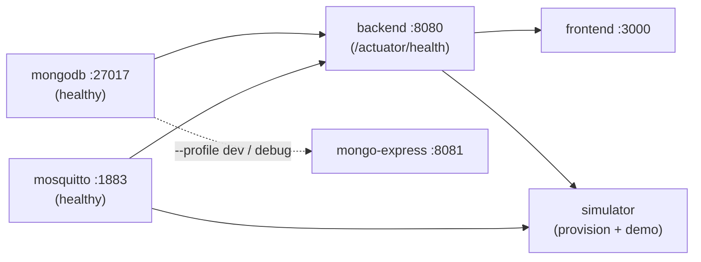

# 12 — Cẩm Nang Cài Đặt, Vận Hành & Xử Lý Sự Cố (Runbook)

> **Tài liệu**: `docs/12-runbook.md` | **Phiên bản**: 2.1 | **Tệp cấu hình SSOT**: [`docker-compose.yml`](../docker-compose.yml), [`.env.example`](../.env.example), [`pom.xml`](../pom.xml), [`frontend/package.json`](../frontend/package.json)
>
> [!NOTE]
> **TL;DR**: Tài liệu hướng dẫn dựng toàn bộ hệ thống **AIoTLibTQB** cục bộ (6 Docker services với `mongo-express` chạy theo profile `dev`/`debug`), chạy độc lập Backend/Frontend/Simulator, chia sẻ nhanh qua **Cloudflare Quick Tunnel (`gateway.js :4000`)**, nghiệm thu 4 kịch bản phần cứng và xử lý 7 sự cố phổ biến.

---

## 1. Yêu Cầu Môi Trường & Sơ Đồ Khởi Động

| Công cụ | Phiên bản tối thiểu | Kiểm tra |
| :--- | :--- | :--- |
| **Docker Engine & Compose** | Docker `24.0+`, Compose `v2.20+` | `docker --version && docker compose version` |
| **Java JDK** | **Java 21 LTS** (nếu chạy Backend ngoài Docker) | `java -version` |
| **Node.js & npm** | Node.js `20+` (đã test tốt trên v20/v24), `npm 10+` | `node -v && npm -v` |
| **Maven** | `3.9+` hoặc dùng `./mvnw` (`.\mvnw.cmd`) | `./mvnw -v` |



---

## 2. Cấu Hình Biến Môi Trường (`.env`)

Sao chép `.env.example` thành `.env` (`cp .env.example .env`) trước khi khởi chạy.

> [!CAUTION]
> **Quy tắc bảo mật**: Không commit `.env` hoặc secret thật lên Git. Biến `JWT_SECRET` **bắt buộc $\ge 64$ ký tự** cho `HS512`; trong profile `prod`/`production`, thiếu `INITIAL_ADMIN_PASSWORD` sẽ làm Backend từ chối khởi động.

| Nhóm | Biến môi trường chính trong `.env.example` | Giá trị mẫu / Ghi chú |
| :--- | :--- | :--- |
| **MongoDB** | `MONGO_ROOT_USERNAME`, `MONGO_ROOT_PASSWORD`, `MONGO_DATABASE` | `root` / `CHANGE_ME_MONGO_ROOT_PASSWORD` / `aiot_identity_db` |
| **Mongo Express** | `ME_BASICAUTH_USERNAME`, `ME_BASICAUTH_PASSWORD` | Chỉ bật khi dùng `--profile dev` hoặc `--profile debug` |
| **Backend Security** | `JWT_SECRET`, `INITIAL_ADMIN_PASSWORD`, `CORS_ALLOWED_ORIGINS` | `JWT_SECRET` $\ge 64$ ký tự; `CORS_ALLOWED_ORIGINS=http://localhost:3000` |
| **MQTT Broker** | `MQTT_USERNAME`, `MQTT_PASSWORD`, `MQTT_ADMIN_*`, `MQTT_DEVICE_PASSWORD`, `MQTT_PER_DEVICE_AUTH` | `aiot_backend`, `MQTT_PER_DEVICE_AUTH=true` (ACL `%u`) |
| **Frontend** | `NEXT_PUBLIC_API_BASE_URL`, `NEXT_PUBLIC_WS_URL` | `http://localhost:8080/api/v1` & `ws://localhost:8080/ws-aiot` |
| **Simulator** | `DEFAULT_SCENARIO`, `SIM_INTERVAL_MS`, `SIM_SPEED`, `FORCE_REMOTE` | `demo`, `5000`, `1`, `true` (bên trong mạng Docker) |

---

## 3. Khởi Chạy Nhanh (Docker & Từng Thành Phần)

### 3.1. Chạy toàn bộ 5 services cốt lõi qua Docker Compose
```bash
cp .env.example .env
docker compose up -d --build
# (Tùy chọn) Mở thêm Mongo Express ở cổng 8081:
# docker compose --profile dev up -d mongo-express
docker compose ps
```
Kiểm tra: `curl http://localhost:8080/actuator/health` $\rightarrow$ `{"status":"UP"}`; UI tại `http://localhost:3000` (Kiosk công khai tại `/kiosk`, đăng nhập `admin` bằng mật khẩu `INITIAL_ADMIN_PASSWORD` tại `/login`).

### 3.2. Chạy từng thành phần phục vụ phát triển (Local Dev)
1. **Hạ tầng nền**: `docker compose up -d mongodb mosquitto`
2. **Backend (Java 21)**: `./mvnw spring-boot:run` (hoặc `.\mvnw.cmd spring-boot:run` trên Windows); chạy test bằng `./mvnw test`.
3. **Frontend (Next.js 15)**:
   ```bash
   cd frontend
   npm install
   npm run typecheck   # 0 errors
   npm test            # 33/33 unit tests (Vitest)
   npm run build       # Kiểm tra standalone build
   npm run dev         # http://localhost:3000
   ```
4. **IoT Simulator (`tools/iot-simulator/`)**:
   ```bash
   cd tools/iot-simulator
   npm install && cp .env.example .env
   npm run provision   # Tạo 14 phòng CAD + 23 thiết bị (idempotent)
   node src/index.js --scenario normal --devices 3 --interval 5
   node src/index.js --scenario heat/humid --devices 2 --duration 30 --interval 3
   node src/index.js --scenario demo --speed 10
   ```

---

## 4. Chia Sẻ Public Web Nhanh qua Cloudflare Tunnel (`tools/cloudflared/`)

Khi cần mở bản demo trực tiếp trên điện thoại hoặc cho người đánh giá từ xa mà không cần tên miền/VPS:
- `gateway.js` mở cổng **`4000`** hợp nhất đường dẫn: chuyển `/api/`, `/ws-`, `/actuator/` về Backend (`:8080`) và `/*` về Frontend (`:3000`).
- **Windows**: chạy `.\tools\cloudflared\start-public-web.ps1` (hoặc double-click `start-public-web.bat`, yêu cầu đã cài `cloudflared` trong `PATH` hoặc đặt `cloudflared.exe` tại `tools/cloudflared/`).
- **Linux / macOS**: chạy `node tools/cloudflared/gateway.js` ở terminal 1, và `cloudflared tunnel --url http://127.0.0.1:4000` ở terminal 2 để nhận URL `https://*.trycloudflare.com`.

*(Chi tiết xem thêm tại [`tools/cloudflared/README.md`](../tools/cloudflared/README.md).)*

---

## 5. Danh Mục 4 Kịch Bản Nghiệm Thu Phần Cứng & Vận Hành

| STT | Kịch bản nghiệm thu | Tiêu chí DoD kỳ vọng | Thao tác kiểm chứng nhanh |
| :---: | :--- | :---: | :--- |
| **1** | **Rút nguồn trạm đo** | Phát hiện `OFFLINE` $\le 120\text{s}$; hồi phục `ONLINE` $\le 5\text{s}$ (0 DB query) | Rút nguồn ESP32 (hoặc chạy `--scenario device-dropout`), theo dõi log `DeviceWatchdogService` và `GET /api/v1/alerts`; cắm lại nguồn kiểm tra tự đóng `DEVICE_OFFLINE`. |
| **2** | **Độ trễ E2E Realtime** | Cảm biến $\rightarrow$ UI $\le 1.5\text{s}$ | Vỗ tay cạnh INMP441 hoặc hà hơi ấm vào SHT30; đo thời gian số liệu nhảy trên `/floorplan` hoặc `/rooms/[id]`. |
| **3** | **STOMP Conflation `1Hz`** | Tối đa `1` frame / giây / phòng | Chạy `--scenario burst`, mở DevTools (`Network -> WS -> /ws-aiot`), đếm số frame trong 10s phải xấp xỉ $10 \pm 1$. |
| **4** | **Downsampling `$dateTrunc`** | Phản hồi $\le 200\text{ms}$, payload $\le 50\text{KB}$ | Gọi `GET /api/v1/telemetry/room/{id}/buckets?interval=1h` trong dải 7 ngày (168 buckets) kiểm tra thời gian & dung lượng. |

---

## 6. Xử Lý 7 Sự Cố Thường Gặp (Troubleshooting)

1. **Backend không kết nối được MongoDB**: Kiểm tra `docker compose ps` (`aiot_mongodb` phải `Up (healthy)`); kiểm tra `MONGO_ROOT_USERNAME`/`MONGO_ROOT_PASSWORD` trong `.env` và chắc chắn cổng `27017` không bị service MongoDB local chiếm.
2. **Backend/Simulator bị Mosquitto từ chối (`rc = 5`)**: Kiểm tra `MQTT_USERNAME`/`MQTT_PASSWORD`/`MQTT_DEVICE_PASSWORD`; nhớ rằng với `MQTT_PER_DEVICE_AUTH=true`, thiết bị phải dùng `username == hardware_id`; thử `docker compose restart mosquitto` để entrypoint tái tạo `password.txt`.
3. **Frontend mất kết nối STOMP WebSocket**: Kiểm tra `NEXT_PUBLIC_WS_URL=ws://localhost:8080/ws-aiot` và đăng nhập lại nếu access token hết hạn. Trong lúc mất STOMP, UI tự động bật HTTP polling `15s`.
4. **Lỗi CORS trên trình duyệt**: Thêm origin đang truy cập (VD: LAN IP `http://192.168.1.50:3000`) vào `CORS_ALLOWED_ORIGINS` trong `.env` rồi khởi động lại Backend.
5. **HTTP 429 (`4029: TOO_MANY_REQUESTS`)**: Vượt giới hạn `10 req/phút/IP` trên Auth hoặc `60 req/phút/IP` trên Public API; màn hình `/login` tự hiển thị đếm ngược theo `Retry-After`.
6. **Simulator báo lỗi `Safety Guard Rejection`**: Khi kết nối broker ngoài loopback, thêm cờ `--force-remote` hoặc đặt `FORCE_REMOTE=true`.
7. **Xung đột cổng (`27017`, `1883`, `8080`, `3000`, `8081`, `4000`)**: Dùng `lsof -i :<PORT>` (Linux/macOS) hoặc `Get-NetTCPConnection -LocalPort <PORT>` (Windows) để giải phóng tiến trình chiếm cổng.

---

**Đọc tiếp**: [02 — Kiến trúc Hệ thống](./02-architecture.md) · [07 — REST API & Mã lỗi](./07-api-reference.md) · [10 — Phần cứng IoT & Simulator](./10-iot-hardware-and-simulator.md)
