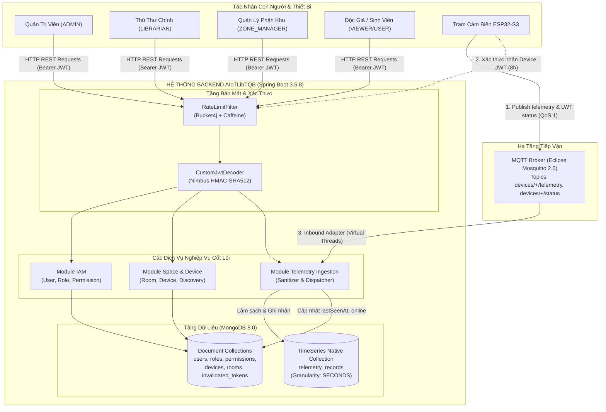

# TỔNG QUAN HỆ THỐNG QUAN TRẮC MÔI TRƯỜNG & ÂM HỌC THÔNG MINH (AIoTLibTQB)

> **Nhãn tài liệu:**  
> - `[Code]`: Kiểm chứng trực tiếp từ mã nguồn thực tế backend Spring Boot.  
> - `[Tài liệu]`: Trích xuất từ các tài liệu kiến trúc, đặc tả dự án (`IOT_SYSTEM_SPECIFICATION.md`, `KE_HOACH_TRIEN_KHAI_PHAN_MEM_IOT.md`).  
> - `[Suy luận]`: Phân tích nghiệp vụ và kiến trúc kỹ thuật.  
> - `[Chưa rõ]`: Các điểm cần người dùng / Product Owner xác nhận thêm.

---

## 1. TÓM TẮT DÀNH CHO NGƯỜI NGOÀI NGÀNH (EXECUTIVE SUMMARY)

**AIoTLibTQB** (tên dự án gốc: *Listen_Project*) `[Tài liệu: IOT_SYSTEM_SPECIFICATION.md:8]` là hệ thống phần mềm trung tâm đóng vai trò "bộ não" điều hành mạng lưới trạm cảm biến thông minh không dây trong các tòa nhà thư viện, giảng đường và không gian tự học. 

Trong thực tế quản lý không gian kín, ban quản trị thư viện thường gặp khó khăn trong việc phát hiện kịp thời các hành vi gây ồn ào (nói chuyện to, kéo bàn ghế, cãi cọ) hoặc tình trạng ô nhiễm vi khí hậu âm thầm (bụi mịn PM2.5 vượt ngưỡng, điều hòa quá lạnh/quá nóng, thiếu ánh sáng đọc sách) làm suy giảm trải nghiệm học tập và ảnh hưởng sức khỏe người đọc `[Tài liệu: IOT_SYSTEM_SPECIFICATION.md:8-9, 48-57]`. 

Hệ thống **AIoTLibTQB** giải quyết trọn vẹn bài toán này bằng cách:
1. Tiếp nhận luồng dữ liệu định kỳ (từ 5 đến 30 giây một lần) từ các trạm quan trắc phần cứng chuyên dụng (sử dụng vi điều khiển ESP32-S3 kết hợp cảm biến âm thanh chuyên nghiệp I2S INMP441, cảm biến bụi laser SPS30, cảm biến nhiệt ẩm SHT30 và ánh sáng) qua giao thức MQTT bảo mật `[Code: MqttConfig.java:47-60]`, `[Tài liệu: IOT_SYSTEM_SPECIFICATION.md:10-16]`.
2. Tự động kiểm tra tính hợp lệ, làm sạch dữ liệu cảm biến (lọc bỏ các số đo nhiễu vật lý bất thường, bù khuyết dữ liệu thiếu trong cửa sổ trượt 30 giây) `[Code: TelemetrySanitizerService.java:41-58]`.
3. Lưu trữ chuỗi thời gian dữ liệu lớn vào cơ sở dữ liệu MongoDB TimeSeries chuyên dụng độ phân giải cao theo từng giây `[Code: TelemetryRecord.java:12-18]`.
4. Cung cấp hệ sinh thái API quản trị không gian phòng đọc trực quan theo tọa độ đa giác biên tường (Floorplan Polygon), định vị trạm cảm biến trên mặt bằng $(posX, posY)$ `[Code: Room.java:38, Device.java:35-37]`.
5. Phân quyền truy cập đa cấp (Quản trị viên, Thủ thư trưởng, Quản lý khu vực, Kỹ thuật viên bảo trì, Người dùng công cộng) và bảo vệ an ninh phân vùng vật lý (Zone Access Control) `[Code: ApplicationInitConfig.java:101-160, TelemetryService.java:72-122]`.

---

## 2. DANH SÁCH TÁC NHÂN & MA TRẬN VAI TRÒ (ACTORS & ROLES)

Hệ thống phân biệt rõ ràng giữa **Tác nhân con người** (Human Actors), **Tác nhân thiết bị** (Device Actors), và **Hệ thống trung gian** (External Systems) `[Code: ApplicationInitConfig.java:99-160, SecurityConfig.java:28-35]`.

### 2.1. Bảng phân loại Tác nhân
| Tác nhân | Phân loại | Mô tả vai trò nghiệp vụ | Kênh tương tác chính |
| :--- | :--- | :--- | :--- |
| **Quản trị viên (ADMIN)** | Con người | Quản trị toàn quyền hệ thống IT, cấu hình tài khoản, phân quyền Role/Permission, xóa phòng/thiết bị `[Code: ApplicationInitConfig.java:103-111]`. | Web Dashboard REST API (`/api/*`) |
| **Thủ thư chính (LIBRARIAN)** | Con người | Quản lý toàn bộ các phòng đọc, đăng ký trạm đo mới, cấp lại khóa API key, xem dữ liệu vi khí hậu toàn thư viện `[Code: ApplicationInitConfig.java:113-121]`. | Web Dashboard REST API (`/api/v1/*`) |
| **Quản lý phân khu (ZONE_MANAGER)** | Con người | Thủ thư phụ trách một hoặc nhiều khu vực/tầng cụ thể (`assignedZones`). Chỉ được xem dữ liệu thiết bị và phòng trong phạm vi phụ trách `[Code: ApplicationInitConfig.java:123-131, User.java:46]`. | Web Dashboard REST API (`/api/v1/telemetry/*`, `/api/v1/devices/zone/*`) |
| **Kỹ thuật viên (MAINTENANCE)** | Con người | Nhân viên kỹ thuật bảo trì trạm đo, kiểm tra trạng thái phần cứng, kết nối mạng và tiếp nhận cảnh báo hỏng hóc `[Code: ApplicationInitConfig.java:133-141]`. | Web/Mobile REST API (`/api/v1/devices/{id}`) |
| **Khách xem công cộng (VIEWER / USER)** | Con người | Độc giả, sinh viên tra cứu mức độ yên tĩnh và điểm tiện nghi của các phòng đọc để tìm chỗ ngồi học phù hợp `[Code: ApplicationInitConfig.java:143-154]`. | Web Public Display / Mobile App |
| **Trạm quan trắc IoT (ESP32-S3)** | Thiết bị vật lý | Trạm phần cứng lắp đặt tại phòng học, gửi dữ liệu đo vi khí hậu/âm học và phát tín hiệu sống còn (LWT/Heartbeat) `[Code: ApplicationInitConfig.java:155-159]`. | MQTT Broker (Port 1883) & REST API (`/api/v1/devices/authenticate`) |
| **MQTT Broker (Mosquitto 2.0)** | Hệ thống ngoài | Máy chủ tiếp vận tin nhắn MQTT trung gian, điều phối luồng dữ liệu từ các trạm về Backend `[Code: docker-compose.yml:43-57]`. | TCP Socket MQTT (Port 1883) |

---

## 3. SƠ ĐỒ NGỮ CẢNH & PHÂN RÃ MODULE (SYSTEM DIAGRAMS)

### 3.1. Sơ đồ ngữ cảnh hệ thống (System Context Diagram)

---

### 3.2. Sơ đồ Phân rã Module Chức năng (Module Architecture Diagram)

```mermaid
flowchart LR
    subgraph M1["MODULE 1: IAM (Identity & Access Management)"]
        direction TB
        M1_Auth["Xác thực & Quản lý Token\n(Login, Refresh Rotation, Logout, Introspect)"]
        M1_User["Quản lý Hồ sơ Người dùng\n(CRUD, Phân trang, Toggle Status, MyInfo)"]
        M1_RBAC["Quản lý Phân quyền RBAC & ABAC\n(Role, Permission, syncRoleInUsers)"]
    end

    subgraph M2["MODULE 2: QUẢN LÝ KHÔNG GIAN & THIẾT BỊ"]
        direction TB
        M2_Room["Quản lý Phòng đọc (Room CRUD)\n(Mã chuẩn hóa, Đa giác tường boundaryPolygon)"]
        M2_Device["Quản lý Trạm đo (Device CRUD)\n(Cấp rawApiKey 32 hex, Định vị posX/posY, Online dynamic)"]
        M2_Discovery["Phát hiện Trạm lạ (Discovery Service)\n(ConcurrentHashMap cache, TTL 10m)"]
    end

    subgraph M3["MODULE 3: THU THẬP & TRUY VẤN TELEMETRY"]
        direction TB
        M3_Dispatch["Bộ điều phối MQTT Inbound\n(Anti-spoofing, Virtual Threads, Clamping timestamp)"]
        M3_Sanitize["Bộ lọc làm sạch (Sanitizer)\n(Ngưỡng cảm biến, Forward-fill 30s)"]
        M3_Query["Truy vấn Chuỗi Thời Gian\n(Latest & History 1h, Zone Scoping Security)"]
    end

    subgraph M4["PHÂN HỆ NỀN TẢNG & VẬN HÀNH"]
        direction TB
        M4_Init["Khởi tạo Dữ liệu (ApplicationInitConfig)\n(Seed 14 perms, 7 roles, Fail-fast Admin)"]
        M4_Purge["Dọn dẹp Token quá hạn (@Scheduled)\n(MongoDB TTL + Cron 02:00 AM)"]
        M4_Actuator["Giám sát Trạng thái Hệ thống\n(/actuator/health, info, metrics)"]
    end

    M1 -. "Cung cấp quyền & phạm vi Zone" .-> M2
    M1 -. "Kiểm soát truy cập dữ liệu quan trắc" .-> M3
    M2 -. "Cung cấp metadata phòng & trạm" .-> M3
    M4 -. "Khởi tạo hạ tầng cho" .-> M1
```

---

## 4. BẢNG THUẬT NGỮ NGHIỆP VỤ (BUSINESS GLOSSARY)

| Thuật ngữ | Tiếng Anh tương đương | Ý nghĩa nghiệp vụ trong hệ thống AIoTLibTQB |
| :--- | :--- | :--- |
| **Trạm đo / Nút cảm biến** | IoT Station / IoT Node | Thiết bị phần cứng vật lý tích hợp vi điều khiển ESP32-S3 và cụm cảm biến âm thanh, bụi, nhiệt ẩm, ánh sáng được lắp đặt cố định tại một phòng học `[Code: Device.java:19-59]`. |
| **Mã phần cứng (Hardware ID)** | Hardware Identifier | Định danh vật lý duy nhất của trạm đo (thường là địa chỉ MAC Wi-Fi hoặc chuỗi ký tự cố định do nhà sản xuất nạp vào chip, ví dụ: `ESP32_ROOM_101`) `[Code: Device.java:27]`. |
| **Khóa truy cập trạm (rawApiKey)** | Raw API Key | Chuỗi bí mật ngẫu nhiên 32 ký tự Hex (UUID loại bỏ dấu gạch ngang) được cấp duy nhất một lần khi đăng ký trạm để xác thực phần cứng an toàn `[Code: DeviceService.java:204-208]`. |
| **Đa giác biên phòng** | Boundary Polygon | Mảng các điểm tọa độ $(x, y)$ khép kín đại diện cho hình học các bức tường của phòng đọc trên mặt bằng, giúp frontend cắt lớp bản đồ nhiệt mà không làm tràn sang phòng khác `[Code: Room.java:38, Point2D.java:11-15]`. |
| **Tọa độ chuẩn hóa trạm** | Normalized Coordinates | Tọa độ vị trí lắp đặt của trạm cảm biến trên ảnh sơ đồ mặt bằng phòng, được quy đổi về khoảng tỉ lệ $[0.0, 1.0]$ đối với trục $posX$ và $posY$ `[Code: Device.java:35-37]`. |
| **Điểm tiện nghi thư viện (LCS)** | Library Comfort Score | Chỉ số chất lượng tổng hợp đánh giá mức độ thoải mái của môi trường học tập theo thang điểm 0 - 100 `[Code: ComfortScoreRecord.java:11-19, Room.java:36]`. |
| **Cơ chế điền bù dữ liệu** | Forward-Fill Mechanism | Thuật toán tự động tái sử dụng giá trị đo hợp lệ gần nhất trong vòng 30 giây khi cảm biến gặp lỗi truyền thông tạm thời `[Code: TelemetrySanitizerService.java:108-133]`. |
| **Bản tin di chúc (LWT)** | Last Will and Testament | Cơ chế tiêu chuẩn của giao thức MQTT, trong đó Broker tự động phát bản tin `{"status": "offline"}` vào topic trạng thái của trạm khi phát hiện trạm mất kết nối mạng đột ngột `[Code: MqttMessageDispatcherService.java:84-125]`. |
| **Trạm lạ phát hiện được** | Discovered Device | Thiết bị phần cứng đã kết nối và phát dữ liệu vào MQTT Broker nhưng chưa được người quản trị đăng ký vào cơ sở dữ liệu `[Code: DiscoveredDeviceService.java:23-48]`. |
| **Phân vùng trách nhiệm (Zone Scoping)** | Spatial/Zone-based Access Control | Cơ chế phân quyền dựa trên danh sách các khu vực được gán (`assignedZones`) của tài khoản người dùng, ngăn nhân viên khu vực này truy cập trạm của khu vực khác `[Code: TelemetryService.java:72-122]`. |
| **Xoay vòng Token** | Refresh Token Rotation | Cơ chế an ninh cấp cặp token mới (Access & Refresh) đồng thời đưa ngay Refresh Token cũ vào danh sách thu hồi để chống tấn công phát lại `[Code: AuthenticationService.java:90-113]`. |

---

## 5. BẢN ĐỒ CHỨC NĂNG HỆ THỐNG (FUNCTIONAL MATRIX MAP)

| Module | Chức năng nghiệp vụ | Tác nhân chính | Phương thức & Endpoint / Trigger | Tài liệu chi tiết |
| :--- | :--- | :--- | :--- | :--- |
| **IAM** | Đăng nhập hệ thống | Mọi tác nhân | `POST /api/auth/login` (Rate limit: 10/phút) | [10_CHUC_NANG_IAM.md](10_CHUC_NANG_IAM.md#chức-năng-1-đăng-nhập-hệ-thống-login) |
| **IAM** | Xoay vòng Refresh Token | Client đã có phiên | `POST /api/auth/refresh` | [10_CHUC_NANG_IAM.md](10_CHUC_NANG_IAM.md#chức-năng-2-xoay-vòng-cấp-mới-token-refresh-token-rotation) |
| **IAM** | Đăng xuất & Thu hồi Token | Client có token | `POST /api/auth/logout` | [10_CHUC_NANG_IAM.md](10_CHUC_NANG_IAM.md#chức-năng-3-đăng-xuất--thu-hồi-token-logout) |
| **IAM** | Kiểm tra hợp lệ của Token | Hệ thống nội bộ | `POST /api/auth/introspect` | [10_CHUC_NANG_IAM.md](10_CHUC_NANG_IAM.md#chức-năng-4-kiểm-tra-tính-hợp-lệ-của-token-introspect) |
| **IAM** | Tự đăng ký tài khoản mới | Người dùng tự do | `POST /api/users` (Mặc định Role: USER) | [10_CHUC_NANG_IAM.md](10_CHUC_NANG_IAM.md#chức-năng-5-tự-đăng-ký-tài-khoản-người-dùng) |
| **IAM** | Xem danh sách người dùng | ADMIN | `GET /api/users` (Có phân trang) | [10_CHUC_NANG_IAM.md](10_CHUC_NANG_IAM.md#chức-năng-6-xem-danh-sách-người-dùng-có-phân-trang) |
| **IAM** | Xem hồ sơ cá nhân | Người dùng đăng nhập| `GET /api/users/myInfo` | [10_CHUC_NANG_IAM.md](10_CHUC_NANG_IAM.md#chức-năng-7-xem-hồ-sơ-cá-nhân-my-profile) |
| **IAM** | Xem chi tiết hồ sơ người dùng| ADMIN / Chính chủ | `GET /api/users/{userId}` (@PostAuthorize) | [10_CHUC_NANG_IAM.md](10_CHUC_NANG_IAM.md#chức-năng-8-xem-chi-tiết-hồ-sơ-người-dùng-theo-id) |
| **IAM** | Cập nhật hồ sơ người dùng | ADMIN / Chính chủ | `PUT /api/users/{userId}` | [10_CHUC_NANG_IAM.md](10_CHUC_NANG_IAM.md#chức-năng-9-cập-nhật-hồ-sơ-người-dùng) |
| **IAM** | Kích hoạt / Khóa tài khoản | ADMIN | `PATCH /api/users/{userId}/status` | [10_CHUC_NANG_IAM.md](10_CHUC_NANG_IAM.md#chức-năng-10-khóa--mở-khóa-tài-khoản-toggle-status) |
| **IAM** | Xóa tài khoản người dùng | ADMIN | `DELETE /api/users/{userId}` | [10_CHUC_NANG_IAM.md](10_CHUC_NANG_IAM.md#chức-năng-11-xóa-vĩnh-viễn-tài-khoản) |
| **IAM** | Quản trị Vai trò (Role CRUD) | ADMIN | `POST, GET, PUT, DELETE /api/roles` | [10_CHUC_NANG_IAM.md](10_CHUC_NANG_IAM.md#chức-năng-12-quản-trị-vai-trò-role-crud) |
| **IAM** | Quản trị Quyền (Permission) | ADMIN | `POST, GET, DELETE /api/permissions` | [10_CHUC_NANG_IAM.md](10_CHUC_NANG_IAM.md#chức-năng-13-quản-trị-quyền-hạn-permission) |
| **Space** | Tạo phòng đọc mới | ADMIN, LIBRARIAN | `POST /api/v1/rooms` | [10_CHUC_NANG_SPACE_DEVICE.md](10_CHUC_NANG_SPACE_DEVICE.md#chức-năng-1-tạo-phòng-đọc-mới-create-room) |
| **Space** | Tra cứu danh sách phòng | Đã xác thực | `GET /api/v1/rooms` (Lọc theo tầng) | [10_CHUC_NANG_SPACE_DEVICE.md](10_CHUC_NANG_SPACE_DEVICE.md#chức-năng-2-tra-cứu-danh-sách-phòng-get-all--filter-by-floor) |
| **Space** | Tra cứu phòng theo ID / Mã | Đã xác thực | `GET /api/v1/rooms/{id}`, `GET .../code/{code}` | [10_CHUC_NANG_SPACE_DEVICE.md](10_CHUC_NANG_SPACE_DEVICE.md#chức-năng-3-tra-cứu-chi-tiết-phòng-theo-id-hoặc-mã-phòng) |
| **Space** | Cập nhật cấu hình phòng | ADMIN, LIBRARIAN | `PUT /api/v1/rooms/{id}` | [10_CHUC_NANG_SPACE_DEVICE.md](10_CHUC_NANG_SPACE_DEVICE.md#chức-năng-4-cập-nhật-thông-tin-phòng-update-room) |
| **Space** | Xóa phòng đọc | **ADMIN duy nhất** | `DELETE /api/v1/rooms/{id}` | [10_CHUC_NANG_SPACE_DEVICE.md](10_CHUC_NANG_SPACE_DEVICE.md#chức-năng-5-xóa-phòng-đọc-delete-room) |
| **Device** | Đăng ký trạm cảm biến | ADMIN, LIBRARIAN | `POST /api/v1/devices` & `/register` | [10_CHUC_NANG_SPACE_DEVICE.md](10_CHUC_NANG_SPACE_DEVICE.md#chức-năng-6-đăng-ký-trạm-cảm-biến-mới-device-registration) |
| **Device** | Xác thực trạm lấy JWT 8h | Trạm IoT (ESP32) | `POST /api/v1/devices/authenticate` (Public) | [10_CHUC_NANG_SPACE_DEVICE.md](10_CHUC_NANG_SPACE_DEVICE.md#chức-năng-7-xác-thực-thiết-bị-lấy-device-jwt-8h-token) |
| **Device** | Cập nhật nhịp tim (Heartbeat)| Trạm IoT / Client | `POST /api/v1/devices/{id}/heartbeat` | [10_CHUC_NANG_SPACE_DEVICE.md](10_CHUC_NANG_SPACE_DEVICE.md#chức-năng-8-gửi-báo-cáo-nhịp-tim-device-heartbeat) |
| **Device** | Tra cứu danh sách trạm | ADMIN, LIBRARIAN | `GET /api/v1/devices` (Tính online < 5m) | [10_CHUC_NANG_SPACE_DEVICE.md](10_CHUC_NANG_SPACE_DEVICE.md#chức-năng-9-tra-cứu-danh-sách-toàn-bộ-trạm-cảm-biến) |
| **Device** | Tra cứu trạm theo ID | Nhân viên nghiệp vụ| `GET /api/v1/devices/{id}` | [10_CHUC_NANG_SPACE_DEVICE.md](10_CHUC_NANG_SPACE_DEVICE.md#chức-năng-10-tra-cứu-chi-tiết-trạm-theo-id) |
| **Device** | Tra cứu trạm theo Phân vùng | Phân quyền Zone | `GET /api/v1/devices/zone/{zoneId}` | [10_CHUC_NANG_SPACE_DEVICE.md](10_CHUC_NANG_SPACE_DEVICE.md#chức-năng-11-tra-cứu-trạm-theo-phân-vùng-quản-lý-zone-scoping) |
| **Device** | Cập nhật cấu hình / Tọa độ | ADMIN, LIBRARIAN | `PUT /api/v1/devices/{id}` | [10_CHUC_NANG_SPACE_DEVICE.md](10_CHUC_NANG_SPACE_DEVICE.md#chức-năng-12-cập-nhật-cấu-hình--tọa-độ-trạm-đo) |
| **Device** | Cấp lại khóa API Key | ADMIN, LIBRARIAN | `POST /api/v1/devices/{id}/regenerate-key` | [10_CHUC_NANG_SPACE_DEVICE.md](10_CHUC_NANG_SPACE_DEVICE.md#chức-năng-13-cấp-lại-khóa-bí-mật-api-key-regenerate-key) |
| **Device** | Bật / Tắt kích hoạt trạm | ADMIN, LIBRARIAN | `PATCH /api/v1/devices/{id}/status` | [10_CHUC_NANG_SPACE_DEVICE.md](10_CHUC_NANG_SPACE_DEVICE.md#chức-năng-14-bật--tắt-kích-hoạt-trạm-cảm-biến-toggle-status) |
| **Device** | Xóa trạm đo | **ADMIN duy nhất** | `DELETE /api/v1/devices/{id}` | [10_CHUC_NANG_SPACE_DEVICE.md](10_CHUC_NANG_SPACE_DEVICE.md#chức-năng-15-xóa-trạm-cảm-biến-delete-device) |
| **Device** | Quét trạm phát sóng lạ | ADMIN, LIBRARIAN | `GET /api/v1/devices/discovered` | [10_CHUC_NANG_SPACE_DEVICE.md](10_CHUC_NANG_SPACE_DEVICE.md#chức-năng-16-quét-và-phát-hiện-trạm-lạ-discovered-devices) |
| **Telemetry**| Tiếp nhận luồng cảm biến | Broker Mosquitto | MQTT Topic: `devices/+/telemetry` | [10_CHUC_NANG_TELEMETRY.md](10_CHUC_NANG_TELEMETRY.md#luồng-1-tiếp-nhận-bản-tin-cảm-biến-telemetry-message-dispatching) |
| **Telemetry**| Tiếp nhận trạng thái sống | Broker Mosquitto | MQTT Topic: `devices/+/status` | [10_CHUC_NANG_TELEMETRY.md](10_CHUC_NANG_TELEMETRY.md#luồng-2-tiếp-nhận-trạng-thái-kết-nối-device-status-dispatching) |
| **Telemetry**| Xem số đo mới nhất của trạm | Phân quyền Zone | `GET /api/v1/telemetry/device/{deviceId}/latest` | [10_CHUC_NANG_TELEMETRY.md](10_CHUC_NANG_TELEMETRY.md#chức-năng-3-truy-vấn-số-đo-mới-nhất-theo-trạm-đo) |
| **Telemetry**| Xem số đo mới nhất của phòng| Phân quyền Zone | `GET /api/v1/telemetry/room/{roomId}/latest` | [10_CHUC_NANG_TELEMETRY.md](10_CHUC_NANG_TELEMETRY.md#chức-năng-4-truy-vấn-số-đo-mới-nhất-theo-phòng-đọc) |
| **Telemetry**| Xem chuỗi lịch sử của trạm | Phân quyền Zone | `GET /api/v1/telemetry/device/{deviceId}` | [10_CHUC_NANG_TELEMETRY.md](10_CHUC_NANG_TELEMETRY.md#chức-năng-5-truy-vấn-lịch-sử-chuỗi-thời-gian-theo-trạm-đo) |
| **Telemetry**| Xem chuỗi lịch sử của phòng | Phân quyền Zone | `GET /api/v1/telemetry/room/{roomId}` | [10_CHUC_NANG_TELEMETRY.md](10_CHUC_NANG_TELEMETRY.md#chức-năng-6-truy-vấn-lịch-sử-chuỗi-thời-gian-theo-phòng-đọc) |
| **Platform** | Dọn dẹp Token thu hồi quá hạn| Tiến trình nền | `@Scheduled(cron = "0 0 2 * * ?")` | [30_TICH_HOP_VA_TIEN_TRINH_NEN.md](30_TICH_HOP_VA_TIEN_TRINH_NEN.md#1-các-tiến-trình-nền-scheduled-jobs) |
| **Platform** | Kiểm tra sức khỏe hệ thống | Public / Auth | `GET /actuator/health`, `/info`, `/metrics` | [50_CAU_HINH_VA_VAN_HANH.md](50_CAU_HINH_VA_VAN_HANH.md#3-giám-sát-vận-hành-qua-spring-actuator) |

---

## 6. DANH MỤC TÀI LIỆU LIÊN KẾT TRONG BỘ HỒ SƠ

1. **[00_TONG_QUAN.md](00_TONG_QUAN.md)**: Tổng quan hệ thống, tác nhân, kiến trúc ngữ cảnh, glossary và bản đồ chức năng tổng thể.
2. **[10_CHUC_NANG_IAM.md](10_CHUC_NANG_IAM.md)**: Đặc tả chi tiết phân hệ Định danh, Người dùng, Vai trò & An ninh Phân quyền.
3. **[10_CHUC_NANG_SPACE_DEVICE.md](10_CHUC_NANG_SPACE_DEVICE.md)**: Đặc tả chi tiết phân hệ Quản lý Phòng đọc, Trạm cảm biến & Phát hiện phần cứng.
4. **[10_CHUC_NANG_TELEMETRY.md](10_CHUC_NANG_TELEMETRY.md)**: Đặc tả chi tiết luồng tiếp nhận MQTT, bộ làm sạch Sanitizer và truy vấn TimeSeries.
5. **[20_MO_HINH_DU_LIEU.md](20_MO_HINH_DU_LIEU.md)**: Sơ đồ ERD, thực thể MongoDB (Chuẩn & TimeSeries), vòng đời trạng thái đối tượng.
6. **[30_TICH_HOP_VA_TIEN_TRINH_NEN.md](30_TICH_HOP_VA_TIEN_TRINH_NEN.md)**: Đặc tả tích hợp Broker Mosquitto, Inbound Virtual Threads, Job dọn rác ban đêm.
7. **[40_BAO_MAT_VA_PHAN_QUYEN.md](40_BAO_MAT_VA_PHAN_QUYEN.md)**: Cơ chế xác thực Nimbus JWT HMAC-512, Rate Limit Bucket4j, Ma trận phân quyền 14 Quyền $\times$ 7 Vai trò.
8. **[50_CAU_HINH_VA_VAN_HANH.md](50_CAU_HINH_VA_VAN_HANH.md)**: Hồ sơ biến môi trường, Docker Compose, Spring Boot Actuator và hướng dẫn triển khai an toàn.
9. **[90_DOI_CHIEU_VA_CAU_HOI_MO.md](90_DOI_CHIEU_VA_CAU_HOI_MO.md)**: Báo cáo đối soát sai lệch giữa tài liệu cũ và mã nguồn thực tế, các tính năng dở dang (Alert, WebSocket, LCS) và danh sách 10 câu hỏi mở.
