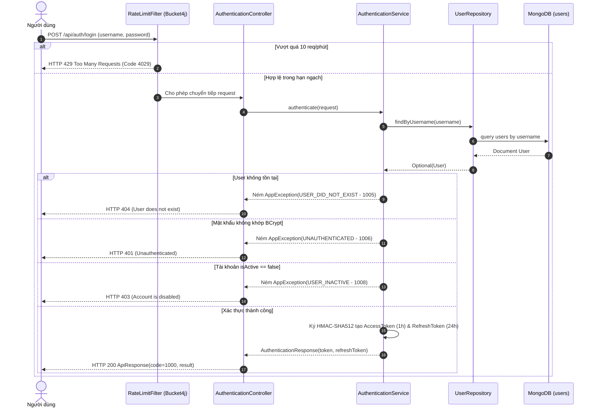
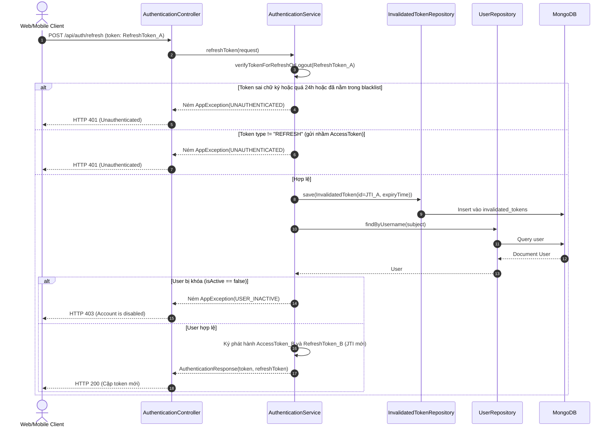

# ĐẶC TẢ CHỨC NĂNG NGHIỆP VỤ: PHÂN HỆ ĐỊNH DANH, NGƯỜI DÙNG & AN NINH PHÂN QUYỀN (IAM)

> **Thuộc tài liệu:** Bộ Tài liệu Nghiệp vụ AIoTLibTQB  
> **Tài liệu cha:** [00_TONG_QUAN.md](00_TONG_QUAN.md)  
> **Nhãn truy vết:**  
> - `[Code]`: Kiểm chứng trực tiếp từ mã nguồn thực tế backend Spring Boot.  
> - `[Tài liệu]`: Trích xuất từ tài liệu đặc tả dự án (`KE_HOACH_TRIEN_KHAI_PHAN_MEM_IOT.md`).  
> - `[Suy luận]`: Phân tích nghiệp vụ và kiến trúc kỹ thuật.  
> - `[Chưa rõ]`: Điểm cần xác nhận thêm từ Product Owner.

---

## 1. DANH SÁCH CHỨC NĂNG TRONG PHÂN HỆ

1. [Chức năng 1: Đăng nhập Hệ thống (Authentication / Login)](#chức-năng-1-đăng-nhập-hệ-thống-login)
2. [Chức năng 2: Xoay vòng Cấp mới Token (Refresh Token Rotation)](#chức-năng-2-xoay-vòng-cấp-mới-token-refresh-token-rotation)
3. [Chức năng 3: Đăng xuất & Thu hồi Token (Logout & Blacklisting)](#chức-năng-3-đăng-xuất--thu-hồi-token-logout)
4. [Chức năng 4: Kiểm tra Tính hợp lệ của Token (Token Introspection)](#chức-năng-4-kiểm-tra-tính-hợp-lệ-của-token-introspect)
5. [Chức năng 5: Tự Đăng ký Tài khoản Người dùng (User Self-Registration)](#chức-năng-5-tự-đăng-ký-tài-khoản-người-dùng)
6. [Chức năng 6: Xem Danh sách Người dùng có Phân trang (User List & Pagination)](#chức-năng-6-xem-danh-sách-người-dùng-có-phân-trang)
7. [Chức năng 7: Xem Hồ sơ Cá nhân (Get My Profile)](#chức-năng-7-xem-hồ-sơ-cá-nhân-my-profile)
8. [Chức năng 8: Xem Chi tiết Hồ sơ Người dùng (Get User by ID)](#chức-năng-8-xem-chi-tiết-hồ-sơ-người-dùng-theo-id)
9. [Chức năng 9: Cập nhật Hồ sơ Người dùng (Update User Profile)](#chức-năng-9-cập-nhật-hồ-sơ-người-dùng)
10. [Chức năng 10: Khóa / Mở khóa Tài khoản (Toggle User Active Status)](#chức-năng-10-khóa--mở-khóa-tài-khoản-toggle-status)
11. [Chức năng 11: Xóa Vĩnh viễn Tài khoản (Delete User)](#chức-năng-11-xóa-vĩnh-viễn-tài-khoản)
12. [Chức năng 12: Quản trị Vai trò (Role CRUD & Atomic User Sync)](#chức-năng-12-quản-trị-vai-trò-role-crud)
13. [Chức năng 13: Quản trị Quyền hạn (Permission Management & Integrity Check)](#chức-năng-13-quản-trị-quyền-hạn-permission)

---

## CHỨC NĂNG 1: ĐĂNG NHẬP HỆ THỐNG (LOGIN)

### 1.1. Mục đích nghiệp vụ và Tác nhân
- **Mục đích:** Xác thực danh tính của người dùng (Thủ thư, Quản trị viên, Quản lý khu vực, Sinh viên) qua tên đăng nhập và mật khẩu, cấp phát cặp khóa điện tử (Access Token 1 giờ & Refresh Token 24 giờ) để thực hiện các phiên làm việc tiếp theo `[Code: AuthenticationService.java:63-79]`.
- **Tác nhân:** Tất cả người dùng có tài khoản hợp lệ trên hệ thống.

### 1.2. Điều kiện tiên quyết & Quyền cần có
- Tài khoản đã được tạo trên hệ thống và đang ở trạng thái kích hoạt (`isActive == true`) `[Code: AuthenticationService.java:71-73]`.
- Quyền truy cập: Công khai (`permitAll`), không yêu cầu JWT trước `[Code: SecurityConfig.java:30, 59]`.
- Ràng buộc tải: Tối đa 10 lượt gọi/phút cho mỗi địa chỉ IP (chống tấn công dò quét mật khẩu) `[Code: RateLimitFilter.java:34-52]`.

### 1.3. Dữ liệu Đầu vào & Đầu ra
- **Đầu vào (`AuthenticationRequest`):**
  | Trường | Kiểu dữ liệu | Bắt buộc | Ràng buộc / Validation | Ý nghĩa |
  | :--- | :--- | :---: | :--- | :--- |
  | `username` | String | Có | Chuỗi không rỗng `[Code: AuthenticationRequest.java:12]` | Tên tài khoản đăng nhập |
  | `password` | String | Có | Chuỗi mật khẩu nguyên bản `[Code: AuthenticationRequest.java:13]` | Mật khẩu xác thực |
- **Đầu ra (`AuthenticationResponse` bọc trong `ApiResponse`):**
  | Trường | Kiểu | Ý nghĩa |
  | :--- | :--- | :--- |
  | `token` | String | JWT Access Token (HS512, sống 1 giờ, chứa `scope` quyền hạn) `[Code: AuthenticationResponse.java:12]` |
  | `refreshToken` | String | JWT Refresh Token (HS512, sống 24 giờ, dùng để gia hạn phiên) `[Code: AuthenticationResponse.java:13]` |

### 1.4. Luồng chính (Main Flow)
1. Người dùng nhập tên tài khoản và mật khẩu trên giao diện và bấm Đăng nhập.
2. Bộ lọc `RateLimitFilter` kiểm tra hạn ngạch của địa chỉ IP gửi đến. Nếu dưới 10 request/phút, cho phép đi tiếp `[Code: RateLimitFilter.java:67-73]`.
3. Hệ thống tìm kiếm tài khoản trong cơ sở dữ liệu theo `username` `[Code: AuthenticationService.java:64]`.
4. Hệ thống so khớp mật khẩu người dùng nhập với chuỗi băm mã hóa BCrypt trong CSDL `[Code: AuthenticationService.java:67]`.
5. Hệ thống kiểm tra cờ hoạt động của tài khoản (`user.isActive()`) `[Code: AuthenticationService.java:71]`.
6. Hệ thống gom toàn bộ tên Vai trò (Role) và Quyền hạn (Permission) của người dùng thành chuỗi phân tách khoảng trắng `scope` `[Code: AuthenticationService.java:196-207]`.
7. Hệ thống ký số tạo cặp Token: Access Token (hạn 1 giờ, gắn `tokenType: "ACCESS"`) và Refresh Token (hạn 24 giờ, gắn `tokenType: "REFRESH"`) bằng thuật toán Nimbus HMAC-SHA512 `[Code: AuthenticationService.java:115-162]`.
8. Hệ thống phản hồi mã trạng thái 1000 kèm cặp token cho người dùng.

### 1.5. Luồng thay thế & Luồng lỗi
- **Lỗi quá tải (Rate limit exceeded):** IP gọi quá 10 lần/phút $\rightarrow$ Trả về HTTP 429 Too Many Requests, mã `4029`, Header `Retry-After: <giây>` `[Code: RateLimitFilter.java:79-88]`.
- **Lỗi không tìm thấy tài khoản:** Tên đăng nhập không có trong hệ thống $\rightarrow$ Trả về HTTP 404, mã `1005` ("User does not exist") `[Code: AuthenticationService.java:65, ErrorCode.java:19]`.
- **Lỗi sai mật khẩu:** Mật khẩu không khớp hash BCrypt $\rightarrow$ Trả về HTTP 401, mã `1006` ("Unauthenticated") `[Code: AuthenticationService.java:68, ErrorCode.java:22]`.
- **Lỗi tài khoản bị khóa:** Tài khoản có `isActive == false` $\rightarrow$ Trả về HTTP 403, mã `1008` ("Account is disabled. Please contact administrator") `[Code: AuthenticationService.java:72, ErrorCode.java:20]`.

### 1.6. Quy tắc nghiệp vụ liên quan
- **`BR-IAM-01` (Kiểm soát Tốc độ Đăng nhập):** Endpoint đăng nhập bị giới hạn 10 request/phút theo IP nguồn để chống tấn công vét cạn từ điển (Brute-force) `[Code: RateLimitFilter.java:34-52]`.
- **`BR-IAM-02` (Bảo mật Mật khẩu Một chiều):** Mật khẩu người dùng bắt buộc mã hóa một chiều qua thuật toán BCrypt với độ mạnh chuẩn (cost factor = 10), không lưu bản rõ `[Code: SecurityConfig.java:86-88]`.
- **`BR-IAM-03` (Thời hạn Cặp Token):** Access Token có hạn dùng 1 giờ; Refresh Token có hạn dùng 24 giờ kể từ thời điểm phát hành `[Code: AuthenticationService.java:52-57, application.yaml:25-26]`.

### 1.7. Dữ liệu tác động & Giao dịch
- **Bảng tác động:** Đọc từ collection `users`. Không thay đổi dữ liệu `users`.
- **Giao dịch (Transaction):** Không sử dụng giao dịch phân tán (Read-only operation).

### 1.8. Sơ đồ tuần tự (Sequence Diagram)


### 1.9. Bảng truy vết kỹ thuật (Trace Matrix)
- **Endpoint:** `POST /api/auth/login`
- **Controller:** `AuthenticationController#login` `[Code: AuthenticationController.java:30-34]`
- **Service:** `AuthenticationService#authenticate` `[Code: AuthenticationService.java:63-79]`
- **Repository:** `UserRepository#findByUsername` `[Code: UserRepository.java:13]`
- **Entity:** `User` (`users` collection) `[Code: User.java:15-48]`

---

## CHỨC NĂNG 2: XOAY VÒNG CẤP MỚI TOKEN (REFRESH TOKEN ROTATION)

### 2.1. Mục đích nghiệp vụ và Tác nhân
- **Mục đích:** Gia hạn phiên làm việc của người dùng mà không bắt họ phải nhập lại mật khẩu, đồng thời áp dụng cơ chế Xoay vòng (Rotation) một lần duy nhất để ngăn chặn kẻ tấn công tái sử dụng Refresh Token bị đánh cắp `[Code: AuthenticationService.java:90-113]`.
- **Tác nhân:** Ứng dụng Client (Web Dashboard / Mobile App) chạy ngầm khi Access Token sắp hoặc vừa hết hạn.

### 2.2. Điều kiện tiên quyết & Quyền cần có
- Client sở hữu Refresh Token hợp lệ (còn trong 24 giờ tính từ lúc phát hành, chưa từng bị thu hồi).
- Quyền: Public endpoint trong `PUBLIC_POST_ENDPOINTS` `[Code: SecurityConfig.java:33]`.

### 2.3. Dữ liệu Đầu vào & Đầu ra
- **Đầu vào (`RefreshRequest`):** `token` (String, Refresh Token cũ) `[Code: RefreshRequest.java:12]`.
- **Đầu ra:** Cặp token mới `AuthenticationResponse(token, refreshToken)`.

### 2.4. Luồng chính (Main Flow)
1. Client gửi Refresh Token cũ lên endpoint `/api/auth/refresh`.
2. Hệ thống kiểm tra tính hợp lệ của token cũ (chữ ký số HS512, thời hạn 24 giờ, chưa nằm trong blacklist) `[Code: AuthenticationService.java:209-228]`.
3. Hệ thống kiểm tra claim `tokenType`. Bắt buộc phải là `"REFRESH"` (từ chối nếu kẻ gian cố tình gửi Access Token) `[Code: AuthenticationService.java:93-97]`.
4. **Tác dụng phụ quan trọng:** Hệ thống thu hồi ngay lập tức Refresh Token cũ bằng cách lưu mã định danh `jti` (UUID) và ngày hết hạn vào bảng `invalidated_tokens` `[Code: AuthenticationService.java:99, 230-236]`.
5. Hệ thống tra cứu lại thông tin người dùng trong DB để đảm bảo tài khoản vẫn còn tồn tại và đang hoạt động `[Code: AuthenticationService.java:101-107]`.
6. Hệ thống tạo và ký mới một cặp Access Token & Refresh Token hoàn toàn mới `[Code: AuthenticationService.java:109-112]`.
7. Hệ thống trả về cặp token mới cho client.

### 2.5. Luồng lỗi
- Gửi nhầm Access Token hoặc token sai định dạng $\rightarrow$ HTTP 401 `UNAUTHENTICATED` (1006) `[Code: AuthenticationService.java:96]`.
- Token đã bị đưa vào danh sách đen trước đó (dấu hiệu bị tấn công Replay) $\rightarrow$ HTTP 401 `UNAUTHENTICATED` (1006) `[Code: AuthenticationService.java:224]`.
- Tài khoản đã bị quản trị viên vô hiệu hóa trong khi phiên còn mở $\rightarrow$ HTTP 403 `USER_INACTIVE` (1008) `[Code: AuthenticationService.java:106]`.

### 2.6. Quy tắc nghiệp vụ liên quan
- **`BR-IAM-04` (Xoay vòng Token Dùng một lần - Single-use Rotation):** Một Refresh Token chỉ được phép đổi token mới đúng một lần duy nhất. Ngay sau khi đổi, nó bị đưa vào Blacklist vĩnh viễn `[Code: AuthenticationService.java:99]`.
- **`AUTH-01` (Tách biệt Phân loại Token - Token Type Segregation):** Refresh Token bị cấm dùng để gọi các API tài nguyên nghiệp vụ; ngược lại Access Token bị cấm dùng để gọi endpoint Refresh `[Code: CustomJwtDecoder.java:38-46, AuthenticationService.java:93-97]`.

### 2.7. Dữ liệu tác động & Giao dịch
- **Ghi dữ liệu:** Thêm 1 bản ghi vào collection `invalidated_tokens` (`id`, `expiryTime`) `[Code: InvalidatedToken.java:11-25]`.
- **Giao dịch:** Thao tác ghi đơn tài liệu (Single-document insert) trong MongoDB, đảm bảo tính nguyên tử.

### 2.8. Sơ đồ tuần tự (Sequence Diagram)


### 2.9. Bảng truy vết kỹ thuật
- **Endpoint:** `POST /api/auth/refresh`
- **Controller:** `AuthenticationController#refresh` `[Code: AuthenticationController.java:51-57]`
- **Service:** `AuthenticationService#refreshToken` `[Code: AuthenticationService.java:90-113]`
- **Repository:** `InvalidatedTokenRepository#save`, `UserRepository#findByUsername` `[Code: InvalidatedTokenRepository.java:8, UserRepository.java:13]`
- **Entity:** `InvalidatedToken`, `User` `[Code: InvalidatedToken.java:11-25, User.java:15-48]`

---

## CHỨC NĂNG 3: ĐĂNG XUẤT & THU HỒI TOKEN (LOGOUT)

### 3.1. Mục đích nghiệp vụ và Tác nhân
- **Mục đích:** Hủy bỏ phiên làm việc của người dùng một cách chủ động, vô hiệu hóa ngay lập tức token trước khi nó tự hết hạn `[Code: AuthenticationService.java:81-88]`.
- **Tác nhân:** Người dùng chủ động bấm Đăng xuất trên ứng dụng.

### 3.2. Dữ liệu Đầu vào & Đầu ra
- **Đầu vào (`LogoutRequest`):** `token` (String, JWT cần thu hồi) `[Code: LogoutRequest.java:12]`.
- **Đầu ra:** `ApiResponse<Void>` với mã `1000` (Thành công rỗng).

### 3.3. Luồng chính & Xử lý lỗi an toàn (Graceful Handling)
1. Người dùng gửi token lên `POST /api/auth/logout`.
2. Hệ thống kiểm tra và băm đọc mã `jti` cùng thời hạn `expiryTime` của token.
3. Hệ thống lưu token vào collection `invalidated_tokens` `[Code: AuthenticationService.java:230-236]`.
4. **Cơ chế chịu lỗi mềm (Graceful Failure):** Nếu token gửi lên đã hết hạn từ trước hoặc đã bị thu hồi rồi, hệ thống không báo lỗi đỏ cho người dùng mà ghi log thông tin và trả về thành công `[Code: AuthenticationService.java:85-87]`.

---

## CHỨC NĂNG 4: KIỂM TRA TÍNH HỢP LỆ CỦA TOKEN (INTROSPECT)

### 4.1. Mục đích nghiệp vụ và Tác nhân
- **Endpoint:** `POST /api/auth/introspect` `[Code: AuthenticationController.java:38]`.
- **Mục đích:** Cung cấp dịch vụ kiểm tra nhanh xem một chuỗi JWT có hợp lệ hay không (chữ ký đúng, còn hạn, chưa bị đưa vào blacklist) `[Code: IntrospectService.java:32-40]`.
- **Tác nhân:** Cổng Gateway hoặc các dịch vụ nội bộ cần đối soát token.

### 4.2. Dữ liệu Đầu vào & Đầu ra
- **Đầu vào (`IntrospectRequest`):** `token` (String) `[Code: IntrospectRequest.java:12]`.
- **Đầu ra (`IntrospectResponse`):** `valid: true / false` `[Code: IntrospectResponse.java:12]`.

---

## CHỨC NĂNG 5: TỰ ĐĂNG KÝ TÀI KHOẢN NGƯỜI DÙNG

### 5.1. Mục đích nghiệp vụ và Tác nhân
- **Mục đích:** Cho phép độc giả, sinh viên tự tạo tài khoản cá nhân để đăng nhập vào hệ thống thư viện `[Code: UserController.java:27-32, UserService.java:39-59]`.
- **Tác nhân:** Người dùng vãng lai chưa có tài khoản.

### 5.2. Điều kiện tiên quyết & Quyền cần có
- Quyền: Công khai (`permitAll` trên `POST /api/users`) `[Code: SecurityConfig.java:29]`.
- Tên tài khoản chưa từng tồn tại trong hệ thống.

### 5.3. Dữ liệu Đầu vào & Ràng buộc Validation
| Trường | Kiểu | Bắt buộc | Ràng buộc nghiệp vụ / Validation |
| :--- | :--- | :---: | :--- |
| `username` | String | Có | Tối thiểu 6 ký tự (`@Size(min = 6, message = "USERNAME_INVALID")`) `[Code: UserCreationRequest.java:14]` |
| `password` | String | Có | Tối thiểu 8 ký tự (`@Size(min = 8, message = "PASSWORD_INVALID")`) `[Code: UserCreationRequest.java:17]` |
| `email` | String | Không | Địa chỉ thư điện tử cá nhân `[Code: UserCreationRequest.java:20]` |
| `phone` | String | Không | Số điện thoại liên hệ `[Code: UserCreationRequest.java:23]` |

### 5.4. Luồng chính (Main Flow)
1. Người dùng gửi thông tin đăng ký lên `POST /api/users`.
2. Hệ thống kiểm tra tên tài khoản trong CSDL qua `userRepository.existsByUsername(username)`. Nếu đã có $\rightarrow$ ném lỗi `USER_EXISTED` (Mã 1001, HTTP 400) `[Code: UserService.java:40-42]`.
3. Hệ thống mã hóa mật khẩu bằng BCrypt `[Code: UserService.java:45]`.
4. **Quy tắc gán quyền mặc định (BR-IAM-05):** Hệ thống tự động gán vai trò cơ sở duy nhất là `USER` (0 quyền hạn mở rộng) `[Code: UserService.java:47-49]`.
5. **Quy tắc bảo vệ phân vùng (BR-IAM-06):** Hệ thống kiểm tra nếu người gửi không phải là quản trị viên (`ADMIN`), trường danh sách phân khu `assignedZones` bị ép buộc làm sạch thành rỗng `new HashSet<>()` `[Code: UserService.java:51-56]`.
6. Lưu tài khoản mới vào CSDL với trạng thái mặc định `isActive = true` và trả về `UserResponse` `[Code: UserService.java:58, User.java:34]`.

---

## CHỨC NĂNG 6: XEM DANH SÁCH NGƯỜI DÙNG CÓ PHÂN TRANG

### 6.1. Mục đích nghiệp vụ và Tác nhân
- **Mục đích:** Giúp quản trị viên duyệt danh sách tài khoản theo trang, lọc và sắp xếp theo ngày tạo hoặc tên `[Code: UserController.java:34-49, UserService.java:68-80]`.
- **Tác nhân:** Quản trị viên (`ADMIN`).
- **Phân quyền:** `@PreAuthorize("hasAuthority('ADMIN')")` `[Code: UserService.java:68]`.

### 6.2. Dữ liệu Đầu vào & Đầu ra
- **Đầu vào (Query Params):** `page` (mặc định 0), `size` (mặc định 10), `sortBy` (mặc định "createdAt"), `sortDir` ("asc" hoặc "desc", mặc định "desc") `[Code: UserController.java:36-39]`.
- **Đầu ra (`PageResponse<UserResponse>`):** Danh sách người dùng trang hiện tại kèm tổng số trang, tổng số bản ghi `[Code: PageResponse.java:13-26]`.

---

## CHỨC NĂNG 7: XEM HỒ SƠ CÁ NHÂN (MY PROFILE)

### 7.1. Mục đích nghiệp vụ và Tác nhân
- **Endpoint:** `GET /api/users/myInfo` `[Code: UserController.java:51-56]`.
- **Mục đích:** Cho phép người dùng đang đăng nhập xem thông tin chi tiết tài khoản của chính mình `[Code: UserController.java:51-56, UserService.java:61-66]`.
- **Tác nhân:** Bất kỳ người dùng nào đã đăng nhập thành công.
- **Quy trình:** Hệ thống trích xuất username từ Security Context (`SecurityContextHolder.getContext().getAuthentication().getName()`) và tra cứu trong CSDL, trả về thông tin hồ sơ `[Code: UserService.java:62-65]`.

---

## CHỨC NĂNG 8: XEM CHI TIẾT HỒ SƠ NGƯỜI DÙNG (THEO ID)

### 8.1. Mục đích nghiệp vụ và Phân quyền ABAC
- **Endpoint:** `GET /api/users/{userId}` `[Code: UserController.java:58-63]`.
- **Quy tắc phân quyền sở hữu tài nguyên (BR-IAM-07):**
  ```java
  @PostAuthorize("hasAuthority('ADMIN') or returnObject.username == authentication.name")
  public UserResponse getByID(String id) { ... }
  ```
  `[Code: UserService.java:82-87]`.
  - Nếu người gọi là `ADMIN`: Xem được hồ sơ của bất kỳ ai.
  - Nếu là người dùng thường: Chỉ xem được nếu `userId` truyền vào đúng là tài khoản của chính mình. Nếu cố tình xem ID của người khác $\rightarrow$ Bị chặn ngay tại bộ đón `@PostAuthorize` với lỗi HTTP 403 `UNAUTHORIZED` (1007) `[Code: GlobalExceptionHandler.java:40-50]`.

---

## CHỨC NĂNG 9: CẬP NHẬT HỒ SƠ NGƯỜI DÙNG

### 9.1. Mục đích nghiệp vụ và Tác nhân
- **Mục đích:** Sửa đổi thông tin liên lạc (email, số điện thoại), đổi mật khẩu hoặc phân quyền quản lý cho tài khoản `[Code: UserController.java:65-72, UserService.java:90-115]`.
- **Tác nhân:** Chính chủ tài khoản hoặc Quản trị viên (`ADMIN`).
- **Phân quyền ABAC:** `@PostAuthorize("hasAuthority('ADMIN') or returnObject.username == authentication.name")` `[Code: UserService.java:89]`.

### 9.2. Quy tắc an toàn chống leo thang đặc quyền (BR-IAM-08)
- `[Code: UserService.java:100-112, UserMapper.java:22-27]`:
  MapStruct được cấu hình bỏ qua không ánh xạ trực tiếp các trường `roles`, `assignedZones`, `username`, `id` từ DTO.
  Trong Service kiểm tra quyền của người gọi:
  - **Nếu là ADMIN:** Được phép thay đổi danh sách vai trò (`user.setRoles(...)`) và gán khu vực quản lý (`user.setAssignedZones(...)`).
  - **Nếu là Người dùng thường:** Bị phớt lờ hoàn toàn các trường `roles` và `assignedZones`, chỉ được phép cập nhật email, số điện thoại hoặc mật khẩu của chính mình.

---

## CHỨC NĂNG 10: KHÓA / MỞ KHÓA TÀI KHOẢN (TOGGLE STATUS)

### 10.1. Mục đích nghiệp vụ và Tác nhân
- **Mục đích:** Quản trị viên tạm thời đình chỉ quyền truy cập của một người dùng vi phạm quy chế thư viện mà không cần xóa dữ liệu `[Code: UserController.java:74-81, UserService.java:117-123]`.
- **Tác nhân:** Quản trị viên (`ADMIN duy nhất`).
- **Endpoint:** `PATCH /api/users/{userId}/status` kèm body `{"active": false}`.
- **Hệ quả:** Tài khoản bị gán `isActive = false`. Ngay lập tức tài khoản này không thể đăng nhập hoặc làm mới token `[Code: AuthenticationService.java:71, 105]`.

---

## CHỨC NĂNG 11: XÓA VĨNH VIỄN TÀI KHOẢN

### 11.1. Mục đích nghiệp vụ và Tác nhân
- **Mục đích:** Xóa hoàn toàn một tài khoản người dùng khỏi cơ sở dữ liệu `[Code: UserController.java:83-89, UserService.java:125-128]`.
- **Tác nhân:** Quản trị viên (`ADMIN duy nhất`).
- **Endpoint:** `DELETE /api/users/{userId}`.

---

## CHỨC NĂNG 12: QUẢN TRỊ VAI TRÒ (ROLE CRUD)

### 12.1. Mục đích nghiệp vụ và Tác nhân
- **Mục đích:** Định nghĩa các nhóm quyền hạn trong hệ thống (như `ADMIN`, `LIBRARIAN`, `ZONE_MANAGER`, `MAINTENANCE`) và gán danh sách quyền nguyên tử cho từng vai trò `[Code: RoleController.java:15-51, RoleService.java:30-92]`.
- **Tác nhân:** Quản trị viên (`ADMIN duy nhất`).
- **Phân quyền cấp Class:** `@PreAuthorize("hasAuthority('ADMIN')")` bảo vệ toàn bộ controller `[Code: RoleController.java:19]`.

### 12.2. Các thao tác chính
1. **Tạo Vai trò mới (`POST /api/roles`):** Nhận `name`, `description`, danh sách `permissions`. Từ chối nếu trùng tên với lỗi `ROLE_EXISTED` (Mã 2001, HTTP 400) `[Code: RoleService.java:41-54]`.
2. **Xem danh sách Vai trò (`GET /api/roles`):** Trả về toàn bộ danh mục vai trò và các quyền kèm theo `[Code: RoleService.java:56-58]`.
3. **Cập nhật Vai trò & Cơ chế Đồng bộ Nguyên tử (Rule PERF-02):**
   - **Endpoint:** `PUT /api/roles/{name}` `[Code: RoleController.java:38-43]`.
   - **Cơ chế:** Khi sửa quyền của một Role, hệ thống gọi hàm `syncRoleInUsers(updatedRole)`:
     ```java
     Query query = Query.query(Criteria.where("roles.name").is(updatedRole.getName()));
     Update update = new Update().set("roles.$", updatedRole);
     mongoTemplate.updateMulti(query, update, User.class);
     ```
     `[Code: RoleService.java:84-91]`.
   - **Ý nghĩa:** Sử dụng toán tử định vị mảng `roles.$` của MongoDB để cập nhật đồng loạt toàn bộ tài khoản người dùng đang mang vai trò đó trong **1 câu lệnh duy nhất**, triệt tiêu hoàn toàn lỗi chậm trễ do lặp N+1 queries.
4. **Xóa Vai trò (`DELETE /api/roles/{name}`):** Xóa vai trò theo tên định danh `[Code: RoleService.java:80-82]`.

---

## CHỨC NĂNG 13: QUẢN TRỊ QUYỀN HẠN (PERMISSION)

### 13.1. Mục đích nghiệp vụ và Tác nhân
- **Mục đích:** Định nghĩa danh mục các đặc quyền nguyên tử của hệ thống (như `READ_SENSOR_DATA`, `MANAGE_DEVICES`, `VIEW_ALERTS`) `[Code: PermissionController.java:15-44, PermissionService.java:18-48]`.
- **Tác nhân:** Quản trị viên (`ADMIN duy nhất`).
- **Phân quyền:** `@PreAuthorize("hasAuthority('ADMIN')")` cấp Class `[Code: PermissionController.java:19]`.

### 13.2. Quy tắc Toàn vẹn Tham chiếu khi Xóa (Rule DATA-01)
- **Endpoint:** `DELETE /api/permissions/{name}` `[Code: PermissionController.java:38-42]`.
- **Quy tắc kiểm tra toàn vẹn:**
  ```java
  if (!permissionRepository.existsById(name)) {
      throw new AppException(ErrorCode.PERMISSION_NOT_EXISTED);
  }
  if (roleRepository.existsByPermissionsName(name)) {
      throw new AppException(ErrorCode.PERMISSION_IN_USE);
  }
  permissionRepository.deleteById(name);
  ```
  `[Code: PermissionService.java:39-47]`.
- **Hành vi nghiệp vụ:** Nếu quyền này đang nằm trong danh sách quyền của **bất kỳ Vai trò nào** trong cơ sở dữ liệu, hệ thống lập tức từ chối lệnh xóa và trả về lỗi HTTP 400 `PERMISSION_IN_USE` (Mã 2005: "Permission is currently in use by one or more roles") `[Code: ErrorCode.java:30]`. Muốn xóa quyền, người quản trị bắt buộc phải gỡ quyền đó ra khỏi tất cả các vai trò liên quan trước.
- **Tính bất biến:** Hệ thống không hỗ trợ API sửa quyền (PUT/PATCH), quyền hạn là đối tượng bất biến (chỉ tạo mới hoặc xóa khi không dùng).

---

## 2. BẢNG TỔNG HỢP QUY TẮC NGHIỆP VỤ PHÂN HỆ IAM

| Mã Quy tắc | Nội dung quy tắc nghiệp vụ | Căn cứ mã nguồn (File:Line) |
| :--- | :--- | :--- |
| **BR-IAM-01** | Giới hạn 10 request/phút theo IP trên `/api/auth/login` chống brute-force | `RateLimitFilter.java:34-52` |
| **BR-IAM-02** | Mật khẩu bắt buộc mã hóa một chiều qua BCrypt (strength 10) | `SecurityConfig.java:86-88` |
| **BR-IAM-03** | Hạn dùng Access Token là 1 giờ; Refresh Token là 24 giờ | `AuthenticationService.java:52-57` |
| **BR-IAM-04** | Refresh Token chỉ dùng 1 lần (Single-use Rotation), thu hồi ngay vào blacklist | `AuthenticationService.java:99, 230-236` |
| **BR-IAM-05** | Tự đăng ký tài khoản luôn nhận vai trò mặc định duy nhất là `USER` | `UserService.java:47-49` |
| **BR-IAM-06** | Chỉ ADMIN mới được gán hoặc đổi `roles` và `assignedZones` của tài khoản | `UserService.java:51-56, 100-112` |
| **BR-IAM-07** | Người dùng thường chỉ được xem/sửa hồ sơ của chính mình qua `@PostAuthorize` | `UserService.java:82, 89` |
| **BR-IAM-08** | Tài khoản bị vô hiệu hóa (`isActive = false`) bị chặn đăng nhập và làm mới token | `AuthenticationService.java:71, 105` |
| **BR-IAM-09** | Cấm dùng Refresh Token làm Bearer Token gọi API nghiệp vụ và ngược lại (AUTH-01) | `CustomJwtDecoder.java:38-46` |
| **BR-IAM-10** | Cấm xóa Permission đang được bất kỳ Role nào tham chiếu (DATA-01) | `PermissionService.java:43-45` |
| **BR-IAM-11** | Cập nhật Role phải đồng bộ nguyên tử vào các User qua `roles.$` (PERF-02) | `RoleService.java:84-91` |
| **BR-IAM-12** | Chế độ Fail-Fast: Từ chối khởi động trên Production nếu thiếu `INITIAL_ADMIN_PASSWORD` | `ApplicationInitConfig.java:210-219` |
