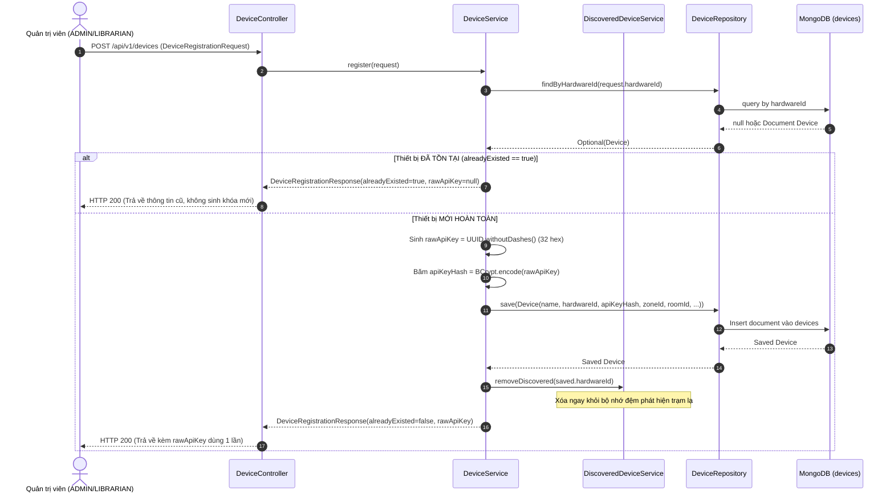

# ĐẶC TẢ CHỨC NĂNG NGHIỆP VỤ: PHÂN HỆ QUẢN LÝ KHÔNG GIAN & TRẠM THIẾT BỊ IOT (SPACE & DEVICE)

> **Thuộc tài liệu:** Bộ Tài liệu Nghiệp vụ AIoTLibTQB  
> **Tài liệu cha:** [00_TONG_QUAN.md](00_TONG_QUAN.md)  
> **Nhãn truy vết:**  
> - `[Code]`: Kiểm chứng trực tiếp từ mã nguồn thực tế backend Spring Boot.  
> - `[Tài liệu]`: Trích xuất từ tài liệu đặc tả dự án (`IOT_SYSTEM_SPECIFICATION.md`, `HUONG_DAN_THUC_HIEN_VA_CAN_NHAC_GIAI_PHAP.md`).  
> - `[Suy luận]`: Phân tích nghiệp vụ và kiến trúc kỹ thuật.  
> - `[Chưa rõ]`: Điểm cần xác nhận thêm từ Product Owner.

---

## 1. TỔNG QUAN PHÂN HỆ

Phân hệ **Quản lý Không gian & Thiết bị** chịu trách nhiệm thiết lập mô hình số hóa cấu trúc tòa nhà thư viện và mạng lưới phần cứng cảm biến:
1. **Mô hình Không gian (Room Topology):** Quản lý thông tin phòng đọc, tầng lầu, sức chứa, mục tiêu tiện nghi (Target Comfort Score) và hình học ranh giới các bức tường theo định dạng đa giác 2D (`boundaryPolygon`) phục vụ vẽ bản đồ nhiệt không bị tràn viền `[Code: Room.java:14-46]`.
2. **Quản lý Vòng đời Trạm đo (Device Lifecycle):** Đăng ký phần cứng qua mã MAC/Hardware ID, cấp phát khóa bảo mật `rawApiKey` 32 ký tự hex (chỉ lộ 1 lần duy nhất), xác thực trạm cấp Device JWT (8 giờ), quản lý tọa độ tương đối $(posX, posY \in [0.0, 1.0])$ trên mặt bằng `[Code: DeviceService.java:47-65, 181-208]`.
3. **Giám sát Trạng thái Kết nối Động (Dynamic Connectivity):** Tự động suy biến trạng thái Online/Offline dựa trên ngưỡng trôi dạt 5 phút của `lastSeenAt` kết hợp trạng thái bản tin di chúc LWT từ Broker `[Code: DeviceService.java:230-235]`.
4. **Phát hiện Phần cứng Mới (Device Discovery):** Bộ nhớ đệm tự động gom các trạm đo ESP32 lạ đang phát sóng vào Broker nhưng chưa đăng ký, hỗ trợ quản trị viên thêm thiết bị dạng Plug-and-Play `[Code: DiscoveredDeviceService.java:23-57]`.

---

## PHẦN A: QUẢN LÝ KHÔNG GIAN PHÒNG ĐỌC (ROOM MANAGEMENT)

---

### CHỨC NĂNG 1: TẠO PHÒNG ĐỌC MỚI (CREATE ROOM)

#### 1.1. Mục đích nghiệp vụ và Tác nhân
- **Mục đích:** Thiết lập một phòng học, phòng tự học hoặc khu vực đọc sách mới trong hệ thống thư viện kèm theo các thông số kiến trúc và ranh giới tường đa giác `[Code: RoomService.java:28-48]`.
- **Tác nhân:** Quản trị viên (`ADMIN`) hoặc Thủ thư chính (`LIBRARIAN`).
- **Quyền hạn:** `@PreAuthorize("hasAnyAuthority('ADMIN', 'LIBRARIAN')")` `[Code: RoomService.java:28]`.

#### 1.2. Dữ liệu Đầu vào & Ràng buộc Validation
- **Đầu vào (`RoomCreationRequest`):**
  | Trường | Kiểu | Bắt buộc | Ràng buộc / Validation | Ý nghĩa |
  | :--- | :--- | :---: | :--- | :--- |
  | `code` | String | Có | `@NotBlank(message = "ROOM_CODE_REQUIRED")` `[Code: RoomCreationRequest.java:18]` | Mã định danh phòng (ví dụ: `ROOM_101`) |
  | `name` | String | Có | `@NotBlank(message = "ROOM_NAME_REQUIRED")` `[Code: RoomCreationRequest.java:21]` | Tên hiển thị (ví dụ: `Phòng Tự Học Tầng 1`) |
  | `floor` | Integer | Có | `@NotNull(message = "FLOOR_REQUIRED")` `[Code: RoomCreationRequest.java:24]` | Số tầng của phòng |
  | `capacity` | Integer | Không | Sức chứa tối đa (số người) `[Code: RoomCreationRequest.java:27]` | Quy mô phục vụ |
  | `description` | String | Không | Mô tả chức năng của phòng `[Code: RoomCreationRequest.java:29]` | Ghi chú vận hành |
  | `targetComfortScore` | Double | Không | Điểm tiện nghi mục tiêu mong muốn (0 - 100) `[Code: RoomCreationRequest.java:31]` | Tiêu chuẩn chất lượng phòng |
  | `boundaryPolygon` | List<Point2D> | Không | Danh sách các đỉnh $(x, y)$ đa giác tường `[Code: RoomCreationRequest.java:33]` | Bản đồ ranh giới phòng |

#### 1.3. Luồng chính (Main Flow)
1. Thủ thư nhập thông tin phòng trên giao diện và nhấn "Lưu phòng".
2. Hệ thống chuẩn hóa mã phòng: tự động cắt bỏ khoảng trắng thừa đầu cuối và chuyển toàn bộ thành chữ in hoa (`request.getCode().trim().toUpperCase()`) `[Code: RoomService.java:30]`.
3. Hệ thống kiểm tra tính duy nhất qua `roomRepository.existsByCode(normalizedCode)` `[Code: RoomService.java:31]`.
4. Nếu mã đã tồn tại: Ném lỗi `ROOM_EXISTED` (Mã 5001, HTTP 400) `[Code: RoomService.java:32]`.
5. Hệ thống khởi tạo thực thể `Room` mới và lưu vào CSDL MongoDB qua `roomRepository.save(room)` `[Code: RoomService.java:45]`.
6. Hệ thống ghi log thông tin và trả về DTO `RoomResponse` (chứa ID được sinh tự động, ngày tạo, ngày sửa).

#### 1.4. Quy tắc nghiệp vụ liên quan
- **`BR-ROOM-01` (Chuẩn hóa và Duy nhất Mã phòng):** Mã phòng không phân biệt chữ hoa chữ thường khi nhập, luôn được lưu trữ dạng chữ hoa và bắt buộc duy nhất trên toàn hệ thống `[Code: RoomService.java:30-33, Room.java:25-26]`.
- **`BR-ROOM-02` (Ranh giới Đa giác Độc lập):** `boundaryPolygon` được lưu dưới dạng danh sách tọa độ `Point2D(x, y)`. Tọa độ này là cơ sở để canvas trình duyệt thực hiện hàm cắt mặt nạ (`ctx.clip()`) chống lan nhiệt sang phòng khác `[Tài liệu: HUONG_DAN_THUC_HIEN_VA_CAN_NHAC_GIAI_PHAP.md:274-275]`.

---

### CHỨC NĂNG 2: TRA CỨU DANH SÁCH PHÒNG (GET ALL / FILTER BY FLOOR)

#### 2.1. Mục đích nghiệp vụ và Tác nhân
- **Mục đích:** Liệt kê toàn bộ các phòng đọc hoặc lọc danh sách phòng theo từng tầng lầu phục vụ hiển thị menu điều hướng và bản đồ tầng `[Code: RoomController.java:32-37, RoomService.java:50-54, 66-70]`.
- **Tác nhân:** Mọi người dùng đã đăng nhập (Độc giả, Thủ thư, Quản trị viên).
- **Phân quyền:** Authenticated (`anyRequest().authenticated()`) `[Code: SecurityConfig.java:61]`.

#### 2.2. Dữ liệu Đầu vào & Đầu ra
- **Đầu vào (Query Param):** `floor` (Integer, tùy chọn) `[Code: RoomController.java:32]`.
- **Luồng xử lý:**
  - Nếu có truyền `floor` $\rightarrow$ gọi `roomRepository.findByFloor(floor)` `[Code: RoomService.java:67]`.
  - Nếu không truyền `floor` $\rightarrow$ gọi `roomRepository.findAll()` `[Code: RoomService.java:51]`.
- **Đầu ra:** Danh sách `List<RoomResponse>` gồm đầy đủ thông tin phòng và mảng `boundaryPolygon`.

---

### CHỨC NĂNG 3: TRA CỨU CHI TIẾT PHÒNG THEO ID HOẶC MÃ PHÒNG

#### 3.1. Mục đích nghiệp vụ và Tác nhân
- **Mục đích:** Xem chi tiết một phòng đọc khi nhấp vào sơ đồ hoặc tìm kiếm nhanh bằng mã phòng `[Code: RoomService.java:56-64]`.
- **Endpoints:**
  1. `GET /api/v1/rooms/{id}`: Tra cứu theo ID định danh CSDL.
  2. `GET /api/v1/rooms/code/{code}`: Tra cứu theo mã phòng (tự động chuẩn hóa `trim().toUpperCase()`).
- **Xử lý lỗi:** Nếu không tìm thấy $\rightarrow$ Ném lỗi `ROOM_NOT_EXISTED` (Mã 5002, HTTP 404: "Room does not exist") `[Code: RoomService.java:63, 111, ErrorCode.java:44]`.

---

### CHỨC NĂNG 4: CẬP NHẬT THÔNG TIN PHÒNG (UPDATE ROOM)

#### 4.1. Mục đích nghiệp vụ và Tác nhân
- **Mục đích:** Cho phép Thủ thư chỉnh sửa tên phòng, tầng lầu, sức chứa, ghi chú mô tả, điểm tiện nghi mục tiêu hoặc vẽ lại đa giác tường `[Code: RoomController.java:53-60, RoomService.java:73-98]`.
- **Tác nhân:** Quản trị viên (`ADMIN`) hoặc Thủ thư (`LIBRARIAN`).
- **Quyền hạn:** `@PreAuthorize("hasAnyAuthority('ADMIN', 'LIBRARIAN')")` `[Code: RoomService.java:72]`.

#### 4.2. Quy tắc nghiệp vụ liên quan
- **`BR-ROOM-03` (Bất biến Mã phòng - Code Immutability):** `RoomUpdateRequest` hoàn toàn không có trường `code` `[Code: RoomUpdateRequest.java:14-27]`. Mã phòng là định danh cố định không thể chỉnh sửa qua API Update.
- **`BR-ROOM-04` (Cập nhật có Chọn lọc - Partial Update):** Hệ thống chỉ cập nhật những trường có giá trị khác null và không bị để trống (`!isBlank()`). Các trường không gửi lên sẽ giữ nguyên giá trị cũ trong DB `[Code: RoomService.java:76-93]`.

---

### CHỨC NĂNG 5: XÓA PHÒNG ĐỌC (DELETE ROOM)

#### 5.1. Mục đích nghiệp vụ và Tác nhân
- **Mục đích:** Xóa bỏ hoàn toàn một phòng đọc không còn sử dụng khỏi hệ thống `[Code: RoomController.java:62-66, RoomService.java:100-107]`.
- **Tác nhân:** **Chỉ riêng Quản trị viên IT (`ADMIN`)**. Thủ thư không có quyền xóa phòng `[Code: RoomService.java:100]`.
- **Phân quyền:** `@PreAuthorize("hasAuthority('ADMIN')")` `[Code: RoomService.java:100]`.
- **Endpoint:** `DELETE /api/v1/rooms/{id}`.

#### 5.2. Quy tắc nghiệp vụ liên quan
- **`BR-ROOM-05` (Chỉ Admin được Xóa phòng và Kiểm tra Tồn tại):** Kiểm tra tồn tại trước khi xóa, ném lỗi `ROOM_NOT_EXISTED` (Mã 5002) nếu ID không hợp lệ. Chỉ quản trị viên cấp cao nhất (`ADMIN`) mới có thẩm quyền thực hiện thao tác này `[Code: RoomService.java:100-105]`.

#### 5.2. Luồng xử lý & Quy tắc an toàn
1. Hệ thống kiểm tra sự tồn tại của phòng qua `roomRepository.existsById(id)` `[Code: RoomService.java:102]`.
2. Nếu không tìm thấy: Ném lỗi `ROOM_NOT_EXISTED` (Mã 5002, HTTP 404) `[Code: RoomService.java:103]`.
3. Nếu tồn tại: Thực thi `roomRepository.deleteById(id)` và ghi log cảnh báo cấp độ WARN `[Code: RoomService.java:105-106]`.
4. `[Chưa rõ / Kiến nghị nghiệp vụ]`: Mã nguồn hiện tại chưa kiểm tra xem phòng có đang gắn các trạm đo (`Device.roomId`) hay không trước khi xóa. Khuyến nghị kiểm tra `deviceRepository.findByRoomId(roomId)` trước khi cho phép xóa phòng để tránh trạm đo bị mồ côi (orphaned device).

---

## PHẦN B: QUẢN LÝ TRẠM CẢM BIẾN IOT (DEVICE MANAGEMENT)

---

### CHỨC NĂNG 6: ĐĂNG KÝ TRẠM CẢM BIẾN MỚI (DEVICE REGISTRATION)

#### 6.1. Mục đích nghiệp vụ và Tác nhân
- **Mục đích:** Khai báo một trạm phần cứng ESP32-S3 mới vào hệ thống, cấp phát khóa bảo mật `rawApiKey` duy nhất, gán trạm vào phòng đọc và phân khu quản lý `[Code: DeviceController.java:38-44, DeviceService.java:46-56, 181-208]`.
- **Tác nhân:** Quản trị viên (`ADMIN`) hoặc Thủ thư chính (`LIBRARIAN`).
- **Phân quyền:** `@PreAuthorize("hasAnyAuthority('ADMIN', 'LIBRARIAN')")` `[Code: DeviceService.java:46]`.

#### 6.2. Dữ liệu Đầu vào & Đầu ra
- **Đầu vào (`DeviceRegistrationRequest`):**
  | Trường | Kiểu | Bắt buộc | Validation | Ý nghĩa |
  | :--- | :--- | :---: | :--- | :--- |
  | `hardwareId` | String | Có | `@NotBlank(message = "HARDWARE_ID_REQUIRED")` `[Code: DeviceRegistrationRequest.java:17]` | Địa chỉ MAC / ID phần cứng duy nhất (ví dụ: `ESP32_ROOM_101`) |
  | `name` | String | Có | `@NotBlank(message = "DEVICE_NAME_REQUIRED")` `[Code: DeviceRegistrationRequest.java:14]` | Tên gọi dễ nhớ của trạm (ví dụ: `Trạm đo Bàn 1 - P101`) |
  | `zoneId` | String | Có | `@NotBlank(message = "ZONE_ID_REQUIRED")` `[Code: DeviceRegistrationRequest.java:20]` | Mã phân khu quản trị (ví dụ: `ZONE_FLOOR_1`) |
  | `deviceType` | String | Có | `@NotBlank(message = "DEVICE_TYPE_REQUIRED")` `[Code: DeviceRegistrationRequest.java:23]` | Loại thiết bị (mặc định: `ESP32-S3-STATION`) |
  | `roomId` | String | Không | ID phòng đọc mà trạm được gắn `[Code: DeviceRegistrationRequest.java:26]` | Gán trạm vào phòng |
  | `posX`, `posY` | Double | Không | Tọa độ chuẩn hóa $\in [0.0, 1.0]$ trên ảnh mặt bằng `[Code: DeviceRegistrationRequest.java:28-30]` | Vị trí vẽ nguồn nhiệt/ồn |
  | `location` | String | Không | Mô tả vị trí thực tế (ví dụ: `Góc cửa sổ phía Đông`) `[Code: DeviceRegistrationRequest.java:32]` | Hướng dẫn vị trí lắp |
  | `firmwareVersion` | String | Không | Phiên bản firmware nạp sẵn (ví dụ: `v1.2.0`) `[Code: DeviceRegistrationRequest.java:34]` | Quản lý phiên bản nạp |

- **Đầu ra (`DeviceRegistrationResponse`):**
  - Trả về thông tin trạm kèm `rawApiKey` (chuỗi 32 ký tự Hex) và cờ `alreadyExisted: false`.

#### 6.3. Luồng chính (Main Flow)
1. Quản trị viên nhập thông tin trạm đo và gửi request tới `POST /api/v1/devices`.
2. Hệ thống kiểm tra xem `hardwareId` đã từng được đăng ký trong CSDL chưa qua `deviceRepository.findByHardwareId(hardwareId)` `[Code: DeviceService.java:49]`.
3. **Trường hợp Thiết bị Mới:**
   - Hệ thống sinh chuỗi ngẫu nhiên bảo mật cao từ UUID v4 loại bỏ dấu gạch ngang (`UUID.randomUUID().toString().replace("-", "")`), thu được chuỗi 32 ký tự Hex `rawApiKey` `[Code: DeviceService.java:205]`.
   - Hệ thống mã hóa chuỗi này bằng BCrypt (`passwordEncoder.encode(rawKey)`) và gán vào trường `device.apiKeyHash` `[Code: DeviceService.java:206]`.
   - Trạng thái hoạt động mặc định được đặt `isActive = true` `[Code: DeviceService.java:192]`.
   - Lưu thực thể `Device` mới vào collection `devices` `[Code: DeviceService.java:196]`.
   - **Tác dụng phụ đồng bộ (BR-DEV-01):** Hệ thống lập tức gỡ bỏ `hardwareId` này ra khỏi bộ nhớ đệm phát hiện trạm lạ: `discoveredDeviceService.removeDiscovered(hardwareId)` `[Code: DeviceService.java:197]`.
   - Trả về thông tin đăng ký kèm `rawApiKey` để quản trị viên sao chép nạp vào firmware thiết bị.
4. **Trường hợp Thiết bị Đã Tồn Tại (Cơ chế Idempotent - BR-DEV-02):**
   - Hệ thống **không ném lỗi** và không ghi đè cấu hình cũ `[Code: DeviceService.java:50-54]`.
   - Trả về DTO với `alreadyExisted = true` và `rawApiKey = null` (bảo vệ không lộ khóa cũ).

#### 6.4. Sơ đồ tuần tự (Sequence Diagram)


---

### CHỨC NĂNG 7: XÁC THỰC TRẠM IOT (DEVICE AUTHENTICATION)

#### 7.1. Mục đích nghiệp vụ và Tác nhân
- **Mục đích:** Xác minh tính danh của trạm phần cứng ESP32 khi kết nối vào mạng hoặc đóng vai trò Webhook xác thực cho Mosquitto MQTT Broker, cấp phát token JWT có thời hạn **8 giờ** `[Code: DeviceController.java:61-67, DeviceService.java:67-85]`.
- **Tác nhân:** Trạm phần cứng ESP32-S3 hoặc Plugin Mosquitto Go-Auth Webhook.
- **Quyền hạn:** Công khai (`permitAll` trên `POST /api/v1/devices/authenticate`) `[Code: SecurityConfig.java:34, 59]`.
- **Bảo vệ:** Chịu sự kiểm soát của `RateLimitFilter` (tối đa 10 req/phút/IP) `[Code: RateLimitFilter.java:36]`.

#### 7.2. Dữ liệu Đầu vào & Đầu ra
- **Đầu vào (`DeviceAuthRequest`):**
  - `hardwareId`: `@NotBlank(message = "HARDWARE_ID_REQUIRED")` `[Code: DeviceAuthRequest.java:14]`.
  - `apiKey`: `@NotBlank(message = "API_KEY_REQUIRED")` `[Code: DeviceAuthRequest.java:17]`.
- **Đầu ra (`AuthenticationResponse`):**
  - `token`: Chuỗi Device JWT (HS512, sống 8 giờ, scope `"DEVICE WRITE_SENSOR_DATA"`).

#### 7.3. Luồng chính & Quy tắc nghiệp vụ
1. Trạm gửi `hardwareId` và `apiKey` lên endpoint xác thực.
2. Hệ thống tìm kiếm theo `hardwareId`. Nếu không thấy $\rightarrow$ Ném `DEVICE_NOT_EXISTED` (Mã 3001, HTTP 404) `[Code: DeviceService.java:68-70]`.
3. Kiểm tra cờ kích hoạt của trạm. Nếu `!device.isActive()` $\rightarrow$ Ném `DEVICE_INACTIVE` (Mã 3002, HTTP 403: "Device is disabled") `[Code: DeviceService.java:71-73]`.
4. So khớp khóa qua `passwordEncoder.matches(request.getApiKey(), device.getApiKeyHash())`. Nếu sai $\rightarrow$ Ném `INVALID_API_KEY` (Mã 3003, HTTP 401: "Invalid API key") `[Code: DeviceService.java:75-77]`.
5. Cập nhật nhịp sống: `device.setLastSeenAt(Instant.now()); deviceRepository.save(device);` `[Code: DeviceService.java:79-80]`.
6. Hệ thống ký phát hành Device JWT Token có hiệu lực đúng **8 giờ** `[Code: AuthenticationService.java:168-194]`.

---

### CHỨC NĂNG 8: GỬI NHỊP TIM SỐNG CÒN (DEVICE HEARTBEAT)

#### 8.1. Mục đích nghiệp vụ và Tác nhân
- **Mục đích:** Cập nhật dấu thời gian sống sót gần nhất (`lastSeenAt`) của trạm đo qua HTTP REST khi trạm không sử dụng kênh MQTT `[Code: DeviceController.java:55-59, DeviceService.java:169-174]`.
- **Tác nhân:** Trạm đo hoặc dịch vụ giám sát gateway.
- **Endpoint:** `POST /api/v1/devices/{id}/heartbeat`.
- **Quy trình:** Hệ thống tìm thiết bị theo `id`, nếu tồn tại thì gán `device.setLastSeenAt(Instant.now())` và lưu lại CSDL `[Code: DeviceService.java:170-173]`.

---

### CHỨC NĂNG 9: TRA CỨU DANH SÁCH TRẠM ĐO (GET ALL DEVICES)

#### 9.1. Mục đích nghiệp vụ và Phân quyền
- **Mục đích:** Xem toàn bộ danh sách trạm đo, kiểm tra tình trạng kết nối Online/Offline và các thông số vị trí mặt bằng `[Code: DeviceController.java:69-74, DeviceService.java:87-92]`.
- **Tác nhân:** Quản trị viên (`ADMIN`) hoặc Thủ thư (`LIBRARIAN`).
- **Phân quyền:** `@PreAuthorize("hasAnyAuthority('ADMIN', 'LIBRARIAN')")` `[Code: DeviceService.java:87]`.

#### 9.2. Thuật toán Đánh giá Trạng thái Online Động (BR-DEV-03)
Khi trả về DTO `DeviceResponse`, cờ `online` được tính toán thời gian thực theo công thức:
```java
boolean online = !"OFFLINE".equalsIgnoreCase(device.getConnectionState()) &&
        device.getLastSeenAt() != null &&
        device.getLastSeenAt().isAfter(
                Instant.now().minus(5L, ChronoUnit.MINUTES));
```
`[Code: DeviceService.java:230-235]`.
- Thiết bị được coi là **ONLINE** khi và chỉ khi:
  1. Trạng thái kết nối không bị ghi đè là `"OFFLINE"` (do bản tin MQTT LWT báo ngắt kết nối).
  2. Thời điểm nhìn thấy cuối cùng `lastSeenAt` nằm trong phạm vi **5 phút gần nhất**. Quá 5 phút không phát sóng, trạm tự động chuyển sang trạng thái **OFFLINE**.

---

### CHỨC NĂNG 10: TRA CỨU CHI TIẾT TRẠM ĐO (GET BY ID)

#### 10.1. Mục đích nghiệp vụ và Tác nhân
- **Mục đích:** Xem đầy đủ hồ sơ phần cứng, tọa độ, phòng gắn và trạng thái online của một trạm cụ thể `[Code: DeviceController.java:76-81, DeviceService.java:94-97]`.
- **Tác nhân:** `ADMIN`, `LIBRARIAN`, `ZONE_MANAGER`, hoặc `MAINTENANCE` (Kỹ thuật viên bảo trì).
- **Phân quyền:** `@PreAuthorize("hasAnyAuthority('ADMIN', 'LIBRARIAN', 'ZONE_MANAGER', 'MAINTENANCE')")` `[Code: DeviceService.java:94]`.

---

### CHỨC NĂNG 11: TRA CỨU TRẠM THEO PHÂN VÙNG QUẢN LÝ (ZONE SCOPING)

#### 11.1. Mục đích nghiệp vụ và Tác nhân
- **Endpoint:** `GET /api/v1/devices/zone/{zoneId}` `[Code: DeviceController.java:83-88]`.
- **Mục đích:** Lọc danh sách các trạm cảm biến thuộc một khu vực cụ thể (`zoneId`), bảo vệ ranh giới phân quyền vật lý giữa các thủ thư quản lý tầng/khu vực `[Code: DeviceController.java:83-88, DeviceService.java:99-120]`.
- **Tác nhân:** `ADMIN`, `LIBRARIAN`, hoặc `ZONE_MANAGER`.

#### 11.2. Quy tắc Kiểm soát Truy cập Phân vùng (BR-DEV-04 / ABAC)
- `[Code: DeviceService.java:101-115]`:
  - **Full Access:** Quyền `ADMIN` và `LIBRARIAN` được toàn quyền xem trạm của bất kỳ `zoneId` nào mà không bị hạn chế.
  - **Zone Manager Restriction:** Nếu người gọi chỉ mang vai trò `ZONE_MANAGER`:
    - Hệ thống tra cứu người dùng trong CSDL để lấy mảng `user.assignedZones`.
    - Bắt buộc `user.assignedZones` phải chứa tham số `zoneId` yêu cầu.
    - Nếu không chứa: Hệ thống từ chối truy cập và ném lỗi `ZONE_ACCESS_DENIED` (Mã 4031, HTTP 403: "You do not have access to this zone") `[Code: DeviceService.java:112, ErrorCode.java:41]`.

---

### CHỨC NĂNG 12: CẬP NHẬT CẤU HÌNH & TỌA ĐỘ TRẠM ĐO

#### 12.1. Mục đích nghiệp vụ và Tác nhân
- **Mục đích:** Thay đổi tên trạm, chuyển trạm sang phòng khác (`roomId`), gán sang phân khu khác (`zoneId`), cập nhật phiên bản firmware hoặc thay đổi vị trí tọa độ $(posX, posY)$ khi kéo-thả trạm trên sơ đồ mặt bằng `[Code: DeviceController.java:46-53, DeviceService.java:122-152]`.
- **Tác nhân:** Quản trị viên (`ADMIN`) hoặc Thủ thư (`LIBRARIAN`).
- **Phân quyền:** `@PreAuthorize("hasAnyAuthority('ADMIN', 'LIBRARIAN')")` `[Code: DeviceService.java:122]`.

#### 12.2. Quy tắc nghiệp vụ
- **`BR-DEV-05` (Bất biến Hardware ID):** `DeviceUpdateRequest` không cho phép sửa đổi `hardwareId` `[Code: DeviceUpdateRequest.java:13-24]`.
- **Cập nhật tọa độ chuẩn hóa:** Khi điều chỉnh vị trí trạm trên sơ đồ mặt bằng phòng, các giá trị `posX` và `posY` được lưu lại dưới dạng số thực thập phân đại diện cho tỉ lệ phần trăm trên ảnh mặt bằng `[Code: DeviceService.java:135-140]`.

---

### CHỨC NĂNG 13: CẤP LẠI KHÓA BẢO MẬT TRẠM (REGENERATE API KEY)

#### 13.1. Mục đích nghiệp vụ và Tác nhân
- **Mục đích:** Thu hồi khóa bí mật cũ và cấp ngay một mã `rawApiKey` mới trong trường hợp nghi ngờ trạm bị xâm nhập phần cứng hoặc lộ mã khóa `[Code: DeviceController.java:90-95, DeviceService.java:58-65]`.
- **Tác nhân:** Quản trị viên (`ADMIN`) hoặc Thủ thư (`LIBRARIAN`).
- **Endpoint:** `POST /api/v1/devices/{id}/regenerate-key`.
- **Luồng xử lý:**
  1. Hệ thống tìm trạm theo `id`.
  2. Sinh chuỗi UUID 32 ký tự hex mới và băm BCrypt đè vào trường `apiKeyHash` `[Code: DeviceService.java:61]`.
  3. Lưu trạm vào CSDL và ghi log cảnh báo cấp độ WARN `[Code: DeviceService.java:62-63]`.
  4. Trả về `rawApiKey` mới cho người quản trị. Khóa cũ lập tức mất hiệu lực xác thực ngay tại thời điểm lưu DB.

---

### CHỨC NĂNG 14: BẬT / TẮT TRẠNG THÁI HOẠT ĐỘNG TRẠM ĐO

#### 14.1. Mục đích nghiệp vụ và Tác nhân
- **Mục đích:** Vô hiệu hóa một trạm đo đang bị hỏng hoặc gửi dữ liệu rác mà không cần xóa cấu hình vị trí của trạm `[Code: DeviceController.java:97-104, DeviceService.java:154-159]`.
- **Tác nhân:** Quản trị viên (`ADMIN`) hoặc Thủ thư (`LIBRARIAN`).
- **Endpoint:** `PATCH /api/v1/devices/{id}/status?active=true/false`.
- **Hệ quả nghiệp vụ:** Trạm có `isActive = false` sẽ bị:
  1. Chặn xác thực tại `authenticateDevice` với mã lỗi `DEVICE_INACTIVE` (3002) `[Code: DeviceService.java:72]`.
  2. Toàn bộ bản tin MQTT Telemetry gửi lên từ `hardwareId` này sẽ bị hủy bỏ (reject) ngay tại bộ điều phối MQTT mà không lưu vào DB `[Code: MqttMessageDispatcherService.java:147-150]`.

---

### CHỨC NĂNG 15: XÓA TRẠM ĐO (DELETE DEVICE)

#### 15.1. Mục đích nghiệp vụ và Tác nhân
- **Mục đích:** Loại bỏ vĩnh viễn một trạm cảm biến khỏi hệ thống `[Code: DeviceController.java:106-110, DeviceService.java:161-167]`.
- **Tác nhân:** **Chỉ riêng Quản trị viên IT (`ADMIN duy nhất`)**. Thủ thư không có quyền xóa trạm `[Code: DeviceService.java:161]`.
- **Quy trình:** Kiểm tra `deviceRepository.existsById(id)`, nếu không có ném `DEVICE_NOT_EXISTED` (3001, HTTP 404), nếu có thực hiện `deleteById(id)`.

---

## PHẦN C: PHÁT HIỆN THIẾT BỊ LẠ CHƯA KHAI BÁO (DEVICE DISCOVERY)

---

### CHỨC NĂNG 16: QUÉT VÀ HIỂN THỊ DANH SÁCH TRẠM PHÁT SÓNG LẠ

#### 16.1. Mục đích nghiệp vụ và Tác nhân
- **Mục đích:** Hỗ trợ quy trình triển khai phần cứng dạng "Cắm và Chạy" (Plug-and-Play). Kỹ thuật viên chỉ cần cấp nguồn cho trạm ESP32 tại phòng đọc; Backend tự động bắt sóng bản tin MQTT và đưa vào hàng đợi chờ duyệt, giúp Thủ thư không cần gõ thủ công địa chỉ MAC phức tạp `[Code: DeviceController.java:30-36, DiscoveredDeviceService.java:23-57]`.
- **Tác nhân:** Quản trị viên (`ADMIN`) hoặc Thủ thư (`LIBRARIAN`).
- **Endpoint:** `GET /api/v1/devices/discovered`.

#### 16.2. Cơ chế Hoạt động & Quản lý Bộ nhớ Đệm (BR-DISC-01)
1. **Điểm kích hoạt tự động (Triggers):**
   - Khi Broker nhận bản tin trạng thái (`devices/{hwId}/status`) từ trạm chưa đăng ký $\rightarrow$ Gọi `discoveredDeviceService.recordDiscovered(hardwareId, null)` `[Code: MqttMessageDispatcherService.java:119]`.
   - Khi Broker nhận bản tin Telemetry (`devices/{hwId}/telemetry`) từ trạm chưa đăng ký $\rightarrow$ Gọi `discoveredDeviceService.recordDiscovered(hardwareId, wifiRssi)` `[Code: MqttMessageDispatcherService.java:142]`. Dữ liệu đo bị bỏ qua để bảo vệ TimeSeries database không bị ô nhiễm.
2. **Cấu trúc bộ nhớ đệm (In-Memory Thread-Safe Cache):**
   - Sử dụng `ConcurrentHashMap<String, DiscoveredEntry>` `[Code: DiscoveredDeviceService.java:25]`.
   - Áp dụng phương thức nguyên tử `cache.compute(hardwareId, ...)` để tăng biến đếm số lượng thông điệp `messageCount` và cập nhật cường độ sóng Wi-Fi `lastWifiRssi` mới nhất `[Code: DiscoveredDeviceService.java:34-47]`.
3. **Thời gian sống và Tự dọn dẹp (10 Minutes TTL):**
   - Hằng số hết hạn: `Duration.ofMinutes(10)` `[Code: DiscoveredDeviceService.java:26]`.
   - Cơ chế dọn dẹp trễ (Lazy Eviction): Mỗi khi có người gọi API tra cứu `getDiscoveredDevices()`, hệ thống tự động lọc bỏ các phần tử có `lastSeenAt < now - 10 phút` `[Code: DiscoveredDeviceService.java:65-68]`.
4. **Tự động xóa khi hoàn tất đăng ký:**
   - Ngay khi người quản trị nhấn nút "Đăng ký trạm này" và trạm được lưu thành công vào CSDL MongoDB, hàm `createNewDevice` lập tức gọi `discoveredDeviceService.removeDiscovered(hardwareId)` để xóa khỏi hàng đợi quét `[Code: DeviceService.java:197]`.

---

## 2. BẢNG TỔNG HỢP QUY TẮC NGHIỆP VỤ PHÂN HỆ KHÔNG GIAN & THIẾT BỊ

| Mã Quy tắc | Nội dung quy tắc nghiệp vụ | Căn cứ mã nguồn (File:Line) |
| :--- | :--- | :--- |
| **BR-ROOM-01**| Mã phòng (`code`) luôn tự động cắt khoảng trắng, viết hoa và duy nhất trên toàn hệ thống | `RoomService.java:30-33, Room.java:25-26` |
| **BR-ROOM-02**| Ranh giới phòng là danh sách tọa độ đa giác `boundaryPolygon` dùng để cắt mặt nạ chống lan nhiệt | `Room.java:35, RoomUpdateRequest.java:24` |
| **BR-ROOM-03**| Mã phòng là trường bất biến, không thể sửa đổi sau khi đã tạo | `RoomUpdateRequest.java:14-27` |
| **BR-ROOM-04**| Cập nhật thông tin phòng có chọn lọc (Partial Update), giữ nguyên các trường để trống/null | `RoomService.java:76-93` |
| **BR-ROOM-05**| Chỉ riêng quyền `ADMIN` mới được xóa phòng và bắt buộc kiểm tra tồn tại (ném lỗi 5002 nếu sai) | `RoomService.java:100-105` |
| **BR-DEV-01**  | Đăng ký thành công trạm đo lập tức gỡ bỏ trạm đó khỏi hàng đợi quét Discovery | `DeviceService.java:197, DiscoveredDeviceService.java:59-63` |
| **BR-DEV-02**  | Đăng ký trùng `hardwareId` sẽ trả về dữ liệu cũ kèm `rawApiKey = null` (Idempotent) | `DeviceService.java:49-55` |
| **BR-DEV-03**  | Trạng thái `online` tính toán động: `lastSeenAt < 5 phút` và `connectionState != "OFFLINE"` | `DeviceService.java:44, 230-235` |
| **BR-DEV-04**  | `ZONE_MANAGER` chỉ được xem trạm đo thuộc phân khu nằm trong `user.assignedZones` | `DeviceService.java:100-115` |
| **BR-DEV-05**  | Mã phần cứng `hardwareId` là trường bất biến, không cho phép cập nhật | `DeviceUpdateRequest.java:13-24` |
| **BR-DEV-06**  | Trạm bị vô hiệu hóa (`isActive = false`) bị chặn xác thực và từ chối tiếp nhận Telemetry | `DeviceService.java:71, MqttMessageDispatcherService.java:147` |
| **BR-DEV-07**  | Token xác thực trạm IoT mang scope `DEVICE WRITE_SENSOR_DATA` và có thời hạn cố định 8 giờ | `AuthenticationService.java:168-194` |
| **BR-DEV-08**  | Chỉ riêng quyền `ADMIN` mới được phép xóa trạm cảm biến (`DELETE /api/v1/devices/{id}`) | `DeviceService.java:161` |
| **BR-DISC-01** | Trạm lạ chưa khai báo được lưu tạm trong RAM 10 phút, tự tăng biến đếm tin nhắn | `DiscoveredDeviceService.java:25-48` |
