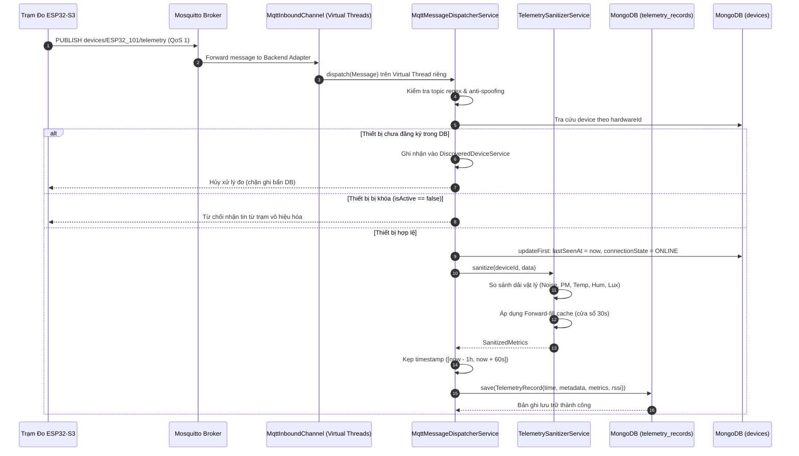

# ĐẶC TẢ CHỨC NĂNG NGHIỆP VỤ: PHÂN HỆ THU THẬP & XỬ LÝ DỮ LIỆU VI KHÍ HẬU / ÂM HỌC (TELEMETRY & INGESTION)

> **Thuộc tài liệu:** Bộ Tài liệu Nghiệp vụ AIoTLibTQB  
> **Tài liệu cha:** [00_TONG_QUAN.md](00_TONG_QUAN.md)  
> **Nhãn truy vết:**  
> - `[Code]`: Kiểm chứng trực tiếp từ mã nguồn thực tế backend Spring Boot.  
> - `[Tài liệu]`: Trích xuất từ tài liệu đặc tả dự án (`IOT_SYSTEM_SPECIFICATION.md`, `KE_HOACH_TRIEN_KHAI_PHAN_MEM_IOT.md`, `ORIGINAL_REQUEST.md`).  
> - `[Suy luận]`: Phân tích nghiệp vụ và kiến trúc kỹ thuật.  
> - `[Chưa rõ]`: Điểm cần xác nhận thêm từ Product Owner.

---

## 1. TỔNG QUAN PHÂN HỆ

Phân hệ **Thu thập & Xử lý Dữ liệu Cảm biến (Telemetry & Ingestion)** là trái tim vận hành luồng dữ liệu thời gian thực của dự án:
1. **Pipeline Tiếp nhận MQTT Bất đồng bộ Cao độ:** Sử dụng Spring Integration MQTT kết hợp luồng ảo Java 21 (`Virtual Threads`) để tiếp nhận hàng ngàn bản tin cảm biến mỗi giây từ Mosquitto Broker mà không gây nghẽn Thread pool hệ điều hành `[Code: MqttConfig.java:41-44]`.
2. **Kiểm tra An ninh Luồng Ingestion:** Tự động phát hiện và ngăn chặn hành vi giả mạo ID phần cứng (Hardware ID spoofing) giữa Topic đường truyền và Payload nội dung `[Code: MqttMessageDispatcherService.java:89-94, 132-137]`.
3. **Bộ Lọc Làm Sạch & Bù Khuyết (Telemetry Sanitizer):** Kiểm soát tính hợp lệ của số đo vật lý dựa trên các dải đo chuẩn của cảm biến công nghiệp (Micro I2S, Sensirion SPS30, SHT30, BH1750), áp dụng thuật toán `Forward-Fill` trong cửa sổ trượt 30 giây để xử lý tình trạng cảm biến lỗi I2C tạm thời `[Code: TelemetrySanitizerService.java:24-36, 108-133]`.
4. **Cơ chế Kẹp Dấu Thời gian (Timestamp Clamping):** Khắc phục lỗi trôi đồng hồ của vi điều khiển ESP32 khi chưa kịp đồng bộ NTP (tránh lưu năm 1970) hoặc đồng hồ trôi về tương lai `[Code: MqttMessageDispatcherService.java:163-177]`.
5. **Lưu trữ Chuỗi Thời Gian Chuyên Dụng:** Ghi dữ liệu vào MongoDB 8.0 Native TimeSeries collection với độ phân giải theo giây (`Granularity.SECONDS`), phân cụm nén tối ưu theo `metadata` `[Code: TelemetryRecord.java:12-18]`.
6. **Truy vấn Dữ liệu Quan trắc Phân quyền Vùng:** Cung cấp các API lấy số đo mới nhất (Latest) và chuỗi lịch sử (History) theo trạm hoặc theo phòng, tự động giới hạn khung thời gian mặc định 1 giờ và kiểm soát chặt chẽ thẩm quyền quản lý phân khu của `ZONE_MANAGER` `[Code: TelemetryService.java:36-70, 72-122]`.

---

## PHẦN A: TIẾP NHẬN DỮ LIỆU LUỒNG MQTT (MQTT INGESTION PIPELINE)

---

### LUỒNG 1: TIẾP NHẬN BẢN TIN CẢM BIẾN (TELEMETRY MESSAGE DISPATCHING)

#### 1.1. Mục đích nghiệp vụ và Kênh truyền
- **Mục đích:** Đón nhận định kỳ (chu kỳ 5s - 30s) các chỉ số tiếng ồn, bụi mịn, nhiệt ẩm và ánh sáng từ các trạm đo ESP32-S3 gửi về qua MQTT Broker `[Code: MqttMessageDispatcherService.java:127-199]`.
- **Kênh tiếp nhận (MQTT Topic):** `devices/{hardwareId}/telemetry` (Ví dụ: `devices/ESP32_ROOM_101/telemetry`) `[Code: MqttMessageDispatcherService.java:45, MqttProperties.java:19]`.
- **Mức chất lượng dịch vụ (QoS):** QoS = 1 (At least once delivery) `[Code: MqttConfig.java:57]`.

#### 1.2. Cấu trúc Payload Dữ liệu Cảm biến (`TelemetryPayload`)
```json
{
  "hardware_id": "ESP32_ROOM_101",
  "timestamp": 1728543600,
  "wifi_rssi": -65,
  "data": {
    "acoustics": {
      "noise_avg": 43.2,
      "noise_peak": 57.8
    },
    "air_quality": {
      "pm1_0": 9.2,
      "pm2_5": 15.6,
      "pm4_0": 19.3,
      "pm10": 22.4
    },
    "environment": {
      "temperature": 26.1,
      "humidity": 61.5,
      "lux": 380.0
    }
  }
}
```
`[Code: TelemetryPayload.java:16-70, StatusPayload.java:1-36]`.

#### 1.3. Luồng xử lý chi tiết từng bước (Step-by-Step Flow)
1. Thông điệp MQTT đến được chuyển giao qua kênh `mqttInboundChannel` chạy trên một **Java 21 Virtual Thread** riêng biệt `[Code: MqttConfig.java:43]`.
2. Hàm `dispatch` nhận diện topic khớp biểu thức chính quy: `^devices/([^/]+)/telemetry$` và bóc tách `topicHardwareId` `[Code: MqttMessageDispatcherService.java:69-74]`.
3. Giải mã chuỗi JSON thành đối tượng `TelemetryPayload` qua Jackson `ObjectMapper` `[Code: MqttMessageDispatcherService.java:129]`.
4. **Kiểm tra Chống Giả Mạo Định Danh (Anti-Spoofing Rule - BR-TEL-01):**
   Hệ thống kiểm tra nếu `telemetryPayload.getHardwareId()` có giá trị nhưng **khác** với `topicHardwareId` trên đường dẫn MQTT $\rightarrow$ Ngay lập tức ghi log cảnh báo `WARN` và hủy bỏ xử lý bản tin `[Code: MqttMessageDispatcherService.java:132-137]`.
5. **Xác thực Thiết bị & Điều phối Hàng đợi Phát hiện (BR-TEL-02):**
   Hệ thống tra cứu thiết bị trong CSDL theo `hardwareId`:
   - *Nếu thiết bị CHƯA đăng ký:* Lập tức chuyển tiếp vào bộ nhớ đệm phát hiện trạm lạ: `discoveredDeviceService.recordDiscovered(hardwareId, wifiRssi)` và dừng luồng `[Code: MqttMessageDispatcherService.java:141-145]`. Dữ liệu đo bị bỏ qua, không ghi vào CSDL.
   - *Nếu thiết bị ĐÃ đăng ký nhưng đang bị khóa (`!device.isActive()`):* Ghi log cảnh báo và dừng luồng (từ chối trạm bị vô hiệu hóa) `[Code: MqttMessageDispatcherService.java:147-150]`.
6. **Cập nhật Nhịp sống Nguyên tử (Atomic Heartbeat):**
   Hệ thống gọi câu lệnh cập nhật nguyên tử trên MongoDB qua `MongoTemplate`:
   ```java
   mongoTemplate.updateFirst(
           Query.query(Criteria.where("hardwareId").is(hardwareId)),
           new Update().set("lastSeenAt", Instant.now()).set("connectionState", "ONLINE"),
           Device.class
   );
   ```
   `[Code: MqttMessageDispatcherService.java:153-157]`. Thao tác này chỉ cập nhật 2 trường `lastSeenAt` và `connectionState`, tuyệt đối không đụng chạm đến vị trí phòng (`roomId`) hay tọa độ $(posX, posY)$ đã gán trên mặt bằng.
7. **Làm Sạch Dữ liệu Đo (Data Sanitization):**
   Chuyển cụm dữ liệu `telemetryPayload.getData()` sang `TelemetrySanitizerService.sanitize(deviceId, data)` để kiểm tra ngưỡng vật lý và áp dụng Forward-fill `[Code: MqttMessageDispatcherService.java:160-161]`.
8. **Kẹp Dấu Thời Gian Chuẩn Hóa (Timestamp Clamping - BR-TEL-03):**
   ```java
   Instant now = Instant.now();
   Instant timestamp;
   if (telemetryPayload.getTimestamp() != null) {
       Instant parsed = Instant.ofEpochSecond(telemetryPayload.getTimestamp());
       if (parsed.isBefore(now.minus(Duration.ofHours(1))) || parsed.isAfter(now.plusSeconds(60))) {
           log.warn("Telemetry timestamp out of bounds ({}), clamping to current server time for hardwareId={}",
                   parsed, hardwareId);
           timestamp = now;
       } else {
           timestamp = parsed;
       }
   } else {
       timestamp = now;
   }
   ```
   `[Code: MqttMessageDispatcherService.java:164-177]`.
   - Nếu `timestamp` bị null: Lấy thời gian hiện tại của máy chủ (`server now`).
   - Nếu thời gian đo trôi về quá khứ quá 1 giờ ($parsed < now - 1\text{h}$) hoặc trôi về tương lai quá 60 giây ($parsed > now + 60\text{s}$) $\rightarrow$ Kẹp về thời gian hiện tại của máy chủ (`server now`).
   - Nếu nằm trong khoảng an toàn $[now - 1\text{h}, now + 60\text{s}]$: Chấp nhận `timestamp = parsed`.
9. **Lưu trữ Chuỗi Thời Gian (TimeSeries Persistence):**
   Khởi tạo đối tượng `TelemetryRecord` và lưu vào MongoDB native TimeSeries collection qua `telemetryRepository.save(record)` `[Code: MqttMessageDispatcherService.java:179-195]`.

---

### LUỒNG 2: TIẾP NHẬN TRẠNG THÁI SỐNG CÒN MQTT (STATUS & LWT DISPATCHING)

#### 2.1. Mục đích nghiệp vụ và Kênh truyền
- **Mục đích:** Cập nhật tức thời trạng thái trực tuyến/ngoại tuyến của trạm cảm biến thông qua bản tin chào sân (`online`) hoặc bản tin di chúc LWT (`offline`) do MQTT Broker tự động phát khi đứt kết nối vật lý `[Code: MqttMessageDispatcherService.java:84-125]`.
- **Kênh tiếp nhận (MQTT Topic):** `devices/{hardwareId}/status` `[Code: MqttMessageDispatcherService.java:44]`.

#### 2.2. Luồng xử lý chi tiết
1. Topic khớp regex `^devices/([^/]+)/status$` $\rightarrow$ Gọi `handleStatusMessage(topicHardwareId, payloadStr)`.
2. Kiểm tra chống giả mạo Hardware ID tương tự như luồng Telemetry `[Code: MqttMessageDispatcherService.java:89-94]`.
3. Kiểm tra cờ trạng thái `isOffline = "offline".equalsIgnoreCase(statusPayload.getStatus())`:
   - **Nếu là bản tin OFFLINE (Bản tin di chúc LWT):**
     Cập nhật nguyên tử: `connectionState = "OFFLINE"`, `lastOfflineAt = Instant.now()`. **Lưu ý: Tuyệt đối không cập nhật `lastSeenAt` khi offline** `[Code: MqttMessageDispatcherService.java:100-103]`.
   - **Nếu là bản tin ONLINE (Bản tin chào kết nối):**
     Cập nhật nguyên tử: `connectionState = "ONLINE"`, `lastSeenAt = Instant.now()`.
4. Nếu gói tin có đính kèm `firmwareVersion` $\rightarrow$ Tự động cập nhật phiên bản firmware mới nhất vào thông tin thiết bị `[Code: MqttMessageDispatcherService.java:108-110]`.
5. Nếu cập nhật không tìm thấy thiết bị (`result.getMatchedCount() == 0`) $\rightarrow$ Tự động ghi nhận vào hàng đợi phát hiện trạm lạ: `discoveredDeviceService.recordDiscovered(hardwareId, null)` `[Code: MqttMessageDispatcherService.java:117-120]`.

---

## PHẦN B: BỘ LỌC LÀM SẠCH & BÙ KHUYẾT (TELEMETRY SANITIZER)

Mã nguồn: `TelemetrySanitizerService.java` (`src/main/java/com/example/AIoTLibTQB/service/TelemetrySanitizerService.java`)

---

### 1. CÁC NGƯỠNG GIỚI HẠN VẬT LÝ CẢM BIẾN (SENSOR BOUNDS)

Hệ thống định nghĩa các ngưỡng hằng số vật lý tiêu chuẩn nhằm phát hiện sự cố phần cứng hoặc nhiễu điện từ `[Code: TelemetrySanitizerService.java:24-35]`:

| Nhóm Cảm Biến | Chỉ số (Metric) | Đơn vị | Dải đo hợp lệ [Min, Max] | Cảm biến phần cứng tham chiếu | Hành vi khi vượt ngưỡng |
| :--- | :--- | :---: | :---: | :--- | :--- |
| **Âm học (Acoustics)** | Mức ồn trung bình (`noiseAvg`) | dBA | **[30.0, 110.0]** | Micro I2S (INMP441) | Từ chối số đo, kích hoạt Forward-fill `[Code: dòng 24-25, 61]` |
| **Âm học (Acoustics)** | Mức ồn đỉnh tức thời (`noisePeak`) | dBA | **[30.0, 130.0]** | Micro I2S (INMP441) | Từ chối số đo, kích hoạt Forward-fill `[Code: dòng 24, 26, 62]` |
| **Bụi mịn (Air Quality)** | Bụi siêu mịn PM1.0 | $\mu\text{g/m}^3$ | **[0.0, 1000.0]** | Sensirion SPS30 | Từ chối số đo, kích hoạt Forward-fill `[Code: dòng 27-28, 75]` |
| **Bụi mịn (Air Quality)** | Bụi mịn PM2.5 | $\mu\text{g/m}^3$ | **[0.0, 1000.0]** | Sensirion SPS30 | Từ chối số đo, kích hoạt Forward-fill `[Code: dòng 27-28, 76]` |
| **Bụi mịn (Air Quality)** | Bụi mịn PM4.0 | $\mu\text{g/m}^3$ | **[0.0, 1000.0]** | Sensirion SPS30 | Từ chối số đo, kích hoạt Forward-fill `[Code: dòng 27-28, 77]` |
| **Bụi mịn (Air Quality)** | Bụi thô PM10 | $\mu\text{g/m}^3$ | **[0.0, 1000.0]** | Sensirion SPS30 | Từ chối số đo, kích hoạt Forward-fill `[Code: dòng 27-28, 78]` |
| **Môi trường (Env)** | Nhiệt độ phòng (`temperature`) | $^\circ\text{C}$ | **[0.0, 60.0]** | SHT30 / BME280 | Từ chối số đo, kích hoạt Forward-fill `[Code: dòng 29-30, 93]` |
| **Môi trường (Env)** | Độ ẩm tương đối (`humidity`) | %RH | **[0.0, 100.0]** | SHT30 / BME280 | Từ chối số đo, kích hoạt Forward-fill `[Code: dòng 31-32, 94]` |
| **Môi trường (Env)** | Cường độ ánh sáng (`lux`) | Lux | **[0.0, 65535.0]** | BH1750 (16-bit) | Từ chối số đo, kích hoạt Forward-fill `[Code: dòng 33-34, 95]` |

---

### 2. CƠ CHẾ BÙ KHUYẾT DỮ LIỆU THIẾU (FORWARD-FILL FALLBACK)

- **Cấu trúc bộ nhớ đệm:**
  `deviceFieldCache = new ConcurrentHashMap<String, Map<String, TimestampedValue>>()` `[Code: TelemetrySanitizerService.java:39]`.
  Lưu trữ giá trị hợp lệ gần nhất kèm thời điểm ghi nhận cho từng trường cụ thể của từng thiết bị.
- **Cửa sổ thời gian bù khuyết:** `FORWARD_FILL_WINDOW = Duration.ofSeconds(30)` `[Code: TelemetrySanitizerService.java:36]`.
- **Giải thuật xử lý từng trường (`sanitizeField`):**
  1. Kiểm tra tính hợp lệ: `hasValidIncoming = incomingValue != null && incomingValue >= min && incomingValue <= max` `[Code: TelemetrySanitizerService.java:112]`.
  2. Nếu **HỢP LỆ**: Cập nhật bộ nhớ đệm với timestamp hiện tại `fields.put(fieldKey, new TimestampedValue(incomingValue, now))` và trả về giá trị mới.
  3. Nếu **KHÔNG HỢP LỆ HOẶC BỊ NULL**:
     - Ghi log cảnh báo `WARN` về số đo lệch dải vật lý `[Code: TelemetrySanitizerService.java:120-122]`.
     - Kiểm tra giá trị cũ `lastKnown` trong cache.
     - Nếu `lastKnown != null` và độ chênh thời gian so với hiện tại $\le 30$ giây: Áp dụng giá trị cũ để điền bù (Forward-fill fallback) `[Code: TelemetrySanitizerService.java:125-129]`.
     - Nếu đã quá 30 giây hoặc chưa từng có dữ liệu: Trả về `null`.
- **Loại trừ nhóm dữ liệu rỗng (Pruning Empty Metric Objects):**
  - Nếu cả 2 trường âm thanh (`noiseAvg`, `noisePeak`) đều null $\rightarrow$ Object `AcousticMetrics` được gán `null` `[Code: dòng 64]`.
  - Nếu cả 4 trường bụi đều null $\rightarrow$ Object `AirQualityMetrics` được gán `null` `[Code: dòng 80]`.
  - Nếu cả 3 trường môi trường đều null $\rightarrow$ Object `EnvironmentMetrics` được gán `null` `[Code: dòng 97]`.
- `[Chưa rõ / Đối chiếu R2]` **Quy tắc Xung Âm Đỉnh (`noisePeak`):**
  Tài liệu yêu cầu `ORIGINAL_REQUEST.md (R2)` yêu cầu loại trừ `noisePeak` khỏi cơ chế Forward-fill vì xung âm là hiện tượng biến thiên tức thời, không duy trì qua các giây sau. Tuy nhiên, trong mã nguồn hiện hành `[Code: TelemetrySanitizerService.java:62]`, `acoustics.noisePeak` vẫn đang được gọi qua `sanitizeField` giống hệt các cảm biến khác. Đây là điểm lệch code cần lưu ý.

---

## PHẦN C: MÔ HÌNH LƯU TRỮ VÀ TRUY VẤN DỮ LIỆU CHUỖI THỜI GIAN

---

### 1. MÔ HÌNH DỮ LIỆU CHUỖI THỜI GIAN (MONGODB TIMESERIES)

- **Định nghĩa Thực thể:** `TelemetryRecord.java` (`src/main/java/com/example/AIoTLibTQB/document/TelemetryRecord.java`).
- **Cấu hình Spring Data MongoDB TimeSeries:**
  ```java
  @Document(collection = "telemetry_records")
  @TimeSeries(
          collection = "telemetry_records",
          timeField = "timestamp",
          metaField = "metadata",
          granularity = Granularity.SECONDS
  )
  public class TelemetryRecord {
      @Id String id;
      Instant timestamp;
      TelemetryMetadata metadata;
      AcousticMetrics acoustics;
      AirQualityMetrics airQuality;
      EnvironmentMetrics environment;
      ComfortScoreRecord comfortScore;
      Integer wifiRssi;
  }
  ```
  `[Code: TelemetryRecord.java:12-24]`.
- **Cơ chế nén Bucket:**
  - `timeField = "timestamp"`: Trục thời gian chuẩn ISO Instant.
  - `metaField = "metadata"`: Chứa `deviceId`, `hardwareId`, `roomId` `[Code: TelemetryMetadata.java:11-15]`. MongoDB sử dụng `metadata` làm khóa phân vùng dữ liệu để gom nhóm các bản ghi đo liên tiếp của cùng một trạm/phòng vào cùng một khối đĩa (Bucket) được nén chặt bằng thuật toán zstandard/snappy.
  - `granularity = Granularity.SECONDS`: Tối ưu hóa chu kỳ đóng bucket theo từng khoảng thời gian ngắn, phù hợp với tần suất gửi định kỳ 5s - 10s của phần cứng ESP32.

---

### 2. CÁC API TRUY VẤN DỮ LIỆU QUAN TRẮC (TELEMETRY APIS)

Phân quyền tổng thể Controller:  
`@PreAuthorize("hasAnyAuthority('ADMIN', 'LIBRARIAN', 'ZONE_MANAGER', 'USER', 'VIEWER')")` `[Code: TelemetryController.java:20]`.

---

#### CHỨC NĂNG 3: TRUY VẤN SỐ ĐO MỚI NHẤT THEO TRẠM ĐO
- **Endpoint:** `GET /api/v1/telemetry/device/{deviceId}/latest` `[Code: TelemetryController.java:25-30]`.
- **Mục đích:** Lấy bản ghi trạng thái vi khí hậu và âm học tức thời của một trạm cảm biến để hiển thị popup khi người dùng nhấp vào node trên sơ đồ mặt bằng `[Code: TelemetryService.java:36-41]`.
- **Bảo mật phân vùng (Zone Access Control - BR-TEL-04):**
  - Hệ thống gọi `checkDeviceAccess(deviceId)` `[Code: TelemetryService.java:72-95]`.
  - Nếu người gọi mang vai trò `ZONE_MANAGER`, hệ thống tìm `Device` trong CSDL. Nếu `device.zoneId` không nằm trong `user.assignedZones` $\rightarrow$ Ném lỗi `ZONE_ACCESS_DENIED` (Mã 4031, HTTP 403) `[Code: TelemetryService.java:90]`.
  - Quyền `ADMIN` và `LIBRARIAN` được toàn quyền bỏ qua kiểm tra này.
- **Truy vấn Repository:** `telemetryRepository.findTopByMetadataDeviceIdOrderByTimestampDesc(deviceId)` `[Code: TelemetryRepository.java:20]`.

---

#### CHỨC NĂNG 4: TRUY VẤN SỐ ĐO MỚI NHẤT THEO PHÒNG ĐỌC
- **Endpoint:** `GET /api/v1/telemetry/room/{roomId}/latest` `[Code: TelemetryController.java:32-37]`.
- **Mục đích:** Lấy số đo mới nhất của phòng phục vụ hiển thị nhãn tóm tắt độ ồn/chất lượng không khí trên danh sách thẻ phòng `[Code: TelemetryService.java:43-48]`.
- **Bảo mật phân vùng:**
  - Hệ thống gọi `checkRoomAccess(roomId)` `[Code: TelemetryService.java:97-122]`.
  - Đối với `ZONE_MANAGER`: Tìm tất cả thiết bị trong phòng qua `deviceRepository.findByRoomId(roomId)`. Bắt buộc phải có **ít nhất một thiết bị** trong phòng thuộc phân khu mà user phụ trách (`anyMatch`). Nếu không có thiết bị nào thuộc quyền quản lý $\rightarrow$ Ném `ZONE_ACCESS_DENIED` (4031) `[Code: TelemetryService.java:117]`.
- **Truy vấn Repository:** `telemetryRepository.findTopByMetadataRoomIdOrderByTimestampDesc(roomId)` `[Code: TelemetryRepository.java:22]`.

---

#### CHỨC NĂNG 5: TRUY VẤN LỊCH SỬ CHUỖI THỜI GIAN THEO TRẠM ĐO
- **Endpoint:** `GET /api/v1/telemetry/device/{deviceId}` `[Code: TelemetryController.java:39-47]`.
- **Tham số lọc:**
  - `start` (Instant, ISO Date-Time, tùy chọn).
  - `end` (Instant, ISO Date-Time, tùy chọn).
- **Quy tắc Dải Thời Gian Mặc Định 1 Giờ (BR-TEL-05):**
  ```java
  Instant actualEnd = (end != null) ? end : Instant.now();
  Instant actualStart = (start != null) ? start : actualEnd.minus(1, ChronoUnit.HOURS);
  ```
  `[Code: TelemetryService.java:52-53]`.
  Nếu client không truyền tham số thời gian, hệ thống tự động giới hạn truy vấn trong **đúng 1 giờ gần nhất**, ngăn ngừa việc quét cạn kiệt toàn bộ collection gây quá tải RAM.
- **Truy vấn Repository:**
  `findByMetadataDeviceIdAndTimestampBetweenOrderByTimestampDesc(deviceId, actualStart, actualEnd)` `[Code: TelemetryRepository.java:14-15]`.

---

#### CHỨC NĂNG 6: TRUY VẤN LỊCH SỬ CHUỖI THỜI GIAN THEO PHÒNG ĐỌC
- **Endpoint:** `GET /api/v1/telemetry/room/{roomId}` `[Code: TelemetryController.java:49-57]`.
- **Tham số lọc:** `start`, `end` (áp dụng dải mặc định 1 giờ tương tự như Chức năng 5).
- **Mục đích:** Vẽ biểu đồ xu hướng tiếng ồn và chất lượng không khí của toàn phòng học phục vụ công tác thanh tra chất lượng không gian học tập `[Code: TelemetryService.java:61-70]`.
- **Truy vấn Repository:**
  `findByMetadataRoomIdAndTimestampBetweenOrderByTimestampDesc(roomId, actualStart, actualEnd)` `[Code: TelemetryRepository.java:17-18]`.

---

## 3. SƠ ĐỒ TUẦN TỰ: PIPELINE INGESTION & TRUY VẤN TELEMETRY



---

## 4. BẢNG TỔNG HỢP QUY TẮC NGHIỆP VỤ PHÂN HỆ TELEMETRY

| Mã Quy tắc | Tên Quy tắc Nghiệp vụ | Chi tiết Yêu cầu Nghiệp vụ | Căn cứ mã nguồn (File:Line) |
| :--- | :--- | :--- | :--- |
| **BR-TEL-01** | Anti-Hardware-ID Spoofing | Hủy bỏ xử lý và cảnh báo log nếu `hardwareId` trong payload JSON khác với định danh trên Topic MQTT | `MqttMessageDispatcherService.java:89-94, 132-137` |
| **BR-TEL-02** | Unregistered Device Isolation | Bản tin cảm biến từ trạm chưa đăng ký bị cô lập vào hàng đợi quét Discovery, cấm ghi vào TimeSeries | `MqttMessageDispatcherService.java:141-145` |
| **BR-TEL-03** | Server Timestamp Clamping | Timestamp đo bị lệch quá 1 giờ quá khứ hoặc 60 giây tương lai sẽ bị kẹp cứng về thời gian máy chủ `now` | `MqttMessageDispatcherService.java:164-177` |
| **BR-TEL-04** | Zone Access Boundary (ABAC) | `ZONE_MANAGER` bị từ chối truy cập (HTTP 403) nếu trạm đo hoặc phòng không thuộc `user.assignedZones` | `TelemetryService.java:72-122` |
| **BR-TEL-05** | Default 1-Hour Query Window | Truy vấn lịch sử không truyền thời gian sẽ tự động mặc định lấy trong phạm vi đúng 1 giờ gần nhất | `TelemetryService.java:52-53, 63-64` |
| **BR-TEL-06** | Physical Metric Thresholds | Số đo ngoài ngưỡng (Noise 30-130, PM 0-1000, Temp 0-60, Hum 0-100, Lux 0-65535) bị coi là lỗi cảm biến | `TelemetrySanitizerService.java:24-35` |
| **BR-TEL-07** | 30s Forward-Fill Window | Cảm biến lỗi hoặc null được phép điền bù giá trị hợp lệ gần nhất trong vòng tối đa 30 giây | `TelemetrySanitizerService.java:36, 125-129` |
| **BR-TEL-08** | Inactive Device Rejection | Trạm bị tắt kích hoạt (`isActive == false`) bị chặn ghi telemetry vào CSDL chuỗi thời gian | `MqttMessageDispatcherService.java:147-150` |
| **BR-TEL-09** | Virtual Thread Concurrency | Mỗi thông điệp MQTT được thực thi trên 1 Virtual Thread độc lập để giải phóng Thread Pool | `MqttConfig.java:41-44` |
