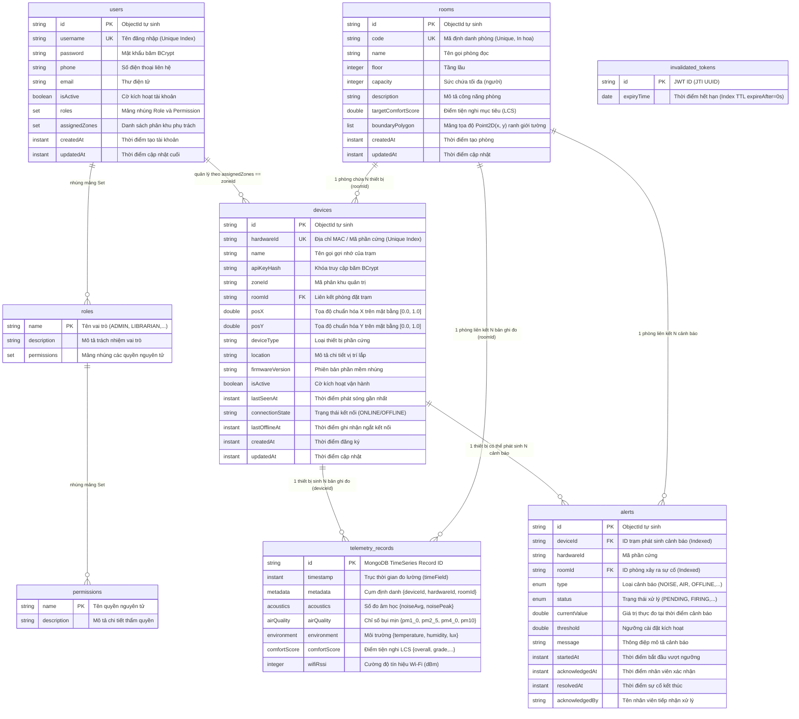
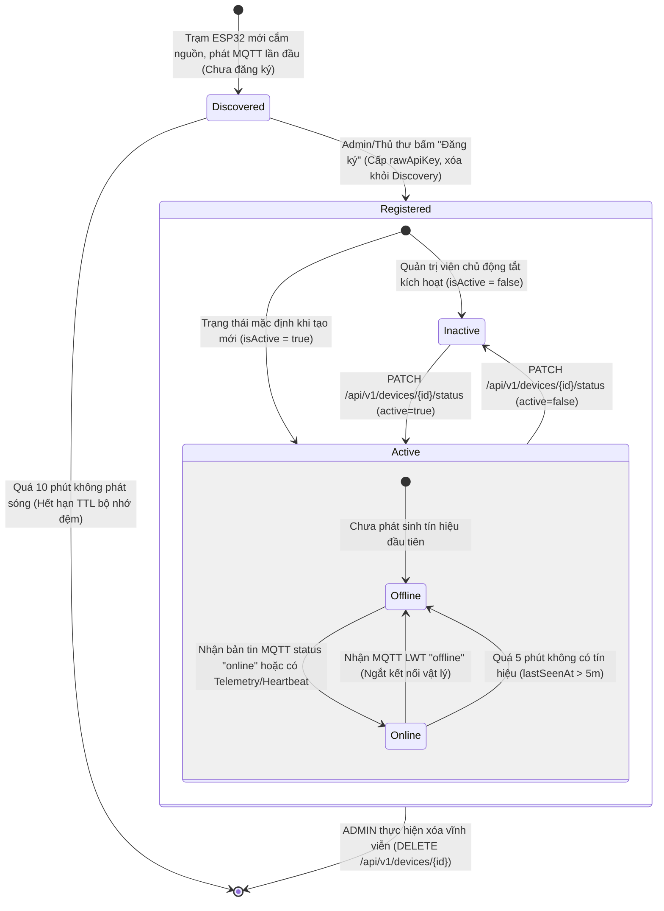
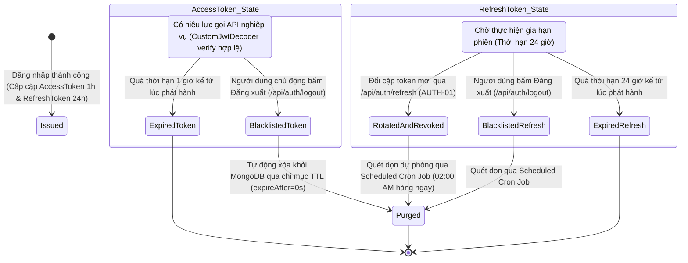
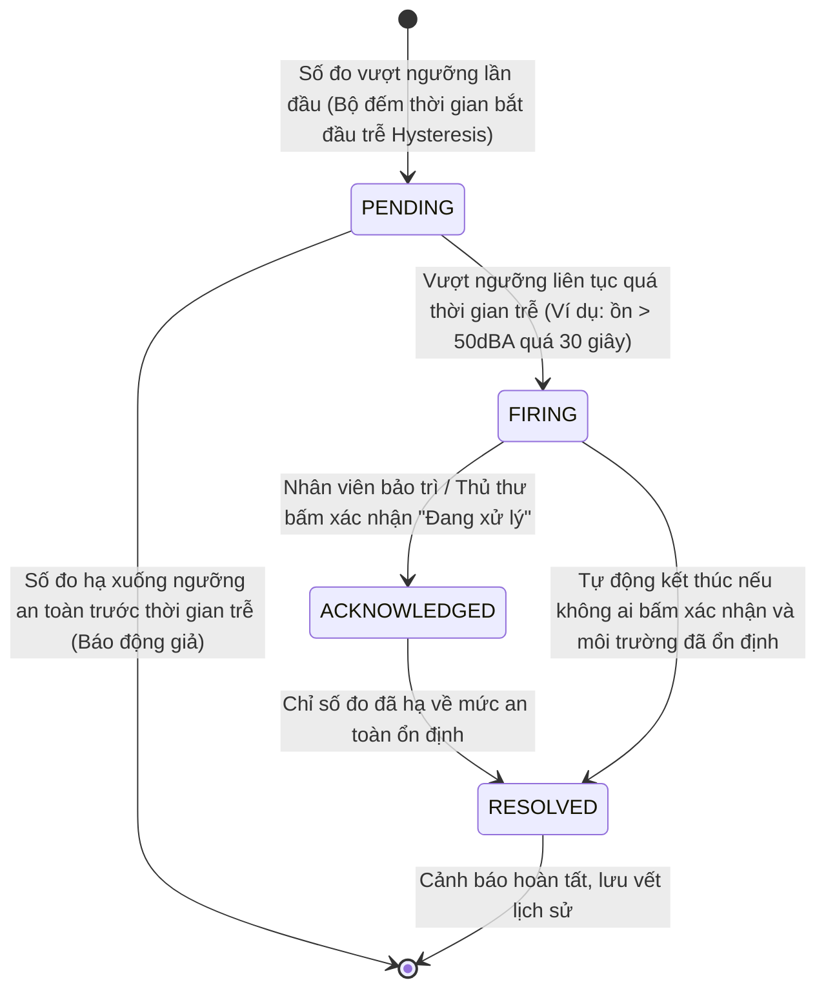

# MÔ HÌNH DỮ LIỆU TOÀN DIỆN HỆ THỐNG (DATA ARCHITECTURE & ERD)

> **Thuộc tài liệu:** Bộ Tài liệu Nghiệp vụ AIoTLibTQB  
> **Tài liệu cha:** [00_TONG_QUAN.md](00_TONG_QUAN.md)  
> **Nhãn truy vết:**  
> - `[Code]`: Kiểm chứng trực tiếp từ mã nguồn thực tế backend Spring Boot.  
> - `[Tài liệu]`: Trích xuất từ tài liệu đặc tả dự án (`IOT_SYSTEM_SPECIFICATION.md`, `KE_HOACH_TRIEN_KHAI_PHAN_MEM_IOT.md`).  
> - `[Suy luận]`: Phân tích nghiệp vụ và kiến trúc kỹ thuật.  
> - `[Chưa rõ]`: Điểm cần xác nhận thêm từ Product Owner.

---

## 1. SƠ ĐỒ THỰC THỂ QUAN HỆ (ENTITY RELATIONSHIP DIAGRAM - ERD)

Hệ thống **AIoTLibTQB** vận hành hoàn toàn trên nền tảng **MongoDB 8.0**, kết hợp linh hoạt giữa mô hình tài liệu quan hệ (Document Store) cho cấu trúc định danh, quản lý không gian và mô hình chuỗi thời gian tối ưu phần cứng (**Native TimeSeries Collection**) cho dữ liệu vi khí hậu `[Code: pom.xml:53-56, TelemetryRecord.java:12-18]`.

---

## 2. ĐẶC TẢ CHI TIẾT TỪNG THỰC THỂ DỮ LIỆU (DATA DICTIONARY)

### 2.1. Collection `users` (`User.java`)
- **Ý nghĩa nghiệp vụ:** Quản lý danh tính, phân quyền và phạm vi trách nhiệm vật lý của nhân sự vận hành hệ thống `[Code: User.java:15-48]`.
- **Cơ chế lưu trữ:** Standard MongoDB Document.

| Tên trường | Kiểu dữ liệu | Ràng buộc / Index | Ý nghĩa nghiệp vụ |
| :--- | :--- | :--- | :--- |
| `id` | `String` | `@Id` (Primary Key) | Mã định danh duy nhất của người dùng trong CSDL |
| `username` | `String` | `@Indexed(unique = true)` | Tên tài khoản đăng nhập (bắt buộc duy nhất, $\ge 6$ ký tự) |
| `password` | `String` | Not Null | Mật khẩu xác thực đã được mã hóa bằng thuật toán BCrypt (strength 10) |
| `phone` | `String` | Nullable | Số điện thoại cá nhân phục vụ liên hệ khẩn cấp |
| `email` | `String` | Nullable | Thư điện tử của người dùng |
| `isActive` | `boolean` | Default `true` | Cờ kích hoạt tài khoản. Nếu `false`, người dùng bị khóa hoàn toàn quyền truy cập |
| `roles` | `Set<Role>` | Embedded Array | Danh sách các vai trò được phân bổ, nhúng trực tiếp toàn bộ Document `Role` |
| `assignedZones` | `Set<String>` | Embedded Array | Danh sách mã khu vực mà người dùng có quyền quản lý (áp dụng cho `ZONE_MANAGER`) |
| `createdAt` | `Instant` | `@CreatedDate` | Dấu thời gian hệ thống tự động ghi nhận khi tài khoản được tạo |
| `updatedAt` | `Instant` | `@LastModifiedDate` | Dấu thời gian hệ thống tự động cập nhật khi hồ sơ có thay đổi |

---

### 2.2. Collection `roles` (`Role.java`)
- **Ý nghĩa nghiệp vụ:** Định nghĩa danh mục vai trò chức năng trong hệ thống thư viện (RBAC) `[Code: Role.java:11-27]`.

| Tên trường | Kiểu dữ liệu | Ràng buộc / Index | Ý nghĩa nghiệp vụ |
| :--- | :--- | :--- | :--- |
| `name` | `String` | `@Id` (Primary Key) | Tên vai trò (chữ in hoa, ví dụ: `ADMIN`, `LIBRARIAN`, `ZONE_MANAGER`) |
| `description` | `String` | Nullable | Mô tả trách nhiệm và phạm vi nghiệp vụ của vai trò |
| `permissions` | `Set<Permission>` | Embedded Array | Danh sách các quyền hạn nguyên tử được cấp cho vai trò này |

---

### 2.3. Collection `permissions` (`Permission.java`)
- **Ý nghĩa nghiệp vụ:** Bảng từ điển các đặc quyền nguyên tử của hệ thống (bất biến, không hỗ trợ API sửa) `[Code: Permission.java:8-21]`.

| Tên trường | Kiểu dữ liệu | Ràng buộc / Index | Ý nghĩa nghiệp vụ |
| :--- | :--- | :--- | :--- |
| `name` | `String` | `@Id` (Primary Key) | Tên quyền nguyên tử (ví dụ: `READ_SENSOR_DATA`, `MANAGE_DEVICES`) |
| `description` | `String` | Nullable | Mô tả chi tiết hành động mà quyền này cho phép thực hiện |

---

### 2.4. Collection `invalidated_tokens` (`InvalidatedToken.java`)
- **Ý nghĩa nghiệp vụ:** Danh sách đen (Blacklist) lưu trữ các JWT ID (`jti`) đã bị thu hồi trước hạn do người dùng Đăng xuất (Logout) hoặc do cơ chế Xoay vòng Refresh Token (Token Rotation) `[Code: InvalidatedToken.java:11-25]`.

| Tên trường | Kiểu dữ liệu | Ràng buộc / Index | Ý nghĩa nghiệp vụ |
| :--- | :--- | :--- | :--- |
| `id` | `String` | `@Id` (Primary Key) | Chuỗi UUID đại diện cho trường `jti` (JWT ID) của token bị thu hồi |
| `expiryTime` | `Date` | `@Indexed(expireAfter = "0s")` | **Chỉ mục TTL của MongoDB**: Hệ thống tự động xóa bản ghi khi thời gian chạm mốc này |

---

### 2.5. Collection `rooms` (`Room.java`)
- **Ý nghĩa nghiệp vụ:** Quản lý không gian vật lý phòng đọc, tầng lầu, sức chứa và ranh giới hình học tường phục vụ hiển thị bản đồ nhiệt `[Code: Room.java:14-46]`.

| Tên trường | Kiểu dữ liệu | Ràng buộc / Index | Ý nghĩa nghiệp vụ |
| :--- | :--- | :--- | :--- |
| `id` | `String` | `@Id` (Primary Key) | Định danh nội bộ của phòng |
| `code` | `String` | `@Indexed(unique = true)` | Mã phòng chuẩn hóa (in hoa, không khoảng trắng, ví dụ: `ROOM_101`) |
| `name` | `String` | Not Null | Tên hiển thị đầy đủ của phòng đọc |
| `floor` | `Integer` | Not Null | Tầng lầu của tòa nhà thư viện |
| `capacity` | `Integer` | Nullable | Sức chứa tối đa số lượng người đọc |
| `description` | `String` | Nullable | Ghi chú công năng (ví dụ: Phòng đọc yên tĩnh tuyệt đối) |
| `targetComfortScore` | `Double` | Nullable | Điểm tiện nghi thư viện mục tiêu mong muốn đạt được (0.0 - 100.0) |
| `boundaryPolygon` | `List<Point2D>` | Embedded List | Danh sách tọa độ các đỉnh ranh giới tường phòng $\{ (x_1, y_1), (x_2, y_2), ... \}$ |
| `createdAt` | `Instant` | `@CreatedDate` | Ngày tạo phòng |
| `updatedAt` | `Instant` | `@LastModifiedDate` | Ngày cập nhật thông tin phòng gần nhất |

---

### 2.6. Collection `devices` (`Device.java`)
- **Ý nghĩa nghiệp vụ:** Quản lý toàn bộ thông tin phần cứng, vị trí lắp đặt và trạng thái sống còn của trạm cảm biến ESP32-S3 `[Code: Device.java:13-60]`.

| Tên trường | Kiểu dữ liệu | Ràng buộc / Index | Ý nghĩa nghiệp vụ |
| :--- | :--- | :--- | :--- |
| `id` | `String` | `@Id` (Primary Key) | Định danh nội bộ của trạm đo trong CSDL |
| `hardwareId` | `String` | `@Indexed(unique = true)` | Mã phần cứng duy nhất (Địa chỉ MAC Wi-Fi hoặc ID nạp sẵn trong chip) |
| `name` | `String` | Not Null | Tên gọi gợi nhớ của trạm (ví dụ: Trạm đo P101 - Cửa sổ) |
| `apiKeyHash` | `String` | Not Null | Khóa xác thực bí mật của trạm đã được băm mã hóa một chiều qua BCrypt |
| `zoneId` | `String` | Not Null | Mã phân khu quản trị mà trạm trực thuộc |
| `roomId` | `String` | Nullable | ID phòng đọc mà trạm được gắn kết vật lý |
| `posX` | `Double` | Nullable | Tọa độ tỉ lệ trục hoành trên ảnh mặt bằng phòng ($posX \in [0.0, 1.0]$) |
| `posY` | `Double` | Nullable | Tọa độ tỉ lệ trục tung trên ảnh mặt bằng phòng ($posY \in [0.0, 1.0]$) |
| `deviceType` | `String` | Not Null | Chủng loại thiết bị (mặc định: `ESP32-S3-STATION`) |
| `location` | `String` | Nullable | Mô tả thực tế vị trí lắp đặt phần cứng |
| `firmwareVersion` | `String` | Nullable | Phiên bản phần mềm nhúng đang chạy trên trạm (tự cập nhật qua MQTT status) |
| `isActive` | `boolean` | Default `true` | Trạng thái kích hoạt. Nếu `false`, trạm bị chặn xác thực và từ chối ghi nhận đo lường |
| `lastSeenAt` | `Instant` | Nullable | Thời điểm máy chủ nhìn thấy tín hiệu phát sóng gần nhất của trạm |
| `connectionState` | `String` | Nullable | Trạng thái kết nối nhận từ MQTT Broker (`ONLINE` hoặc `OFFLINE` từ bản tin LWT) |
| `lastOfflineAt` | `Instant` | Nullable | Dấu thời gian ghi nhận trạm bị mất kết nối gần nhất |
| `createdAt` | `Instant` | `@CreatedDate` | Thời điểm đăng ký trạm |
| `updatedAt` | `Instant` | `@LastModifiedDate` | Thời điểm cấu hình trạm thay đổi gần nhất |

---

### 2.7. Collection Chuỗi Thời Gian `telemetry_records` (`TelemetryRecord.java`)
- **Ý nghĩa nghiệp vụ:** Lưu trữ toàn bộ chuỗi số đo quan trắc môi trường và âm học với tần suất dày đặc (5s - 30s) theo thời gian `[Code: TelemetryRecord.java:12-43]`.
- **Đặc tính kỹ thuật:** **MongoDB 8.0 Native TimeSeries Collection**.
  - `timeField`: `timestamp`
  - `metaField`: `metadata`
  - `granularity`: `SECONDS`

| Tên trường | Kiểu dữ liệu | Đặc tính kiến trúc | Ý nghĩa nghiệp vụ |
| :--- | :--- | :--- | :--- |
| `id` | `String` | `@Id` | Định danh bản ghi chuỗi thời gian do MongoDB quản lý |
| `timestamp` | `Instant` | `timeField` | Thời điểm thực hiện phép đo (đã qua thuật toán kẹp chuẩn hóa chống lệch giờ) |
| `metadata` | `TelemetryMetadata` | `metaField` | Cụm khóa phân vùng: `{ deviceId, hardwareId, roomId }` |
| `acoustics` | `AcousticMetrics` | Embedded Object | Dữ liệu âm học: `{ noiseAvg: dBA, noisePeak: dBA }` |
| `airQuality` | `AirQualityMetrics` | Embedded Object | Dữ liệu bụi mịn: `{ pm1_0, pm2_5, pm4_0, pm10 }` tính bằng $\mu\text{g/m}^3$ |
| `environment`| `EnvironmentMetrics`| Embedded Object | Dữ liệu vi khí hậu: `{ temperature: °C, humidity: %, lux: Lux }` |
| `comfortScore`| `ComfortScoreRecord`| Embedded Object | Điểm tiện nghi thư viện: `{ overall, grade, acousticScore,... }` `[Chưa rõ: null]` |
| `wifiRssi` | `Integer` | Nullable | Cường độ tín hiệu sóng Wi-Fi tại thời điểm gửi bản tin (dBm) |

---

### 2.8. Collection Cảnh báo `alerts` (`Alert.java`)
- **Ý nghĩa nghiệp vụ:** Thực thể lưu trữ các sự cố vượt ngưỡng môi trường hoặc mất kết nối thiết bị `[Code: Alert.java:14-52]`.
- **Trạng thái:** [Code] Đã khai báo Document, Repository, Enums và ErrorCode; [Tài liệu: Phase 2] Chờ kết nối Service kích hoạt tự động.

| Tên trường | Kiểu dữ liệu | Index | Ý nghĩa nghiệp vụ |
| :--- | :--- | :--- | :--- |
| `id` | `String` | `@Id` | Định danh sự cố cảnh báo |
| `deviceId` | `String` | `@Indexed` | ID trạm đo phát sinh cảnh báo |
| `hardwareId` | `String` | Nullable | Mã phần cứng của trạm |
| `roomId` | `String` | `@Indexed` | ID phòng đọc xảy ra sự cố |
| `type` | `AlertType` | Not Null | Phân loại sự cố (`NOISE_EXCEEDED`, `AIR_UNHEALTHY`, `DEVICE_OFFLINE`,...) |
| `status` | `AlertStatus` | Not Null | Trạng thái vòng đời cảnh báo (`PENDING`, `FIRING`, `ACKNOWLEDGED`, `RESOLVED`) |
| `currentValue` | `Double` | Nullable | Số đo thực tế vượt ngưỡng (ví dụ: độ ồn 85.5 dBA) |
| `threshold` | `Double` | Nullable | Ngưỡng giới hạn cho phép đã bị vi phạm (ví dụ: 55.0 dBA) |
| `message` | `String` | Nullable | Thông điệp giải thích chi tiết cảnh báo |
| `startedAt` | `Instant` | `@CreatedDate` | Thời điểm bắt đầu vi phạm ngưỡng |
| `acknowledgedAt`| `Instant` | Nullable | Thời điểm nhân viên bảo trì bấm nút xác nhận tiếp nhận |
| `resolvedAt` | `Instant` | Nullable | Thời điểm các chỉ số quay trở lại mức an toàn |
| `acknowledgedBy`| `String` | Nullable | Tên tài khoản nhân viên tiếp nhận xử lý |

---

## 3. SƠ ĐỒ VÒNG ĐỜI TRẠNG THÁI (STATE LIFECYCLE DIAGRAMS)

### 3.1. Vòng đời Trạng thái Trạm Cảm biến (Device Lifecycle)

---

### 3.2. Vòng đời Token Bảo Mật (Token Lifecycle & Invalidation)

---

### 3.3. Vòng đời Trạng thái Cảnh báo (Alert State Machine)
`[Tài liệu: HUONG_DAN_THUC_HIEN_VA_CAN_NHAC_GIAI_PHAP.md:148-150 & Code: AlertStatus.java]`

---

## 4. DANH MỤC ENUMS VÀ Ý NGHĨA CHUẨN HÓA

### 4.1. Enum `AlertStatus` (`AlertStatus.java`) `[Code: AlertStatus.java:3-8]`
- `PENDING`: Trạng thái chờ xác nhận trễ (Hysteresis delay) nhằm lọc nhiễu âm thanh nhất thời (như tiếng ho, tiếng lật sách).
- `FIRING`: Sự cố vượt ngưỡng đã được xác nhận chính thức, đang kích hoạt còi/thông báo trên Dashboard.
- `ACKNOWLEDGED`: Nhân viên kỹ thuật/thủ thư đã ghi nhận sự cố và đang trong quá trình can thiệp thực địa.
- `RESOLVED`: Sự cố đã chấm dứt hoàn toàn, môi trường đã trở lại dải tiêu chuẩn.

### 4.2. Enum `AlertType` (`AlertType.java`) `[Code: AlertType.java:3-8]`
- `NOISE_EXCEEDED`: Mức độ ồn trung bình (`noiseAvg`) hoặc xung đỉnh (`noisePeak`) vượt quá ngưỡng quy định của phòng.
- `AIR_UNHEALTHY`: Nồng độ bụi mịn PM2.5 vượt tiêu chuẩn an toàn không khí (WHO / ALDREN TAIL).
- `DEVICE_OFFLINE`: Trạm cảm biến bị mất nguồn hoặc mất kết nối mạng quá thời hạn giám sát.
- `SENSOR_MALFUNCTION`: Cảm biến gặp trục trặc kỹ thuật (đứt bus I2C, giá trị đo gửi về liên tục bị null/out-of-bounds).

### 4.3. Enum `Role` (`Role.java`) `[Code: enums/Role.java:3-11]`
- `ADMIN`: Quản trị viên toàn quyền hệ thống.
- `LIBRARIAN`: Thủ thư trưởng quản trị không gian và thiết bị toàn thư viện.
- `ZONE_MANAGER`: Thủ thư phụ trách phân khu phòng học được phân công.
- `MAINTENANCE`: Kỹ thuật viên bảo trì phần cứng và xử lý sự cố.
- `VIEWER`: Khách vãng lai xem bảng điểm tiện nghi tóm tắt công cộng.
- `USER`: Tài khoản người dùng web cơ bản.
- `DEVICE`: Tài khoản định danh của nút IoT phần cứng ESP32.

### 4.4. Enum `Permission` (`Permission.java`) `[Code: enums/Permission.java:3-20]`
Bao gồm 14 đặc quyền nguyên tử: `READ_SENSOR_DATA`, `READ_SENSOR_DETAIL`, `WRITE_SENSOR_DATA`, `VIEW_ALERTS`, `ACKNOWLEDGE_ALERT`, `MANAGE_ALERT_CONFIG`, `MANAGE_DEVICES`, `VIEW_DEVICE_STATUS`, `MANAGE_ZONES`, `VIEW_ZONE_SUMMARY`, `GENERATE_REPORT`, `VIEW_ANALYTICS`, `MANAGE_USERS`, `MANAGE_ROLES`.

### 4.5. Enum `ErrorCode` (`ErrorCode.java`) `[Code: enums/ErrorCode.java:11-61]`

Định nghĩa toàn bộ 26 mã lỗi hệ thống phân vùng logic theo dải mã, liên kết chặt chẽ với HTTP Status chuẩn:

| Dải mã | Mã lỗi Enum | Mã số | HTTP Status | Thông điệp mặc định | Ý nghĩa nghiệp vụ |
| :--- | :--- | :---: | :---: | :--- | :--- |
| **Hệ thống** | `UNCATEGORIZED_EXCEPTION` | 9999 | 500 INTERNAL_SERVER_ERROR | Uncategorized exception | Lỗi ngoại lệ chưa được phân loại cụ thể |
| **IAM - User** | `USER_EXISTED` | 1001 | 400 BAD_REQUEST | User already existed | Tên tài khoản đã tồn tại khi đăng ký |
| | `USERNAME_INVALID` | 1002 | 400 BAD_REQUEST | Username must be at least 6 characters | Tên tài khoản không đạt độ dài tối thiểu |
| | `PASSWORD_INVALID` | 1003 | 400 BAD_REQUEST | Password must be at least 8 characters | Mật khẩu không đạt độ dài tối thiểu |
| | `INVALID_MESSAGE_KEY` | 1004 | 400 BAD_REQUEST | Validation key is invalid | Khóa thông điệp xác thực không hợp lệ |
| | `USER_DID_NOT_EXIST` | 1005 | 404 NOT_FOUND | User does not exist | Không tìm thấy người dùng trong CSDL |
| | `USER_INACTIVE` | 1008 | 403 FORBIDDEN | Account is disabled. Please contact administrator | Tài khoản người dùng đã bị khóa |
| **IAM - Auth** | `UNAUTHENTICATED` | 1006 | 401 UNAUTHORIZED | Unauthenticated | Sai mật khẩu hoặc token không hợp lệ |
| | `UNAUTHORIZED` | 1007 | 403 FORBIDDEN | You do not have permission | Không có thẩm quyền thực hiện thao tác |
| **IAM - Role** | `ROLE_EXISTED` | 2001 | 400 BAD_REQUEST | Role already existed | Vai trò đã tồn tại trong hệ thống |
| | `ROLE_NOT_EXISTED` | 2002 | 404 NOT_FOUND | Role does not exist | Không tìm thấy vai trò chỉ định |
| **IAM - Perm** | `PERMISSION_EXISTED` | 2003 | 400 BAD_REQUEST | Permission already existed | Quyền hạn đã tồn tại |
| | `PERMISSION_NOT_EXISTED` | 2004 | 404 NOT_FOUND | Permission does not exist | Không tìm thấy quyền hạn chỉ định |
| | `PERMISSION_IN_USE` | 2005 | 400 BAD_REQUEST | Permission is currently in use by one or more roles | Quyền đang được gán cho vai trò, cấm xóa |
| **Thiết bị** | `DEVICE_NOT_EXISTED` | 3001 | 404 NOT_FOUND | Device does not exist | Không tìm thấy thiết bị IoT |
| | `DEVICE_INACTIVE` | 3002 | 403 FORBIDDEN | Device is disabled | Thiết bị đang bị vô hiệu hóa |
| | `INVALID_API_KEY` | 3003 | 401 UNAUTHORIZED | Invalid API key | Sai mã bí mật API Key trạm đo |
| | `DEVICE_NAME_REQUIRED` | 3004 | 400 BAD_REQUEST | Device name is required | Thiếu tên thiết bị khi đăng ký |
| | `HARDWARE_ID_REQUIRED` | 3005 | 400 BAD_REQUEST | Hardware ID is required | Thiếu mã phần cứng trạm đo |
| | `ZONE_ID_REQUIRED` | 3006 | 400 BAD_REQUEST | Zone ID is required | Thiếu phân khu quản lý |
| | `DEVICE_TYPE_REQUIRED` | 3007 | 400 BAD_REQUEST | Device type is required | Thiếu loại thiết bị |
| | `API_KEY_REQUIRED` | 3008 | 400 BAD_REQUEST | API key is required | Thiếu mã API Key khi xác thực trạm |
| **Hạn ngạch** | `TOO_MANY_REQUESTS` | 4029 | 429 TOO_MANY_REQUESTS | Too many requests. Please try again later | Vượt quá giới hạn gọi API (Rate limit) |
| **Phân vùng** | `ZONE_ACCESS_DENIED` | 4031 | 403 FORBIDDEN | You do not have access to this zone | Thủ thư không có quyền trên khu vực này |
| **Không gian** | `ROOM_EXISTED` | 5001 | 400 BAD_REQUEST | Room already existed | Mã phòng đọc đã tồn tại |
| | `ROOM_NOT_EXISTED` | 5002 | 404 NOT_FOUND | Room does not exist | Không tìm thấy phòng đọc |
| | `ROOM_CODE_REQUIRED` | 5003 | 400 BAD_REQUEST | Room code is required | Thiếu mã phòng |
| | `ROOM_NAME_REQUIRED` | 5004 | 400 BAD_REQUEST | Room name is required | Thiếu tên phòng |
| | `FLOOR_REQUIRED` | 5005 | 400 BAD_REQUEST | Floor is required | Thiếu số tầng |
| **Cảnh báo** | `ALERT_NOT_EXISTED` | 6001 | 404 NOT_FOUND | Alert does not exist | Không tìm thấy bản ghi cảnh báo |
