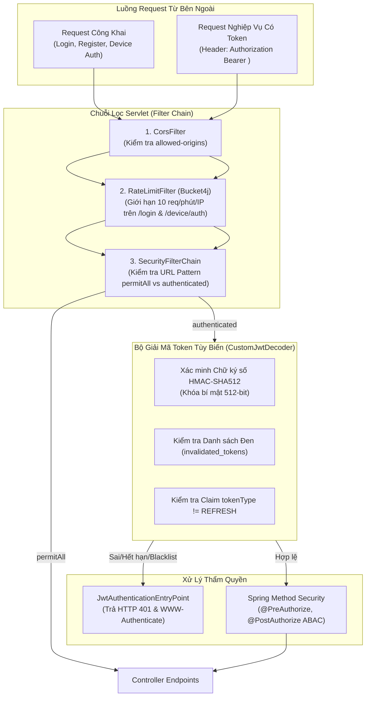

# BẢO MẬT HỆ THỐNG VÀ MA TRẬN PHÂN QUYỀN (SECURITY & ACCESS CONTROL)

> **Thuộc tài liệu:** Bộ Tài liệu Nghiệp vụ AIoTLibTQB  
> **Tài liệu cha:** [00_TONG_QUAN.md](00_TONG_QUAN.md)  
> **Nhãn truy vết:**  
> - `[Code]`: Kiểm chứng trực tiếp từ mã nguồn thực tế backend Spring Boot.  
> - `[Tài liệu]`: Trích xuất từ tài liệu đặc tả dự án (`KE_HOACH_TRIEN_KHAI_PHAN_MEM_IOT.md`).  
> - `[Suy luận]`: Phân tích nghiệp vụ và kiến trúc kỹ thuật.  
> - `[Chưa rõ]`: Điểm cần xác nhận thêm từ Product Owner.

---

## 1. CƠ CHẾ XÁC THỰC VÀ BẢO MẬT TOKEN (AUTHENTICATION MECHANISMS)

Hệ thống AIoTLibTQB áp dụng kiến trúc an ninh nhiều lớp (Defense in Depth) kết hợp giữa tiêu chuẩn OAuth2 Resource Server của Spring Security 6.x và thư viện Nimbus JOSE + JWT `[Code: SecurityConfig.java:23-73, pom.xml:47-61]`.

---

### 1.1. Xác thực Người dùng (User Authentication)
- **Cơ chế băm mật khẩu:** Toàn bộ mật khẩu người dùng được băm mã hóa một chiều qua `BCryptPasswordEncoder(10)` với log-rounds bằng 10 `[Code: SecurityConfig.java:86-88]`.
- **Cặp Token HMAC-SHA512:**
  - **Access Token:** Có thời hạn sống **1 giờ** (`jwt.expiration-hours = 1`) `[Code: AuthenticationService.java:52-54, application.yaml:25]`. Mang claim `scope` (gom tất cả Role và Permission của người dùng), `tokenType = "ACCESS"`, `userId`, `sub` (username), `iss` (`AIoTLibTQB.com`).
  - **Refresh Token:** Có thời hạn sống **24 giờ** (`jwt.refreshable-hours = 24`) `[Code: AuthenticationService.java:56-58, application.yaml:26]`. Mang claim `tokenType = "REFRESH"`, `userId`, `sub`. Không chứa claim `scope`.
- **Quy tắc phân loại Token nghiêm ngặt (AUTH-01):**
  - Trong `CustomJwtDecoder.java:38-46`, một bộ validator độc lập kiểm tra claim `tokenType`. Nếu client cố tình gửi Refresh Token làm Bearer token để gọi API tài nguyên $\rightarrow$ Ngay lập tức từ chối với lỗi `invalid_token: "Refresh token cannot be used as an access token"`.
  - Trong `AuthenticationService.java:93-97`, khi gọi `/api/auth/refresh`, nếu gửi Access Token $\rightarrow$ Bị từ chối với lỗi `UNAUTHENTICATED`.

---

### 1.2. Xác thực Phần cứng Thiết bị IoT (Device Authentication)
- **Khóa bí mật trạm (`rawApiKey`):** Được sinh ngẫu nhiên từ UUID v4 (32 ký tự hex) `[Code: DeviceService.java:204-208]`. Khóa chỉ lộ diện một lần duy nhất lúc tạo mới hoặc khi cấp lại (`regenerateKey`).
- **Lưu trữ CSDL:** Trong MongoDB chỉ lưu trữ chuỗi hash BCrypt (`device.apiKeyHash`).
- **Quy trình cấp Device Token:**
  - Nút ESP32 gửi `hardwareId` và `apiKey` lên `POST /api/v1/devices/authenticate` `[Code: DeviceService.java:67-85]`.
  - So khớp thành công $\rightarrow$ Cấp phát **Device JWT Token có thời hạn cố định 8 giờ** (`Instant.now().plus(8, ChronoUnit.HOURS)`) `[Code: AuthenticationService.java:176]`.
  - Token này mang thẩm quyền chuyên biệt: `scope = "DEVICE WRITE_SENSOR_DATA"`, `tokenType = "DEVICE"`, và đính kèm `deviceId`, `zoneId`, `deviceType`.

---

### 1.3. Cơ chế Điểm vào Xác thực Lỗi (`JwtAuthenticationEntryPoint`)
- Khi request có token sai chữ ký, hết hạn hoặc nằm trong blacklist gọi vào các endpoint được bảo vệ, `JwtAuthenticationEntryPoint` được kích hoạt `[Code: JwtAuthenticationEntryPoint.java:25-58]`:
  - Trả về mã HTTP `401 Unauthorized`.
  - Đính kèm Header chuẩn: `WWW-Authenticate: Bearer error="invalid_token"`.
  - **Phân hóa thông điệp thân thiện:** Nếu exception chứa từ khóa `"expired"` $\rightarrow$ Trả về thông điệp chi tiết: `"Token expired. Please refresh your session."` để báo hiệu cho client tự động gọi refresh token mà không làm gián đoạn người dùng `[Code: dòng 45-48]`.

---

### 1.4. Bộ Lọc Giới Hạn Tần Suất Truy Cập (`RateLimitFilter`)
- **Vị trí chuỗi lọc:** Đứng trước `UsernamePasswordAuthenticationFilter` trong Spring SecurityFilterChain `[Code: SecurityConfig.java:69]`.
- **Công nghệ & Cấu hình:** Thư viện **Bucket4j Core 8.10.1** kết hợp bộ nhớ đệm **Caffeine** `[Code: RateLimitFilter.java:39-52]`:
  - Dung lượng tối đa: 10 token.
  - Tốc độ nạp (Refill): 10 token / 1 phút (thuật toán greedy).
  - Phạm vi áp dụng: Phương thức `POST` trên 2 endpoints nhạy cảm nhất:
    1. `POST /api/auth/login` (Chống brute-force mật khẩu tài khoản người dùng).
    2. `POST /api/v1/devices/authenticate` (Chống brute-force API key trạm đo).
  - Phản hồi khi vi phạm: HTTP 429 Too Many Requests, mã lỗi số `4029`, Header `Retry-After: <số giây cần chờ>`.
- **Cơ chế chống giả mạo IP qua Proxy:** Hệ thống kiểm tra địa chỉ IP socket vật lý (`remoteAddr`). Chỉ chấp nhận header `X-Forwarded-For` nếu `remoteAddr` thuộc dải mạng tin cậy (Loopback `127.0.0.1`, dải IP nội bộ `10.0.0.0/8`, `192.168.0.0/16`, `172.16.0.0/12`) `[Code: RateLimitFilter.java:97-114]`.

---

## 2. MA TRẬN PHÂN QUYỀN TOÀN DIỆN (ROLE × PERMISSION × ENDPOINT MATRIX)

Hệ thống được khởi tạo sẵn **14 Quyền nguyên tử** và **7 Vai trò chuẩn hóa** `[Code: ApplicationInitConfig.java:42-160]`:

### 2.1. Ma trận Vai trò × Quyền nguyên tử (Role-to-Permission Mapping)
| Quyền nguyên tử (Permission) | ADMIN | LIBRARIAN | ZONE_MANAGER | MAINTENANCE | VIEWER | USER | DEVICE |
| :--- | :---: | :---: | :---: | :---: | :---: | :---: | :---: |
| `READ_SENSOR_DATA` | ✅ | ✅ | ✅ | ✅ | ✅ | ❌ | ❌ |
| `READ_SENSOR_DETAIL` | ✅ | ✅ | ✅ | ❌ | ❌ | ❌ | ❌ |
| `WRITE_SENSOR_DATA` | ✅ | ❌ | ❌ | ❌ | ❌ | ❌ | ✅ |
| `VIEW_ALERTS` | ✅ | ✅ | ✅ | ✅ | ✅ | ❌ | ❌ |
| `ACKNOWLEDGE_ALERT` | ✅ | ✅ | ✅ | ✅ | ❌ | ❌ | ❌ |
| `MANAGE_ALERT_CONFIG`| ✅ | ✅ | ❌ | ❌ | ❌ | ❌ | ❌ |
| `MANAGE_DEVICES` | ✅ | ✅ | ❌ | ❌ | ❌ | ❌ | ❌ |
| `VIEW_DEVICE_STATUS` | ✅ | ✅ | ✅ | ✅ | ❌ | ❌ | ❌ |
| `MANAGE_ZONES` | ✅ | ❌ | ❌ | ❌ | ❌ | ❌ | ❌ |
| `VIEW_ZONE_SUMMARY` | ✅ | ✅ | ✅ | ✅ | ✅ | ❌ | ❌ |
| `GENERATE_REPORT` | ✅ | ✅ | ✅ | ❌ | ❌ | ❌ | ❌ |
| `VIEW_ANALYTICS` | ✅ | ✅ | ✅ | ✅ | ❌ | ❌ | ❌ |
| `MANAGE_USERS` | ✅ | ❌ | ❌ | ❌ | ❌ | ❌ | ❌ |
| `MANAGE_ROLES` | ✅ | ❌ | ❌ | ❌ | ❌ | ❌ | ❌ |
| **Tổng số quyền sở hữu** | **14** | **10** | **8** | **6** | **3** | **0** | **1** |

---

### 2.2. Ma trận Vai trò × Endpoint Nghiệp vụ (Role-to-Endpoint Matrix)

| Endpoint | Phương thức | ADMIN | LIBRARIAN | ZONE_MANAGER | MAINTENANCE | VIEWER / USER | DEVICE | Căn cứ mã nguồn (`@PreAuthorize` / Filter) |
| :--- | :---: | :---: | :---: | :---: | :---: | :---: | :---: | :--- |
| `/api/auth/login` | POST | 🟢 | 🟢 | 🟢 | 🟢 | 🟢 | ❌ | Public (Rate-limited: 10/min) `[Code: SecurityConfig.java:30]` |
| `/api/auth/refresh` | POST | 🟢 | 🟢 | 🟢 | 🟢 | 🟢 | ❌ | Public `[Code: SecurityConfig.java:33]` |
| `/api/auth/logout` | POST | 🟢 | 🟢 | 🟢 | 🟢 | 🟢 | ❌ | Public `[Code: SecurityConfig.java:32]` |
| `/api/auth/introspect` | POST | 🟢 | 🟢 | 🟢 | 🟢 | 🟢 | ❌ | Public `[Code: SecurityConfig.java:31]` |
| `/api/users` | POST | 🟢 | 🟢 | 🟢 | 🟢 | 🟢 | ❌ | Public (Đăng ký tự do) `[Code: SecurityConfig.java:29]` |
| `/api/users` | GET | 🟢 | ❌ | ❌ | ❌ | ❌ | ❌ | `hasAuthority('ADMIN')` `[Code: UserService.java:68]` |
| `/api/users/myInfo` | GET | 🟢 | 🟢 | 🟢 | 🟢 | 🟢 | ❌ | Authenticated `[Code: SecurityConfig.java:61]` |
| `/api/users/{id}` | GET | 🟢 | ⚠️ | ⚠️ | ⚠️ | ⚠️ | ❌ | `@PostAuthorize: ADMIN hoặc chính chủ` `[Code: UserService.java:82]` |
| `/api/users/{id}` | PUT | 🟢 | ⚠️ | ⚠️ | ⚠️ | ⚠️ | ❌ | `@PostAuthorize: ADMIN hoặc chính chủ` `[Code: UserService.java:89]` |
| `/api/users/{id}/status` | PATCH | 🟢 | ❌ | ❌ | ❌ | ❌ | ❌ | `hasAuthority('ADMIN')` `[Code: UserService.java:117]` |
| `/api/users/{id}` | DELETE | 🟢 | ❌ | ❌ | ❌ | ❌ | ❌ | `hasAuthority('ADMIN')` `[Code: UserService.java:125]` |
| `/api/roles/**` (CRUD) | ALL | 🟢 | ❌ | ❌ | ❌ | ❌ | ❌ | Class `@PreAuthorize("hasAuthority('ADMIN')")` `[Code: RoleController.java:19]` |
| `/api/permissions/**` | ALL | 🟢 | ❌ | ❌ | ❌ | ❌ | ❌ | Class `@PreAuthorize("hasAuthority('ADMIN')")` `[Code: PermissionController.java:19]` |
| `/api/v1/rooms` | POST | 🟢 | 🟢 | ❌ | ❌ | ❌ | ❌ | `hasAnyAuthority('ADMIN', 'LIBRARIAN')` `[Code: RoomService.java:28]` |
| `/api/v1/rooms` (GetAll) | GET | 🟢 | 🟢 | 🟢 | 🟢 | 🟢 | ❌ | Authenticated `[Code: SecurityConfig.java:61]` |
| `/api/v1/rooms/{id}` | GET | 🟢 | 🟢 | 🟢 | 🟢 | 🟢 | ❌ | Authenticated `[Code: SecurityConfig.java:61]` |
| `/api/v1/rooms/code/{code}` | GET | 🟢 | 🟢 | 🟢 | 🟢 | 🟢 | ❌ | Authenticated `[Code: SecurityConfig.java:61]` |
| `/api/v1/rooms/{id}` | PUT | 🟢 | 🟢 | ❌ | ❌ | ❌ | ❌ | `hasAnyAuthority('ADMIN', 'LIBRARIAN')` `[Code: RoomService.java:72]` |
| `/api/v1/rooms/{id}` | DELETE | 🟢 | ❌ | ❌ | ❌ | ❌ | ❌ | **Chỉ riêng `ADMIN`** `[Code: RoomService.java:100]` |
| `/api/v1/devices` | POST | 🟢 | 🟢 | ❌ | ❌ | ❌ | ❌ | `hasAnyAuthority('ADMIN', 'LIBRARIAN')` `[Code: DeviceService.java:46]` |
| `/api/v1/devices/authenticate` | POST | ❌ | ❌ | ❌ | ❌ | ❌ | 🟢 | Public (Rate-limited: 10/min) `[Code: SecurityConfig.java:34]` |
| `/api/v1/devices/{id}/heartbeat` | POST | 🟢 | 🟢 | 🟢 | 🟢 | 🟢 | 🟢 | Authenticated `[Code: SecurityConfig.java:61]` |
| `/api/v1/devices` | GET | 🟢 | 🟢 | ❌ | ❌ | ❌ | ❌ | `hasAnyAuthority('ADMIN', 'LIBRARIAN')` `[Code: DeviceService.java:87]` |
| `/api/v1/devices/{id}` | GET | 🟢 | 🟢 | 🟢 | 🟢 | ❌ | ❌ | `ADMIN, LIBRARIAN, ZONE_MGR, MAINTENANCE` `[Code: DeviceService.java:94]` |
| `/api/v1/devices/zone/{zoneId}` | GET | 🟢 | 🟢 | 👁️ | ❌ | ❌ | ❌ | Kiểm tra `user.assignedZones` nếu là `ZONE_MGR` `[Code: DeviceService.java:99-115]` |
| `/api/v1/devices/{id}` | PUT | 🟢 | 🟢 | ❌ | ❌ | ❌ | ❌ | `hasAnyAuthority('ADMIN', 'LIBRARIAN')` `[Code: DeviceService.java:122]` |
| `/api/v1/devices/{id}/regenerate-key` | POST | 🟢 | 🟢 | ❌ | ❌ | ❌ | ❌ | `hasAnyAuthority('ADMIN', 'LIBRARIAN')` `[Code: DeviceService.java:58]` |
| `/api/v1/devices/{id}/status` | PATCH | 🟢 | 🟢 | ❌ | ❌ | ❌ | ❌ | `hasAnyAuthority('ADMIN', 'LIBRARIAN')` `[Code: DeviceService.java:154]` |
| `/api/v1/devices/{id}` | DELETE | 🟢 | ❌ | ❌ | ❌ | ❌ | ❌ | **Chỉ riêng `ADMIN`** `[Code: DeviceService.java:161]` |
| `/api/v1/devices/discovered` | GET | 🟢 | 🟢 | ❌ | ❌ | ❌ | ❌ | `hasAnyAuthority('ADMIN', 'LIBRARIAN')` `[Code: DeviceController.java:30]` |
| `/api/v1/telemetry/device/{id}/latest` | GET | 🟢 | 🟢 | 👁️ | ❌ | 🟢 | ❌ | Kiểm tra `assignedZones` nếu là `ZONE_MGR` `[Code: TelemetryService.java:72-95]` |
| `/api/v1/telemetry/room/{id}/latest` | GET | 🟢 | 🟢 | 👁️ | ❌ | 🟢 | ❌ | Kiểm tra `assignedZones` nếu là `ZONE_MGR` `[Code: TelemetryService.java:97-122]` |
| `/api/v1/telemetry/device/{id}` | GET | 🟢 | 🟢 | 👁️ | ❌ | 🟢 | ❌ | Kiểm tra `assignedZones` nếu là `ZONE_MGR` `[Code: TelemetryService.java:50-59]` |
| `/api/v1/telemetry/room/{id}` | GET | 🟢 | 🟢 | 👁️ | ❌ | 🟢 | ❌ | Kiểm tra `assignedZones` nếu là `ZONE_MGR` `[Code: TelemetryService.java:61-70]` |
| `/actuator/health`, `/info` | GET | 🟢 | 🟢 | 🟢 | 🟢 | 🟢 | 🟢 | Public `[Code: SecurityConfig.java:57]` |
| `/actuator/metrics` | GET | 🟢 | 🟢 | 🟢 | 🟢 | 🟢 | 🟢 | Authenticated `[Code: SecurityConfig.java:61]` |

**Ghi chú ký hiệu:**
- 🟢: Có quyền truy cập đầy đủ.
- ❌: Bị từ chối truy cập (HTTP 403 Forbidden hoặc HTTP 401 Unauthorized).
- ⚠️: Chỉ xem/sửa được thông tin nếu là chính chủ tài khoản (`authentication.name == returnObject.username`).
- 👁️: Chỉ truy cập được nếu khu vực/trạm đó nằm trong danh sách `user.assignedZones`.

---

## 3. DANH SÁCH ENDPOINTS CÔNG KHAI (PUBLIC ENDPOINTS)

Các endpoint sau đây được cấu hình mở (`permitAll`) không yêu cầu gửi kèm Bearer Token trong Header `[Code: SecurityConfig.java:28-35, 55-60]`:
1. `OPTIONS /**`: Cho phép trình duyệt gửi yêu cầu CORS Preflight kiểm tra quyền gốc.
2. `GET /actuator/health`: Kiểm tra trạng thái Liveness/Readiness của ứng dụng (ẩn chi tiết CSDL đối với người ngoài qua `show-details: when_authorized`).
3. `GET /actuator/info`: Xem thông tin phiên bản phần mềm.
4. `POST /api/users`: Endpoint đăng ký người dùng mới.
5. `POST /api/auth/login`: Endpoint gửi username/password để nhận cặp token.
6. `POST /api/auth/introspect`: Endpoint kiểm tra tính hợp lệ của token.
7. `POST /api/auth/logout`: Endpoint thu hồi token.
8. `POST /api/auth/refresh`: Endpoint nạp Refresh Token để nhận cặp token mới.
9. `POST /api/v1/devices/authenticate`: Endpoint dành cho phần cứng ESP32 hoặc Webhook Mosquitto xác thực nhận Device JWT.

---

## 4. QUẢN LÝ DỮ LIỆU NHẠY CẢM VÀ PHÒNG THỦ AN NINH (DATA PRIVACY & PROTECTION)

### 4.1. Mật khẩu Người dùng (`password`)
- **[Code: SecurityConfig.java:86-88]**: Băm mã hóa một chiều qua BCrypt.
- **[Code: UserMapper.java:14-16, UserResponse.java:12-25]**: Thực thể DTO `UserResponse` trả về hoàn toàn **không có trường `password`**. Dù ở bất kỳ API nào, chuỗi băm mật khẩu cũng không bao giờ bị rò rỉ ra ngoài mạng.

### 4.2. Khóa Bí Mật Thiết Bị (`rawApiKey`)
- **[Code: DeviceService.java:204-208, 210-228]**: Chuỗi bí mật `rawApiKey` chỉ được sinh và hiển thị đúng một lần trong response của API đăng ký (`POST /api/v1/devices`) hoặc API cấp lại khóa (`POST /api/v1/devices/{id}/regenerate-key`).
- Khi tra cứu danh sách hoặc xem chi tiết trạm đo (`DeviceResponse.java:14-35`), CSDL và API chỉ trả về `apiKeyHash` (hoặc ẩn đi hoàn toàn), không có cách nào phục hồi lại khóa gốc nếu chỉ nhìn vào CSDL.

### 4.3. Khóa Bí Mật Ký Token (`jwt.secret-key`)
- **[Code: application.yaml:24]**: Cấu hình nạp từ biến môi trường `${JWT_SECRET}`.
- Khóa bí mật có độ dài tối thiểu 64 ký tự (512-bit) đáp ứng tiêu chuẩn an toàn bắt buộc của thuật toán ký số `HS512` (HMAC-SHA512).

### 4.4. Phòng Vệ Dữ Liệu Âm Học & Quyền Riêng Tư (Acoustic Privacy by Design)
- `[Tài liệu: IOT_SYSTEM_SPECIFICATION.md:48-49 & KE_HOACH_TRIEN_KHAI_PHAN_MEM_IOT.md: Mục 6]`:
  Hệ thống **tuyệt đối không thu âm hay lưu trữ file âm thanh (Audio stream/WAV/MP3)** của độc giả trong thư viện.
  Trạm đo ESP32-S3 tại rìa (Edge) chỉ thực hiện biến đổi chuỗi tín hiệu âm thanh thu được từ Micro I2S thành các chỉ số mức độ ồn trung bình đại số `noiseAvg` (dBA) và mức ồn đỉnh `noisePeak` (dBA) trước khi phát MQTT. Backend chỉ nhận và lưu trữ các giá trị số thực này, tuân thủ nghiêm ngặt **Nghị định 13/2023/NĐ-CP** về bảo vệ dữ liệu cá nhân.
