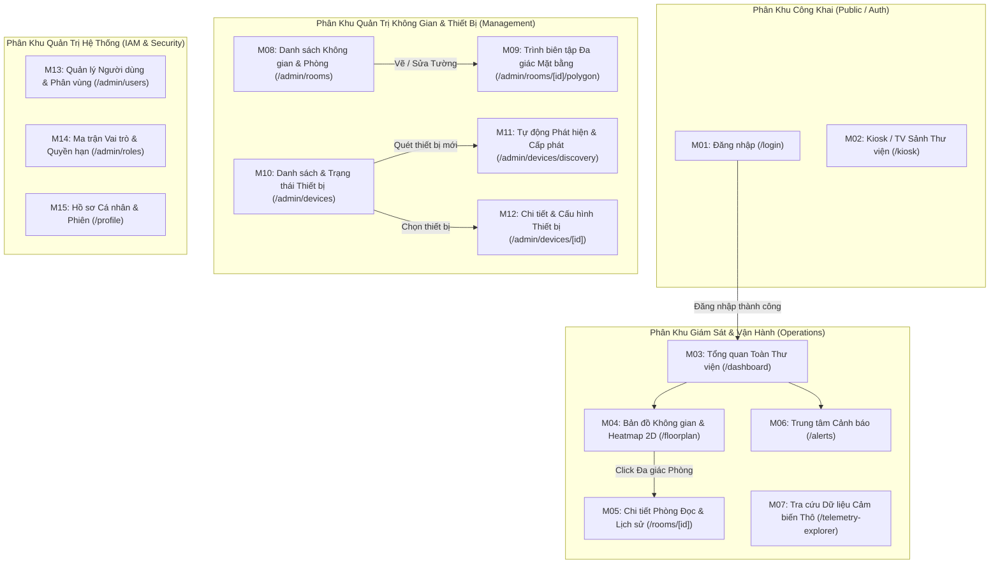

# TÀI LIỆU BÀN GIAO KỸ THUẬT & ĐẶC TẢ TÍCH HỢP FRONTEND (FRONTEND HANDOVER SPECIFICATION)

> **Dự án**: AIoTLibTQB — Hệ thống Quản lý & Giám sát Vi khí hậu, Âm học Thư viện Tạ Quang Bửu  
> **Phiên bản Backend**: MVP v1.0 (Hoàn tất Giai đoạn 1: T1–T6)  
> **Cập nhật lần cuối**: 2026-10-22  
> **Đối tượng sử dụng**: Đội ngũ phát triển Frontend (Web Dashboard & Public Kiosk/TV View)

---

## MỤC LỤC
1. [Tổng Quan Kiến Trúc Giao Tiếp & Quy Chuẩn Chung](#1-tổng-quan-kiến-trúc-giao-tiếp--quy-chuẩn-chung)
2. [Cơ Chế Xác Thực (Auth Flow) & Ma Trận Phân Quyền (RBAC)](#2-cơ-chế-xác-thực-auth-flow--ma-trận-phân-quyền-rbac)
3. [Danh Mục Chi Tiết Toàn Bộ REST API (`/api/v1/**`)](#3-danh-mục-chi-tiết-toàn-bộ-rest-api-apiv1)
   - [3.1. Phân hệ Xác thực & Phiên (Authentication)](#31-phân-hệ-xác-thực--phiên-authentication)
   - [3.2. Phân hệ Người dùng, Vai trò & Quyền hạn (IAM)](#32-phân-hệ-người-dùng-vai-trò--quyền-hạn-iam)
   - [3.3. Phân hệ Không gian & Mặt bằng Đa giác (Rooms & Polygons)](#33-phân-hệ-không-gian--mặt-bằng-đa-giác-rooms--polygons)
   - [3.4. Phân hệ Thiết bị IoT & Tự động Phát hiện (Devices & Auto-Discovery)](#34-phân-hệ-thiết-bị-iot--tự-động-phát-hiện-devices--auto-discovery)
   - [3.5. Phân hệ Dữ liệu Cảm biến, Nén Biểu đồ & KPI (Telemetry & Buckets)](#35-phân-hệ-dữ-liệu-cảm-biến-nén-biểu-đồ--kpi-telemetry--buckets)
   - [3.6. Phân hệ Cảnh báo & Máy Trạng Thái (Alerts)](#36-phân-hệ-cảnh-báo--máy-trạng-thái-alerts)
4. [Hướng Dẫn Tích Hợp Kênh Thời Gian Thực (WebSocket STOMP)](#4-hướng-dẫn-tích-hợp-kênh-thời-gian-thực-websocket-stomp)
5. [Đặc Tả Thiết Kế 15 Màn Hình UI/UX & Ma Trận Ghép Nối API](#5-đặc-tả-thiết-kế-15-màn-hình-uiux--ma-trận-ghép-nối-api)
6. [Hướng Dẫn Thuật Toán Bản Đồ Nhiệt 2D (HTML5 Canvas & IDW)](#6-hướng-dẫn-thuật-toán-bản-đồ-nhiệt-2d-html5-canvas--idw)
7. [Bảng Tra Cứu Mã Lỗi Chuẩn (`ErrorCode`)](#7-bảng-tra-cứu-mã-lỗi-chuẩn-errorcode)
8. [Đề Xuất Công Nghệ (Tech Stack) & Lộ Trình Xây Dựng Frontend](#8-đề-xuất-công-nghệ-tech-stack--lộ-trình-xây-dựng-frontend)

---

## 1. TỔNG QUAN KIẾN TRÚC GIAO TIẾP & QUY CHUẨN CHUNG

### 1.1. Thông Số Kết Nối Cơ Sở (Base Connection Info)
- **REST API Base URL**: `http://localhost:8080/api/v1` *(100% các endpoint nghiệp vụ và quản trị đều thống nhất dưới tiền tố `/api/v1`)*.
- **WebSocket STOMP Endpoint**:
  - Native WebSocket: `ws://localhost:8080/ws-aiot`
  - SockJS Fallback: `http://localhost:8080/ws-aiot`
- **CORS Allowed Origins (Mặc định môi trường Dev)**: `http://localhost:3000`, `http://localhost:8081` (cấu hình qua biến `CORS_ALLOWED_ORIGINS` trong `application.yaml`, hỗ trợ `allowCredentials: true`).
- **Định dạng Thời gian**: Toàn bộ các trường thời gian (`Instant`) trao đổi qua JSON và Query Parameter đều theo chuẩn **ISO-8601 UTC** (ví dụ: `"2026-10-22T08:30:00Z"`).
- **Rate Limiting (Chống Brute-force)**: Các endpoint `POST /api/v1/auth/login` và `POST /api/v1/devices/authenticate` được bảo vệ bởi Bucket4j (**tối đa 10 requests / phút / IP**). Khi vượt ngưỡng, server trả về **HTTP 429 Too Many Requests** (`code: 4029`) kèm header `Retry-After` (số giây động đến lần nạp token tiếp theo).

### 1.2. Cấu Trúc Envelope Phản Hồi Chuẩn (`ApiResponse<T>`)
Mọi phản hồi từ Backend đều được bọc trong cấu trúc JSON thống nhất:

- **Khi thành công (HTTP 200 OK)**:
  ```json
  {
    "code": 1000,
    "result": { ... }
  }
  ```
  *(Lưu ý: Với các API xóa hoặc heartbeat trả về `Void`, phản hồi chỉ gồm `{"code": 1000}` do cấu hình `@JsonInclude(NON_NULL)`).*

- **Khi có lỗi nghiệp vụ / xác thực / kiểm tra đầu vào (HTTP 400, 401, 403, 404, 429, 500)**:
  ```json
  {
    "code": 5006,
    "message": "Cannot delete room with associated devices"
  }
  ```

### 1.3. Cấu Trúc Phân Trang Chuẩn (`PageResponse<T>`)
Áp dụng đồng nhất cho các danh sách có phân trang (`GET /api/v1/users`, `GET /api/v1/rooms`, `GET /api/v1/devices`, `GET /api/v1/alerts`):

```json
{
  "code": 1000,
  "result": {
    "content": [ ... ],
    "page": 0,
    "size": 10,
    "totalElements": 45,
    "totalPages": 5,
    "last": false
  }
}
```

---

## 2. CƠ CHẾ XÁC THỰC (AUTH FLOW) & MA TRẬN PHÂN QUYỀN (RBAC)

### 2.1. Luồng Đăng Nhập & Silent Refresh Token Rotation (RTR)
Backend sử dụng cơ chế **Stateless JWT (HMAC-SHA256)** kết hợp **Refresh Token Rotation** và **MongoDB TTL Blacklist**:

1. **Đăng nhập (`POST /api/v1/auth/login`)**:
   - Nhận về cặp `token` (`tokenType: "ACCESS"`, hạn mặc định **1 giờ**) và `refreshToken` (`tokenType: "REFRESH"`, hạn mặc định **24 giờ**).
2. **Gắn Header cho các Request cần bảo mật**:
   - Đính kèm header `Authorization: Bearer <accessToken>`.
3. **Cơ chế Silent Refresh khi gặp HTTP 401 (`code: 1006`)**:
   - Khi Axios/Fetch Interceptor bắt lỗi `401 Unauthorized`, Frontend gọi `POST /api/v1/auth/refresh` với body `{"token": "<refreshToken>"}`.
   - **Ràng buộc quan trọng**: Chỉ token có `tokenType == "REFRESH"` mới được chấp nhận tại `/refresh`. Ngay sau khi cấp cặp `token` + `refreshToken` mới, `refreshToken` cũ bị đưa vào Blacklist ngay lập tức (chống tấn công Replay). Do đó, ở Frontend phải dùng **Single-flight Mutex/Queue trong Interceptor** để tránh gọi `/refresh` trùng lặp khi nhiều request cùng bị 401.
4. **Đăng xuất (`POST /api/v1/auth/logout`)**:
   - Gửi `{"token": "<accessToken>", "refreshToken": "<refreshToken>"}` lên để Backend đưa cả hai token vào danh sách đen trước khi xóa state ở trình duyệt.

### 2.2. Giải Mã JWT Claims & Ma Trận Phân Quyền
Trong payload của `accessToken` có các claim:
- `sub`: Tên đăng nhập (`username`).
- `scope`: Chuỗi chứa tất cả **Roles** và **Permissions** cách nhau bởi dấu cách, **không có tiền tố `ROLE_`** (ví dụ: `"LIBRARIAN READ_SENSOR_DATA VIEW_ALERTS ACKNOWLEDGE_ALERT ..."`).

#### Danh sách 7 Vai trò (Roles) được khởi tạo sẵn (`ApplicationInitConfig.java`):
| Mã Role | Mô tả | Phạm vi truy cập chính trên UI |
| :--- | :--- | :--- |
| `ADMIN` | Quản trị viên toàn quyền | Toàn bộ 15 màn hình (bao gồm Quản lý User, Role/Permission, Xóa Phòng/Thiết bị). |
| `LIBRARIAN` | Thủ thư quản lý vận hành | Dashboard, Bản đồ nhiệt, Quản lý Không gian/Phòng, Cấp phát/Sửa Thiết bị, Cảnh báo. |
| `ZONE_MANAGER` | Quản lý khu vực | Chỉ xem/tác nghiệp trên các thiết bị và dữ liệu thuộc `assignedZones` của tài khoản. |
| `MAINTENANCE` | Kỹ thuật viên bảo trì | Xem Dashboard, danh sách thiết bị, trạng thái kết nối, tiếp nhận cảnh báo kỹ thuật. |
| `VIEWER` | Người xem nội bộ / Kiosk | Xem Dashboard, Bản đồ, Biểu đồ cảm biến và Cảnh báo (Read-only). |
| `USER` | Sinh viên / Bạn đọc | Xem Dashboard công khai, tra cứu độ ồn / tiện nghi phòng đọc (0 permissions riêng, không xem cảnh báo nội bộ). |
| `DEVICE` | Tài khoản trạm đo phần cứng | Dành riêng cho thiết bị nhúng ESP32 (`WRITE_SENSOR_DATA`). |

#### Danh sách 14 Quyền hạn chi tiết (`Permission.java`):
- **Dữ liệu cảm biến**: `READ_SENSOR_DATA`, `READ_SENSOR_DETAIL`, `WRITE_SENSOR_DATA`
- **Cảnh báo**: `VIEW_ALERTS`, `ACKNOWLEDGE_ALERT`, `MANAGE_ALERT_CONFIG`
- **Thiết bị & Không gian**: `MANAGE_DEVICES`, `VIEW_DEVICE_STATUS`, `MANAGE_ZONES`, `VIEW_ZONE_SUMMARY`
- **Báo cáo & Phân tích**: `GENERATE_REPORT`, `VIEW_ANALYTICS`
- **Người dùng & Bảo mật**: `MANAGE_USERS`, `MANAGE_ROLES`

---

## 3. DANH MỤC CHI TIẾT TOÀN BỘ REST API (`/api/v1/**`)

### 3.1. Phân hệ Xác thực & Phiên (Authentication)
**Base Path**: `/api/v1/auth`

| Method | Endpoint | Quyền hạn | Request Body | Response `result` |
| :---: | :--- | :--- | :--- | :--- |
| `POST` | `/api/v1/auth/login` | Public *(Rate-limited)* | `{"username": "admin", "password": "***"}` *(bắt buộc `@NotBlank`)* | `{"token": "...", "refreshToken": "..."}` |
| `POST` | `/api/v1/auth/refresh` | Public | `{"token": "<refreshToken>"}` *(bắt buộc `@NotBlank`)* | `{"token": "...", "refreshToken": "..."}` |
| `POST` | `/api/v1/auth/logout` | Public | `{"token": "<accessToken>", "refreshToken": "<refreshToken>"}` | `Void` (`{"code": 1000}`) |
| `POST` | `/api/v1/auth/introspect` | Public | `{"token": "<token>"}` *(bắt buộc `@NotBlank`)* | `{"valid": true}` |

---

### 3.2. Phân hệ Người dùng, Vai trò & Quyền hạn (IAM)

#### A. Quản lý Người dùng (`/api/v1/users`)
| Method | Endpoint | Quyền hạn | Query / Body | Response `result` |
| :---: | :--- | :--- | :--- | :--- |
| `POST` | `/api/v1/users` | Public *(Gán `roles`/`assignedZones` tùy chọn chỉ hiệu lực khi người gọi là `ADMIN`; mặc định gán `USER`)* | `UserCreationRequest` | `UserResponse` |
| `GET` | `/api/v1/users/myInfo` | Authenticated | — | `UserResponse` (Thông tin cá nhân + `roles` + `assignedZones`) |
| `GET` | `/api/v1/users` | `ADMIN` | `?page=0&size=10&sortBy=createdAt&sortDir=desc` | `PageResponse<UserResponse>` |
| `GET` | `/api/v1/users/{id}` | `ADMIN` hoặc Chính chủ | — | `UserResponse` |
| `PUT` | `/api/v1/users/{id}` | `ADMIN` hoặc Chính chủ | `UserUpdateRequest` | `UserResponse` |
| `PATCH` | `/api/v1/users/{id}/status` | `ADMIN` | `{"active": false}` | `UserResponse` |
| `DELETE` | `/api/v1/users/{id}` | `ADMIN` | — | `String` (`"User with id: ... has been deleted"`) |

**Mẫu `UserCreationRequest` / `UserUpdateRequest` & `UserResponse`**:
```json
// Request tạo mới (POST /api/v1/users)
{
  "username": "librarian01",    // @Size(min = 6) -> lỗi 1002 USERNAME_INVALID
  "password": "password123",    // @Size(min = 8) -> lỗi 1003 PASSWORD_INVALID
  "phone": "0901234567",
  "email": "lib01@tqb.edu.vn",
  "roles": ["LIBRARIAN"],
  "assignedZones": ["ZONE_A", "ZONE_B"]
}

// Response (UserResponse)
{
  "id": "6717a...",
  "username": "librarian01",
  "phone": "0901234567",
  "email": "lib01@tqb.edu.vn",
  "active": true,
  "assignedZones": ["ZONE_A", "ZONE_B"],
  "roles": [
    {
      "name": "LIBRARIAN",
      "description": "Library Staff",
      "permissions": [
        { "name": "READ_SENSOR_DATA", "description": "..." }
      ]
    }
  ]
}
```

#### B. Quản lý Vai trò (`/api/v1/roles`) & Quyền hạn (`/api/v1/permissions`)
*(Tất cả yêu cầu quyền `ADMIN`)*:
- `GET /api/v1/roles`: Trả về `List<RoleResponse>`.
- `POST /api/v1/roles`: Body `{"name": "CUSTOM_ROLE", "description": "...", "permissions": ["READ_SENSOR_DATA"]}` -> `RoleResponse`.
- `PUT /api/v1/roles/{name}`: Cập nhật danh sách quyền của vai trò -> `RoleResponse`.
- `DELETE /api/v1/roles/{name}`: Xóa vai trò và tự động gỡ vai trò đó khỏi toàn bộ người dùng (`$pull`) -> `Void`.
- `GET /api/v1/permissions`: Trả về `List<PermissionResponse>`.
- `POST /api/v1/permissions`: Body `{"name": "NEW_PERM", "description": "..."}` -> `PermissionResponse`.
- `DELETE /api/v1/permissions/{name}`: Xóa quyền (nếu quyền đang gắn với bất kỳ Role nào sẽ bị chặn với lỗi `2005 PERMISSION_IN_USE`).

---

### 3.3. Phân hệ Không gian & Mặt bằng Đa giác (Rooms & Polygons)
**Base Path**: `/api/v1/rooms`

| Method | Endpoint | Quyền hạn | Query / Body | Response `result` |
| :---: | :--- | :--- | :--- | :--- |
| `GET` | `/api/v1/rooms` | Authenticated | `?page=0&size=10&floor=3` (`floor` tùy chọn) | `PageResponse<RoomResponse>` |
| `GET` | `/api/v1/rooms/{id}` | Authenticated | — | `RoomResponse` |
| `GET` | `/api/v1/rooms/code/{code}` | Authenticated | — | `RoomResponse` |
| `POST` | `/api/v1/rooms` | `ADMIN`, `LIBRARIAN` | `RoomCreationRequest` | `RoomResponse` |
| `PUT` | `/api/v1/rooms/{id}` | `ADMIN`, `LIBRARIAN` | `RoomUpdateRequest` | `RoomResponse` |
| `DELETE` | `/api/v1/rooms/{id}` | `ADMIN` | — *(Chặn xóa nếu phòng còn gắn thiết bị -> mã lỗi `5006 ROOM_HAS_DEVICES`)* | `Void` |

**Cấu trúc `RoomCreationRequest` / `RoomUpdateRequest` & `RoomResponse`**:
```json
// Request Body (POST /api/v1/rooms)
{
  "code": "P-302",                      // @NotBlank (5003)
  "name": "Phòng Đọc Tự Chọn 302",      // @NotBlank (5004)
  "floor": 3,                           // @NotNull (5005)
  "capacity": 120,
  "description": "Phòng đọc yên tĩnh tầng 3",
  "targetComfortScore": 85.0,           // Mặc định 80.0 nếu bỏ trống
  "type": "STUDY_ROOM",                 // Enum: STUDY_ROOM | BOOK_STORAGE | CIRCULATION_HALL
  "boundaryPolygon": [                  // Tọa độ đa giác tường tương đối chuẩn hóa [0.0, 1.0] trên mặt bằng tầng
    { "x": 0.05, "y": 0.10 },
    { "x": 0.45, "y": 0.10 },
    { "x": 0.45, "y": 0.40 },
    { "x": 0.05, "y": 0.40 }
  ]
}
```
*(Trong `RoomResponse` có thêm `id`, `createdAt`, `updatedAt`)*.

---

### 3.4. Phân hệ Thiết bị IoT & Tự động Phát hiện (Devices & Auto-Discovery)
**Base Path**: `/api/v1/devices`

| Method | Endpoint | Quyền hạn | Query / Body | Response `result` |
| :---: | :--- | :--- | :--- | :--- |
| `GET` | `/api/v1/devices` | `ADMIN`, `LIBRARIAN`, `ZONE_MANAGER`, `MAINTENANCE`, `VIEWER`, `USER` | `?page=0&size=10&zoneId=...&roomId=...` *(Với `ZONE_MANAGER` chỉ trả về thiết bị thuộc `assignedZones`)* | `PageResponse<DeviceResponse>` |
| `GET` | `/api/v1/devices/{id}` | `ADMIN`, `LIBRARIAN`, `ZONE_MANAGER`, `MAINTENANCE` | — | `DeviceResponse` |
| `GET` | `/api/v1/devices/zone/{zoneId}` | `ADMIN`, `LIBRARIAN`, `ZONE_MANAGER` | — *(`ZONE_MANAGER` kiểm tra `assignedZones` -> lỗi `4031` nếu ngoài vùng)* | `List<DeviceResponse>` |
| `GET` | `/api/v1/devices/discovered` | `ADMIN`, `LIBRARIAN` | — *(Lấy danh sách trạm ESP32 mới cắm điện đang phát MQTT chờ cấp phát)* | `List<DiscoveredDeviceResponse>` |
| `POST` | `/api/v1/devices` *(hoặc `/register`)* | `ADMIN`, `LIBRARIAN` | `DeviceRegistrationRequest` | `DeviceRegistrationResponse` *(Chứa `rawApiKey` hiển thị 1 lần duy nhất và `alreadyExisted`)* |
| `PUT` | `/api/v1/devices/{id}` | `ADMIN`, `LIBRARIAN` | `DeviceUpdateRequest` | `DeviceResponse` |
| `POST` | `/api/v1/devices/{id}/regenerate-key` | `ADMIN`, `LIBRARIAN` | — | `DeviceRegistrationResponse` *(Sinh lại `rawApiKey`)* |
| `PATCH` | `/api/v1/devices/{id}/status` | `ADMIN`, `LIBRARIAN` | `?active=false` | `DeviceResponse` |
| `DELETE` | `/api/v1/devices/{id}` | `ADMIN` | — | `Void` |

**Cấu trúc `DiscoveredDeviceResponse` (Phục vụ màn hình Auto-Discovery M11)**:
```json
{
  "hardwareId": "ESP32_MAC_A1B2C3",
  "firstSeenAt": "2026-10-22T08:00:00Z",
  "lastSeenAt": "2026-10-22T08:15:30Z",
  "messageCount": 93,
  "lastWifiRssi": -58
}
```

**Cấu trúc `DeviceRegistrationRequest` & `DeviceResponse`**:
```json
// Request đăng ký thiết bị (POST /api/v1/devices/register)
{
  "deviceName": "Trạm Cảm Biến Góc Đông Bắc P302", // @NotBlank (3004)
  "hardwareId": "ESP32_MAC_A1B2C3",               // @NotBlank (3005)
  "zoneId": "ZONE_FLOOR_3",                       // @NotBlank (3006)
  "roomId": "6717b...",                           // ID của Room (tùy chọn)
  "posX": 0.25,                                   // Tọa độ X tương đối [0.0, 1.0] trên mặt bằng tầng
  "posY": 0.22,                                   // Tọa độ Y tương đối [0.0, 1.0] trên mặt bằng tầng
  "deviceType": "ESP32_ENV_NODE",                 // @NotBlank (3007)
  "location": "Cột số 2 cạnh cửa sổ",
  "firmwareVersion": "1.2.0"
}

// Response khi xem thiết bị (DeviceResponse)
{
  "id": "6717c...",
  "name": "Trạm Cảm Biến Góc Đông Bắc P302",
  "hardwareId": "ESP32_MAC_A1B2C3",
  "zoneId": "ZONE_FLOOR_3",
  "roomId": "6717b...",
  "posX": 5.5,
  "posY": 4.2,
  "deviceType": "ESP32_ENV_NODE",
  "location": "Cột số 2 cạnh cửa sổ",
  "firmwareVersion": "1.2.0",
  "active": true,
  "lastSeenAt": "2026-10-22T08:20:00Z",
  "connectionState": "ONLINE",                    // "ONLINE" | "OFFLINE" (Tự động cập nhật bởi Watchdog 2 phút)
  "lastOfflineAt": null,
  "createdAt": "2026-10-20T01:00:00Z",
  "updatedAt": "2026-10-22T08:20:00Z",
  "online": true
}
```
*(Lưu ý: Khi gọi `register` hoặc `regenerate-key`, response trả về `DeviceRegistrationResponse` có thêm trường `"rawApiKey": "aiot_live_..."`. UI **bắt buộc** hiển thị hộp thoại One-time Secret Copy cho người quản trị vì khóa này được băm một chiều trong DB và không bao giờ lấy lại được).*

---

### 3.5. Phân hệ Dữ liệu Cảm biến, Nén Biểu đồ & KPI (Telemetry & Buckets)
**Base Path**: `/api/v1/telemetry`  
**Quyền hạn**: Tất cả endpoint yêu cầu một trong các quyền: `ADMIN`, `LIBRARIAN`, `ZONE_MANAGER`, `MAINTENANCE`, `USER`, `VIEWER`.

| Method | Endpoint | Query Parameters | Mô tả & Quy tắc Sử dụng trên UI |
| :---: | :--- | :--- | :--- |
| `GET` | `/api/v1/telemetry/overview/summary` | — | **KPI Tổng quan Toàn Thư viện (Từ Cache RAM)**: Trả về số phòng đang phát trong cache (`totalRooms`), số phòng đạt chuẩn $\ge 75$ điểm (`optimalRoomsCount`), điểm tiện nghi trung bình, hạng chung (`Platinum`/`Gold`/`Silver`/`Bronze`/`Poor`/`N/A`), `bestRoom`, `attentionRoom` và `worstRoom`. *(Lưu ý: `roomName` trong response hiện trả `roomId` nên UI cần tra tên phòng từ cache danh sách `rooms`; sau khi restart server, `totalRooms = 0` và `overallGrade = "N/A"` cho đến khi nhận bản tin mới).* |
| `GET` | `/api/v1/telemetry/room/{roomId}/buckets` | `?interval=15m\|1h\|1d`<br>`&start=2026-10-15T00:00:00Z`<br>`&end=2026-10-22T00:00:00Z` | **API Vẽ Biểu Đồ Lịch Sử (Khuyến nghị bắt buộc cho Charts)**: Nén chuỗi thời gian bằng MongoDB `$dateTrunc`, trả về `avg`, `min`, `max` đã làm tròn 2 chữ số thập phân (cấu hình `@JsonInclude(NON_NULL)` nên trường không có giá trị sẽ được lược bỏ). Giới hạn tối đa **1000 buckets** (`start < end`). |
| `GET` | `/api/v1/telemetry/room/{roomId}/latest` | — | Lấy bản tin đo đạc mới nhất của một phòng đọc (`TelemetryResponse`). |
| `GET` | `/api/v1/telemetry/device/{deviceId}/latest` | — | Lấy bản tin đo đạc mới nhất của một trạm thiết bị (`TelemetryResponse`). |
| `GET` | `/api/v1/telemetry/room/{roomId}` | `?start=...&end=...` | Lấy dữ liệu thô (Raw Logs) theo phòng trong khoảng thời gian ngắn (dùng để xuất CSV hoặc debug chi tiết). |
| `GET` | `/api/v1/telemetry/device/{deviceId}` | `?start=...&end=...` | Lấy dữ liệu thô (Raw Logs) theo thiết bị. |

#### A. Mẫu Phản Hồi KPI Tổng Quan (`GET /api/v1/telemetry/overview/summary`)
```json
{
  "code": 1000,
  "result": {
    "totalRooms": 12,
    "optimalRoomsCount": 9,
    "averageComfortScore": 84.25,
    "overallGrade": "Gold",
    "bestRoom": {
      "roomId": "6717b001...",
      "roomName": "6717b001...",
      "comfortScore": 94.5,
      "grade": "Platinum",
      "temperature": 24.5,
      "humidity": 55.0,
      "noiseAvg": 41.2,
      "pm25": 9.8,
      "bottleneckReason": null
    },
    "attentionRoom": {
      "roomId": "6717b005...",
      "roomName": "6717b005...",
      "comfortScore": 56.4,
      "grade": "Bronze",
      "temperature": 28.5,
      "humidity": 68.0,
      "noiseAvg": 67.8,
      "pm25": 22.0,
      "bottleneckReason": "Average noise level (67.8 dBA) exceeded threshold (65.0 dBA)"
    },
    "worstRoom": { ... }
  }
}
```

#### B. Mẫu Phản Hồi Biểu Đồ Nén (`GET /api/v1/telemetry/room/{roomId}/buckets`)
```json
{
  "code": 1000,
  "result": {
    "roomId": "6717b001...",
    "interval": "1h",
    "dataPoints": [
      {
        "bucketTime": "2026-10-22T07:00:00Z",
        "sampleCount": 360,
        "comfortScoreAvg": 86.42,
        "comfortScoreMin": 78.10,
        "comfortScoreMax": 92.00,
        "tempAvg": 25.12,
        "tempMin": 24.50,
        "tempMax": 26.00,
        "humidityAvg": 58.30,
        "humidityMin": 55.00,
        "humidityMax": 62.10,
        "noiseAvg": 44.85,
        "noiseMin": 38.20,
        "noiseMax": 61.40,
        "pm25Avg": 12.40,
        "pm25Min": 8.00,
        "pm25Max": 18.50,
        "luxAvg": 410.50,
        "luxMin": 350.00,
        "luxMax": 480.00
      }
    ]
  }
}
```

#### C. Mẫu Phản Hồi Bản Tin Đo Đạc Mới Nhất (`TelemetryResponse` — Dùng chung cho REST `/latest` và WebSocket STOMP)
```json
{
  "id": "6717d999...",
  "timestamp": "2026-10-22T08:30:05Z",
  "metadata": {
    "deviceId": "6717c...",
    "hardwareId": "ESP32_MAC_A1B2C3",
    "roomId": "6717b001..."
  },
  "acoustics": {
    "noiseAvg": 43.5,
    "noisePeak": 52.1
  },
  "airQuality": {
    "pm1_0": 7.2,
    "pm2_5": 11.4,
    "pm4_0": 14.0,
    "pm10": 16.8
  },
  "environment": {
    "temperature": 24.8,
    "humidity": 56.0,
    "lux": 425.0
  },
  "comfortScore": {
    "overall": 91.2,
    "grade": "Platinum",
    "acousticScore": 95.0,
    "airScore": 92.0,
    "thermalScore": 88.0,
    "lightScore": 90.0
  },
  "wifiRssi": -54
}
```

---

### 3.6. Phân hệ Cảnh báo & Máy Trạng Thái (Alerts)
**Base Path**: `/api/v1/alerts`

Hệ thống vận hành Máy trạng thái hữu hạn (FSM) 4 bước chống bão cảnh báo:
`PENDING` (vượt ngưỡng liên tục < 30s, chỉ giữ trong RAM) $\rightarrow$ `FIRING` (vượt ngưỡng $\ge$ 30s, lưu DB & phát STOMP) $\rightarrow$ `ACKNOWLEDGED` (nhân viên đã tiếp nhận xử lý) $\rightarrow$ `RESOLVED` (chỉ số đã về ngưỡng an toàn liên tục $\ge$ 60s hoặc đóng thủ công).

| Method | Endpoint | Quyền hạn (`@PreAuthorize`) | Query Parameters | Response `result` |
| :---: | :--- | :--- | :--- | :--- |
| `GET` | `/api/v1/alerts` | `hasAuthority('VIEW_ALERTS')` | `?roomId=...&type=...&status=...&page=0&size=10&sortBy=startedAt&direction=DESC` | `PageResponse<AlertResponse>` |
| `GET` | `/api/v1/alerts/unread-count` | `hasAuthority('VIEW_ALERTS')` | — *(Đếm số cảnh báo đang ở trạng thái `FIRING` chưa được Acknowledge)* | `Long` (ví dụ: `3`) |
| `POST` hoặc `PATCH` | `/api/v1/alerts/{id}/acknowledge` | `hasAuthority('ACKNOWLEDGE_ALERT')` | — *(Chuyển trạng thái sang `ACKNOWLEDGED`, ghi nhận người tiếp nhận)* | `AlertResponse` |
| `POST` hoặc `PATCH` | `/api/v1/alerts/{id}/resolve` | `hasAuthority('MANAGE_ALERT_CONFIG')` | — *(Đóng cảnh báo thủ công sang `RESOLVED`)* | `AlertResponse` |

**Danh sách Enum `AlertType` và `AlertStatus`**:
- `AlertType`: `NOISE_EXCEEDED`, `AIR_UNHEALTHY`, `DEVICE_OFFLINE`, `SENSOR_MALFUNCTION`
- `AlertStatus`: `PENDING`, `FIRING`, `ACKNOWLEDGED`, `RESOLVED`

**Mẫu `AlertResponse` (REST & WebSocket `/topic/alerts`)**:
```json
{
  "id": "6717e123...",
  "deviceId": "6717c...",
  "hardwareId": "ESP32_MAC_A1B2C3",
  "roomId": "6717b001...",
  "type": "NOISE_EXCEEDED",
  "status": "FIRING",
  "currentValue": 68.5,
  "threshold": 60.0,
  "message": "Sustained noise level 68.5 dBA exceeded threshold 60.0 dBA",
  "startedAt": "2026-10-22T08:25:00Z",
  "acknowledgedAt": null,
  "resolvedAt": null,
  "acknowledgedBy": null
}
```

---

## 4. HƯỚNG DẪN TÍCH HỢP KÊNH THỜI GIAN THỰC (WEBSOCKET STOMP)

### 4.1. Quy Tắc Bảo Mật Kênh STOMP (`StompChannelInterceptor`)
1. **Xác thực tại Frame `CONNECT`**:
   - Client **bắt buộc** truyền JWT Access Token trong `connectHeaders` của STOMP với khóa `Authorization: "Bearer <accessToken>"` (hoặc khóa `token: "<accessToken>"`).
   - Lưu ý: Không truyền token trên URL query string để tránh lộ token trong access logs.
2. **Kiểm soát tại Frame `SUBSCRIBE`**:
   - Chỉ kết nối đã xác thực hợp lệ ở bước `CONNECT` mới được phép đăng ký nhận tin (`SUBSCRIBE`). Riêng kênh `/topic/alerts` yêu cầu người dùng có quyền `VIEW_ALERTS` (tài khoản `USER` thông thường không subscribe kênh này). Nếu thiếu token hoặc không đủ quyền, Broker sẽ ném `MessageDeliveryException`.

### 4.2. Danh Sách Các Topic Phát Sóng (Broker Topics)
| Topic Destination | Tần suất phát | Kiểu Payload JSON | Mục đích sử dụng trên UI |
| :--- | :--- | :--- | :--- |
| `/topic/rooms/{roomId}/telemetry` | Tối đa **1 Hz** (1 bản tin / giây / phòng) nhờ bộ điều tiết Conflation | `TelemetryResponse` | Cập nhật tức thời số liệu trên thẻ phòng, đồng hồ đo và vẽ lại Canvas Heatmap của phòng `{roomId}`. |
| `/topic/alerts` | Tức thời (Event-driven) ngay khi chuyển trạng thái (`FIRING`, `ACKNOWLEDGED`, `RESOLVED`) | `AlertResponse` | Hiển thị Toast Notification kèm âm báo, tăng/giảm số Badge trên quả chuông cảnh báo và cập nhật bảng sự cố. |

### 4.3. Mẫu Code Tích Hợp Chuẩn với `@stomp/stompjs` (TypeScript / React)
```typescript
import { Client, IMessage } from '@stomp/stompjs';

export function createAiotStompClient(
  accessToken: string,
  roomId: string | null,
  onRoomTelemetry: (data: TelemetryResponse) => void,
  onAlertEvent: (alert: AlertResponse) => void
): Client {
  const client = new Client({
    brokerURL: process.env.NEXT_PUBLIC_WS_URL || 'ws://localhost:8080/ws-aiot',
    connectHeaders: {
      Authorization: `Bearer ${accessToken}`,
    },
    reconnectDelay: 5000, // Tự động kết nối lại sau 5s nếu rớt mạng
    heartbeatIncoming: 10000,
    heartbeatOutgoing: 10000,
    onConnect: () => {
      // 1. Lắng nghe kênh cảnh báo toàn cục
      client.subscribe('/topic/alerts', (msg: IMessage) => {
        const alert: AlertResponse = JSON.parse(msg.body);
        onAlertEvent(alert);
      });

      // 2. Lắng nghe kênh telemetry 1Hz của phòng đang mở
      if (roomId) {
        client.subscribe(`/topic/rooms/${roomId}/telemetry`, (msg: IMessage) => {
          const telemetry: TelemetryResponse = JSON.parse(msg.body);
          onRoomTelemetry(telemetry);
        });
      }
    },
    onStompError: (frame) => {
      console.error('STOMP Broker Error:', frame.headers['message']);
    },
  });

  client.activate();
  return client;
}
```

---

## 5. ĐẶC TẢ THIẾT KẾ 15 MÀN HÌNH UI/UX & MA TRẬN GHÉP NỐI API

### 5.1. Sơ Đồ Luồng Điều Hướng Tổng Thể (Navigation Architecture)



### 5.2. Bảng Đặc Tả Chi Tiết 15 Màn Hình & Điểm Ghép Nối API

| Mã | Tên Màn Hình & Route | Role Truy Cập | API & Kênh STOMP Sử Dụng | Thành Phần UI & Tương Tác Cốt Lõi |
| :---: | :--- | :--- | :--- | :--- |
| **M01** | **Đăng nhập & Khôi phục phiên** (`/login`) | Public | - `POST /api/v1/auth/login`<br>- `GET /api/v1/users/myInfo` | Form đăng nhập có xử lý đếm ngược khi chạm Rate Limit (HTTP 429 `Retry-After`). Lưu token và điều hướng theo Role. |
| **M02** | **Màn hình Kiosk / TV Sảnh** (`/kiosk`) | `VIEWER`, `USER` | - `GET /api/v1/rooms?page=0&size=50`<br>- `GET /api/v1/telemetry/overview/summary`<br>- STOMP `/topic/rooms/{id}/telemetry` | Giao diện toàn màn hình (Dark Mode) đặt ở cửa thư viện: hiển thị bảng xếp hạng độ yên tĩnh/tiện nghi các tầng, gợi ý phòng đọc lý tưởng nhất (`bestRoom`) cho sinh viên. |
| **M03** | **Dashboard Tổng quan** (`/dashboard`) | Tất cả Role nội bộ | - `GET /api/v1/telemetry/overview/summary`<br>- `GET /api/v1/alerts/unread-count`<br>- `GET /api/v1/alerts?page=0&size=5`<br>- STOMP `/topic/alerts` | 4 thẻ KPI đầu trang (`totalRooms`, `optimalRoomsCount`, `averageComfortScore`, `unreadCount`); Thẻ vinh danh `bestRoom` và cảnh báo `attentionRoom`; Danh sách 5 cảnh báo mới nhất. |
| **M04** | **Bản đồ Mặt bằng & Heatmap 2D** (`/floorplan`) | Tất cả Role nội bộ | - `GET /api/v1/rooms?floor={f}&size=50`<br>- `GET /api/v1/devices?size=100`<br>- STOMP `/topic/rooms/{id}/telemetry` | Bộ chọn tầng (`floor`); Bộ chọn lớp hiển thị (`Comfort Score`, `Noise dBA`, `PM2.5`, `Temp`); Canvas 2D vẽ đa giác phòng (`boundaryPolygon`), tô màu nội suy IDW từ tọa độ `(posX, posY)` của thiết bị. |
| **M05** | **Chi tiết Phòng Đọc & Biểu đồ** (`/rooms/[id]`) | Tất cả Role nội bộ | - `GET /api/v1/rooms/{id}`<br>- `GET /api/v1/telemetry/room/{id}/latest`<br>- `GET /api/v1/telemetry/room/{id}/buckets`<br>- STOMP `/topic/rooms/{id}/telemetry` | Gauge bán nguyệt Comfort Score (`Platinum`/`Gold`/`Silver`/`Bronze`/`Poor`) + 4 thanh điểm thành phần (`acousticScore`, `airScore`, `thermalScore`, `lightScore`); Biểu đồ vùng Min-Avg-Max theo mốc `15m` / `1h` / `1d`. |
| **M06** | **Trung tâm Cảnh báo & Sự cố** (`/alerts`) | `VIEW_ALERTS`, `ACKNOWLEDGE_ALERT`, `MANAGE_ALERT_CONFIG` | - `GET /api/v1/alerts` (lọc `roomId`, `type`, `status`)<br>- `PATCH /api/v1/alerts/{id}/acknowledge`<br>- `PATCH /api/v1/alerts/{id}/resolve`<br>- STOMP `/topic/alerts` | Bảng sự cố phân trang thời gian thực; Bộ lọc theo `AlertType` và `AlertStatus`; Nút thao tác nhanh "Tiếp nhận (Acknowledge)" và "Đóng sự cố (Resolve)". |
| **M07** | **Tra cứu Dữ liệu Cảm biến Thô** (`/telemetry-explorer`) | `ADMIN`, `LIBRARIAN`, `ZONE_MANAGER` | - `GET /api/v1/telemetry/room/{id}?start=...&end=...`<br>- `GET /api/v1/telemetry/device/{id}?start=...&end=...` | Bảng tra cứu lịch sử bản tin chi tiết phục vụ kiểm toán/xuất CSV (giới hạn chọn khoảng thời gian $\le 24\text{h}$ trên DatePicker để tránh tải nặng). |
| **M08** | **Quản lý Không gian & Phòng** (`/admin/rooms`) | `ADMIN`, `LIBRARIAN` | - `GET /api/v1/rooms`<br>- `POST /api/v1/rooms`<br>- `PUT /api/v1/rooms/{id}`<br>- `DELETE /api/v1/rooms/{id}` | Bảng phân trang danh sách phòng; Modal thêm/sửa thông tin phòng (`code`, `name`, `floor`, `type`, `targetComfortScore`). Hiển thị thông báo rõ khi xóa phòng đang có thiết bị (`code: 5006`). |
| **M09** | **Trình Biên Tập Đa Giác Mặt Bằng** (`/admin/rooms/[id]/polygon`) | `ADMIN`, `LIBRARIAN` | - `GET /api/v1/rooms/{id}`<br>- `PUT /api/v1/rooms/{id}`<br>- `PUT /api/v1/devices/{id}` | Công cụ trực quan trên Canvas/SVG: click chấm các đỉnh đa giác `boundaryPolygon` (`[{x, y}, ...]`) trên ảnh nền bản vẽ kiến trúc tầng, và kéo-thả (Drag & Drop) vị trí cảm biến `(posX, posY)`. |
| **M10** | **Danh sách & Trạng thái Thiết bị** (`/admin/devices`) | `ADMIN`, `LIBRARIAN`, `ZONE_MANAGER`, `MAINTENANCE` | - `GET /api/v1/devices?page=0&size=10&zoneId=...&roomId=...`<br>- `PATCH /api/v1/devices/{id}/status` | Bảng quản lý thiết bị có huy hiệu `ONLINE` (xanh) / `OFFLINE` (đỏ), cột `lastSeenAt` ("vừa xong", "3 phút trước"), công tắc bật/tắt `active`. |
| **M11** | **Tự động Phát hiện & Cấp phát** (`/admin/devices/discovery`) | `ADMIN`, `LIBRARIAN` | - `GET /api/v1/devices/discovered`<br>- `POST /api/v1/devices/register` | Hiển thị danh sách các trạm ESP32 mới cắm điện đang phát MQTT (`hardwareId`, `lastWifiRssi`, `messageCount`). Nút **"Claim / Cấp phát"** mở form gán phòng + hiển thị `rawApiKey` 1 lần. |
| **M12** | **Chi tiết & Khóa Thiết bị** (`/admin/devices/[id]`) | `ADMIN`, `LIBRARIAN`, `ZONE_MANAGER` | - `GET /api/v1/devices/{id}`<br>- `PUT /api/v1/devices/{id}`<br>- `POST /api/v1/devices/{id}/regenerate-key`<br>- `DELETE /api/v1/devices/{id}` | Xem/cập nhật metadata thiết bị, đổi phòng/tọa độ, nút **Cấp lại API Key (`regenerate-key`)** có hộp thoại xác nhận mật khẩu/cảnh báo thu hồi key cũ. |
| **M13** | **Quản lý Người dùng & Phân vùng** (`/admin/users`) | `ADMIN` | - `GET /api/v1/users`<br>- `POST /api/v1/users`<br>- `PUT /api/v1/users/{id}`<br>- `PATCH /api/v1/users/{id}/status`<br>- `DELETE /api/v1/users/{id}` | Bảng người dùng phân trang; Modal gán `roles` và chọn danh sách khu vực phụ trách `assignedZones` cho `ZONE_MANAGER`. |
| **M14** | **Ma trận Vai trò & Quyền hạn** (`/admin/roles`) | `ADMIN` | - `GET /POST /PUT /DELETE /api/v1/roles`<br>- `GET /POST /DELETE /api/v1/permissions` | Giao diện ma trận Checkbox (Hàng = 14 Permissions, Cột = Roles) giúp Admin cấp/thu hồi quyền trực quan. Xử lý lỗi `2005 PERMISSION_IN_USE` khi xóa quyền đang dùng. |
| **M15** | **Hồ sơ Cá nhân & Phiên** (`/profile`) | Authenticated | - `GET /api/v1/users/myInfo`<br>- `PUT /api/v1/users/{id}`<br>- `POST /api/v1/auth/logout` | Xem thông tin tài khoản, danh sách quyền hạn hiện có, đổi mật khẩu/số điện thoại và đăng xuất an toàn. |

### 5.3. Quy Tắc Hiển Thị 4 Trạng Thái Giao Diện (UI States)
Mọi màn hình dữ liệu bắt buộc xử lý đủ 4 trạng thái:
1. **Loading State**: Dùng khung xương chuyển động (`Skeleton Shimmer`) khớp bố cục thực tế, không dùng spinner chặn toàn trang khi chuyển tab/trang.
2. **Empty State**:
   - Phòng chưa vẽ `boundaryPolygon`: Hiển thị nút CTA *"Thiết lập đa giác mặt bằng"* dẫn sang **M09**.
   - Phòng chưa có dữ liệu đo: Hiển thị thẻ màu xám trung tính (`#94A3B8` — *"Đang chờ bản tin đầu tiên từ trạm đo"*).
3. **Error / Stale State**:
   - Đứt kết nối WebSocket: Hiển thị thanh banner mảnh màu vàng hổ phách trên đỉnh trang (*"Đang kết nối lại kênh thời gian thực..."*) và tự động fallback sang polling nhẹ.
   - Thiết bị `OFFLINE`: Đổi viền marker thiết bị trên bản đồ sang nét đứt màu xám kèm biểu tượng mất sóng.
4. **Realtime Active State**: Khi nhận bản tin STOMP mới trên `/topic/rooms/{roomId}/telemetry`, kích hoạt hiệu ứng nháy sáng nhẹ (`pulse ring` 300ms) tại con số vừa thay đổi.

---

## 6. HƯỚNG DẪN THUẬT TOÁN BẢN ĐỒ NHIỆT 2D (HTML5 CANVAS & IDW)

Tại màn hình **M04 (`/floorplan`)**, mỗi phòng đọc `RoomResponse` có mảng đỉnh đa giác `boundaryPolygon: [{x, y}, ...]` và các thiết bị `DeviceResponse` có tọa độ `(posX, posY)` trong cùng **hệ tọa độ tương đối chuẩn hóa $[0.0, 1.0]$** theo kích thước ảnh mặt bằng tầng (khi render nhân với `canvasWidth` / `canvasHeight` để không bị lệch tỉ lệ trên mọi độ phân giải màn hình).

### Quy trình Render 2 Lớp (Dual-Layer Rendering):
1. **Lớp nền (HTML5 `<canvas>`) — Vẽ Bản Đồ Nhiệt Giới Hạn Trong Tường Phòng**:
   - Với mỗi phòng trên tầng:
     - Gọi `ctx.save()` và `ctx.beginPath()`.
     - Duyệt qua `room.boundaryPolygon`: đổi sang tọa độ pixel `(p.x * canvasWidth, p.y * canvasHeight)`, gọi `ctx.moveTo` / `ctx.lineTo`, sau đó `ctx.closePath()` và **`ctx.clip()`** để khóa vùng tô màu không bị tràn ra ngoài hành lang.
     - **Trường hợp phòng có 1 thiết bị**: Tô màu nền đồng nhất (hoặc `RadialGradient` tâm tại `(posX, posY)`) theo thang màu của chỉ số đang chọn.
     - **Trường hợp phòng lớn có $\ge 2$ thiết bị**: Áp dụng nội suy khoảng cách nghịch đảo **IDW (Inverse Distance Weighting)** trên lưới ô vuông nhỏ (grid step $4\times 4\text{ px}$):
       $$V(x, y) = \frac{\sum_{i=1}^{N} w_i(x,y) \cdot V_i}{\sum_{i=1}^{N} w_i(x,y)}, \quad \text{với } w_i(x,y) = \frac{1}{d(x, y, x_i, y_i)^2 + \epsilon}$$
     - Gọi `ctx.restore()` để kết thúc vùng cắt của phòng đó và vẽ đường viền tường (`ctx.stroke()`).
2. **Lớp tương tác (SVG / DOM Overlay đặt chồng lên Canvas)**:
   - Hiển thị các chấm tròn (Pin/Marker) tại đúng tọa độ `(posX, posY)` của từng thiết bị để hỗ trợ Hover Tooltip xem nhanh (`noiseAvg`, `pm2_5`, `temperature`, `wifiRssi`) và Click mở Drawer chi tiết.

### Bảng Thang Màu Quy Chuẩn Theo Nghiệp Vụ (`ComfortScoreService.java`):
| Trạng thái / Hạng (`grade`) | Comfort Score (`overall`) | Độ ồn (`noiseAvg`) | Bụi mịn (`pm2_5`) | Mã màu Hex (Tailwind) |
| :--- | :---: | :---: | :---: | :--- |
| **Tối ưu (`Platinum`)** | $90 - 100$ | $< 45\text{ dBA}$ | $< 12\ \mu\text{g/m}^3$ | `#10B981` (`emerald-500`) |
| **Tốt (`Gold`)** | $75 - 89.99$ | $45 - 55\text{ dBA}$ | $12 - 35\ \mu\text{g/m}^3$ | `#22C55E` (`green-500`) |
| **Chú ý (`Silver`)** | $60 - 74.99$ | $55 - 65\text{ dBA}$ | $35 - 55\ \mu\text{g/m}^3$ | `#F59E0B` (`amber-500`) |
| **Kém (`Bronze`)** | $45 - 59.99$ | $65 - 70\text{ dBA}$ | $55 - 75\ \mu\text{g/m}^3$ | `#F97316` (`orange-500`) |
| **Cảnh báo (`Poor`)** | $< 45$ | $> 70\text{ dBA}$ | $> 75\ \mu\text{g/m}^3$ | `#EF4444` (`red-500`) |
| **Không có dữ liệu (`N/A` / `OFFLINE`)** | — | — | — | `#64748B` (`slate-500`) |

---

## 7. BẢNG TRA CỨU MÃ LỖI CHUẨN (`ErrorCode`)

Frontend có thể dựa trực tiếp vào trường `code` trong JSON lỗi để hiển thị thông báo tiếng Việt thân thiện cho người dùng:

| Mã `code` | Tên Hằng Số (`ErrorCode`) | HTTP Status | Thông điệp gốc từ Backend | Gợi ý Xử lý trên Frontend |
| :---: | :--- | :---: | :--- | :--- |
| `1000` | *(SUCCESS)* | `200 OK` | — | Giao dịch thành công. |
| `1001` | `USER_EXISTED` | `400` | User already existed | Báo lỗi tên đăng nhập đã tồn tại trên form tạo User. |
| `1002` | `USERNAME_INVALID` | `400` | Username must be at least 6 characters | Báo lỗi validate trường `username` (< 6 ký tự). |
| `1003` | `PASSWORD_INVALID` | `400` | Password must be at least 8 characters | Báo lỗi validate trường `password` (< 8 ký tự). |
| `1004` | `INVALID_MESSAGE_KEY` | `400` | Validation key is invalid | Lỗi dữ liệu đầu vào chung. |
| `1005` | `USER_DID_NOT_EXIST` | `404` | User does not exist | Không tìm thấy người dùng. |
| `1006` | `UNAUTHENTICATED` | `401` | Unauthenticated | Kích hoạt Silent Refresh Token; nếu ở `/login` hoặc `/refresh` thì điều hướng về trang Đăng nhập. |
| `1007` | `UNAUTHORIZED` | `403` | You do not have permission | Hiển thị Toast *"Bạn không có quyền thực hiện thao tác này"*. |
| `1008` | `USER_INACTIVE` | `403` | Account is disabled. Please contact administrator | Hiển thị thông báo tài khoản đã bị khóa tại màn hình Login. |
| `1009` | `USERNAME_REQUIRED` | `400` | Username is required | Bắt buộc nhập `username`. |
| `1010` | `PASSWORD_REQUIRED` | `400` | Password is required | Bắt buộc nhập `password`. |
| `2001` | `ROLE_EXISTED` | `400` | Role already existed | Vai trò đã tồn tại. |
| `2002` | `ROLE_NOT_EXISTED` | `404` | Role does not exist | Vai trò không tồn tại. |
| `2003` | `PERMISSION_EXISTED` | `400` | Permission already existed | Quyền hạn đã tồn tại. |
| `2004` | `PERMISSION_NOT_EXISTED` | `404` | Permission does not exist | Quyền hạn không tồn tại. |
| `2005` | `PERMISSION_IN_USE` | `400` | Permission is currently in use by one or more roles | Không thể xóa quyền đang được gán cho Role; yêu cầu gỡ khỏi Role trước. |
| `3001` | `DEVICE_NOT_EXISTED` | `404` | Device does not exist | Thiết bị không tồn tại hoặc đã bị xóa. |
| `3002` | `DEVICE_INACTIVE` | `403` | Device is disabled | Thiết bị đang bị vô hiệu hóa. |
| `3003` | `INVALID_API_KEY` | `401` | Invalid API key | Sai API Key của thiết bị. |
| `3004`–`3008` | `DEVICE_*_REQUIRED` | `400` | Device name / Hardware ID / Zone ID / Type / API key is required | Thiếu các trường bắt buộc khi đăng ký/xác thực thiết bị. |
| `4029` | `TOO_MANY_REQUESTS` | `429` | Too many requests. Please try again later | Đọc header `Retry-After` (60s) và khóa tạm nút Submit kèm đồng hồ đếm ngược. |
| `4031` | `ZONE_ACCESS_DENIED` | `403` | You do not have access to this zone | `ZONE_MANAGER` truy cập thiết bị ngoài phân vùng `assignedZones`. |
| `5001` | `ROOM_EXISTED` | `400` | Room already existed | Mã phòng (`code`) đã tồn tại. |
| `5002` | `ROOM_NOT_EXISTED` | `404` | Room does not exist | Phòng đọc không tồn tại. |
| `5003`–`5005` | `ROOM_*_REQUIRED` | `400` | Room code / name / floor is required | Thiếu mã phòng, tên phòng hoặc số tầng. |
| `5006` | `ROOM_HAS_DEVICES` | `400` | Cannot delete room with associated devices | Chặn xóa phòng: yêu cầu người dùng gỡ hoặc chuyển các thiết bị trong phòng sang phòng khác trước khi xóa. |
| `6001` | `ALERT_NOT_EXISTED` | `404` | Alert does not exist | Bản ghi cảnh báo không tồn tại. |
| `7001` | `INVALID_TIME_RANGE` | `400` | Invalid time range: start must be before end | Thời gian `start` phải nhỏ hơn `end` trên bộ chọn lịch biểu đồ. |
| `7002` | `TOO_MANY_BUCKETS` | `400` | Too many buckets requested: maximum allowed is 1000 | Khoảng thời gian quá rộng so với `interval` (ví dụ chọn `15m` cho 30 ngày > 1000 điểm); tự động gợi ý nâng `interval` lên `1h` hoặc `1d`. |
| `7003` | `INVALID_INTERVAL` | `400` | Invalid interval: supported intervals are 15m, 1h, 1d | Chỉ truyền `15m`, `1h`, hoặc `1d`. |
| `9999` | `UNCATEGORIZED_EXCEPTION` | `500` | Uncategorized exception | Lỗi hệ thống nội bộ; hiển thị thông báo thử lại sau. |

---

## 8. ĐỀ XUẤT CÔNG NGHỆ (TECH STACK) & LỘ TRÌNH XÂY DỰNG FRONTEND

### 8.1. Bộ Công Nghệ Khuyến Nghị (Recommended Stack)
- **Core Framework**: **Next.js 14/15 (App Router) + TypeScript** (hoặc **React 18 + Vite**).
- **UI & Styling**: **Tailwind CSS + shadcn/ui + Lucide Icons** (hỗ trợ sẵn Dark/Light Mode, Drawer, Dialog, DataTable, Toast).
- **Quản lý Server State & Caching**: **TanStack Query (React Query v5)** (tự động đồng bộ cache phân trang và cho phép `queryClient.setQueryData` cập nhật trực tiếp từ WebSocket STOMP).
- **Quản lý Client State**: **Zustand** (lưu phiên đăng nhập, bộ lọc tầng/chỉ số bản đồ nhiệt đang chọn).
- **WebSocket Client**: **`@stomp/stompjs`** (kết nối trực tiếp `ws://localhost:8080/ws-aiot`).
- **Biểu đồ & Trực quan hóa**: **Recharts** (hoặc **Apache ECharts**) cho chuỗi thời gian `buckets` + **HTML5 Canvas 2D API** cho bản đồ nhiệt đa giác.
- **Validation Form**: **React Hook Form + Zod** (đồng bộ quy tắc `@Size`, `@NotBlank` với Backend).

### 8.2. Lộ Trình Triển Khai Frontend Theo 3 Giai Đoạn (Sprint Plan)

1. **Sprint 1 — Nền tảng Xác thực, Khung Layout & Quản trị Danh mục (M01, M08, M10, M11, M13, M14, M15)**:
   - Dựng Axios/Fetch client có **Silent Refresh Interceptor** và xử lý lỗi tập trung theo bảng `ErrorCode`.
   - Hoàn thiện đăng nhập (**M01**), phân quyền menu theo `scope` / `roles`, quản lý Phòng (**M08**), Thiết bị & Auto-Discovery (**M10, M11**) và IAM (**M13, M14**).
2. **Sprint 2 — Giám sát Thời gian thực, Biểu đồ Nén & Trung tâm Cảnh báo (M03, M05, M06, M07)**:
   - Tích hợp `AiotStompClient` lắng nghe `/topic/alerts` và `/topic/rooms/{roomId}/telemetry`.
   - Xây dựng Dashboard Tổng quan (**M03**), Chi tiết Phòng đọc & Biểu đồ lịch sử Min-Avg-Max từ API `/buckets` (**M05**), và Trung tâm Cảnh báo FSM (**M06**).
3. **Sprint 3 — Bản Đồ Nhiệt Không Gian 2D, Trình Vẽ Đa Giác & Màn Hình Kiosk (M02, M04, M09, M12)**:
   - Xây dựng trình biên tập vẽ đa giác `boundaryPolygon` và kéo-thả vị trí trạm đo `(posX, posY)` (**M09**).
   - Hiện thực thuật toán HTML5 Canvas Polygon Clipping + nội suy IDW cho Bản đồ nhiệt 2D (**M04**) và chế độ trình chiếu TV Kiosk Sảnh Thư viện (**M02**).
